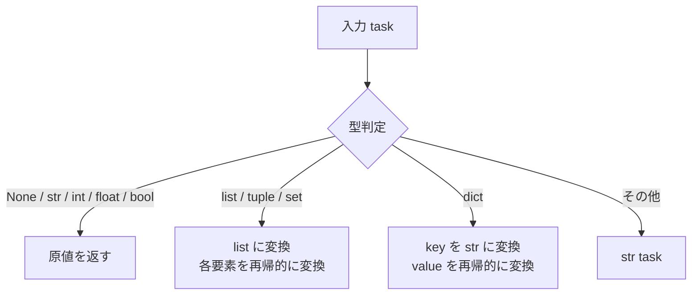

# src/celestialflow/persist/util_payload.py

> 📅 最終更新日: 2026/11/13

`persist/util_payload.py` は、タスクデータの永続化シリアライゼーションツールを提供し、任意の Python オブジェクトを再帰的に JSON フレンドリーな構造に変換します。

## コア関数

### to_persisted_payload

```python
def to_persisted_payload(task: Any) -> Any:
    """
    タスクを永続化可能な JSON フレンドリーな構造に変換する。

    :param task: シリアライズするタスクデータ
    :return: 永続化可能な JSON フレンドリーな構造
    """
```

**変換ルール：**

| 入力型 | 出力 | 説明 |
|---------|------|------|
| `None` / `str` / `int` / `float` / `bool` | そのまま返す | 既に JSON ネイティブ型 |
| `list` / `tuple` / `set` | `list` | 各要素を再帰的に変換 |
| `dict` | `dict` | key を `str` に変換し、value を再帰的に変換 |
| その他の型 | `str(task)` | 文字列表現に変換 |



## 使用例

### 基本型はそのまま透過

```python
from celestialflow.persist.util_payload import to_persisted_payload

print(to_persisted_payload(42))  # 42
print(to_persisted_payload("hello"))  # "hello"
print(to_persisted_payload(True))  # True
print(to_persisted_payload(None))  # None
```

### 複合型の再帰的変換

```python
from celestialflow.persist.util_payload import to_persisted_payload

# リスト
result = to_persisted_payload([1, "a", True])
print(result)  # [1, 'a', True]

# 入れ子辞書
result = to_persisted_payload({"score": 95, "tags": ["a", "b"]})
print(result)  # {'score': 95, 'tags': ['a', 'b']}


# カスタムオブジェクト
class MyTask:
    def __str__(self):
        return "MyTask(id=1)"


result = to_persisted_payload(MyTask())
print(result)  # "MyTask(id=1)"
```

### LifecycleObserver での使用

`to_persisted_payload` は `LifecycleObserver.on_event()` から自動的に呼び出されます：`TaskInputEvent` を処理する際は `to_persisted_payload(event.task)` で `InsertRecord.task` を埋め、`TaskSuccessEvent` を処理する際は `to_persisted_payload(event.result)` で `PromoteSuccessRecord.result` を埋めます。したがってタスクと結果は最終的に JSON フレンドリーな形式で SQLite へ保存されます。

```python
from celestialflow.persist.util_payload import to_persisted_payload

payload = to_persisted_payload({"x": 1, "obj": object()})
print(payload["x"])  # 1
print(type(payload["obj"]))  # <class 'str'>
```

> 通常の使用では手動で呼び出す必要はありません：`LifecycleObserver` を `ObserverHub` に登録するか、その `on_event()` に直接イベントを送出するだけです。

## 注意事項

- シリアライゼーション戦略は**ベストエフォート**：直接 JSON シリアライズできないオブジェクトは `str()` による文字列表現にフォールバックします。
- 変換結果は最終的に `LifecycleSpout` が `util_sqlite` 層を通じて `json.dumps` 形式で SQLite の `task_json` / `result_json` フィールドへ書き込みます。
- 本モジュールはデータフォーマット変換のみを担当し、ファイル読み書きには関与しません。
- 変換結果自体は依然としてネスト構造であり得ます；`dict` の key は一律 `str` に変換され、`set` の順序は保証されません。