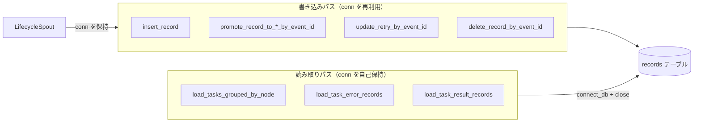

# src/celestialflow/persist/util_sqlite.py

> 📅 最終更新日: 2026/10/30

`persist/util_sqlite.py` は SQLite データベースの接続管理とレコードの読み書きツールを提供し、`LifecycleSpout` の基盤となるストレージエンジンです。

関数は**接続のライフサイクルの帰属**によって 2 種類に分かれます：

- **呼び出し側の接続を再利用する書き込み操作**：`sqlite3.Connection` を明示的に受け取り、開く / `commit()` / 閉じるのは呼び出し側（`LifecycleSpout`）の責任です；
- **接続を自前で保持する読み取り操作**：内部で自ら `connect_db()` し、`finally` で `close()` します。

2 つの変換ツール（`normalize_record` / `row_to_record_dict`）は接続に触れません。

## コア関数概要

| 関数 | シグネチャの要点 | 説明 |
|------|---------|------|
| `connect_db` | `(db_path) -> Connection` | 接続を作成し、PRAGMA を設定し、テーブル構造とインデックスを確保 |
| `normalize_record` | `(record) -> dict \| None` | sqlite へ書き込み可能な引数辞書に正規化；`event_id` がない場合は `None` を返す |
| `row_to_record_dict` | `(row) -> dict` | `sqlite3.Row` を対外的なレコード辞書に復元 |
| `insert_record` | `(conn, record) -> bool` | pending レコードを 1 件挿入 |
| `promote_record_to_success_by_event_id` | `(conn, event_id, result, *, ts) -> bool` | `success` に昇格し、結果を書き込む |
| `promote_record_to_failed_by_event_id` | `(conn, event_id, new_event_id, *, ts, error_type="", error_message="") -> bool` | `failed` に昇格し、エラーイベント ID に切り替える |
| `promote_record_to_skipped_by_event_id` | `(conn, event_id, new_event_id, *, ts) -> bool` | `skipped` に昇格し、スキップイベント ID に切り替える |
| `update_retry_by_event_id` | `(conn, event_id, *, ts, retry_times, error_type="", error_message="") -> bool` | pending を保ち、リトライ回数と直近のエラーを更新 |
| `delete_record_by_event_id` | `(conn, event_id) -> bool` | `event_id` でレコードを削除 |
| `load_tasks_grouped_by_node` | `(db_path, statuses=("failed", "pending")) -> dict[str, list[dict]]` | 指定状態のレコードを node 別にグループ化して読み取る |
| `load_task_error_records` | `(db_path, node) -> list[tuple[task, (error_type, error_message)]]` | ある node の失敗タスクとエラーのペアを読み取る |
| `load_task_result_records` | `(db_path, node) -> list[tuple[task, result]]` | ある node の成功タスクと結果のペアを読み取る |

> プライベート補助関数 `_ensure_table(conn)` は `connect_db` からのみ呼び出され、外部には公開されません。



## データベーステーブル構造

```sql
CREATE TABLE IF NOT EXISTS records (
    id INTEGER PRIMARY KEY AUTOINCREMENT,
    event_id INTEGER NOT NULL,
    ts REAL,
    node TEXT NOT NULL,
    status TEXT NOT NULL,
    error_type TEXT NOT NULL DEFAULT '',
    error_message TEXT NOT NULL DEFAULT '',
    task_json TEXT NOT NULL,
    result_json TEXT NOT NULL DEFAULT 'null',
    retry_times INTEGER NOT NULL DEFAULT 0
)
```

> 旧データベースとの互換性：`_ensure_table` は `retry_times` 列をチェックし、欠落している場合は自動的に `ALTER TABLE` で補完します。

**インデックス：**

- `idx_records_event_id`（UNIQUE）：`event_id` で高速に特定し、同時に 1 つのイベント ID には 1 件のレコードしか存在しないことを保証
- `idx_records_status_id`：`(status, id)` の組み合わせ検索

> テーブル内の `node` フィールドはタスクが属するノードを識別します（ビジネスフィールドであり、呼び出し側が明示的に書き込む必要があります）。

## 接続管理

### connect_db

```python
def connect_db(db_path: str | Path) -> sqlite3.Connection:
```

- まず `mkdir(parents=True, exist_ok=True)` で親ディレクトリを作成；
- PRAGMA を自動設定：
  - `journal_mode=WAL` — 書き込み操作が読み取りをブロックしない
  - `synchronous=NORMAL` — パフォーマンスと安全性のバランス
  - `foreign_keys=ON` — 外部キー制約を有効化
- `check_same_thread=False` — スレッドを跨いだ使用を許可（使用側の spout は単一の消費スレッドのみ）；
- `row_factory = sqlite3.Row` のため、クエリ結果は列名で値を取得できます；
- 最後に `_ensure_table(conn)` を呼び出してテーブル作成、列の補完、インデックス作成を行い、`commit()` します。

> 本関数は**接続の作成のみ**を担当し、閉じる / コミットするのは呼び出し側の責任です。

## レコードのシリアライズ

### normalize_record

```python
def normalize_record(record: dict[str, Any]) -> dict[str, Any] | None:
```

- `event_id` がない場合は `None` を返します（ビジネスレコードではないものは無視されます）。
- ビジネスレコードは `node`、`status`、`task_json` を明示的に提供する必要があります。
- 出力は標準パラメータ辞書：`event_id` / `node` / `status` / `error_type` / `error_message` / `ts` / `task_json` / `result_json` / `retry_times`。`task_json` / `result_json` は `json.dumps(..., ensure_ascii=False)` の結果です。
- 省略時の値：`error_type` / `error_message` は空文字列、`ts` は `0.0`、`retry_times` は `0`。

### row_to_record_dict

```python
def row_to_record_dict(row: sqlite3.Row) -> dict[str, Any]:
```

sqlite の行を対外的なレコード辞書（`id` / `event_id` / `ts` / `node` / `status` / `error_type` / `error_message` / `task_json` / `result_json` / `retry_times`）に変換します。`task_json` / `result_json` は `json.loads` で復元されます。

## 書き込み操作（呼び出し側の接続を再利用）

以下の関数は `conn` を受け取り、**コミットもクローズも行いません**。変更後は呼び出し側が自ら `commit()` します。戻り値はいずれも `bool` で、実際にレコードへ影響したかどうかを表します（`cursor.rowcount > 0`。`insert_record` は INSERT の実行に成功した場合 `True`、メタ情報レコードが無視された場合は `False` を返します）。

| 関数 | 動作 |
|------|------|
| `insert_record(conn, record)` | 正規化後に INSERT；`event_id` の一意インデックスに依存するため、重複書き込みは `sqlite3.IntegrityError` を送出 |
| `promote_record_to_success_by_event_id(conn, event_id, result, *, ts)` | `status='success'`、`ts` と `result_json` を書き込み、同時に `error_type` / `error_message` をクリア |
| `promote_record_to_failed_by_event_id(conn, event_id, new_event_id, *, ts, error_type="", error_message="")` | `status='failed'`、`ts` とエラー情報を書き込み、`event_id` を `new_event_id` に切り替え |
| `promote_record_to_skipped_by_event_id(conn, event_id, new_event_id, *, ts)` | `status='skipped'`、`ts` を書き込み、`event_id` を切り替え、エラーフィールドをクリア |
| `update_retry_by_event_id(conn, event_id, *, ts, retry_times, error_type="", error_message="")` | `retry_times` / `ts` / エラー情報のみを更新し、`status` は**変更しない**（pending を維持） |
| `delete_record_by_event_id(conn, event_id)` | `DELETE FROM records WHERE event_id = ?` |

> `promote_*` / `update_retry` はすべて `event_id` を位置指定条件とします。成功 / スキップ / 失敗で `event_id` が切り替わるため、同じ pending レコードを段階に応じて異なる ID で特定できます。

## 読み取り操作（接続を自己保持）

以下の関数は内部で `connect_db(db_path)` を呼び出し、`finally` で `close()` するため、呼び出し側は接続を管理する必要がありません。

### load_tasks_grouped_by_node

```python
def load_tasks_grouped_by_node(
    db_path: str | Path,
    statuses: Iterable[str] = ("failed", "pending"),
) -> dict[str, list[dict[str, Any]]]:
```

- `statuses` が空の場合は直接 `{}` を返します；
- `ORDER BY node ASC, id ASC` で読み取ります；
- `{node_name: [{"task_json": task, "error_type": str, "status": str}, ...]}` を返します。`task_json` はすでに `json.loads` で Python オブジェクトに復元されています。

### load_task_error_records

```python
def load_task_error_records(
    db_path: str | Path, node: str
) -> list[tuple[Any, tuple[str, str]]]:
```

指定した node の `status='failed'` のレコードを読み取り、`id ASC` 順に `[(task, (error_type, error_message)), ...]` を返します。

### load_task_result_records

```python
def load_task_result_records(db_path: str | Path, node: str) -> list[tuple[Any, Any]]:
```

指定した node の `status='success'` のレコードを読み取り、`id ASC` 順に `[(task, result), ...]` を返します。

## 使用例

### 基本的な書き込みと読み取り

```python
from celestialflow.persist.util_sqlite import (
    connect_db,
    insert_record,
    load_task_result_records,
    promote_record_to_success_by_event_id,
)

# 1. 接続を作成（自動設定 + テーブル作成）
conn = connect_db("test_data.sqlite3")

# 2. pending レコードを書き込み（conn を渡す必要あり）
record = {
    "event_id": 1,
    "ts": 0.0,
    "node": "StageA",
    "status": "pending",
    "task_json": {"x": 1},
}
insert_record(conn, record)

# 3. タスク成功後に success へ昇格
promote_record_to_success_by_event_id(conn, 1, {"y": 2}, ts=0.0)
conn.commit()
conn.close()

# 4. 読み取り時は関数が接続を自己管理
for task, result in load_task_result_records("test_data.sqlite3", node="StageA"):
    print(task, "->", result)
```

### node 別にグループ化して読み込む

```python
from celestialflow.persist.util_sqlite import load_tasks_grouped_by_node

grouped = load_tasks_grouped_by_node(
    "lifecycles/2026-10-30/flow_lifecycle(10-00-00-123).sqlite3",
    ("failed", "pending"),
)
for node_name, items in grouped.items():
    print(node_name, len(items))
```

### タスクのエラー / 結果ペアを読み取る

```python
from celestialflow.persist.util_sqlite import (
    load_task_error_records,
    load_task_result_records,
)

db_path = "lifecycles/2026-10-30/flow_lifecycle(10-00-00-123).sqlite3"
errors = load_task_error_records(
    db_path, node="StageA"
)  # [(task, (error_type, error_message))]
results = load_task_result_records(db_path, node="StageA")  # [(task, result)]
```

## 注意事項

1. **接続の帰属**：書き込み操作（`insert` / `promote_*` / `update_retry` / `delete`）は呼び出し側が `conn` を渡し、手動で `commit()` する必要があります。3 つの `load_*` 読み取り関数は内部で自ら接続を確立して閉じます。
2. **一意性**：`insert_record` は通常の `INSERT` を使用し、`event_id` の一意インデックスが 1 つのイベント ID に 1 件のレコードのみを対応させます。重複挿入は `sqlite3.IntegrityError` を送出するため、呼び出し側が自ら処理する必要があります。
3. **フィルタリング規則**：`normalize_record` は `event_id` を欠くレコードを除外し（`None` を返す）、`insert_record` はそのまま `False` を返します。
4. **JSON フィールド**：`task_json` と `result_json` はデータベース内では `json.dumps` 後の文字列です。`row_to_record_dict` と各 `load_*` 関数は読み取り時に `json.loads` で復元します。
5. **`retry_times`**：`update_retry_by_event_id` によって維持され、タスクが昇格する前のリトライ回数を記録します。
6. **ビジネスフィールドの明示的な書き込み**：`node` と `status` はビジネスフィールドであり、呼び出し側（`LifecycleInlet` など）がレコード書き込み時に明示的に提供する必要があります。`normalize_record` はデフォルトの推定を行いません。
