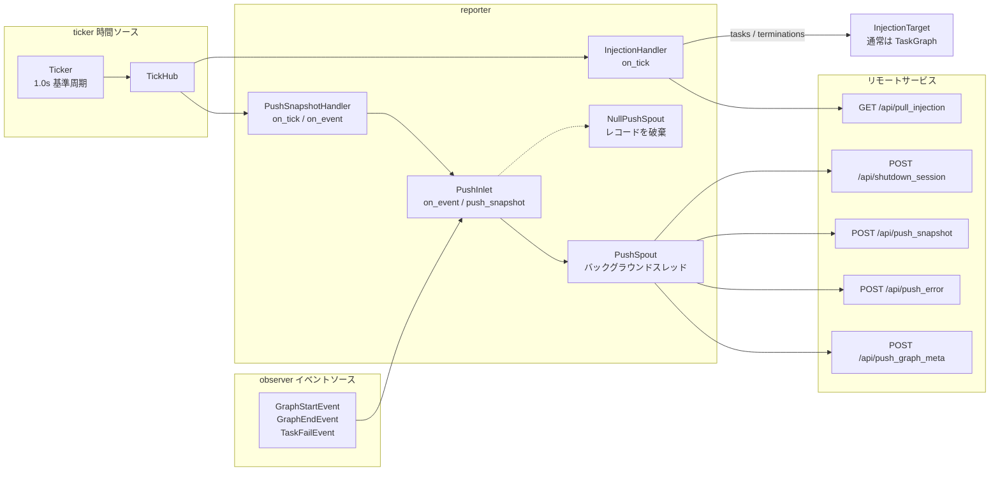

# src/celestialflow/reporter/__init__.py

> 📅 最終更新日: 2026/11/13

`reporter` は CelestialFlow の**リモートレポートとタスク注入モジュール**です。フレームワーク内部の観測イベント、指標スナップショット、失敗情報をリモートサービスへプッシュし、拍に従ってリモートサービスから注入待ちのタスクと終了シグナルを取得します。

モジュールは 3 つの部分で構成されます：

| ファイル | 役割 |
|------|------|
| [`core_push.py`](./core_push.md) | `PushRecord`、`PushSpout`、`NullPushSpout`、`PushInlet`：イベント / スナップショット → HTTP プッシュレコード |
| [`core_snapshot.py`](./core_snapshot.md) | `PushSnapshotHandler`、`to_status_snapshot()`：拍ごとに指標を読み取り状態スナップショットを生成 |
| [`core_inject.py`](./core_inject.md) | `InjectionTarget`、`InjectionHandler`：拍ごとにリモート注入を取得 |

## エクスポートシンボル

```python
__all__ = [
    "InjectionHandler",
    "InjectionTarget",
    "NullPushSpout",
    "PushInlet",
    "PushSnapshotHandler",
    "PushSpout",
]
```

| エクスポートシンボル | ソース | 説明 |
|---------|------|------|
| `InjectionHandler` | `core_inject.py` | 拍ハンドラ。5 拍ごとに `/api/pull_injection` からタスクと終了シグナルを取得 |
| `InjectionTarget` | `core_inject.py` | 注入対象プロトコル。`inject_tasks()` と `inject_terminations()` のみを要求 |
| `NullPushSpout` | `core_push.py` | 空のプッシュ spout。レコードを消費しても即座に破棄。テストやエンキューセマンティクスのみを気にするプレースホルダ用途に利用可能 |
| `PushInlet` | `core_push.py` | 観測者 + inlet。イベントとスナップショットを `PushRecord` に変換してエンキュー |
| `PushSnapshotHandler` | `core_snapshot.py` | 拍ハンドラかつ観測者。拍ごとにスナップショットをプッシュし、グラフ終了時に終態を追加プッシュ |
| `PushSpout` | `core_push.py` | バックグラウンドスレッド spout。`PushRecord.kind` に応じて対応する HTTP エンドポイントを呼び出す |

> `PushRecord`、`PushKind`、`to_status_snapshot()` は `core_*` ファイルで定義されていますが、パッケージレベルの `__init__.py` からは再エクスポートされていません。直接使用する場合は具体的なモジュールからインポートしてください。例：`from celestialflow.reporter.core_push import PushRecord`。

## データフロー



## エンドポイント一覧

| メソッド | エンドポイント | トリガー元 | 主なペイロード |
|------|------|---------|---------|
| `POST` | `/api/push_graph_meta` | `PushInlet` が `GraphStartEvent` を受信 | セッション ID、グラフ名、グラフモード、起動時刻、DAG かどうか、ノード、エッジ、ソースノード、ノードメタ情報 |
| `POST` | `/api/push_error` | `PushInlet` が `TaskFailEvent` を受信 | セッション ID、`event_id`、ノード、タスクペイロード、例外型、例外メッセージ、タイムスタンプ |
| `POST` | `/api/push_snapshot` | `PushInlet.push_snapshot()`（`PushSnapshotHandler` が拍ごとに呼び出す） | セッション ID、ノード状態スナップショット、送信時刻 |
| `POST` | `/api/shutdown_session` | `PushInlet` が `GraphEndEvent` を受信 | セッション ID のみ。サーバはこれを受けてセッションを終了済みとしてマークする |
| `GET` | `/api/pull_injection` | `InjectionHandler.on_tick()` | クエリパラメータ `session_id`。レスポンスには `tasks` と `terminations` を含む |

## 使用例

### レポートを無効化する：`NullPushSpout` でプレースホルダ

```python
from celestialflow.observer import GraphEndEvent, GraphStartEvent
from celestialflow.reporter import NullPushSpout, PushInlet

spout = NullPushSpout()
inlet = PushInlet().bind_spout(spout)
spout.start()

inlet.on_event(
    GraphStartEvent(
        graph="Demo",
        graph_mode="thread",
        start_time=0.0,
        is_dag=True,
        nodes=["A"],
        edges={"A": []},
        source_nodes=["A"],
        node_meta={"A": {}},
    )
)
inlet.on_event(GraphEndEvent(graph="Demo", end_time=1.0, elapsed=1.0))

spout.stop()
```

`NullPushSpout` は HTTP セッションを確立せず、すべてのレコードを破棄するため、この例はオフラインで実行できます。

### アセンブリエントリによる自動配線

本番コードでは通常、手動で組み立てる必要はありません。`assembly.run_graph_resources()` は `report` が `None` でない場合に `PushInlet`、`PushSpout`、`PushSnapshotHandler`、`InjectionHandler`、`Ticker` を自動的に作成して登録します：

```python
from celestialflow.assembly import run_graph_resources
from celestialflow.observer import ObserverHub
from celestialflow.runtime import ReportConfig


class DemoGraph:
    def inject_tasks(self, tasks) -> None:
        print("リモートタスク:", tasks)

    def inject_terminations(self, nodes) -> None:
        print("リモート終了シグナル:", list(nodes))

    def run(self, init_tasks) -> None:
        print("ローカル初期タスク:", init_tasks)


graph = DemoGraph()
init_tasks = {"A": [1, 2, 3]}

with run_graph_resources(
    ObserverHub(),
    injection_target=graph,
    report=ReportConfig("http://127.0.0.1:5005"),
):
    graph.run(init_tasks)
```

## 注意事項

1. **プッシュ失敗は致命的ではない**：`PushSpout` のバックグラウンドスレッドはレコード単体のプッシュ例外を捕捉してトレースバックを出力し、そのレコードを破棄して後続のレコードを消費し続けます。
2. **レポートのセッション識別子は不透明**：`assembly` は `uuid4().hex` で `session_id` を生成し、プッシュ、オフライン通知、注入取得で共用します。呼び出し側はその形式を気にする必要はありません。
3. **スナップショットとオフライン通知の順序**：グラフレベルのアセンブリは `PushSnapshotHandler` を `PushInlet` より先に登録するため、`GraphEndEvent` でトリガーされる終態スナップショットが先にエンキューされ、`shutdown_session` が後でエンキューされます。
4. **パッケージルートからはエクスポートされない**：`from celestialflow import PushInlet` は失敗します。`celestialflow.reporter` またはその具体的なサブモジュールからインポートしてください。
