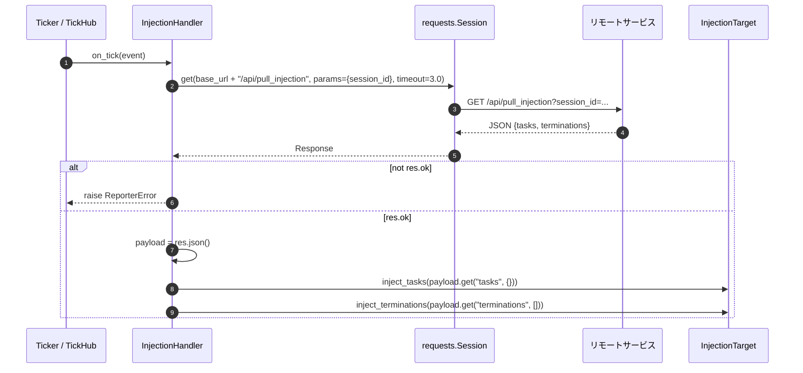

# src/celestialflow/reporter/core_inject.py

> 📅 最終更新日: 2026/11/13

`core_inject.py` は**リモートタスク注入**を実装します。`InjectionHandler` は拍ハンドラとして、固定の拍数ごとにリモートサービスから注入待ちのタスクと終了シグナルを取得し、`InjectionTarget`（通常は `TaskGraph`）に渡して処理させます。

## コアオブジェクト

| オブジェクト | 型 | 責務 |
|------|------|------|
| `InjectionTarget` | `Protocol` | 注入対象の最小インターフェース。2 つの注入メソッドのみを要求 |
| `InjectionHandler` | `TickHandler` サブクラス | `tick_period=5` 拍ごとに注入エンドポイントへ GET し、対象を呼び出す |
| `_PULL_TIMEOUT` | モジュール定数 | 単一取得のタイムアウト。`3.0` 秒 |

## InjectionTarget

```python
class InjectionTarget(Protocol):
    def inject_tasks(self, tasks: Mapping[str, Iterable[Any]]) -> None: ...

    def inject_terminations(self, nodes: Sequence[str]) -> None: ...
```

| メソッド | パラメータ | 説明 |
|------|------|------|
| `inject_tasks` | `Mapping[str, Iterable[Any]]` | ノード名からタスクのイテラブルへのマッピング。各値は 1 回だけ走査される |
| `inject_terminations` | `Sequence[str]` | 終了シグナルを注入する必要があるノード名のシーケンス |

> このプロトコルは意図的に注入セマンティクスのみを公開し、ノードコンテナや永続化の詳細は公開しません。これによりレポートモジュールはグラフ構造と疎結合になります。`TaskGraph` はちょうどこの 2 つのメソッドを実装しているため、そのまま `target` として使用できます。

## InjectionHandler

```python
class InjectionHandler(TickHandler):
    tick_period: int = 5

    def __init__(
        self,
        base_url: str,
        session_id: str,
        target: InjectionTarget,
        session: requests.Session,
    ) -> None: ...

    def on_tick(self, event: TickEvent) -> None: ...
```

| パラメータ | 説明 |
|------|------|
| `base_url` | リモートサービスのベースアドレス。例：`http://127.0.0.1:5005` |
| `session_id` | レポートのセッション識別子。クエリパラメータ `session_id` として送信 |
| `target` | 注入対象。通常はタスクグラフ |
| `session` | 再利用する HTTP セッション。呼び出し側（`assembly`）がクローズする責任を負い、ハンドラはクローズしない |

### 拍のスケーリング

`tick_period = 5` は「5 拍ごとに 1 回実行する」ことを意味します。実際の周期は `Ticker` の基準周期で決まります：

| `Ticker.interval` | 実際の取得周期 |
|:-----------------:|:------------:|
| `1.0` 秒（`assembly` のデフォルト） | 5 秒 |
| `0.5` 秒 | 2.5 秒 |
| `2.0` 秒 | 10 秒 |

フィルタは `TickHandler.should_tick()` を使用します：`(seq - 1) % tick_period == 0` のため、1、6、11… 拍目がヒットします（位相は `seq == 1` に固定）。

### 単一拍のフロー



### 期待されるレスポンス構造

```json
{
  "tasks": {
    "A": [1, 2, 3],
    "B": ["x"]
  },
  "terminations": ["A"]
}
```

- `tasks`：省略時は `{}`；
- `terminations`：省略時は `[]`；
- どちらのキーもサーバ側が決め、ハンドラはそれを取り出してそのまま対象へ渡すだけです。

### 例外セマンティクス

| 状況 | 挙動 |
|------|------|
| HTTP レスポンスが 2xx 以外 | `ReporterError("Failed to pull task injection: <status>")` を送出 |
| 接続失敗 / タイムアウト | `requests` 自身の例外がそのまま送出される |
| `inject_tasks()` が例外を送出 | 例外はそのまま送出され、`inject_terminations()` は**実行されない** |
| ハンドラの例外 | `TickHub` / `Ticker` の例外分離機構により `handler.handle_exception()` に渡され（デフォルトはトレースバック出力）、後続の拍は継続する |

> ハンドラ自体にリトライや重複排除のロジックはありません。取得失敗は現在の拍にのみ影響し、次の拍で再要求します。サーバ側は同じ `session_id` における注入エンドポイントの冪等性を保証するか、重複配信を自前で処理する必要があります。

## 使用例

以下の例では最小限のスタブで HTTP セッションとグラフを置き換え、1 回の取得と注入を示します。オフラインで実行できます：

```python
from collections.abc import Iterable, Mapping, Sequence
from typing import Any

from celestialflow.reporter import InjectionHandler
from celestialflow.ticker import TickEvent


class StubResponse:
    ok = True
    status_code = 200

    def json(self) -> dict[str, Any]:
        return {
            "tasks": {"A": [1, 2]},
            "terminations": ["A"],
        }


class StubSession:
    """最小限の requests.Session スタブ。デモ専用。"""

    def get(self, url, params=None, timeout=None):
        print("GET", url, params, timeout)
        return StubResponse()


class DemoGraph:
    """InjectionTarget プロトコルを満たす最小実装。"""

    def inject_tasks(self, tasks: Mapping[str, Iterable[Any]]) -> None:
        print("tasks:", {node: list(values) for node, values in tasks.items()})

    def inject_terminations(self, nodes: Sequence[str]) -> None:
        print("terminations:", list(nodes))


handler = InjectionHandler(
    base_url="http://127.0.0.1:5005",
    session_id="session-1",
    target=DemoGraph(),
    session=StubSession(),  # 本番環境では requests.Session() を使用する
)

# seq=5 は tick_period=5 の拍にヒットする
handler.on_tick(
    TickEvent(
        seq=5,
        interval=1.0,
        scheduled_at=4.0,
        fired_at=4.0,
        wall_time=0.0,
        drift=0.0,
        skipped=0,
    )
)
```

出力：

```text
GET http://127.0.0.1:5005/api/pull_injection {'session_id': 'session-1'} 3.0
tasks: {'A': [1, 2]}
terminations: ['A']
```

## 注意事項

1. **セッションの再利用**：`requests.Session` は `assembly.run_graph_resources()` が作成し、`PushSpout` と `InjectionHandler` の両方に渡します。ハンドラは使用するだけでクローズしません。
2. **`event` パラメータは未使用**：`on_tick(event)` のトリガーリズムは完全に `tick_period` で制御され、ハンドラは `TickEvent` のフィールドを読みません。
3. **`target` の `inject_tasks` 引数型は `Mapping[str, Iterable[Any]]`**：値は range、ジェネレータ、リストなど任意のイテラブルですが、1 回しか消費されません。
4. **注入失敗は自動ロールバックしない**：`inject_tasks()` が一部注入した後に例外を送出した場合、注入済みのタスクはグラフに残ります。これは対象オブジェクト自身のセマンティクスであり、ハンドラは関与しません。
5. **グラフレベルでのみ有効**：`run_node_resources()` は注入ハンドラをアセンブリしません。単独で実行するノードはリモートからタスクを取得しません。
