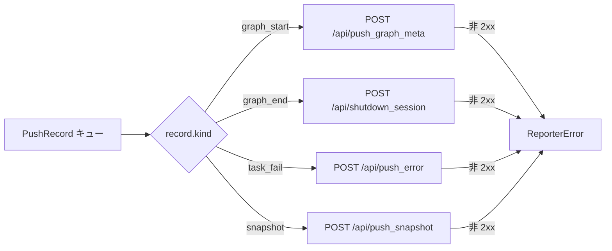

# src/celestialflow/reporter/core_push.py

> 📅 最終更新日: 2026/11/13

`core_push.py` は CelestialFlow の**プッシュチャネル**を定義します。グラフ起動、グラフ終了、タスク失敗、状態スナップショットを統一的に `PushRecord` として表現し、バックグラウンドスレッド `PushSpout` がレコード種別に応じて異なる HTTP エンドポイントを呼び出します。

本ファイルには 4 つのコアオブジェクトが含まれます：

| オブジェクト | 型 | 責務 |
|------|------|------|
| `PushKind` | 型エイリアス | レコード種別：`"graph_start"` / `"graph_end"` / `"task_fail"` / `"snapshot"` |
| `PushRecord` | `frozen` + `slots` データクラス | プッシュ待ちの 1 レコード。フィールドはイベント種別ごとにグループ化 |
| `PushSpout` | `BaseSpout` サブクラス | バックグラウンドでキューを消費し、`kind` に応じて HTTP リクエストをプッシュ |
| `NullPushSpout` | `BaseSpout` サブクラス | 空実装。消費後すぐに破棄 |
| `PushInlet` | `BaseInlet` + `Observer` | 観測イベントと状態スナップショットを `PushRecord` に変換し、`send()` でエンキュー |

## PushRecord

```python
type PushKind = Literal["graph_start", "graph_end", "task_fail", "snapshot"]


@dataclass(frozen=True, slots=True)
class PushRecord:
    kind: PushKind
    # GraphStartEvent フィールド
    graph: str = ""
    graph_mode: str = ""
    start_time: float = 0.0
    is_dag: bool = False
    nodes: list[str] = field(default_factory=list[str])
    edges: dict[str, list[str]] = field(default_factory=dict[str, list[str]])
    source_nodes: list[str] = field(default_factory=list[str])
    node_meta: dict[str, dict[str, Any]] = field(default_factory=dict[str, dict[str, Any]])
    # GraphEndEvent フィールド
    end_time: float = 0.0
    elapsed: float = 0.0
    # TaskFailEvent フィールド
    event_id: int = 0
    node: str = ""
    task_json: Any = None
    error_type: str = ""
    error_message: str = ""
    ts: float = 0.0
    # 状態スナップショットフィールド
    snapshot: dict[str, dict[str, Any]] = field(default_factory=dict[str, dict[str, Any]])
```

`kind` がどのフィールドを有効にするかを決め、残りのフィールドはデフォルト値を保ちます：

| `kind` | 有効なフィールド | 対応するイベント / ソース |
|--------|---------|----------------|
| `"graph_start"` | `graph`、`graph_mode`、`start_time`、`is_dag`、`nodes`、`edges`、`source_nodes`、`node_meta` | `GraphStartEvent` |
| `"graph_end"` | `graph`、`end_time`、`elapsed` | `GraphEndEvent` |
| `"task_fail"` | `event_id`、`node`、`task_json`、`error_type`、`error_message`、`ts` | `TaskFailEvent` |
| `"snapshot"` | `snapshot` | `PushInlet.push_snapshot()`（`PushSnapshotHandler` が拍ごとに呼び出す） |

> `graph` フィールドは `graph_start` と `graph_end` の両方で使われます。`graph_end` レコードは `end_time` / `elapsed` を保持していますが、現在の `PushSpout` のオフライン通知は `session_id` のみを送信するため、この 2 つのフィールドは `/api/shutdown_session` のリクエストボディには現れません。

## PushSpout

```python
class PushSpout(BaseSpout):
    def __init__(
        self,
        session_id: str,
        base_url: str,
        timeout: float = 3.0,
    ) -> None: ...
```

| パラメータ | 説明 |
|------|------|
| `session_id` | レポートのセッション識別子。各レコードに付与して送信。ワイヤ上のフィールド名は `session_id` |
| `base_url` | リモートサービスのベースアドレス。例：`http://127.0.0.1:5005` |
| `timeout` | 単一 HTTP リクエストのタイムアウト（秒）。デフォルト `3.0` |

ライフサイクル：

- `_before_start()`：再利用する `requests.Session` を作成します。
- `_after_stop()`：そのセッションを閉じてクリアします。
- spout が未起動の場合（`_session is None`）、`_handle_record()` は即座に戻り、レコードは黙って破棄されます。

### プッシュディスパッチテーブル



| `kind` | エンドポイント | リクエストボディのフィールド | 失敗時の例外 |
|--------|------|-----------|---------|
| `graph_start` | `/api/push_graph_meta` | `session_id`、`graph`、`graph_mode`、`start_time`、`is_dag`、`nodes`、`edges`、`source_nodes`、`node_meta` | `ReporterError("Failed to push graph meta: <status>")` |
| `graph_end` | `/api/shutdown_session` | `session_id` | `ReporterError("Failed to notify shutdown: <status>")` |
| `task_fail` | `/api/push_error` | `session_id`、`event_id`、`node`、`task_json`、`error_type`、`error_message`、`ts` | `ReporterError("Failed to push error: <status>")` |
| `snapshot` | `/api/push_snapshot` | `session_id`、`snapshot`、`timestamp`（送信時の `time.time()`） | `ReporterError("Failed to push snapshot: <status>")` |

> `ReporterError` は `BaseSpout` のバックグラウンドループが捕捉してトレースバックを出力し、スレッドを**終了させません**。該当レコードは破棄され、後続のレコードはプッシュされ続けます。

## NullPushSpout

`NullPushSpout` は `PushSpout` の空実装です。`_handle_record()` は即座に `return None` を返し、HTTP セッションを確立せず、リクエストも送りません。ネットワークを必要とせず「エンキューセマンティクス」だけが必要なシナリオ（テストやプレースホルダなど）に使用します。

```python
class NullPushSpout(BaseSpout):
    def _handle_record(self, _record: PushRecord) -> None:
        return None
```

## PushInlet

`PushInlet` は `BaseInlet` と `Observer` の両方を継承します：

- `Observer` として、`on_event(event)` を実装し、`match event` で 3 種類のイベントを `PushRecord` に変換します；
- `BaseInlet` として、`bind_spout(spout)` でプッシュ spout をバインドし、`BaseInlet` から継承した `send(record)` を呼び出してエンキューします；
- `push_snapshot(snapshot)` を提供し、`PushSnapshotHandler` が拍ごとに状態スナップショットを直接プッシュできるようにします。

### イベントマッピング

| イベント | 生成されるレコード | 説明 |
|------|-----------|------|
| `GraphStartEvent` | `kind="graph_start"` | グラフメタ情報、ノード / エッジ / ソースノード、ノードメタ情報 |
| `GraphEndEvent` | `kind="graph_end"` | セッションのオフライン通知。サーバは受信後にセッションを終了済みとしてマークするが、セッションデータとエラー格納庫は保持される |
| `TaskFailEvent` | `kind="task_fail"` | `task_json` は `to_persisted_payload(event.task)` で変換。`error_type` は例外クラス名、`error_message` は `str(exception)`、`ts` は現在の壁時計時刻 |
| その他のイベント | なし | `case _: pass` で黙って無視 |

> `GraphEndEvent` は `PushInlet` では `graph_end`（オフライン通知）のみを生成します。同じイベントは `PushSnapshotHandler` でも 1 回だけ終態スナップショットの追加プッシュに使われます。両者は独立した観測者です。詳細は [`core_snapshot.md`](./core_snapshot.md) を参照してください。

## 使用例

以下の例では `NullPushSpout` のサブクラスでレコード内容を出力し、ネットワークリクエストは一切送りません：

```python
from celestialflow.observer import GraphEndEvent, GraphStartEvent, TaskFailEvent
from celestialflow.reporter import NullPushSpout, PushInlet


class PrintSpout(NullPushSpout):
    """レコード内容を出力するが、HTTP リクエストは送信しない。"""

    def _handle_record(self, record) -> None:
        print(f"kind={record.kind}, graph={record.graph}, node={record.node}")


spout = PrintSpout()
inlet = PushInlet().bind_spout(spout)
spout.start()

inlet.on_event(
    GraphStartEvent(
        graph="Demo",
        graph_mode="thread",
        start_time=0.0,
        is_dag=True,
        nodes=["A"],
        edges={"A": []},
        source_nodes=["A"],
        node_meta={"A": {}},
    )
)
inlet.on_event(
    TaskFailEvent(
        node="A",
        task=1,
        task_repr="1",
        exception=ValueError("bad value"),
        task_id=1,
        error_id=2,
    )
)
inlet.push_snapshot({"A": {"status": 2, "tasks_succeeded": 0}})
inlet.on_event(GraphEndEvent(graph="Demo", end_time=2.0, elapsed=2.0))

spout.stop()
```

出力（順序はエンキュー順と一致）：

```text
kind=graph_start, graph=Demo, node=
kind=task_fail, graph=, node=A
kind=snapshot, graph=, node=
kind=graph_end, graph=Demo, node=
```

## 注意事項

1. **レコードは不変**：`PushRecord` は `frozen=True, slots=True` のデータクラスであり、構築後は変更できません。送信スレッドは読み取るだけです。
2. **プッシュ失敗はレコードを失う**：現在リトライキューはありません。単一の失敗はトレースバックを出力して破棄されるだけです。
3. **セッションは spout が管理**：`PushSpout` は `start()` 時に `requests.Session` を作成し、`stop()` 時に閉じます。呼び出し側はその内部セッションを再利用しないでください。
4. **レコード順序はキュー順序**：`BaseSpout.stop()` は終了シグナルをキューの末尾に入れるため、`stop()` 呼び出し前にエンキューされたレコードは先に処理し終わります。
5. **`push_snapshot` はネットワーク IO を行わない**：スナップショットを `PushRecord` に包んでエンキューするだけで、実際の送信は `PushSpout` のバックグラウンドスレッドで行われます。
