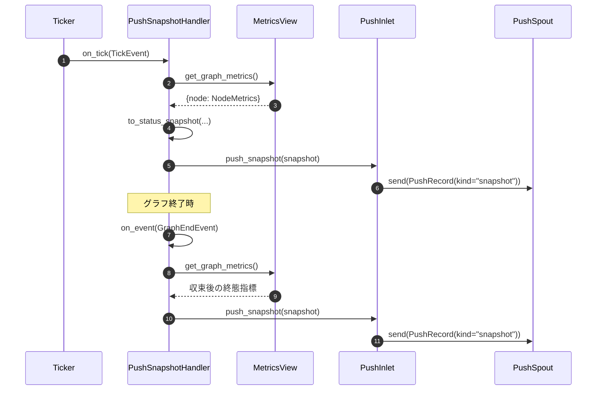

# src/celestialflow/reporter/core_snapshot.py

> 📅 最終更新日: 2026/11/13

`core_snapshot.py` は**グラフレベルの指標スナップショット**をレポートペイロードに変換し、プッシュチャネルへ渡す役割を担います。これは「時間駆動」と「イベント駆動」の交点です：

- `TickHandler` として、拍ごと（デフォルトは毎拍、基準周期 1 秒）にグラフ全体の指標を読み取ってプッシュします；
- `Observer` として、グラフ終了時に**終態スナップショット**を 1 回追加プッシュします。

本ファイルはネットワーク IO を一切行いません。指標の射影とエンキューのみを行い、実際の HTTP 送信は `PushSpout` が担当します。

## to_status_snapshot

```python
def to_status_snapshot(
    metrics: Mapping[str, NodeMetrics],
) -> dict[str, dict[str, Any]]: ...
```

`{ノード名: NodeMetrics}` を `{ノード名: 状態辞書}` に射影します。フィールドのマッピングは以下の通りです：

| `NodeMetrics` フィールド | スナップショットキー | 説明 |
|--------------------|--------|------|
| `start_time` | `start_time` | ノードが実行状態に入った壁時計時刻 |
| `end_time` | `end_time` | ノードが実行状態を抜けた壁時計時刻 |
| `status` | `status` | `NodeStatus`（`IntEnum`）。JSON では整数にシリアライズされる |
| `input_total` | `tasks_input` | 入力タスクの総数（外部注入 + 上流） |
| `succeeded` | `tasks_succeeded` | 成功タスク数 |
| `failed` | `tasks_failed` | 失敗タスク数 |
| `skipped` | `tasks_skipped` | スキップタスク数 |
| `processed` | `tasks_processed` | 処理済みタスク数 |
| `pending` | `tasks_pending` | 処理待ちタスク数 |
| `upstream_counts` | `upstream_counts` | 各上流ノードが提供したタスク数 |
| `downstream_counts` | `downstream_counts` | 各下流ノードへ送ったタスク数 |

> `external_input` と `upstream_input` は個別にはスナップショットに入りません。それらの情報はすでに `tasks_input` に集約されています。

出力例：

```python
{
    "A": {
        "start_time": 100.0,
        "end_time": 100.1,
        "status": 2,
        "tasks_input": 1,
        "tasks_succeeded": 1,
        "tasks_failed": 0,
        "tasks_skipped": 0,
        "tasks_processed": 1,
        "tasks_pending": 0,
        "upstream_counts": {},
        "downstream_counts": {},
    }
}
```

## PushSnapshotHandler

```python
class PushSnapshotHandler(TickHandler, Observer):
    def __init__(self, metrics_view: MetricsView, inlet: PushInlet) -> None: ...
    def on_tick(self, event: TickEvent) -> None: ...
    def on_event(self, event: Event) -> None: ...
    def _push_snapshot(self) -> None: ...
```

| パラメータ | 型 | 説明 |
|------|------|------|
| `metrics_view` | `MetricsView` | 指標の読み取り専用ビュー。通常は `MetricsObserver` インスタンス |
| `inlet` | `PushInlet` | `PushSpout` がバインド済みのプッシュ inlet |

### 2 つのトリガーパス



| メソッド | トリガー条件 | 動作 |
|------|---------|------|
| `on_tick(event)` | ヒットした各拍（`tick_period` は `TickHandler` から継承、デフォルト 1） | `_push_snapshot()` を呼び出す |
| `on_event(event)` | `GraphEndEvent` のみ | 終態スナップショットを 1 回追加プッシュ。その他のイベントは `case _: pass` |
| `_push_snapshot()` | 内部メソッド | `to_status_snapshot(metrics_view.get_graph_metrics())` → `inlet.push_snapshot(...)` |

### グラフ終了時に追加プッシュが必要な理由

スナップショットは拍でのみ生成されますが、グラフの収尾は即座にタイマーを停止します。そのため**最終拍とグラフ終了の間**の状態変化はどの拍にも捕捉されません。例えば：

- すべてのノードが最終的に `NodeStatus.STOPPED` に入る；
- 最後のバッチのタスクの成功 / 失敗 / スキップ数；
- 最終的に `tasks_pending` が 0 になる。

`GraphEndEvent` は全ノードが終了したグラフ収尾フェーズでトリガーされ、この時点で指標は終値に収束しています。このイベントで 1 回追加プッシュすれば、サーバは完全な終態を取得できます。

> 終態スナップショットのエンキュー順序は `assembly` の観測者登録順序に依存します。`PushSnapshotHandler` は `PushInlet` より先に登録されるため、`GraphEndEvent` は先に終態スナップショットをトリガーし、次に `graph_end`（`shutdown_session`）をトリガーします。両者は同じ FIFO キューに入り、サーバは先にスナップショットを受信し、後でオフライン通知を受信します。

## 使用例

以下の例では実際の `MetricsObserver` で指標を生成し、`PushSpout` のキューでエンキュー結果を観察します（spout を起動しないため、ネットワークリクエストは送信されません）：

```python
from celestialflow.observer import (
    GraphEndEvent,
    MetricsObserver,
    NodeEndEvent,
    NodeStartEvent,
    TaskInputEvent,
    TaskSuccessEvent,
)
from celestialflow.reporter import PushInlet, PushSnapshotHandler, PushSpout
from celestialflow.ticker import TickEvent

# 1. イベントで指標の書き込みモデルを埋める
metrics = MetricsObserver()
metrics.on_event(
    NodeStartEvent(node="A", execution_mode="serial", max_workers=1, start_time=100.0)
)
metrics.on_event(TaskInputEvent(node="A", task=1, task_repr="1", input_id=1))
metrics.on_event(
    TaskSuccessEvent(
        node="A",
        task=1,
        task_repr="1",
        result=2,
        result_repr="2",
        elapsed=0.1,
        task_id=1,
        success_id=1,
    )
)
metrics.on_event(
    NodeEndEvent(
        node="A",
        execution_mode="serial",
        max_workers=1,
        elapsed=0.1,
        end_time=100.1,
    )
)

# 2. スナップショットハンドラを組み立てる（ここでは spout を start せず、キューを観察するだけ）
spout = PushSpout(session_id="demo", base_url="http://127.0.0.1:5005")
inlet = PushInlet().bind_spout(spout)
handler = PushSnapshotHandler(metrics, inlet)

# 3. 1 回の拍 + 1 回のグラフ終了をシミュレート
tick = TickEvent(
    seq=1,
    interval=1.0,
    scheduled_at=0.0,
    fired_at=0.0,
    wall_time=0.0,
    drift=0.0,
    skipped=0,
)
handler.on_tick(tick)
handler.on_event(GraphEndEvent(graph="Demo", end_time=100.2, elapsed=0.2))

# 4. エンキューされた 2 つの snapshot レコードを確認
for _ in range(2):
    record = spout.get_queue().get()
    node = record.snapshot["A"]
    print(record.kind, node["status"], node["tasks_succeeded"], node["tasks_processed"])
```

出力：

```text
snapshot 2 1 1
snapshot 2 1 1
```

## 注意事項

1. **読み取り専用ビュー**：ハンドラは `MetricsView.get_graph_metrics()` を呼ぶだけで指標を変更しません。ログ観測者と同じ `MetricsObserver` を安全に共有できます。
2. **ネットワーク IO を行わない**：`on_tick` / `on_event` はどちらもエンキューするだけです。ネットワークの失敗は `PushSpout` のバックグラウンドスレッドが処理します。
3. **`tick_period` は調整可能**：デフォルトでは毎拍プッシュします。サーバの負荷が大きい場合は `handler.set_tick_period(n)` で頻度を下げられます（基準周期 1 秒なら `n` 秒に 1 回）。
4. **終態スナップショットは拍スナップショットを置き換えない**：最終状態を 1 回追加するだけで、過去の中間状態は補いません。
5. **スナップショットの構造は通常の辞書**：`snapshot` フィールドは `requests` の JSON エンコーダでそのままシリアライズできます。`status` は `NodeStatus` ですが、`IntEnum` として整数にエンコードされます。
