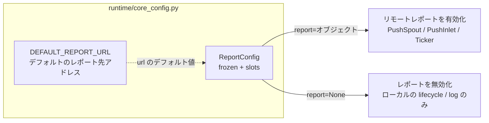

# src/celestialflow/runtime/core_config.py

> 📅 最終更新日: 2026/10/30

`runtime/core_config.py` は**ランタイムエントリから明示的に渡される**実行時設定型を定義します。ホストプロジェクトの `pyproject.toml` は読み込みません — レポートを有効にするか、どこへレポートするかは、完全に呼び出し側が決定します。

## 役割

- デフォルトのレポート先アドレス定数 `DEFAULT_REPORT_URL` を提供する
- 不変の設定オブジェクト `ReportConfig` を提供し、構築時にアドレス検証と正規化を完了する
- `run()` / `run_async()` / `restore_db()` の `report` パラメータの型を統一する



## コアオブジェクト

### DEFAULT_REPORT_URL

```python
DEFAULT_REPORT_URL = "http://127.0.0.1:5005"
```

`ReportConfig` でアドレスが明示的に指定されない場合に使用されるデフォルトのレポート先アドレスです。

### ReportConfig

```python
@dataclass(frozen=True, slots=True)
class ReportConfig:
    url: str = DEFAULT_REPORT_URL
```

| メンバー | 型 | 説明 |
|------|------|------|
| `url` | `str` | レポートサービスのベースアドレス。`http` / `https` でなければならず、末尾の `/` は除去されます |

特性：

- **`frozen=True`**：構築後は再代入できないため、設定オブジェクトを複数のランタイムエントリ間で安全に共有できます
- **`slots=True`**：属性の動的追加は許可されません
- **`__post_init__` が検証と正規化を担当**するため、不正なアドレスは**構築時**にエラーとなり、実行時リソース（`PushSpout`、`Ticker`）の起動後に初めて失敗するようなことはありません

### 検証ルール

`__post_init__()` は `url` を次の順序で処理します：

| ステップ | チェック | 失敗時 |
|:----:|------|--------|
| 1 | `url` は `str` でなければならない | `ConfigurationError` |
| 2 | `url.strip().rstrip("/")` した結果が空であってはならない | `ConfigurationError` |
| 3 | `urllib.parse.urlsplit` の `scheme` が `http` / `https` であり、`netloc` が空でないこと | `ConfigurationError` |
| 4 | 検証を通過したら `object.__setattr__(self, "url", url)` で正規化結果を書き戻す | — |

正規化で行うのは 2 点のみです：前後の空白を除去すること、**すべての**連続する末尾の `/` を除去すること。例えば `" http://127.0.0.1:5005/// "` → `"http://127.0.0.1:5005"`。

> 注意：`"127.0.0.1:5005"` のように scheme を欠く文字列は拒否されます（`urlsplit` が scheme を空とみなすため）。`"http://127.0.0.1:5005"` と書く必要があります。

## セマンティクス：オブジェクトを渡す = レポート有効、None を渡す = 無効

ランタイムエントリ（`TaskGraph.run()` / `run_async()` / `restore_db()`）の `report` パラメータのデフォルトは `None` です：

| `report` の値 | 動作 |
|---------------|------|
| `ReportConfig(...)` インスタンス | リモートレポートを有効化：`PushSpout`、`PushInlet`、`PushSnapshotHandler`、`InjectionHandler`、`Ticker` を作成し、拍ごとに `report.url` へ状態スナップショットを送信し、リモートから注入タスクを取得します |
| `None`（デフォルト） | ローカルの `MetricsObserver` / `LifecycleSpout` / `LogSpout` のみを組み立て、ネットワークリクエストは一切行いません |

デフォルト値が `None` であるため、**`report` を渡さなければレポートは無効**です。「アドレスを設定すれば自動的にレポートされる」といった暗黙的な動作は存在しません。

## 使用例

### 1. デフォルトアドレスでレポートを有効化

```python
from celestialflow import TaskExecutor, TaskGraph
from celestialflow.runtime import ReportConfig

graph = TaskGraph(name="ReportDemo")
graph.set_nodes([TaskExecutor("worker", lambda x: x * 2)])

# ReportConfig オブジェクトを渡すとレポートが有効になり、デフォルトで http://127.0.0.1:5005 へレポートする
graph.run({"worker": [1, 2, 3]}, report=ReportConfig())
```

### 2. カスタムアドレスの指定 / レポートの無効化

```python
from celestialflow import TaskExecutor, TaskGraph
from celestialflow.runtime import ReportConfig

# カスタムアドレス。位置引数でもキーワード引数でも渡せる
with_report = ReportConfig("https://flow.example.com/api/")
print(f"正規化後のアドレス: {with_report.url}")  # https://flow.example.com/api

graph = TaskGraph(name="CustomReportDemo")
graph.set_nodes([TaskExecutor("worker", lambda x: x)])
graph.run({"worker": [1]}, report=with_report)

# report を渡さない（report=None と等価）とレポートは完全に無効になる
graph_local = TaskGraph(name="LocalOnlyDemo")
graph_local.set_nodes([TaskExecutor("worker", lambda x: x)])
graph_local.run({"worker": [2]})
```

### 3. 不正なアドレスの処理

```python
from celestialflow.runtime import ReportConfig
from celestialflow.runtime.util_errors import ConfigurationError

for bad_url in ["", "   ", "127.0.0.1:5005", "ftp://127.0.0.1:5005", 5005]:
    try:
        ReportConfig(url=bad_url)  # type: ignore[arg-type]
    except ConfigurationError as exc:
        print(f"{bad_url!r} -> {exc}")
```

## 注意事項

- `ReportConfig` は**読み取り専用**の設定です。アドレスを変更したい場合は新しいインスタンスを作成してください。`url` フィールドは変更できません。
- 検証は**構築時**に行われます。`ReportConfig(...)` を try ブロックに入れておけば、実行時リソースを起動する前に設定エラーを捕捉できます。
- 実行時には `pyproject.toml` の `[tool.celestialflow]` を**読み込みません**。レポートアドレスは本オブジェクトのみが提供し、有効かどうかは `report` が `None` かどうかだけで判断されます。
- `DEFAULT_REPORT_URL` と `ReportConfig` はどちらも `celestialflow.runtime` からエクスポートされます。うち `ReportConfig` はパッケージルートでも再エクスポートされており（`from celestialflow import ReportConfig` も使用可能）、`DEFAULT_REPORT_URL` は `celestialflow.runtime` からのみインポートできます。
- ログレベルのデフォルト値と検証は本ファイルにはなく、`runtime/util_log_level.py` を参照してください。
