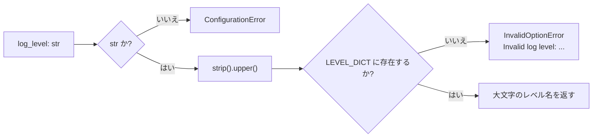

# src/celestialflow/runtime/util_log_level.py

> 📅 最終更新日: 2026/10/30

`runtime/util_log_level.py` はログレベルのデフォルト値と正規化・検証を提供します。**ランタイムエントリ内部でのみ使用され**、対外的な設定 API には属しません。

## 役割

- ランタイムエントリでログレベルが明示的に指定されない場合のデフォルト値 `DEFAULT_LOG_LEVEL` を定義する
- `normalize_log_level()` を提供する：ユーザーが渡したレベル名を `LEVEL_DICT` の大文字キー名に正規化し、不正な入力に対しては例外を送出する

> 本ファイルは `util_*` モジュールであり、`celestialflow.runtime/__init__.py` の `__all__` に**含まれていません**。完全修飾パスでインポートする必要があります：
> `from celestialflow.runtime.util_log_level import DEFAULT_LOG_LEVEL, normalize_log_level`。

## コアオブジェクト

### DEFAULT_LOG_LEVEL

```python
DEFAULT_LOG_LEVEL = "INFO"
```

ランタイムエントリでログレベルが明示的に指定されない場合に使用されるデフォルト値です。複数のシグネチャでデフォルト引数として使用されています：

| 使用箇所 | 説明 |
|----------|------|
| `TaskGraph.run()` / `run_async()` / `restore_db()` の `log_level` | グラフレベルのランタイムエントリ |
| `BaseTaskNode.run()` などノードの `log_level` | 単一ノードのランタイムエントリ |
| `LogInlet.__init__()` | ログフィルター構築時のデフォルト値 |
| `assembly.core_run.run_graph_resources()` / `run_node_resources()` | 実行時のリソース組み立て |

### normalize_log_level

```python
def normalize_log_level(log_level: str) -> str: ...
```

ログレベルを検証し、正規化します：

1. `log_level` は `str` でなければならず、そうでない場合は `ConfigurationError` を送出する
2. `strip().upper()` を実行し、前後の空白は無視され、大文字小文字は区別しない
3. 結果が `LEVEL_DICT`（`runtime/util_constant.py` を参照）のキーに存在しない場合、`InvalidOptionError("log level", ...)` を送出する
4. 正規化後の**大文字**レベル名を返す

`LEVEL_DICT` の有効なキーは `TRACE` / `DEBUG` / `SUCCESS` / `INFO` / `WARNING` / `ERROR` / `CRITICAL` です。



```python
def normalize_log_level(log_level: str) -> str:
    """
    ログレベルを検証し、正規化します。

    :param log_level: 検証対象のログレベル
    :return: 正規化後のログレベル（大文字）
    :rtype: str
    :raises ConfigurationError: ``log_level`` が文字列でない場合
    :raises InvalidOptionError: ``log_level`` が許可されたレベル集合に含まれない場合
    """
```

## 使用例

### 1. ログレベルの正規化

```python
from celestialflow.runtime.util_log_level import DEFAULT_LOG_LEVEL, normalize_log_level

print(DEFAULT_LOG_LEVEL)  # INFO

print(normalize_log_level("info"))  # INFO
print(normalize_log_level("  Debug "))  # DEBUG
print(normalize_log_level("WARNING"))  # WARNING
```

### 2. 不正な入力の扱い

```python
from celestialflow.runtime.util_errors import ConfigurationError, InvalidOptionError
from celestialflow.runtime.util_log_level import normalize_log_level

for bad_level in ["VERBOSE", ""]:
    try:
        normalize_log_level(bad_level)
    except InvalidOptionError as exc:
        print(f"{bad_level!r} は有効なレベルではありません。選択可能な値: {exc.allowed}")

try:
    normalize_log_level(30)  # type: ignore[arg-type]
except ConfigurationError as exc:
    print(f"型エラー: {exc}")
```

### 3. グラフのランタイムエントリへ渡す

```python
from celestialflow import TaskExecutor, TaskGraph
from celestialflow.runtime.util_log_level import DEFAULT_LOG_LEVEL, normalize_log_level

graph = TaskGraph(name="LogLevelDemo")
graph.set_nodes([TaskExecutor("worker", lambda x: x)])

level = normalize_log_level("debug")  # ランタイムエントリへ渡す前に正規化する
graph.run({"worker": [1, 2, 3]}, log_level=level)

# デフォルト値をそのまま使うこともできる
graph_default = TaskGraph(name="LogLevelDefaultDemo")
graph_default.set_nodes([TaskExecutor("worker", lambda x: x)])
graph_default.run({"worker": [4]}, log_level=DEFAULT_LOG_LEVEL)
```

## 注意事項

- ランタイムエントリ内部でもう一度 `normalize_log_level()` が呼ばれるため、`"debug"` を直接渡しても動作します。事前に呼び出すのは、実行時リソースを起動する前にエラーを検出するためだけです。
- `InvalidOptionError` は `ConfigurationError` のサブクラスであるため、`ConfigurationError` を捕捉すれば「型が不正」と「値が不正」の両方のケースを同時にカバーできます。
- ログレベルから数値へのマッピングは `runtime/util_constant.py` の `LEVEL_DICT` で定義されており、本ファイルは正規化のみを行い、数値比較は担当しません。
- ログレベルは `pyproject.toml` から暗黙的に読み込まれることは**ありません**。ランタイムエントリの `log_level` 引数で明示的に渡す必要があり、渡さない場合は `DEFAULT_LOG_LEVEL` が使用されます。
