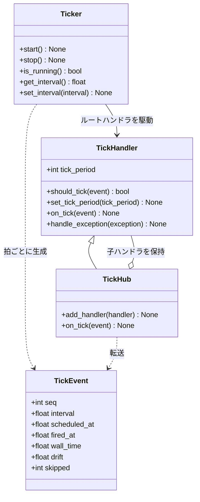
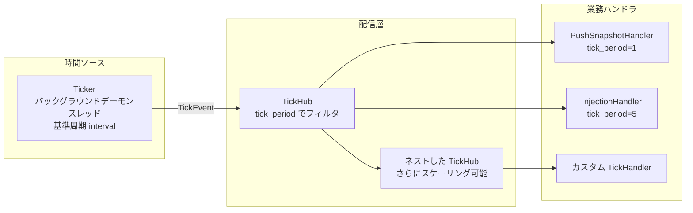

# src/celestialflow/ticker/__init__.py

> 📅 最終更新日: 2026/11/13

`ticker` は CelestialFlow の**時間駆動モジュール**です。独立したバックグラウンドスレッドで固定の基準周期ごとに拍を生成し、各ハンドラが宣言した `tick_period` でスケーリングして配信します。イベント駆動の `observer` / `funnel` とは互いに独立しており、使用箇所で必要に応じて組み合わせられます。

典型的な用途は `reporter` のレポート経路です。`PushSnapshotHandler` が毎拍状態スナップショットをプッシュし、`InjectionHandler` が 5 拍ごとにリモート注入を 1 回取得します。

## エクスポートシンボル

```python
__all__ = [
    "TickEvent",
    "TickHandler",
    "TickHub",
    "Ticker",
]
```

| シンボル | ソース | 説明 |
|------|------|------|
| `TickEvent` | `core_event.py` | 1 回の拍の不変な時系列スナップショット（番号、周期、予定 / 実際の発火時刻、ドリフト、スキップ数） |
| `TickHandler` | `core_handler.py` | 拍ハンドラ基底クラス。`tick_period` を宣言し、`should_tick()` / `on_tick()` / `handle_exception()` を提供 |
| `TickHub` | `core_hub.py` | 拍の配信センター。それ自体も `TickHandler` であり、拍を各子ハンドラの `tick_period` でフィルタして転送 |
| `Ticker` | `core_ticker.py` | 時間ソースとバックグラウンドスレッド。基準周期ごとに `TickEvent` を生成し、ルートハンドラを駆動 |

> `validate_tick_period()` は `core_handler.py` で定義されていますが、パッケージレベルの `__init__.py` からは再エクスポートされていません。必要な場合は `celestialflow.ticker.core_handler` からインポートしてください。

## クラス関係



## 階層構造



`Ticker` は 1 つのルートハンドラしか認識しません。`TickHub` がブロードキャストを担当します。ハンドラはリーフノードにも、別の `TickHub` にもなれるため、木構造の拍配信構造を形成できます。

## 拍のスケーリング

すべてのハンドラは同じ `Ticker.interval` の基準周期を共有しますが、それぞれが `tick_period` で「何拍ごとに実行するか」を宣言します：

```text
実際の周期 = Ticker.interval × handler.tick_period
```

| `Ticker.interval` | `tick_period` | 実際の周期 | ヒットする `seq` |
|:-----------------:|:-------------:|:--------:|:------------:|
| 1.0 秒 | 1 | 1 秒 | 1, 2, 3, 4, … |
| 1.0 秒 | 2 | 2 秒 | 1, 3, 5, 7, … |
| 1.0 秒 | 5 | 5 秒 | 1, 6, 11, 16, … |
| 0.5 秒 | 5 | 2.5 秒 | 1, 6, 11, 16, … |

> フィルタ式は `(seq - 1) % tick_period == 0` であるため、**1 拍目は必ずヒットします**。実行時に `set_tick_period()` で変更すると、位相は `seq == 1` に再固定されます。

## 使用例

以下の例では基準周期 0.1 秒のタイマーを起動し、2 つのハンドラをそれぞれ毎拍、2 拍ごとに実行させます。例は約 0.5 秒で終了します：

```python
import time

from celestialflow.ticker import TickEvent, TickHandler, TickHub, Ticker


class RecordingHandler(TickHandler):
    def __init__(self, name: str, tick_period: int = 1) -> None:
        self.name = name
        self.tick_period = tick_period
        self.hits: list[int] = []

    def on_tick(self, event: TickEvent) -> None:
        self.hits.append(event.seq)
        print(f"{self.name}: seq={event.seq}, skipped={event.skipped}")


hub = TickHub()
every = RecordingHandler("every", tick_period=1)
every_other = RecordingHandler("every-other", tick_period=2)
hub.add_handler(every)
hub.add_handler(every_other)

ticker = Ticker(0.1, hub, name="demo-ticker")
ticker.start()
time.sleep(0.55)
ticker.stop()

print("every:", every.hits)
print("every-other:", every_other.hits)
```

想定される出力（実際の拍数はスケジューリングに依存）：

```text
every: seq=1, skipped=0
every-other: seq=1, skipped=0
every: seq=2, skipped=0
every: seq=3, skipped=0
every-other: seq=3, skipped=0
every: seq=4, skipped=0
every: seq=5, skipped=0
every-other: seq=5, skipped=0
every: [1, 2, 3, 4, 5]
every-other: [1, 3, 5]
```

## ファイル説明

| ファイル | 重点内容 |
|------|---------|
| [`core_event.py`](./core_event.md) | `TickEvent` の 7 つのフィールドの意味、monotonic と壁時計の違い |
| [`core_handler.py`](./core_handler.md) | `TickHandler` のフィルタ式、実行時の速度調整、例外処理の契約 |
| [`core_hub.py`](./core_hub.md) | 登録、循環検出、コピーオンライト、ハンドラ単位の例外分離 |
| [`core_ticker.py`](./core_ticker.md) | バックグラウンドループ、予定時刻のアンカリング、拍のスキップ（追い越しなし）、起動 / 停止セマンティクス |

## 注意事項

1. **ハンドラは直列実行**：同じ拍内でヒットしたすべてのハンドラは `Ticker` のバックグラウンドスレッドで登録順にインライン実行されます。遅いハンドラは後続の拍を遅延させます。非同期に分離する必要がある場合は、ハンドラを「キューへの書き込み + 独立したコンシューマ」として実装してください。
2. **追い越さない**：ある拍の処理がタイムアウトして複数の周期を逃した場合、`Ticker` は逃した数を `TickEvent.skipped` に記録するだけで、その後は現在時刻から再アンカリングし、連続して補発しません。
3. **例外分離は 2 層**：ハンドラの `on_tick()` が例外を送出すると、それ自身の `handle_exception()` に渡されます。さらにそれが例外を送出すると、ルートハンドラ（通常は `TickHub`）の `handle_exception()` がフォールバックとして処理します。
4. **observer とは独立**：`ticker` は `observer` / `funnel` に依存しません。`PushSnapshotHandler` のように両方の基底クラスを継承するオブジェクトは、使用箇所で組み合わせます。
5. **パッケージルートからエクスポート済み**：`Ticker` / `TickEvent` / `TickHandler` / `TickHub` は `celestialflow/__init__.py` からも再エクスポートされており、`from celestialflow import Ticker` で直接インポートできます。
