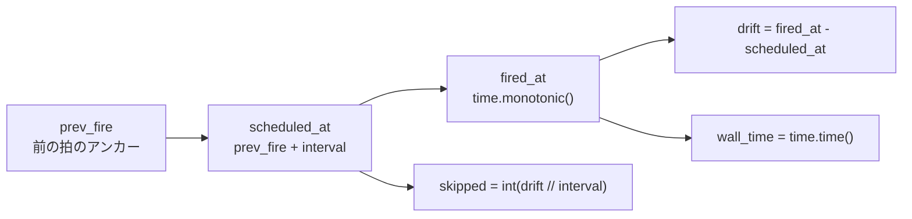

# src/celestialflow/ticker/core_event.py

> 📅 最終更新日: 2026/11/13

`core_event.py` は `TickEvent` を定義します。`Ticker` が発火するたびに構築してハンドラへ渡す**不変の時系列スナップショット**です。ハンドラはこれを介して現在の拍番号を判定し、基準周期を読み取り、スケジューリングのドリフトや拍のスキップを診断できます。

## TickEvent

```python
@dataclass(frozen=True, slots=True)
class TickEvent:
    seq: int
    interval: float
    scheduled_at: float
    fired_at: float
    wall_time: float
    drift: float
    skipped: int
```

| フィールド | 型 | 単位 | 説明 |
|------|------|------|------|
| `seq` | `int` | — | 拍番号。`1` から始まり単調増加。`TickHandler.should_tick()` のフィルタ基準 |
| `interval` | `float` | 秒 | この拍で使われた**基準周期**（スケーリング後の実際の周期ではない） |
| `scheduled_at` | `float` | monotonic 秒 | 予定発火時刻 |
| `fired_at` | `float` | monotonic 秒 | 実際の発火時刻 |
| `wall_time` | `float` | Unix 秒 | 実際の発火時刻の壁時計時間（`time.time()`） |
| `drift` | `float` | 秒 | 予定より実際に遅れた時間。すなわち `fired_at - scheduled_at` |
| `skipped` | `int` | 拍 | 前の拍の処理タイムアウトによりスキップされた基準周期数 |

## 時間基準



- `wall_time` を除き、すべての時間フィールドは `time.monotonic()` に基づき、**システムの壁時計調整（NTP、手動の時刻変更）の影響を受けません**。
- `wall_time` は外部表示や業務時刻との整合にのみ使われ、スケジューリング計算には関与しません。
- `drift` は通常ごく小さな正の値です（スレッドの起床オーバーヘッド）。ある拍の処理が 1 周期を超えると `drift` は顕著に増大し、`skipped` も 0 より大きくなります。
- `skipped` は「追い越さないために直接スキップした完全な基準周期数」を表します。例えば `interval=1.0` で実際に `2.3` 秒遅れた場合、`skipped=2` となり、次の拍のアンカーは `scheduled_at + 2 × interval` まで直接進みます。

## `tick_period` との関係

`interval` は常に `Ticker` の基準周期であり、ハンドラの `tick_period` によって**書き換えられることはありません**。ハンドラが `seq=6`、`tick_period=5` を見るとき、実際にはすでに 5 基準周期（約 5 × `interval` 秒）が経過しています。

```text
Ticker.interval = 1.0
handler.tick_period = 5

seq:      1    2    3    4    5    6    7 ...
handler:  ✅   -    -    -    -    ✅   -  ...
event.interval = 1.0（毎拍同じ）
```

## 使用例

`TickEvent` は通常 `Ticker` が生成します。テストや手動でハンドラを駆動する場合は直接構築できます：

```python
from celestialflow.ticker import TickEvent

event = TickEvent(
    seq=6,
    interval=1.0,
    scheduled_at=5.0,
    fired_at=5.05,
    wall_time=1_700_000_000.0,
    drift=0.05,
    skipped=0,
)

print(event.seq)                     # 6
print(event.interval)                # 1.0
print(round(event.drift, 3))         # 0.05
print(event.wall_time)               # 1700000000.0
```

ハンドラ内で拍情報を読み取る：

```python
from celestialflow.ticker import TickEvent, TickHandler


class DriftMonitor(TickHandler):
    tick_period = 10

    def on_tick(self, event: TickEvent) -> None:
        if event.skipped:
            print(f"{event.seq} 拍目で {event.skipped} 周期をスキップしました")
        if event.drift > event.interval / 2:
            print(f"{event.seq} 拍目のドリフトが大きすぎます: {event.drift:.3f}s")
```

## 注意事項

1. **不変**：`frozen=True, slots=True` のため、ハンドラはイベントのフィールドを変更できません。派生状態が必要な場合は自前で計算してください。
2. **`seq` は 1 から始まる**：フィルタ式 `(seq - 1) % tick_period == 0` はこれに依存しており、1 拍目は必ずヒットします。
3. **`interval` は基準周期**：これに `tick_period` を掛けて過去の時刻を逆算しないでください。スケジューリングのアンカーは `scheduled_at` / `fired_at` が示します。
4. **`skipped` は完全周期のみを数える**：1 周期未満の遅延は `drift` に現れ、`skipped` には現れません。
5. **`wall_time` は巻き戻る可能性がある**：ホストマシンがシステム時刻を調整した場合、`wall_time` は単調でなくなる可能性があります。`seq`、`scheduled_at`、`fired_at` は影響を受けません。
