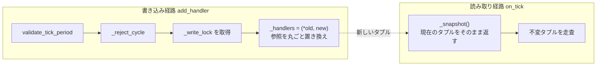
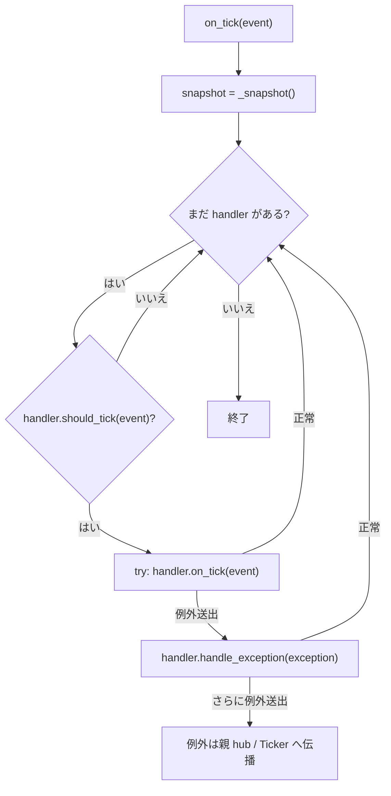

# src/celestialflow/ticker/core_hub.py

> 📅 最終更新日: 2026/11/13

`core_hub.py` は `TickHub` を定義します。拍の**配信センター**です。それ自体も `TickHandler` であるため、`Ticker` のルートハンドラとしても、別の `TickHub` にネストしても使用できます。各拍は各子ハンドラ自身の `tick_period` でフィルタして転送されます。

## TickHub

```python
class TickHub(TickHandler):
    def __init__(self) -> None: ...
    def add_handler(self, handler: TickHandler) -> None: ...
    def on_tick(self, event: TickEvent) -> None: ...
```

| メンバー | 説明 |
|------|------|
| `_handlers` | 現在の子ハンドラのタプル。コピーオンライト |
| `_write_lock` | 書き込み経路の相互排他ロック |
| `add_handler(handler)` | `tick_period` と循環参照を検証してから追加 |
| `on_tick(event)` | 登録順にヒットした拍を子ハンドラへ転送 |

### 登録

`add_handler()` は順に以下を実行します：

1. `validate_tick_period(handler)`：`tick_period` は `>= 1` でなければならない；
2. `_reject_cycle(handler)`：hub の循環参照を形成する登録を拒否する；
3. `_write_lock` の保護下で `(*self._handlers, handler)` によりタプルを丸ごと置き換える。

> 現在 `remove_handler()` はありません。ハンドラは一度登録するとずっと配信に参加します。同じインスタンスを重複登録しても重複排除されず、毎拍複数回呼び出されます。

### 循環検出

`_reject_cycle()` は**ネストした `TickHub`** のみを下方向に探索します：

- `handler is self` → `ConfigurationError("cannot register a TickHub into itself")`；
- `handler` が `TickHub` でない場合はそのまま通過（通常のハンドラは他の hub を保持しないため、循環を形成できない）；
- それ以外の場合はスタックで DFS を行い、`handler` 内部のすべてのネストした hub を走査して `self` に遭遇したら送出：
  `ConfigurationError("cyclic TickHub registration detected: ...")`。

これにより、A → B → A の hub の循環が配信時に無限再帰するのを防ぎます。

### コピーオンライト



- タプルは不変であり、書き込み側は参照を丸ごと置き換える；
- 読み取り経路 `_snapshot()` はロックもコピーもしない；
- そのため配信中のハンドラ追加は現在のイテレーションを壊さず、イテレーション側は常にいずれかの完全なバージョンを見ます。

### 配信と例外分離



| シナリオ | 結果 |
|------|------|
| ある子ハンドラの `on_tick()` が例外を送出 | そのハンドラ自身の `handle_exception()` を呼び出し、他のハンドラは継続 |
| そのハンドラの `handle_exception()` も例外を送出 | 例外が `TickHub.on_tick()` から脱出 |
| `TickHub` が `Ticker` に駆動されている | `Ticker` が脱出した例外を捕捉し、本 hub の `handle_exception()` でフォールバック処理。拍ループは継続 |
| `TickHub` が別の hub にネストされている | 親 hub が捕捉し、本 hub の `handle_exception()` でフォールバック処理 |

### ネストと全体スケーリング

`TickHub` は `TickHandler.tick_period`（デフォルト `1`）を継承します。親は子 hub の `on_tick()` を呼ぶ前に同様に `should_tick()` を実行するため、子 hub に `tick_period` を設定すると**そのサブツリー全体のトリガー頻度を下げる**ことができます：

```text
Ticker(interval=1.0)
└── root Hub (tick_period=1)
    ├── handler A (tick_period=1)   → 1 秒
    └── sub Hub (tick_period=5)     → 5 秒ごとに 1 回入る
        ├── handler B (tick_period=1) → 実際は 5 秒
        └── handler C (tick_period=2) → 実際は 10 秒
```

## 使用例

以下の例は `on_tick()` を直接呼び出し、`tick_period` によるフィルタとネストした hub の挙動を検証します：

```python
from celestialflow.ticker import TickEvent, TickHandler, TickHub


class Collector(TickHandler):
    def __init__(self, name: str, tick_period: int = 1) -> None:
        self.name = name
        self.tick_period = tick_period
        self.hits: list[int] = []

    def on_tick(self, event: TickEvent) -> None:
        self.hits.append(event.seq)


def make_event(seq: int) -> TickEvent:
    return TickEvent(
        seq=seq,
        interval=1.0,
        scheduled_at=float(seq - 1),
        fired_at=float(seq - 1),
        wall_time=0.0,
        drift=0.0,
        skipped=0,
    )


every = Collector("every", tick_period=1)
every_other = Collector("every-other", tick_period=2)

root = TickHub()
root.add_handler(every)
root.add_handler(every_other)

for seq in range(1, 7):
    root.on_tick(make_event(seq))

print(every.hits)        # [1, 2, 3, 4, 5, 6]
print(every_other.hits)  # [1, 3, 5]
```

循環参照は拒否されます：

```python
from celestialflow.runtime.util_errors import ConfigurationError
from celestialflow.ticker import TickHub

outer = TickHub()
inner = TickHub()
outer.add_handler(inner)

try:
    inner.add_handler(outer)
except ConfigurationError as exc:
    print(exc)
# cyclic TickHub registration detected: ...
```

## 注意事項

1. **登録順が実行順**：同じ拍内でヒットしたハンドラは `add_handler()` の順に直列実行されます。
2. **例外は他のハンドラを中断させない**：単一ハンドラの `on_tick()` の失敗はそれ自身にのみ影響します。
3. **`handle_exception()` は再度送出してはならない**：それ自身が例外を送出すると現在の hub から脱出します。親 / `Ticker` にもフォールバック層はありますが、現在の拍の残りのハンドラへの配信は失われます。
4. **循環検出は hub のみを見る**：通常のハンドラが内部で hub 参照を保持していても検出されません。カスタムハンドラで親 hub を逆方向に駆動することは避けてください。
5. **コピーオンライトは読み取り多用・書き込み少量に適する**：実行時に頻繁に `add_handler()` を呼ぶと新しいタプルが生成されますが、進行中の読み取りをブロックしません。
