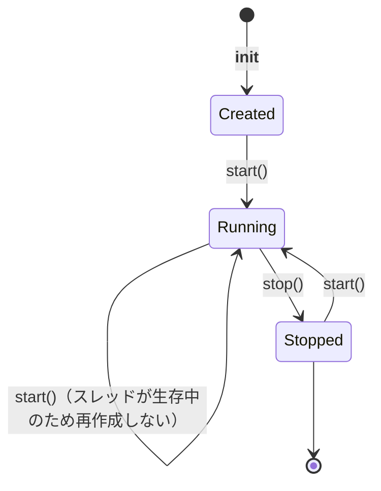
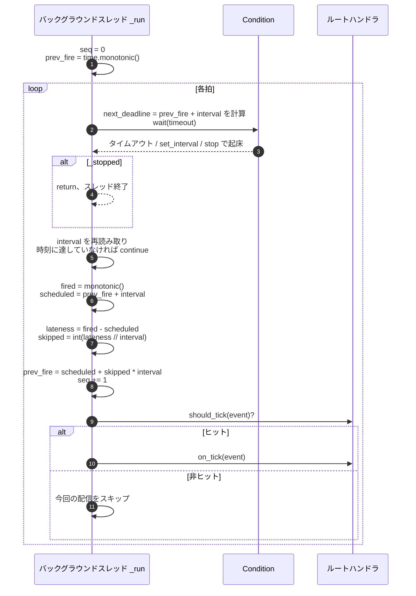

# src/celestialflow/ticker/core_ticker.py

> 📅 最終更新日: 2026/11/13

`core_ticker.py` は `Ticker` を定義します。時間駆動のタイマーです。独立したデーモンスレッドで `time.monotonic()` を基準に予定発火時刻をアンカリングし、拍ごとに `TickEvent` を構築してルートハンドラ（通常は `TickHub`）へ渡します。

## Ticker

```python
class Ticker:
    def __init__(
        self,
        interval: float,
        handler: TickHandler,
        *,
        name: str = "ticker",
    ) -> None: ...

    def start(self) -> None: ...
    def stop(self) -> None: ...
    def is_running(self) -> bool: ...
    def get_interval(self) -> float: ...
    def set_interval(self, interval: float) -> None: ...
```

| パラメータ | 説明 |
|------|------|
| `interval` | 基準周期（秒）。正の数でなければならない |
| `handler` | ルートハンドラ。通常は `TickHub` |
| `name` | バックグラウンドスレッド名。デフォルトは `"ticker"` |

構築時の検証：

- `interval <= 0` → `ConfigurationError("ticker interval must be positive, got ...")`；
- `handler.tick_period < 1` → `validate_tick_period()` により `ConfigurationError` を送出。

## ライフサイクル



| メソッド | 挙動 |
|------|------|
| `start()` | 先に `_before_start()` を呼び出す。バックグラウンドスレッドが存在しないか既に終了している場合、`Condition` の保護下で `_stopped=False` にリセットし、デーモンスレッドを作成して起動する |
| `stop()` | 一度も起動していない場合（`_thread is None`）は即座に戻る。そうでなければ `_stopped=True` にして `notify_all()` で待機中のスレッドを起床させ、`join(timeout=5.0)` する。スレッドがまだ生存していれば `RuntimeStateError` を送出し、最後に `_thread=None` にして `_after_stop()` を呼び出す |
| `is_running()` | `_thread is not None and _thread.is_alive()` |
| `get_interval()` | `Condition` の保護下で現在の基準周期を読み取る |
| `set_interval(interval)` | 正の数を検証した後、`Condition` の保護下で周期を更新し `notify_all()`。次の拍から有効 |

> `start()` は呼び出すたびに `_before_start()` を実行します。スレッドが既に動作中でも同様です。カスタムサブクラスでこのフックにリソース初期化を置く場合は、冪等性を保証してください。

## スケジューリングアルゴリズム



### 要点

| 挙動 | 説明 |
|------|------|
| **初回の拍は 1 周期遅れる** | `prev_fire` はスレッド起動時に現在の `monotonic()` で初期化されるため、最初の発火は `interval` 秒後になる |
| **予定時刻のアンカリング** | 各拍の目標時刻は `prev_fire + interval` であり、「前の拍の実際の終了時刻 + interval」ではない |
| **追い越さない** | 処理時間により `lateness > 0` になった場合、`skipped = int(lateness // interval)` とし、`prev_fire` を `scheduled + skipped × interval` まで直接進め、逃した拍を連続して補発しない |
| **1 周期未満の遅延** | `skipped=0` となり、`TickEvent.drift` にのみ現れる |
| **動的な速度調整** | `set_interval()` は待機を起床させる。ループは `_interval` を再読み取りして deadline を再計算し、次の拍から有効になる |
| **インライン実行** | ルートハンドラは現在のスレッドで同期的に実行される。遅いハンドラは後続の拍を遅延させる |

### 拍スキップの例

```text
interval = 1.0
prev_fire = 0.0

予定 1.0s、実際 1.2s に発火：lateness=0.2、skipped=0
    prev_fire = 1.0、次の拍は 2.0s を予定

予定 2.0s、実際 4.3s に発火（ハンドラの所要時間 3.1s）：lateness=2.3、skipped=2
    prev_fire = 2.0 + 2×1.0 = 4.0、次の拍は 5.0s を予定
    —— 2.0〜4.0 の間の 2 周期は直接スキップされる
```

## 例外分離

`_dispatch()` の実行順序：

1. `handler.should_tick(event)` が `False` を返す → 現在の拍ではハンドラを呼び出さない；
2. そうでなければ `try: handler.on_tick(event)`；
3. 例外を捕捉したら `handler.handle_exception(exception)` を呼び出す。

失敗の分離は 2 層です：

| 層 | 挙動 |
|------|------|
| 第 1 層 | ハンドラの `on_tick()` が送出した例外は、それ自身の `handle_exception()` に渡される |
| 第 2 層 | `handle_exception()` がさらに送出した場合、例外は `_dispatch()` から脱出する。ルートハンドラは通常 `TickHub` であり、`Ticker` が捕捉してその hub の `handle_exception()` をコールバックしてフォールバック処理し、拍ループは継続する |
| スレッド終了 | ルートハンドラが `TickHub` ではなく、その `handle_exception()` も例外を送出した場合、例外はバックグラウンドスレッドを終了させる |

> `_run()` は `_dispatch()` をさらに `try` で包んでいないため、第 2 層のフォールバックは完全にルートハンドラの `handle_exception()` に依存します。

## 使用例

```python
import time

from celestialflow.ticker import TickEvent, TickHandler, TickHub, Ticker


class Collector(TickHandler):
    def __init__(self) -> None:
        self.seqs: list[int] = []

    def on_tick(self, event: TickEvent) -> None:
        self.seqs.append(event.seq)


handler = Collector()
hub = TickHub()
hub.add_handler(handler)

ticker = Ticker(0.1, hub, name="demo-ticker")
print(ticker.is_running())  # False
ticker.start()
print(ticker.is_running())  # True

time.sleep(0.35)
ticker.stop()
print("発火した拍数:", len(handler.seqs))
print("前後の間隔の例:", handler.seqs[:5])
```

動的な速度調整：

```python
import time

from celestialflow.ticker import TickEvent, TickHandler, TickHub, Ticker


class Collector(TickHandler):
    def __init__(self) -> None:
        self.times: list[float] = []

    def on_tick(self, event: TickEvent) -> None:
        self.times.append(event.fired_at)


handler = Collector()
hub = TickHub()
hub.add_handler(handler)

ticker = Ticker(0.2, hub)
ticker.start()
time.sleep(0.25)
ticker.set_interval(0.1)   # 次の拍から新しい周期を使用
time.sleep(0.25)
ticker.stop()

print("基準周期:", ticker.get_interval())
```

## 注意事項

1. **デーモンスレッド**：`Ticker` のスレッドは `daemon=True` であり、メインプログラムの終了をブロックしません。ただし通常の終了処理では明示的に `stop()` を呼ぶべきです。
2. **停止タイムアウト**：`join` は最大 `5.0` 秒待機します。ハンドラが長時間ブロックすると、`stop()` は `RuntimeStateError` を送出し、`_after_stop()` も実行しません。再度 `stop()` を呼び出してリトライできます。
3. **`start()` の重複呼び出しは安全**：スレッドが生存中なら 2 つ目のスレッドは作成されませんが、`_before_start()` は依然として呼び出されます。
4. **`stop()` 後に同じスレッドオブジェクトは再利用不可**：`stop()` は `_thread` を `None` にするため、再度 `start()` すると新しいスレッドが作成されます。`seq` も `1` から数え直します。
5. **ハンドラは直列**：並行消費が必要な場合は、`on_tick()` でキューに書き込むだけにして、独立したコンシューマで処理してください。
6. **`funnel` とは疎結合**：`Ticker` は `BaseSpout` / `BaseInlet` に依存しません。非同期で永続化やプッシュが必要な場合は、ハンドラ内部で対応するオブジェクトを組み合わせてください。
