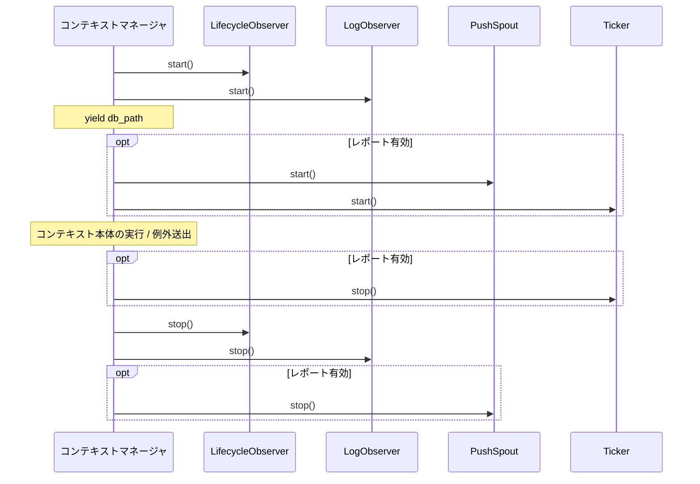

# tests/assembly/test_run.py

> 📅 最終更新日: 2026/11/13

## 役割

`celestialflow.assembly.core_run` の 2 つの実行時リソースコンテキストマネージャ——`run_graph_resources` と `run_node_resources`——のリソースアセンブリ、産出、回収セマンティクスを検証します：

- コンテキストに入るときに永続化オブザーバーを起動し、lifecycle sqlite データベースパスを産出する；
- `log_level` に従って `LogObserver` を構築して登録する；
- グラフエントリは `report` が存在する場合にプッシュチャネル、スナップショットハンドラ、スナップショットタイマーをアセンブリし、`report is None` の場合にはプッシュリソースを一切作成しない；
- 終了時（コンテキスト本体で例外が送出された場合を含む）に正しい順序でタイマー、プッシュ spout、ライフサイクル / ログ観測者を停止する。

> 現在の実装はプライベートな `_persistence_resources` を介して `LifecycleObserver` と `LogObserver` を統一的にアセンブリし、`LifecycleSpout` / `LogSpout` / `LifecycleInlet` / `LogInlet` を直接作成しません。テストがアサートするのはオブザーバー層での起動 / 停止と登録であり、旧版の inlet / spout のペアではありません。

## コアテスト対象

| オブジェクト | ソース | 説明 |
|------|------|------|
| `run_graph_resources(observers, injection_target, *, log_level, report)` | `celestialflow.assembly.core_run` | グラフ実行時リソースのエントリ。`db_path` を産出 |
| `run_node_resources(observers, *, log_level)` | `celestialflow.assembly.core_run` | 単一ノード実行時リソースのエントリ。`db_path` を産出 |
| `_persistence_resources(observers, metrics_view, log_level)` | `celestialflow.assembly.core_run`（プライベート） | `LifecycleObserver` / `LogObserver` を作成して起動し、終了時は先に lifecycle を停止してから log を停止 |
| `LifecycleObserver` / `LogObserver` | `celestialflow.persist.core_lifecycle` / `celestialflow.persist.core_log` | テスト対象エントリがアセンブリする永続化オブザーバー |
| `MetricsObserver` / `ObserverHub` | `celestialflow.observer` | 指標の書き込みモデルと観測者コンテナ |
| `PushSpout` / `PushInlet` / `PushSnapshotHandler` | `celestialflow.reporter` | レポート有効時のプッシュチャネルと観測者 |
| `Ticker` / `ReportConfig` / `DEFAULT_REPORT_URL` | `celestialflow.ticker` / `celestialflow.runtime.core_config` | スナップショットタイマーとレポート設定 |
| `InvalidOptionError` | `celestialflow.runtime.util_errors` | 不正な `log_level` に対する期待例外 |

## 主要 fixture とスタブ

| 名前 | 型 | 用途 |
|------|------|------|
| `tmp_path` + `monkeypatch.chdir(tmp_path)` | pytest 内蔵 | 作業ディレクトリを一時ディレクトリへ切り替え、`./lifecycles/...` 配下の sqlite ファイルが一時パスに落ちるようにする |
| `ObserverHub._snapshot()` | テスト対象ライブラリの内部インターフェース | 現在登録済みの観測者タプルを読み取り、数、型、登録順序のアサートに使用 |
| `_InjectionTarget` | テスト内スタブ | `InjectionTarget` プロトコルを満たす最小実装。`inject_tasks` / `inject_terminations` はどちらも何もしない |
| `_RecordingLifecycleObserver` / `_RecordingLogObserver` | テスト内サブクラス | `stop()` をオーバーライドし、`super().stop()` の後に `stopped` リストへ `'lifecycle'` / `'log'` を追加 |
| `_RecordingPushSpout` | テスト内サブクラス | `__init__` をオーバーライドし、構築回数（`used.append('push')`）と実際の `base_url` を記録 |
| `_RecordingTicker` | テスト内サブクラス | `start()` / `stop()` をオーバーライドし、`'ticker-start'` / `'ticker-stop'` を記録 |
| `monkeypatch.setattr(core_run, ...)` | pytest 内蔵 | `core_run` モジュール名前空間の `LifecycleObserver` / `LogObserver` / `PushSpout` / `Ticker` を置き換え、テスト対象エントリ内部の構築をインターセプトする |

## テストカバレッジマトリクス

### `TestGraphRunResources` — グラフエントリ

| ケース | カバレッジ目標 |
|------|---------|
| `test_yields_db_path_and_registers_observers` | 入る時に存在する sqlite パスを産出し、デフォルトで 3 つの観測者（指標 + lifecycle + log）を登録する |
| `test_stops_spouts_on_exit` | 終了時に lifecycle と log の観測者がどちらも `stop()` される |
| `test_cleans_up_when_body_raises` | コンテキスト本体が `RuntimeError` を送出したとき例外が外へ伝播し、かつ永続化オブザーバーが依然として回収される |
| `test_uses_push_spout_when_report_enabled` | `ReportConfig(url=...)` を渡したときに `PushSpout` を作成し、そのアドレスを使用する |
| `test_no_push_spout_when_report_disabled` | `report` を渡さない場合にプッシュ spout を一切作成しない |
| `test_uses_default_url_when_report_enabled_without_url` | `ReportConfig()` が `DEFAULT_REPORT_URL` で `PushSpout` を構築する |
| `test_registers_snapshot_handler_before_push_inlet` | `PushSnapshotHandler` が `PushInlet` より前に登録され、終態スナップショットがオフライン通知より先にエンキューされることを保証する |
| `test_starts_and_stops_snapshot_ticker_when_report_enabled` | レポート有効時に spout を構築 → ticker を起動 → 終了時に ticker を停止 |
| `test_log_level_argument` | `log_level='error'` が `'ERROR'` に正規化されて `LogObserver` へ渡される |
| `test_rejects_invalid_log_level` | 不正なレベル（`'VERBOSE'`）が `InvalidOptionError` を送出する |

### `TestNodeRunResources` — ノードエントリ

| ケース | カバレッジ目標 |
|------|---------|
| `test_registers_metrics_and_inlets` | ノードエントリ内部で `MetricsObserver` を作成し、lifecycle / log と合わせて 3 つの観測者を登録し、`db_path` を産出する |
| `test_log_level_argument` | `LogObserver.log_level == 'ERROR'` |
| `test_rejects_invalid_log_level` | 不正なレベルが `InvalidOptionError` を送出する |
| `test_stops_spouts_on_exit` | 終了時に lifecycle / log がどちらも停止される |

## 主要な動作の詳細

### 観測者の登録順序

グラフエントリの登録順序は固定です：

1. `MetricsObserver`（エントリ内部で作成）
2. `LifecycleObserver`
3. `LogObserver`
4. `PushSnapshotHandler`（レポート有効時のみ）
5. `PushInlet`（レポート有効時のみ）

`test_registers_snapshot_handler_before_push_inlet` は `_snapshot()` 内の各観測者の型名リストを取得し、`PushSnapshotHandler` のインデックスが `PushInlet` より小さいことをアサートします。この順序は `core_run` における「先に `observers.add_observer(snapshot_handler)`、次に `observers.add_observer(push_inlet)`」という実装に対応します：`GraphEndEvent` の配信時にはスナップショットレコードが先にエンキューされ、その後で `/api/shutdown_session` のオフラインレコードがエンキューされます。

### リソースの起動 / 停止順序



- ticker は `try/finally` で先に停止され、その後で `_persistence_resources` を抜けて lifecycle / log を停止し、最後に最外層の `finally` で `push_spout` を停止して `requests.Session` を閉じます。これにより、拍スレッドが観測者 / spout のクローズ後にエンキューし続けることはありません。
- `test_starts_and_stops_snapshot_ticker_when_report_enabled` のアサーションは `events == ['push', 'ticker-start', 'ticker-stop']` です。`_RecordingPushSpout` は**構築**時にのみ `'push'` を記録し、`start()` は記録しない点に注意してください。`_RecordingTicker` は start / stop を記録します。したがってこのアサーションが証明するのは「先に spout を構築し、次に ticker を起動 / 停止する」ことです。
- 停止順序は `test_stops_spouts_on_exit` で `set(stopped) == {'lifecycle', 'log'}` によりアサートされ、両者が回収されることのみを検証し、両者の相対順序は制約しません（実装では lifecycle → log）。

### `db_path` の産出

`run_graph_resources` / `run_node_resources` はどちらも `lifecycle.db_path` をコンテキスト値として産出します。`LifecycleObserver.start()` は内部 spout の `_before_start()` をトリガーし、`./lifecycles/<YYYY-MM-DD>/flow_lifecycle(<HH-MM-SS-毫秒>).sqlite3` にデータベースを作成して `db_path` に代入します。テストは `monkeypatch.chdir(tmp_path)` の後に `db_path is not None` かつ `Path(db_path).exists()` をアサートします。

### レポート設定の分岐

| `report` の値 | 作成されるプッシュリソース |
|---------------|----------------|
| `None`（デフォルト） | `PushSpout` なし、`PushInlet` なし、`PushSnapshotHandler` なし、`Ticker` なし |
| `ReportConfig()` | `PushSpout(session_id, DEFAULT_REPORT_URL)` + `PushInlet` + `PushSnapshotHandler` + `Ticker(1.0, hub, name="report")` |
| `ReportConfig(url=...)` | 同上。`base_url` は明示されたアドレスを使用 |

テストは `core_run.PushSpout` を記録用サブクラスに置き換えて構築呼び出しと実際の URL を観測し、実際の HTTP リクエストは送信しません。`PushSpout` 内部で作成される `requests.Session` は終了時に閉じられます。

### ログレベル

両方のエントリは先頭で `normalize_log_level(log_level)` を呼び出します：空白を除去して大文字に変換し、不正な値は `InvalidOptionError` を送出します。そのため `log_level='error'` は最終的に `LogObserver.log_level == 'ERROR'` として書き込まれます。`run_node_resources` のこのアサーションはコンテキスト本体内にあり、`run_graph_resources` はコンテキスト本体内で `LogObserver` インスタンスをフィルタします。

## 実行方法

```bash
# すべて実行
uv run pytest tests/assembly/test_run.py -v

# グラフエントリのみ
uv run pytest tests/assembly/test_run.py -k "TestGraphRunResources" -v

# ノードエントリのみ
uv run pytest tests/assembly/test_run.py -k "TestNodeRunResources" -v

# レポート関連のみ
uv run pytest tests/assembly/test_run.py -k "report or push or ticker" -v
```

## 注意事項

- テストは実際のタスクグラフを起動せず、リソースのアセンブリとライフサイクルのみを検証します。注入対象には `_InjectionTarget` の空実装を使用します。
- すべての置き換えは `core_run` モジュール名前空間に対して行われます（`monkeypatch.setattr(core_run, 'Ticker', ...)`）。そのためテスト対象エントリ内部の参照がインターセプトされます。`celestialflow.ticker.Ticker` を直接置き換えても効果はありません。
- イベント順序のアサーションは「`PushSpout` が `Ticker` より先に構築され、`push_spout.start()` が `ticker.start()` より先に呼ばれる」という実装詳細に依存します。アセンブリ順序を変更する場合はこのテストケースも同期して更新する必要があります。
- 関連実装は `src/celestialflow/assembly/core_run.py` にあり、リソースのセマンティクスは `docs/zh-CN/src/assembly/core_run.md` も参照してください。
