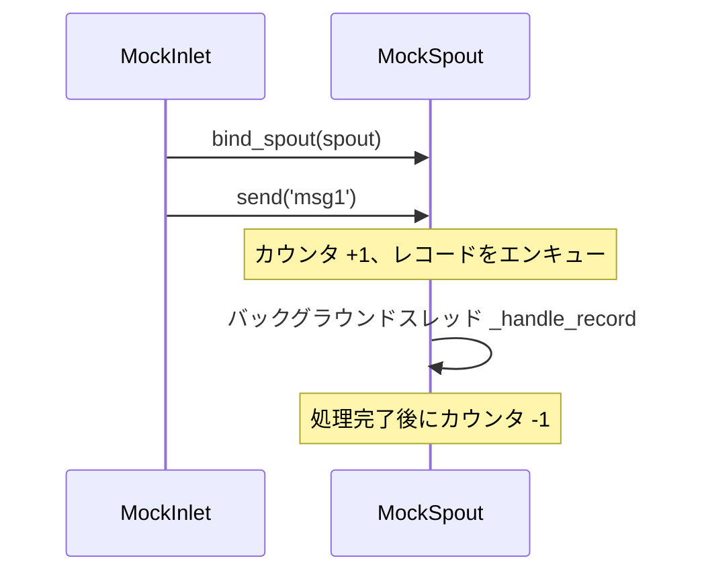

# tests/funnel/test_inlet.py

> 📅 最終更新日: 2026/11/13

## 役割

`celestialflow.funnel.core_inlet.BaseInlet` の最小責務を検証します：`send(record)` でレコードをバインド済み spout のキューに入れ、処理待ちカウントを進め、最終的に実行中の `BaseSpout` サブクラスによって消費されること。

## カバレッジポイント

- `MockInlet.send()` は `BaseInlet.send()` を直接再利用し、レコードを対象のキューに入れます。
- `MockSpout` はキューから文字列と辞書の 2 種類のメッセージを消費します。
- コンシューマが起動していない場合でも、レコードはキューに入り、`get_pending_count()` が増加して後続の読み取りに備えます。
- `bind_spout()` は対象 spout とキュー / カウンタを共有する inlet を返し、自身の型はサブクラス（`MockInlet`）のまま維持されます。

## テストカバレッジマトリクス

| テストクラス | ケース | カバレッジ目標 |
|--------|------|----------|
| `TestBaseInlet` | `test_inlet_to_spout_communication` | spout 起動後、inlet が `'msg1'` と `{'key': 'val'}` を順に送信し、最終的に順序通り消費され、処理待ちカウントが 0 に戻る |
| `TestBaseInlet` | `test_send_puts_record_into_queue` | spout 未起動時に `send()` が元のレコードを `get_queue()` に入れ、`get_pending_count() == 1` となる |
| `TestBaseInlet` | `test_bind_spout_creates_bound_inlet` | `bind_spout()` が `MockInlet` インスタンスを返し、送信後に同じ spout のキューとカウントを共有する |

## 主要な動作



- `send()` はエンキュー前に `PendingCounter` をインクリメントし、エンキュー失敗時はカウントをロールバックします。spout が未バインドの場合は `InitializationError` を送出します。
- `get_pending_count()` が数えるのは「エンキュー済みだが処理が未完了」のレコード数であるため、デキュー済みで処理中のレコードも含まれます。

## 実行方法

```bash
pytest tests/funnel/test_inlet.py -v
pytest tests/funnel/test_inlet.py -k "communication" -v
```

## 注意事項

- `wait_until` はルートレベルの `tests/conftest.py` から提供され、バックグラウンド消費の完了を待つために使用し、固定の `sleep` を避けます。
- すべてのレコードはそのまま透過的に渡され、`BaseInlet` はシリアライズや変換を行いません。
