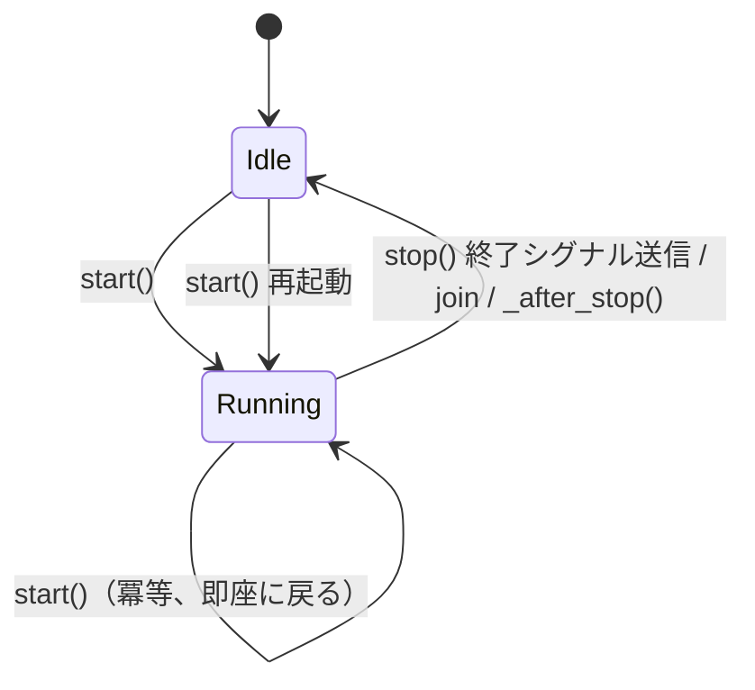

# tests/funnel/test_spout.py

> 📅 最終更新日: 2026/11/13

## 役割

`celestialflow.funnel.core_spout.BaseSpout` のライフサイクルフック、起動の冪等性、終了シグナル処理、抽象メソッド制約を検証し、バックグラウンド監視スレッドが期待通りに起動、停止、再起動し、停止前のレコードを消費できることを確認します。

## カバレッジポイント

- `start()` は初回起動時に `_before_start()` を呼び出します。`start()` の重複呼び出しでは `_before_start()` が再度実行されません（冪等）。
- `stop()` は終了シグナルを送信し、スレッドの終了を待って `_after_stop()` をトリガーします。停止後は新しいレコードを消費しません。
- `stop()` は重複呼び出しをサポートし、重複呼び出しでも例外を発生させません。
- `stop()` の後に再度 `start()` でき、再起動後の spout は引き続き新しいレコードを消費できます。
- 基底クラスが `_handle_record()` を実装していない場合は `CelestialFlowError` を送出します。

## テストカバレッジマトリクス

| テストクラス | ケース | カバレッジ目標 |
|--------|------|----------|
| `TestBaseSpout` | `test_start_is_idempotent` | `start()` を連続して 2 回呼び出し、`_before_start()` が 1 回だけ実行される |
| `TestBaseSpout` | `test_base_spout_lifecycle` | `start()` が `_before_start()` をトリガーし、停止前のデータが消費される。`stop()` が `_after_stop()` をトリガーし、その後エンキューされたデータは消費されない |
| `TestBaseSpout` | `test_spout_termination_signal` | 終了シグナル前の 2 つのレコードがすべて処理され、`stop()` 後に処理待ちカウントが 0 になり、`stop()` の重複呼び出しが安全である |
| `TestBaseSpout` | `test_spout_can_restart_after_stop` | `stop()` 後に再度 `start()` するとバックグラウンドスレッドが再作成され、`"second"` を引き続き消費できる |
| `TestBaseSpout` | `test_spout_not_implemented_error` | `_handle_record()` をオーバーライドしない場合に `CelestialFlowError` を送出し、メッセージに `_handle_record must be implemented` を含む |

## 主要フロー



- `start()` はまず `_thread` が生存しているかを確認し、生存していれば即座に戻ります。そうでなければ `_before_start()` を実行してから daemon スレッドを作成します。
- `stop()` はキューに `TERMINATION_SIGNAL` を書き込み、`join(timeout=5)` します。タイムアウトしても終了しない場合は `RuntimeStateError` を送出します。終了後、キュー内の新しいレコードは消費されません（`get_pending_count()` は 1 のまま）。
- バックグラウンドループでは単一レコードの処理失敗はトレースバックを出力するだけで、スレッドを殺しません。成功可否に関わらず処理待ちカウントはデクリメントされます。

## 実行方法

```bash
pytest tests/funnel/test_spout.py -v
pytest tests/funnel/test_spout.py -k "lifecycle or termination or idempotent" -v
```

## 注意事項

- `wait_until` と `assert_stays_true` はルートレベルの `tests/conftest.py` から提供され、それぞれ消費完了の待機と、停止後に消費されないことの検証に使用されます。
- `assert_stays_true` は `duration=0.3` の間継続的にサンプリングし、1 回だけのチェックによるタイミングの見逃しを避けます。
