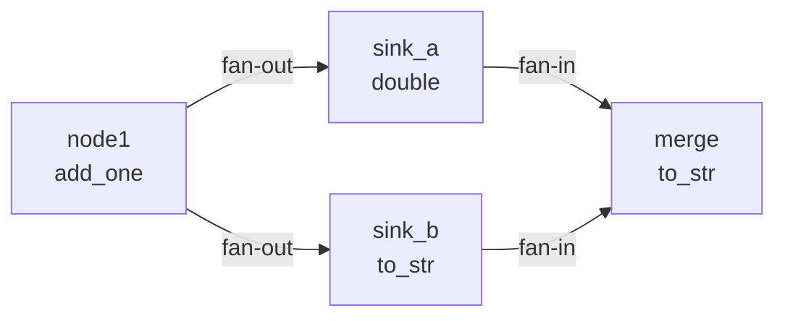

# tests/graph/test_graph.py

> 📅 最終更新日: 2026/11/13

## 役割
`TaskGraph` およびその各種トポロジサブクラス（`TaskChain`、`TaskCross`、`TaskGrid`）のコア機能を全面的に検証し、同期/非同期/スレッド実行、タスクと終了シグナルの注入、エラー伝播、SQLite リプレイ、ランタイムスナップショットカウント、トポロジ解析、実行モードマトリクス、ソースノード導出（SCC 含む）、循環グラフの動作をカバーします。

## コアテスト対象
- `TaskGraph`: 汎用タスクグラフコンテナ
- `TaskChain`, `TaskCross`, `TaskGrid`: 事前定義トポロジ構造
- `TaskExecutor`: グラフノード定義
- `TaskGraph.inject_tasks` / `inject_terminations`: ノード名でタスクと終了シグナルを注入するエントリ
- `run` / `run_async` / `start` / `start_async` / `restore_db`: グラフ実行エントリ

## テスト範囲

### 集計表

| テストクラス | ケース数 | カバレッジポイント |
|-------------|---------|------------------|
| `TestTaskGraphBasic` | 12 | set_ctree による既存ノードの更新、未知ノード名検索の例外、2ノード DAG、読み取り専用マッピングと使い捨てイテラブルの入力、未知ノード注入の `ExceptionGroup`、ファンアウト、ファンイン、エラー伝播、DB リプレイ、DB エラータイプフィルタリプレイ、DB での pending 保持、finish 後の例外グループ一括送出 |
| `TestTaskGraphSnapshotCounts` | 3 | fan-in 上流カウント、fan-out 下流カウント、指標による `processed`/`pending` の導出 |
| `TestTaskGraphAsync` | 6 | async モード 2ノード、ファンアウト、ファンイン、エラー伝播、async execution_mode、async finish 後の例外グループ一括送出 |
| `TestTaskGraphStructure` | 3 | Chain、Cross、Grid 構造 |
| `TestTaskGraphAnalysis` | 5 | ノードメタ情報、ゲッターによるオンデマンドな解析構築、構造変更後のキャッシュ自動再構築、DAG 検出、階層計算 |
| `TestNodeExecutionMatrix` | 7 | serial/thread/async graph_mode × serial/thread/async execution_mode |
| `TestTaskGraphThread` | 6 | thread モード 2ノード、ファンアウト、ファンイン、エラー伝播、lambda、線形鎖スケジューリング |
| `TestSourceNodes` | 5 | 線形グラフ source、ファンイン source、ダイヤモンドグラフ source、単一ソース SCC 代表点、複数ソース SCC は各1点を返す |
| `TestCyclicGraph` | 3 | serial モードでの循環グラフ例外送出、循環グラフ `is_dag()` 検出、循環内同層 + 尾の階層 |
| `TestTaskGraphReporterCapabilities` | 3 | `inject_tasks` / `inject_terminations` で注入し、未知ノードを処理 |
| **合計** | **53** | |

> **説明**: ここでの統計は `test_graph.py` 内のテストクラスです。`TaskLoop` と `TaskWheel` の専用テストは `test_structure.py` にあります。

### 主要テストフロー

#### 基本トポロジ実行


- **2ノード DAG** (`test_graph_dag_two_nodes`): A→B のデータフローが正しく、2ノードがそれぞれ3つ成功することを検証。
- **読み取り専用マッピングとジェネレータ入力** (`test_run_accepts_mapping_of_iterables`): `run()` は `MappingProxyType` のような読み取り専用マッピングを受け付け、値にはジェネレータなど使い捨てのイテラブルを使用できます（各値は1回だけ走査）。2ノードがそれぞれ3つ成功します。
- **未知ノードによる例外グループ** (`test_run_raises_exception_group_for_unknown_node`): `run({"s1": [1], "missing": [2]})` は `ExceptionGroup` を送出し、その中には `UnknownNodeError` が1つだけ含まれ、メッセージには未知ノード名 `missing` が含まれます。
- **ファンアウト** (`test_graph_fan_out`): 1つの上流が複数の下流に分配され、`sink_a` と `sink_b` がそれぞれ2つ成功することを検証。
- **ファンイン** (`test_graph_fan_in`): 複数の上流が1つの下流に集約され、merge ノードが4つのタスクを受け取ることを検証。
- **エラー伝播** (`test_graph_error_propagation`): `50` が `ValueError` をトリガーしてもフローが中断されず、下流が成功タスクのみを受け取ることを検証（node1 は成功 2 / 失敗 1、node2 は成功 2 / 失敗 0）。
- **DB リプレイ** (`test_graph_restore_db`): `restore_db` はデフォルトで `failed` と `pending` のレコードを読み取り、ノード名ごとにグループ化してリプレイします。
- **DB エラータイプフィルタ** (`test_graph_restore_db_filters_error_type_when_enabled`): `restore_db(..., statuses=["failed"], filter_by_error_type=True)` は各ノードの `retry_exceptions` に基づいて `error_type` をフィルタリングします。
- **DB での pending 保持** (`test_graph_restore_db_filter_keeps_pending_records`): フィルタ有効時も `pending` レコードは引き続きリプレイされます。
- **未知ノード名の例外** (`test_graph_node_lookup_unknown_node_raises`): ノード名で検索して失敗する分岐をシミュレートします——`graph.node_dict.get("unknown_node")` が `None` を返した後に明示的に `NodeNotFoundError` を送出し、`pytest.raises` で捕捉します。このケースが検証するのは例外型の約束であり、ある図 API の自動的な例外送出動作ではありません（`run` 経路の未知ノードは `UnknownNodeError` + `ExceptionGroup` でカバーされます）。
- **set_ctree による既存ノードの更新** (`test_set_ctree_updates_existing_nodes`): 先に `set_nodes` を呼んだ後で `set_ctree` を呼ぶ場合、既存ノードも同じイベントクライアントを共有すべきです。
- **finish 後の例外グループ一括送出** (`test_start_raises_exception_group_after_finish`): 同期 `start` は `_finish_start` 後に収集された `ExceptionGroup` を一括送出します。

#### スナップショット辺カウント (`TestTaskGraphSnapshotCounts`)
- `test_fan_in_upstream_counts`: `metrics_of(graph).get_node_metrics("merge").upstream_counts` で、fan-in ノードが各上流から提供されたタスク数を記録すること（`{"src_a": 2, "src_b": 2}`）を検証。上流ノードの `downstream_counts` も対応して一致します。
- `test_fan_out_downstream_counts`: node metrics の `downstream_counts` で各下流へ送信した数を記録し、下流ノードの `upstream_counts` も対応して一致します。
- `test_snapshot_restores_processed_and_pending`: グラフ実行後の node metrics スナップショットで `processed` / `pending` / `succeeded` を導出（`processed == 3`、`pending == 0`）。

#### 非同期と並行 (`TestTaskGraphAsync`)
- async モードの2ノード、ファンアウト、ファンイン、エラー伝播は同期モードとセマンティクスが一致。
- `test_graph_async_execution_mode`: `graph_mode="async"` + `execution_mode="async"` の組み合わせを検証。
- `test_start_async_raises_exception_group_after_finish`: 非同期 `start_async` が finish 後に例外グループを一括送出することを検証。

#### 実行モードマトリクス (`TestNodeExecutionMatrix`)
`graph_mode` × `execution_mode` の全 **7 組み合わせ**をカバー：

| ケース | graph_mode | execution_mode |
|--------|-----------|----------------|
| `test_serial_serial` | serial | serial |
| `test_serial_thread` | serial | thread |
| `test_thread_serial` | thread | serial |
| `test_thread_thread` | thread | thread |
| `test_async_serial` | async | serial |
| `test_async_thread` | async | thread |
| `test_async_async` | async | async |

各ケースは5つの入力タスクを持つ2ノード DAG を使用し、2つのノードがそれぞれ5つ成功することを検証。

#### グラフ構造解析 (`TestTaskGraphAnalysis`)
- **ノードメタ情報** (`test_get_node_meta_covers_all_nodes`): `get_node_meta()` は各ノードに対して `class_name`、`execution_mode` などの構築期メタ情報を返します。
- **オンデマンド構築** (`test_getters_build_analysis_on_demand`): 明示的に build していなくても、`get_nodes()`、`get_edges()`、`get_source_nodes()`、`is_dag()`、`get_layers()` を直接呼び出せ、それぞれが必要に応じて解析キャッシュを構築します。
- **キャッシュ自動再構築** (`test_getters_refresh_analysis_after_connect`): `connect` 後、ゲッターは解析キャッシュを自動的に再構築し、ソースノードと階層もそれに伴って更新されるべきです（`s1` は第 0 層、`s2` は第 1 層）。
- **DAG 検出** (`test_dag_detection`): `is_dag()` メソッドがグラフに循環があるかどうかを正しく反映すべきです。
- **階層計算** (`test_layer_computation`): 線形チェーン A→B→C を `get_layers()` で得られる階層は {A:0, B:1, C:2}。

#### 複雑な構造 (`TestTaskGraphStructure`)
| 構造 | ノード数 | カバーシナリオ |
|------|--------|---------|
| Chain | 3 チェーン | 線形パイプライン、各ノードが 2 つ成功 |
| Cross | 2×3 階層全結合 | 各 layer2 ノードが 2 つの layer1 ノードからそれぞれ 1 つの結果を受け取る |
| Grid | 2×2 グリッド | 左上のルートが 2 つのタスクを処理し、残りのノードは伝播に従って累積 |

#### スレッドモード (`TestTaskGraphThread`)
`graph_mode="thread"` における 2 ノード直列、fan-out、fan-in、エラー伝播、lambda 関数サポート、線形鎖スケジューリングを検証。

#### ソースノード導出 (`TestSourceNodes`)
5つのケースで以下のシナリオをカバー：

| ケース | トポロジ | 期待される結果 |
|--------|---------|-------------|
| `test_source_nodes_linear` | A→B→C | `[A]` |
| `test_source_nodes_fan_in` | A→C, B→C | `{A, B}` |
| `test_source_nodes_diamond` | A→{B,C}→D | `[A]` |
| `test_source_nodes_cycle_returns_one_source_scc_member` | s1→s2→s3→s1 | 循環内の代表点1つ |
| `test_source_nodes_returns_one_member_per_source_scc` | 2つの交わらない循環が s5 に集約 | 各ソース SCC から代表点1つずつ |

#### 循環グラフ (`TestCyclicGraph`)
| ケース | 検証ポイント |
|--------|------------|
| `test_cyclic_serial_graph_raises` | serial graph_mode 時に `get_source_nodes()` を呼ぶと循環グラフは `ConfigurationError` をスローすべき（`"TaskGraph contains a cycle while graph_mode='serial'"` にマッチ） |
| `test_cyclic_is_dag_false` | s1→s2→s3→s1 の `is_dag()` が `False` を返すべき |
| `test_cyclic_layers` | `get_layers()` で循環内ノード (s1,s2,s3) が同層、尾の s4 が循環階層 + 1 |

#### 注入能力 (`TestTaskGraphReporterCapabilities`)
- `test_inject_tasks_injects_valid_nodes_and_raises_for_missing`: `graph.inject_tasks({"s1": [1, 2], "missing": [9]})` はまず既存ノード `s1` にタスクを注入し、次に未知ノードに対して `UnknownNodeError` を送出します。注入済みタスクはキューに残り、その後 `graph.run({})` がそれらを消費し、`s1` が2つ成功します。
- `test_inject_tasks_with_only_valid_nodes_does_not_raise`: すべてのターゲットノードが存在する場合は例外を送出せず、`run({})` 後に `s1` が2つ成功します。
- `test_inject_terminations_injects_valid_nodes_and_raises_for_missing`: `graph.inject_terminations(["s1", "missing"])` はまず `s1` に終了シグナルを注入し（ノード側の `put_signal()`）、次に未知ノードに対して `UnknownNodeError` を送出します。ケースでは `Observer` サブクラスを登録し、統一エントリ `on_event` をオーバーライドして `match event` で `TerminationInputEvent` をマッチし `event.node` を記録し、最終的に `"s1"` だけが終了シグナルを受け取ったことをアサートします。

## 重要な詳細

### 実行と注入のセマンティクス
`run()` / `run_async()` の実行順序は次の通りです：`_build_analysis()` → `_inject_observers()` → `inject_tasks(init_tasks_dict)` → `if_put_signal` が真なら `inject_terminations(self._source_names)` → `start()` / `start_async()`。

- `inject_tasks` のシグネチャは `Mapping[str, Iterable[Any]]` であり、各値は1回だけ走査されるため、`tuple`、ジェネレータ、`MappingProxyType` をそのまま渡せます。
- 2つの注入メソッドはどちらも「まず可能な限り注入し、最後に一括でエラー報告する」戦略を採用します：単一の未知ノードが他のノードのタスクや終了シグナルの破棄を引き起こすことはなく、最後に `UnknownNodeError` を一括送出します（メッセージにはすべての未知ノードが列挙されます）。
- `run` / `run_async` は注入または実行段階で送出された例外を `ExceptionGroup("Errors occurred during run", [...])` に回収するため、呼び出し側が見るのは生の `UnknownNodeError` ではなく集約例外です。
- 終了シグナル注入の対象は解析段階で得られたソースノードのリスト（`self._source_names`）であり、ノード側は統一的に `put_signal()` を通ります。グラフには個別のソースシグナル書き込みインターフェースは存在しません。

### 終了シグナルの動作
- 循環グラフは `run()` で起動しタスクを注入します（`run` のデフォルトは `if_put_signal=True` で、ソースノードに終了シグナルを自動補完してテストの終了を保証）。
- serial graph_mode 時に循環グラフで `get_source_nodes()` を呼ぶと `ConfigurationError` がトリガーされます（`test_cyclic_serial_graph_raises` 参照）。

### データベースリプレイ
- リプレイケースのモジュールレベル補助関数 `_insert_records(sqlite_path, records)` は `connect_db` で接続とテーブル作成を行い、次に `insert_record(conn, record)` を 1 件ずつ呼び出して書き込み、`event_id` の重複による `sqlite3.IntegrityError` が発生した場合はスキップし、最後にまとめて `commit` して接続を閉じます。
- `restore_db(db_path, statuses=None, *, filter_by_error_type=False, if_put_signal=True, log_level=DEFAULT_LOG_LEVEL, report=None)`：`statuses` のデフォルトは `["failed", "pending"]`；`filter_by_error_type` はキーワード引数で、有効にすると各ノードの `get_retry_error_type_names()` に基づいて `error_type` をフィルタリングしますが、`pending` レコードは常に保持されます。リプレイ時、データベース内に存在するがグラフに存在しないノード名は直接スキップされます。

### Lambda サポート
スレッドモードでは lambda をタスク関数として使用可能（`test_graph_thread_with_lambda`）。

### テスト装置と patch
- `tmp_path`：3 つの DB リプレイケースは sqlite ファイルを pytest の一時ディレクトリに作成し、互いに汚染しません。
- `monkeypatch`：`test_start_raises_exception_group_after_finish` と `test_start_async_raises_exception_group_after_finish` は `monkeypatch.setattr(graph, "_prepare_start", crash_prepare)` で例外を送出する関数を注入し、さらに `_finish_start` を `[RuntimeError("finish failed")]` を返す lambda に置き換えます。`_prepare_start` が先に例外を送出するため、`start()` / `start_async()` はどのノードも実行せず、ケースは例外収集の順序（`["prepare failed", "finish failed"]`）に専念します。
- `metrics_of`（`tests/conftest.py` で定義）：`node.observers.find(MetricsObserver)` で hub から指標オブザーバーを取り戻します。本ファイルのすべての成功/失敗/カウントのアサーションはこれを介して読み取ります。
- モジュールレベルのタスク関数：同期 `add_one` / `double` / `to_str` / `add_offset_10`、非同期 `async_add_one` / `async_double` / `async_to_str` / `async_add_offset_10`。オフセット付きのバージョンは `x > 30` のときに `ValueError` を送出し、失敗タスクを生成するために使われます。`*_10` ラッパーは実行器の「単一引数の呼び出し可能オブジェクト」制約を満たします。
- `_insert_records(sqlite_path, records)`：`connect_db` / `insert_record` を再利用して直接データベースへ書き込み、`event_id` の重複で `sqlite3.IntegrityError` が発生した場合はスキップし、実際に書き込んだ件数を返します。

## 依存関係

| 依存 | 説明 |
|------|------|
| `pytest` | テストフレームワーク |
| `celestialflow` | `TaskGraph`, `TaskChain`, `TaskCross`, `TaskGrid`, `TaskExecutor` |
| `celestialflow.persist.util_sqlite` | `connect_db`, `insert_record`（DB リプレイケースでテストレコードを書き込む） |
| `celestialflow.runtime.util_errors` | `ConfigurationError`, `NodeNotFoundError`, `UnknownNodeError` |
| `celestialflow.runtime.util_event` | `LocalEventClient`（`set_ctree` ケース） |
| `celestialflow.observer` | `Event`、`Observer`、`TerminationInputEvent`（Reporter 注入ケースは `on_event` 統一エントリでイベント型ごとにディスパッチ） |
| 標準ライブラリ | `sqlite3`（`IntegrityError` による重複排除）、`types.MappingProxyType`（読み取り専用マッピング入力ケース） |
| `conftest` | `metrics_of`（ノード hub の観測者スナップショットから `MetricsObserver` を取り戻しアサーションに使用） |

## 実行方法

```bash
# すべて実行
uv run pytest tests/graph/test_graph.py -v

# 構造テストのみ（マルチスレッド含む）
uv run pytest tests/graph/test_graph.py::TestTaskGraphStructure -v

# 解析テストのみ（最速、タスク実行なし）
uv run pytest tests/graph/test_graph.py::TestTaskGraphAnalysis -v

# スナップショットカウントテストのみ
uv run pytest tests/graph/test_graph.py::TestTaskGraphSnapshotCounts -v

# 注入能力テストのみ
uv run pytest tests/graph/test_graph.py::TestTaskGraphReporterCapabilities -v
```

## パフォーマンス参考

| テスト | 所要時間 |
|--------|------|
| `TestTaskGraphBasic` | < 0.5s（DB リプレイケースは約 0.1s、それ以外は < 0.05s） |
| `TestTaskGraphSnapshotCounts` | < 0.1s |
| `TestTaskGraphAsync` | < 0.1s |
| `TestTaskGraphStructure` | < 0.1s |
| `TestTaskGraphAnalysis` | < 0.1s |
| `TestNodeExecutionMatrix` | < 0.1s |
| `TestTaskGraphThread` | < 0.1s |
| `TestSourceNodes` | < 0.1s |
| `TestCyclicGraph` | < 0.1s |
| `TestTaskGraphReporterCapabilities` | < 0.1s |

> ファイル全体（53 ケース）は現在の開発機で約 1s 以内に完了します。

## 関連ファイル

- `src/celestialflow/graph/core_graph.py`: `TaskGraph` 実装
- `src/celestialflow/graph/core_structure.py`: グラフ構造サブクラス
- `tests/graph/test_structure.py`: TaskLoop / TaskWheel 専用テスト
