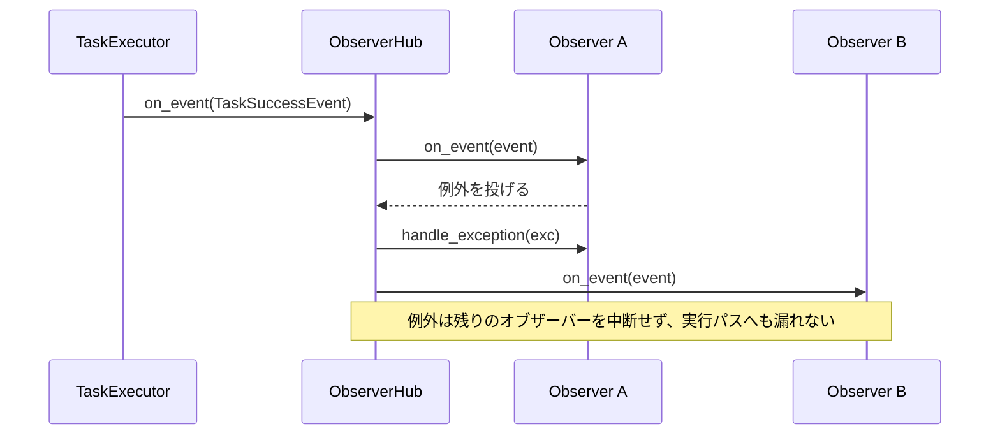

# tests/observer/test_observer.py

> 📅 最終更新日: 2026/11/13

## 役割

`celestialflow.observer` の統一イベントモデル（`Event` 基底クラス + `Observer.on_event(event)`）、オブザーバー配信センター `ObserverHub`（`find()` 探索を含む）、組み込みの `PrintObserver` と実行ノード / タスクグラフ（`TaskExecutor` / `TaskGraph` / `TaskChain`）の間の契約を検証します。タスク実行ライフサイクルにおける各種イベントがオブザーバーへ正しく届くこと、hub が単一オブザーバーの例外を隔離できること、グラフレベルのオブザーバーが全ノードのイベントとグラフ開始 / 終了イベントを受信できることを確認します。

## コアテスト対象

| クラス / オブジェクト | ソース | 説明 |
|-----------|------|------|
| `Event` | `celestialflow.observer` | すべての観測イベントの不変基底クラス（`__slots__ = ()`）で、それ自体は状態を持たない |
| `Observer` | `celestialflow.observer` | オブザーバー基底クラス。コールバックは `on_event(event)` と `handle_exception(exception)` の 2 つのみ；サブクラスは `on_event` 内で `match` によりイベント型ごとにディスパッチする |
| `ObserverHub` | `celestialflow.observer` | それ自体が `Observer` であり、登録順に `on_event` をブロードキャストする；`add_observer()`、`find(type)`、`handle_exception()` を提供；循環登録を拒否する |
| `PrintObserver` | `celestialflow`（`celestialflow.observer` からもエクスポート） | 組み込みの標準出力オブザーバー。構築引数は `name` で、`total` / `succeeded` / `failed` / `skipped` カウントを保持する |
| `MetricsObserver` | `celestialflow.observer` | 指標オブザーバー。テストは `metrics_of(executor)` 経由でノード指標を読み取る |
| `TaskExecutor` / `TaskGraph` / `TaskChain` | `celestialflow` | 実行ホスト。ライフサイクル中に `observers.on_event(...)` へイベントを送出する |
| イベント型 | `celestialflow.observer` | `NodeStartEvent` / `NodeEndEvent` / `TaskInputEvent` / `TaskSuccessEvent` / `TaskFailEvent` / `TaskSkipEvent` / `TaskRetryEvent` / `TerminationInputEvent` / `TerminationMergeEvent` / `GraphStartEvent` / `GraphEndEvent` |

## テスト補助オブジェクト

| オブジェクト | 説明 |
|------|------|
| `RecordingObserver` | `Observer` を継承し、`on_event()` を上書きして受信したすべてのイベントを `events` リストへ追加する。型でフィルタしてアサートするために使用 |
| `_only(events, event_type)` | イベントリストから指定型（`isinstance`）のイベントを抽出する |
| `CountObserver` / `SkipObserver` / `Counter` / `Tagged` など | ケース内で定義されるローカルオブザーバー。`match` で特定のイベント型のみを扱う |
| `RetryOnceThenSucceed` | 初回に `ValueError` を投げ、2 回目に `x + 1` を返すリトライ可能な関数オブジェクト |

## テストカバレッジマトリックス

### `TestExecutorObserver` — エグゼキュータのイベント

| ケース | カバレッジ目標 |
|------|---------|
| `test_observer_receives_full_lifecycle` | 直列実行 3 タスク：1 個の `NodeStartEvent`、3 個の `TaskInputEvent`、3 個の `TaskSuccessEvent`、1 個の `NodeEndEvent`；外部入力の `from_node is None`；`NodeEndEvent` が最後に受信されるイベント |
| `test_task_success_event_carries_payload_and_ids` | `TaskSuccessEvent` が `task` / `result` / `node` を保持し、`success_id > task_id` |
| `test_print_observer` | `PrintObserver("PrintObserverTest")` が `[PrintObserverTest] start` / `finish` を出力し、`total=3` / `succeeded=2` / `failed=1` |
| `test_observer_with_errors` | 3 タスク中 2 成功 1 失敗、`TaskSuccessEvent` / `TaskFailEvent` のカウントが正確 |
| `test_observer_receives_skip_callback` | `skip_func=lambda x: x == 0` のとき `TaskSkipEvent` を 1 個受信 |
| `test_no_observer_works` | オブザーバー未マウントでもエグゼキュータは正常動作し、`metrics_of(executor).get_node_metrics(name).succeeded == 3` |
| `test_multiple_observers` | 2 つのオブザーバーが同時に同じイベントを受信 |
| `test_task_input_reports_upstream_source` | タスクグラフで上流が配信したタスクが `TaskInputEvent` をトリガーし、その `node == "down"`、`from_node == "up"` |

### `TestExtendedObserver` — リトライと終了シグナル

| ケース | カバレッジ目標 |
|------|---------|
| `test_observer_receives_retry_and_termination_events` | `max_retries=1` + `set_retry_exceptions(ValueError)` の下で `TaskRetryEvent` 1 個（`retry_times == 1`）、`TerminationInputEvent` 1 個、`TerminationMergeEvent` 1 個を受信 |

### `TestObserverHub` — 配信と探索

| ケース | カバレッジ目標 |
|------|---------|
| `test_hub_explicitly_overrides_every_observer_method` | 転送ドリフトの防止：`Observer` のすべての `on_*` メソッド（現在は `on_event` のみ）が `ObserverHub` で明示的に定義されていなければならない |
| `test_hub_isolates_observer_exception` | あるオブザーバーが `TaskSuccessEvent` で `RuntimeError` を投げても、残りのオブザーバーはすべてのイベントを受信する；例外は `handle_exception` により stderr へ出力される |
| `test_hub_handle_exception_backstops_failing_observer_handler` | オブザーバーの `handle_exception` 自身がさらに例外を投げた場合、hub の `handle_exception` がフォールバックする；stderr に `observer boom` と `handler boom` が同時に現れ、配信は中断しない |
| `test_hub_rejects_cyclic_registration` | hub 自身の登録、および A→B の後に B→A とする循環登録を拒否し、いずれも `ConfigurationError` を送出 |
| `test_find_returns_direct_observer` | `find(RecordingObserver)` が本層に直接登録されたインスタンスにヒット |
| `test_find_returns_none_when_missing` | 一致する型がない場合 `find()` は `None` を返す |
| `test_find_recurses_into_nested_hub` | 一致項目がネストした hub にのみ存在する場合、`find()` は再帰的に探索してそのインスタンスを返す |
| `test_find_prefers_direct_registration_over_nested` | 本層に直接登録されたオブザーバーは、ネストした hub 内の同型インスタンスより優先される |
| `test_find_matches_subclass` | `find()` は `isinstance` でマッチするため、サブクラスのインスタンスもヒットする |
| `test_find_returns_first_registered_match` | 同層に複数の一致がある場合、最も先に登録されたインスタンスを返す |

### `TestGraphObserver` — グラフレベルオブザーバー

| ケース | カバレッジ目標 |
|------|---------|
| `test_graph_observer_receives_all_nodes` | グラフレベルオブザーバーが `up` / `down` 2 ノードの開始 / 終了イベントを受信；`TaskInputEvent` のうち `("up", None)` と `("down", "up")` が各 2 回；合計 4 個の `TaskSuccessEvent` |
| `test_node_local_observer_runs_before_graph_observer` | 同一ノード内で、ノードローカルのオブザーバーがグラフレベルオブザーバーより先にイベントを受信（順序 `["node", "graph"]`） |
| `test_graph_hub_is_injected_as_object` | 注入されるのは hub オブジェクト自体：`run` の後に登録したグラフレベルオブザーバーも有効；ケースは `node.observers.on_event(TaskSuccessEvent(...))` で手動トリガーして検証 |
| `test_run_async_injects_graph_observers` | `run_async` パスでも同様にグラフレベルオブザーバーの注入が完了する |
| `test_graph_observer_receives_graph_events` | `GraphStartEvent` 1 個と `GraphEndEvent` 1 個を受信；開始イベントは `graph` / `graph_mode` / `is_dag` / `nodes` / `edges` / `source_nodes` / `node_meta` を保持し、うち `node_meta["only"]["class_name"] == "TaskExecutor"` |
| `test_structure_supports_graph_observer` | 構造クラス `TaskChain` もグラフレベルオブザーバーをサポート |
| `test_graph_rejects_cycle_between_graph_and_node_hub` | node hub を graph hub へ登録すると、`graph.run()` の注入時に循環参照のため `ConfigurationError` が送出される |

## イベント配信と探索のフロー

```mermaid
flowchart LR
    Node[TaskExecutor] -->|on_event| NH[ノード ObserverHub]
    Graph[TaskGraph] -->|hub を注入| NH
    NH -->|直接登録| L[ノードローカルオブザーバー]
    NH -->|ネスト hub| GH[グラフレベル ObserverHub]
    GH --> G[グラフレベルオブザーバー]
    Q[hub.find(type)] -->|まず本層| NH
    NH -->|未ヒットなら再帰| GH
```



## テストの重点

- **統一エントリ**：すべてのイベントは `on_event(event)` 経由で配信され、オブザーバーは `match` で具体的なイベント型ごとに処理する。イベントごとのコールバックメソッドはもはや存在しない。
- **イベント順序**：`NodeStartEvent` が最初、`NodeEndEvent` が最後；ノードローカルのオブザーバーがグラフレベルオブザーバーより先。
- **ペイロードと ID**：成功イベントはタスク、結果、独立した `task_id` / `success_id`（増分）を保持。
- **原因追跡**：上流が配信したタスクは `TaskInputEvent.from_node` でソースノードを識別。
- **hub の例外隔離**：単一オブザーバーの例外（`handle_exception` 自身の例外を含む）は残りのオブザーバーに影響せず、配信も中断しない。
- **探索の意味論**：`find()` は本層優先、登録順、ネストした hub への再帰、`isinstance` マッチを使用。
- **循環防止**：オブザーバー hub は循環参照を形成する登録を拒否する。

## 実行方法

```bash
# すべて実行
pytest tests/observer/test_observer.py -v

# エグゼキュータオブザーバーテストのみ実行
pytest tests/observer/test_observer.py -k "Executor" -v

# ObserverHub テストのみ実行（find を含む）
pytest tests/observer/test_observer.py -k "Hub" -v

# グラフオブザーバーテストのみ実行
pytest tests/observer/test_observer.py -k "Graph" -v
```

## パフォーマンス参考

| テスト | 所要時間 |
|------|------|
| `TestExecutorObserver` | < 1.0s |
| `TestExtendedObserver` | < 0.5s |
| `TestObserverHub` | < 0.5s |
| `TestGraphObserver` | < 1.0s（グラフ構築と実行を含む） |

## 注意事項

- `test_print_observer` は `redirect_stdout(io.StringIO())` で標準出力をキャプチャし、`[PrintObserverTest] start` / `finish` が含まれることをアサートし、オブザーバーの `total` / `succeeded` / `failed` カウンタを読み取ります；`PrintObserver` は `skipped` カウントも保持します。
- `test_hub_isolates_observer_exception` と `test_hub_handle_exception_backstops_failing_observer_handler` は `redirect_stderr` で hub が転送したエラーのトレースバックをキャプチャします。
- ほとんどのエグゼキュータのケースは `execution_mode="serial"` を使用し、イベントを順序通りにアサートできるようにしています。
- オブザーバーパターンはフレームワークで監視、ログ、プログレスバーを実装する基盤です；`PrintObserver.__init__(name)` はノード名の指定を要求し、出力に `[name]` プレフィックスを付けるために使用します。
