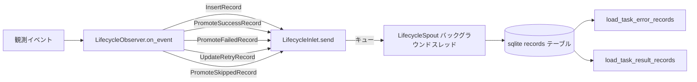

# tests/persist/test_lifecycle.py

> 📅 最終更新日: 2026/11/13

## 役割

`celestialflow.persist.core_lifecycle` の `LifecycleObserver` によるライフサイクル永続化能力を検証します。オブザーバーは `TaskInputEvent` / `TaskSuccessEvent` / `TaskFailEvent` / `TaskRetryEvent` / `TaskSkipEvent` を dataclass レコードへ変換し、`LifecycleInlet.send()` 経由でバックグラウンドの `LifecycleSpout` へ投入し、最終的に sqlite ファイルへ書き込みます。同時に task-error / task-result の読み戻し、リトライ回数の永続化、旧ライブラリの自動カラム追加も検証します。

## コアテスト対象

| クラス / オブジェクト | ソース | 説明 |
|-----------|------|------|
| `LifecycleObserver` | `celestialflow.persist.core_lifecycle` | オブザーバーファサード：内部で `LifecycleSpout` と `LifecycleInlet` を生成してバインドし、`start()` / `stop()` / `db_path` を提供する。`on_event(event)` 内でイベントをライフサイクルレコードへ変換する |
| `LifecycleRecord` | `celestialflow.persist.core_lifecycle` | レコードの共用型。メンバーは以下の 5 つの不変 dataclass |
| `InsertRecord` | `celestialflow.persist.core_lifecycle` | `TaskInputEvent` → `pending` レコードを 1 件書き込む（`event_id` / `ts` / `node` / `task`） |
| `PromoteSuccessRecord` | `celestialflow.persist.core_lifecycle` | pending を `success` へ昇格し結果を書き込む（元の `event_id` を保持） |
| `PromoteFailedRecord` | `celestialflow.persist.core_lifecycle` | pending を `failed` へ昇格し、`event_id` を失敗イベントの `error_id` に切り替え、エラータイプ / メッセージを書き込む |
| `PromoteSkippedRecord` | `celestialflow.persist.core_lifecycle` | pending を `skipped` へ昇格し、`event_id` をスキップイベントの `skip_id` に切り替える |
| `UpdateRetryRecord` | `celestialflow.persist.core_lifecycle` | pending レコードのリトライ回数と直近のエラー情報を更新する。状態は `pending` のまま |
| `LifecycleSpout` / `LifecycleInlet` | `celestialflow.persist.core_lifecycle` | バックグラウンド sqlite ライターとレコード入口；`LifecycleObserver` が内部で組み立てるため、テストから直接インスタンス化しない |
| `load_task_error_records` / `load_task_result_records` | `celestialflow.persist.util_sqlite` | ノード別に task-error / task-result ペアを読み取る |
| `connect_db` | `celestialflow.persist.util_sqlite` | 接続を確立し、テーブル構造のアップグレード（旧ライブラリへの `retry_times` カラム追加など）を担当 |
| イベント型 | `celestialflow.observer` | `TaskInputEvent` / `TaskSuccessEvent` / `TaskFailEvent` / `TaskRetryEvent` / `TaskSkipEvent` |

## レコードマッピング

| イベント | 生成されるレコード | 永続化の意味論 |
|------|-----------|---------|
| `TaskInputEvent` | `InsertRecord(event_id=event.input_id, ts, node, task)` | `status="pending"` の行を新規追加 |
| `TaskSuccessEvent` | `PromoteSuccessRecord(event_id=event.task_id, ts, result)` | `status="success"`、元の `event_id` を保持、エラーフィールドをクリアし `result_json` を書き込む |
| `TaskFailEvent` | `PromoteFailedRecord(event_id=event.task_id, error_id=event.error_id, ts, error_type, error_message)` | `status="failed"`、`event_id` を `error_id` に置き換える |
| `TaskRetryEvent` | `UpdateRetryRecord(event_id=event.task_id, ts, retry_times, error_type, error_message)` | `retry_times` / 直近のエラー / `ts` のみを更新し、状態は `pending` のまま |
| `TaskSkipEvent` | `PromoteSkippedRecord(event_id=event.task_id, skip_id=event.skip_id, ts)` | `status="skipped"`、`event_id` を `skip_id` に置き換え、エラーフィールドをクリア |

## テストカバレッジマトリックス

| テストクラス | ケース数 | カバレッジ目標 |
|--------|--------|---------|
| `TestLifecyclePersistence` | 5 | 完全なライフサイクル永続化、成功結果の永続化、リトライ回数の永続化、スキップの永続化、旧ライブラリへのカラム追加 |

## 主要テストシナリオ

### `test_lifecycle_persistence`

`TaskInputEvent` → `TaskFailEvent` と `TaskInputEvent` → `TaskSuccessEvent` の 2 つの連鎖（s1 / s2 の 2 つのノード）をカバーします。

- `LifecycleObserver.start()` を呼び出してバックグラウンド書き込みスレッドを起動し、`.sqlite3` ファイルを作成します。
- s1：入力（`input_id=1`）が pending として書き込まれ、続く失敗イベント（`task_id=1`、`error_id=21`）がレコードを failed へ昇格させます；最終的に永続化される `event_id` は 21 で、`("ValueError", "oops")` がバインドされます。
- s2：入力（`input_id=2`）の後の成功イベント（`task_id=2`、`success_id=3`）が success へ昇格させ、`event_id=2` を保持して結果 `"ok2"` を書き込みます。
- `finally` 内で `stop()` を呼び出し、トランザクションのコミットと接続のクローズを保証します。
- `db_path` が存在し、拡張子が `.sqlite3` であることをアサートします；`load_task_error_records(db_path, "s1")` が `[("data1", ("ValueError", "oops"))]` を返します。
- `records` テーブルを直接クエリして `id` でソートし、`event_id` の並びが `[21, 2]` であることを検証します（`node` / `status` / `error_type` / `error_message` / `task_json` / `result_json` をフィールドごとに照合）。さらに 2 件のレコードの `ts` がどちらも 0 より大きいことを確認します。

### `test_success_persistence`

- s1、s2 に対してそれぞれ入力 + 成功イベント（結果 100 / 200）を送信します。
- `load_task_result_records(db_path, "s1")` が `[("task1", 100)]` を返すことをアサートします。

### `test_retry_persistence`

- s1：入力 → 2 回の `TaskRetryEvent`（`retry_times` 1、2）→ 成功イベント；success へ昇格する際にエラー情報がクリアされ、`retry_times == 2` が保持されます。
- s2：入力 → 2 回の `TaskRetryEvent` → 失敗イベント；failed レコードは最新のエラー情報（`ValueError` / `final boom`）を保持し、`retry_times == 2` です。
- `records` テーブル内の `(event_id, status, retry_times)` が `[(1, "success", 2), (22, "failed", 2)]` であることをアサートします；成功レコードのエラーフィールドは空で、失敗レコードの `result_json` は `null` です。

### `test_skip_persistence`

- s1：入力（`input_id=1`）+ スキップイベント（`task_id=1`、`skip_id=31`）で、レコードは `skipped` へ昇格し `event_id` が 31 に切り替わります。
- s2：入力 + 成功イベントを対照として実行します。
- `[(event_id, status)]` が `[(31, "skipped"), (2, "success")]` であることをアサートします；スキップレコードのエラーフィールドは空で、`result_json` は `null` です。

### `test_old_db_gets_retry_times_column`

- `retry_times` カラムを含まない `records` テーブルを手動で作成します。
- `connect_db(db_path)` を呼び出した後、`PRAGMA table_info(records)` を通じて `retry_times` カラムが自動補完されたことをアサートします。

## データフロー



## 実行方法

```bash
# すべて実行
pytest tests/persist/test_lifecycle.py -v

# キーワードでマッチ
pytest tests/persist/test_lifecycle.py -k "lifecycle" -v
pytest tests/persist/test_lifecycle.py -k "success" -v
pytest tests/persist/test_lifecycle.py -k "retry" -v
pytest tests/persist/test_lifecycle.py -k "skip" -v
```

## 注意事項

- テストは `monkeypatch.chdir(tmp_path)` で作業ディレクトリを一時ディレクトリに切り替えるため、sqlite ファイルは一時ディレクトリ下の `lifecycles/<日付>/` に書き込まれ、テスト終了後に自動でクリーンアップされます。
- 各ケースはオブザーバーを明示的に `start()` / `stop()` します；`stop()` は残りのトランザクションをコミットし、sqlite 接続を閉じます。
- 失敗 / スキップレコードの永続化 `event_id` は、最終状態イベントが保持するイベント ID（`error_id` / `skip_id`）に置き換えられ、後続のエラークエリ / プッシュのセマンティクスとの一貫性が保たれます。
- `LifecycleInlet` / `LifecycleSpout` は `LifecycleObserver` が内部で対にして生成するため、テストはキューを直接触らず、投入はすべて `LifecycleInlet.send(record)` 経由で行います。
- 関連実装は `src/celestialflow/persist/core_lifecycle.py` にあります。
