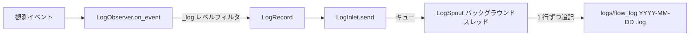

# tests/persist/test_log.py

> 📅 最終更新日: 2026/11/13

## 役割

`celestialflow.persist.core_log` の `LogObserver` によるログ永続化能力を検証します。オブザーバーはグラフ / ノード / タスク / 終了シグナルの各イベントを `LogRecord` へ変換し、`LogInlet.send()` 経由でバックグラウンドの `LogSpout` へ投入して非同期にログファイルへ書き込みます。テストは同時にログレベルのフィルタリングと `[task_id->event_id*]` イベント ID マーカーも検証します。

## コアテスト対象

| クラス / オブジェクト | ソース | 説明 |
|-----------|------|------|
| `LogObserver` | `celestialflow.persist.core_log` | オブザーバーファサード：構築引数は `metrics_view` と `log_level` で、内部で `LogSpout` / `LogInlet` を生成してバインドし、`start()` / `stop()` / `log_path` を提供する。`on_event(event)` 内でイベント型に応じてログを記録する |
| `LogRecord` | `celestialflow.persist.core_log` | 不変 dataclass：`timestamp` / `level` / `message` |
| `LogInlet` | `celestialflow.persist.core_log` | レコード入口。`send(record)` のみを提供し、レコードをバインドされた spout のキューへ入れる |
| `LogSpout` | `celestialflow.persist.core_log` | バックグラウンドスレッドがキューを消費し、レコードを `"{timestamp} {level} {message}"` として 1 行ずつログファイルへ書き込む；パスは `log_path` から取得する |
| `MetricsObserver` | `celestialflow.observer` | `MetricsView` として渡され、`LogObserver` がノード開始 / 終了時にタスク数統計を読み取るために使用する |
| イベント型 | `celestialflow.observer` | `GraphStartEvent` / `TaskRetryEvent` / `GraphEndEvent` / `NodeStartEvent` / `TaskSkipEvent` |

## イベントとログレベル

| イベント | レベル | 主要な内容 |
|------|:----:|---------|
| `GraphStartEvent` | `INFO` | グラフ名、`graph_mode`、および `render_structure_list()` で展開した構造行 |
| `GraphEndEvent` | `INFO` | グラフ名と所要時間 |
| `NodeStartEvent` | `INFO` | ノード名、`metrics_view` から読み取った `input_total`、`execution_mode-max_workers` |
| `NodeEndEvent` | `INFO` | ノード名、実行モード、所要時間、成功 / 失敗 / スキップ数 |
| `TaskInputEvent` | `DEBUG` | タスク表現、ソース（`from_node` または `external`）、`[input_id*]` |
| `TaskSuccessEvent` | `SUCCESS` | タスク表現、結果、所要時間、`[task_id->success_id*]` |
| `TaskFailEvent` | `ERROR` | 例外型とメッセージ、`[task_id->error_id*]` |
| `TaskSkipEvent` | `SUCCESS` | タスク表現、`[task_id->skip_id*]` |
| `TaskRetryEvent` | `WARNING` | リトライ回数、例外型、`[task_id*]` |
| `TerminationInputEvent` | `DEBUG` | `[termination_id*]` |
| `TerminationMergeEvent` | `TRACE` | `[parent_ids->termination_id*]` |

> `LogObserver` は `log_level` を下回るイベントログを破棄します；`log_level` は構築時に `upper()` して検証され、不正な値は `InvalidOptionError` を送出します。デフォルト値は `celestialflow.runtime.util_log_level.DEFAULT_LOG_LEVEL`（現在は `"INFO"`）に由来します。

## テストカバレッジマトリックス

| テストクラス | ケース数 | カバレッジ目標 |
|--------|--------|---------|
| `TestLogPersistence` | 2 | 完全なログライフサイクル、スキップログ |

## 主要テストシナリオ

### `test_log_persistence`

- `LogObserver(MetricsObserver(), log_level='INFO')` を構築し、`start()` を呼び出してバックグラウンド書き込みスレッドを起動します。
- 順に `GraphStartEvent`（グラフ名 / モード / 構造リスト / ノードメタ情報）、`TaskRetryEvent`（`ValueError` を保持）、`GraphEndEvent`、`NodeStartEvent` を送信します。
- `wait_until` でポーリングし、ログファイルが存在し、かつ構造行 `| node |` とタスク表現 `hello world` の両方を含むまで待機します。
- `finally` で `stop()`；最終的にログファイルに `INFO` と `WARNING` の両方のレベルマーカーが存在することをアサートします。

### `test_skip_log`

- `LogObserver(MetricsObserver(), log_level='SUCCESS')` を構築します。
- `TaskSkipEvent("node", "hello world", "hello world", 7, 8)` を送信します。
- `wait_until` でログファイルが `hello world` を含むまで待機します。
- ログに `hello world`、`skipped`、`[7->8*]`、`SUCCESS` レベルマーカーが含まれることをアサートします。

## データフロー



## 実行方法

```bash
pytest tests/persist/test_log.py -v
pytest tests/persist/test_log.py -k "log_persistence" -v
pytest tests/persist/test_log.py -k "skip" -v
```

## 注意事項

- テストは `monkeypatch.chdir(tmp_path)` で作業ディレクトリを切り替えるため、ログは一時ディレクトリ下の `logs/flow_log(<日付>).log` に書き込まれます。
- ログファイルのパスは `LogObserver.log_path` プロパティ（`LogSpout.log_path` へ転送）から取得します；spout が未起動のときは `None` です。
- `LogInlet` は `BaseInlet` を継承するのみで `send(record)` を公開し、イベントはキュー経由で非同期にファイルへ書き込まれます。テストは `wait_until` でスレッドのタイミング揺らぎを回避します。
- 両方のケースとも `log_level` を明示的に渡しており、デフォルト値の分岐はカバーしていません。
- 関連実装は `src/celestialflow/persist/core_log.py` にあります。
