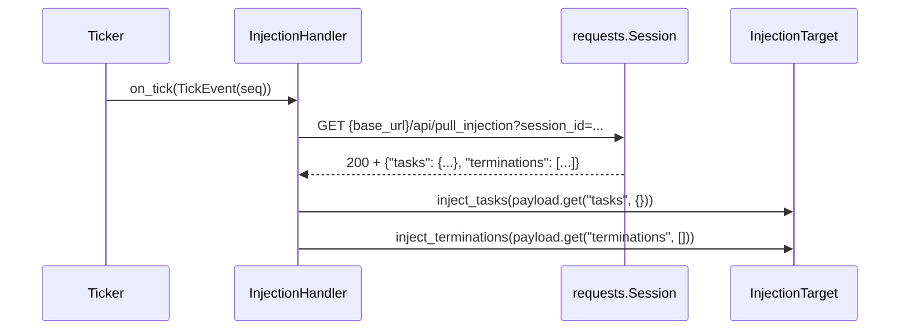

# tests/reporter/test_inject.py

> 📅 最終更新日: 2026/11/13

## 役割

`celestialflow.reporter.InjectionHandler` のリモート注入取得挙動を検証します。拍ごとに `/api/pull_injection` を GET し、返却されたタスクマッピングと終了シグナルのシーケンスを順に `InjectionTarget` へ渡します。取得失敗、注入失敗、拍スケーリングの 3 つの経路をカバーします。

## コアテスト対象

| オブジェクト | ソース | 説明 |
|------|------|------|
| `InjectionHandler` | `celestialflow.reporter` | 拍ハンドラ。`tick_period = 5` |
| `InjectionTarget` | `celestialflow.reporter` | プロトコル：`inject_tasks(Mapping[str, Iterable[Any]])` + `inject_terminations(Sequence[str])` |
| `TickEvent` | `celestialflow.ticker` | テストが直接構築し、実際のティッカーに依存しない |
| `ReporterError` | `celestialflow.runtime.util_errors` | 取得が 2xx 以外を返した際の想定例外 |

## 主要 fixture とフェイクオブジェクト

| 名前 | 用途 |
|------|------|
| `FakeResponse` | 成功レスポンスを模擬：`ok = True`、`status_code = 200`、`json()` は事前設定したペイロードを返す |
| `FakeFailResponse` | 失敗レスポンスを模擬：`ok = False`、`status_code = 500`、`json()` は `{}` を返す（呼ばれてはならない） |
| `FakeSession` | `requests.Session` の代替。`(url, params, timeout)` のタプルを `gets` に記録し、構築時に渡されたレスポンスを返す |
| `FakeTarget` | `InjectionTarget` の代替。注入された `tasks` / `terminations` を毎回リストへ追加し、「何回注入されたか、内容は何か」をアサートしやすくする |
| `make_event(seq)` | `seq` を指定し、他の時刻フィールドを `0.0` に固定した `TickEvent` を構築する |
| `RaisingTarget`（ケース内のローカルクラス） | `FakeTarget` を継承し、`inject_tasks` が `RuntimeError("unknown node")` を送出する |

## テストカバレッジマトリックス

| ケース | カバレッジ目標 |
|------|---------|
| `test_injection_handler_pulls_and_injects` | 取得 URL、クエリパラメータ、タスクと終了シグナルの注入順序 |
| `test_injection_handler_raises_on_pull_failure` | 2xx 以外で `ReporterError` を送出し、いかなる注入も実行しない |
| `test_injection_handler_propagates_inject_failure` | タスク注入の例外が上位へ伝播し、終了シグナルの注入は実行されない |
| `test_injection_handler_tick_period_is_five` | `tick_period == 5`、ヒットする拍が `1, 6, 11, ...` |

## 主要な挙動の詳細

### 1 回の成功した取得



- **URL**：`f"{base_url}/api/pull_injection"`。
- **クエリパラメータ**：`{"session_id": session_id}` のみ；テストは `params["session_id"] == "g1"` をアサートします。
- **タイムアウト**：モジュール定数 `_PULL_TIMEOUT = 3.0`。`FakeSession.get` はこれを 3 番目の要素として記録します（テストは `_timeout` で受け取るだけで、具体値はアサートしません）。
- **注入順序**：先に `inject_tasks`、後に `inject_terminations`。`tasks` の注入が例外を送出した場合、`terminations` は実行されません。`test_injection_handler_propagates_inject_failure` は `target.terminations == []` でこれを証明し、同時に `pytest.raises(RuntimeError, match="unknown node")` で元の例外がラップされていないことを確認します。
- **デフォルトキー**：ペイロードにキーがない場合は `.get("tasks", {})` と `.get("terminations", [])` のデフォルト空値を使用します（本ファイルでは直接カバーしていませんが、被テスト実装の契約です）。

### 取得失敗

- `FakeFailResponse.ok is False` のとき、ハンドラは `json()` を呼ぶ前に `ReporterError("Failed to pull task injection: 500")` を送出します。
- テストは `target.tasks == []` かつ `target.terminations == []` をアサートします。つまり失敗経路では中途半端な注入が発生しません。
- 例外は最終的にティッカーのハンドラ例外隔離機構（`TickHandler.handle_exception`）に消費され、後続の拍には影響しません；テストはハンドラ自体が送出することのみを検証します。

### 拍のスケーリング

`InjectionHandler.tick_period = 5` で、基底クラスの `should_tick` は `(event.seq - 1) % tick_period == 0` を使用します：

| seq | 1 | 2 | 3 | 4 | 5 | 6 | 7 | 8 | 9 | 10 | 11 |
|-----|---|---|---|---|---|---|---|---|---|----|----|
| ヒット | ✅ | ❌ | ❌ | ❌ | ❌ | ✅ | ❌ | ❌ | ❌ | ❌ | ✅ |

`Ticker` の 1 秒基準周期で実行する場合、5 秒ごとに 1 回取得するのに相当します。テストは `range(1, 12)` を直接走査して `should_tick(make_event(seq))` を呼び出し、ティッカーを起動しません。

## 実行方法

```bash
# すべて実行
uv run pytest tests/reporter/test_inject.py -v

# 失敗経路のみ
uv run pytest tests/reporter/test_inject.py -k "failure or propagates" -v
```

## 注意事項

- すべてのネットワーク相互作用は `FakeSession` に置き換えられ、実際の HTTP リクエストは発生しません。単一ファイルの実行は 1 秒を大きく下回るはずです。
- `InjectionHandler` は `requests.Session` の所有権を持たず、クローズは呼び出し側（`run_graph_resources`）が担当します；テスト内のフェイクセッションはクローズ不要です。
- `FakeTarget` は注入のたびに完全なオブジェクトを記録するため、`target.tasks == [{"StageA": [1, 2]}]` は「1 回だけ注入された」ことと「ペイロードがそのまま渡された」ことを同時に検証します。
- 関連実装は `src/celestialflow/reporter/core_inject.py`、意味論の説明は `docs/zh-CN/src/reporter/core_inject.md` を参照してください。
