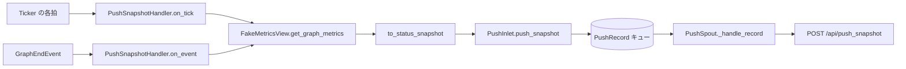

# tests/reporter/test_snapshot.py

> 📅 最終更新日: 2026/11/13

## 役割

レポートモジュールの状態スナップショット経路を検証します：

- `to_status_snapshot()` が `NodeMetrics` をマッピングしてプッシュペイロードへ投影する；
- `PushSnapshotHandler.on_tick()` が拍ごとにグラフ全体の指標を読み取り、`kind="snapshot"` のレコードを `PushInlet` へ渡す；
- `PushSnapshotHandler.on_event(GraphEndEvent)` がグラフ終了時に終状態スナップショットを 1 回追加プッシュする；
- スナップショットレコードが `PushSpout` 経由で `/api/push_snapshot` へプッシュされる。

## コアテスト対象

| オブジェクト | ソース | 説明 |
|------|------|------|
| `to_status_snapshot(metrics)` | `celestialflow.reporter.core_snapshot` | ノード指標 → 状態辞書の純粋な投影関数 |
| `PushSnapshotHandler` | `celestialflow.reporter` | `TickHandler` と `Observer` の両方を兼ねる |
| `PushInlet` / `PushSpout` / `PushRecord` | `celestialflow.reporter.core_push` | スナップショットのエンキューとプッシュ |
| `GraphEndEvent` | `celestialflow.observer` | 終状態の追加プッシュをトリガーするイベント |
| `NodeMetrics` / `NodeStatus` | `celestialflow.runtime.util_types` | 指標スナップショットとノード状態の列挙 |
| `TickEvent` | `celestialflow.ticker` | 直接構築し、ティッカーを起動しない |

## 主要 fixture とフェイクオブジェクト

| 名前 | 用途 |
|------|------|
| `FakeMetricsView` | `get_node_metrics()` / `get_graph_metrics()` を実装した読み取り専用ビューの代替；`graph_calls` が `get_graph_metrics()` の呼び出し回数を記録する |
| `FakePushSession` | POST を記録する `requests.Session` の代替。`post()` は固定の成功レスポンスを返す |
| `make_metrics(node, *, succeeded=0)` | `NodeStatus.RUNNING` の `NodeMetrics` を構築：`start_time=1.0`、`end_time=0.0` で、`external_input` / `input_total` / `succeeded` / `processed` はすべて `succeeded` |
| `make_event(seq)` | 時刻フィールドを固定した `TickEvent` を構築する |

## テストカバレッジマトリックス

| ケース | カバレッジ目標 |
|------|---------|
| `test_to_status_snapshot_projects_node_metrics` | 投影出力のキー集合とフィールドマッピング |
| `test_handler_enqueues_snapshot_record` | `on_tick` が `kind="snapshot"` のレコードを 1 件エンキューし、グラフ全体の指標を 1 回だけ読み取る |
| `test_handler_pushes_final_snapshot_on_graph_end` | `GraphEndEvent` が終状態スナップショットの追加プッシュを 1 回トリガーする |
| `test_spout_pushes_snapshot_to_push_snapshot_endpoint` | `POST /api/push_snapshot` の URL とペイロード（`session_id` / `snapshot` / `timestamp`） |

## 主要な挙動の詳細

### 投影フィールド

`to_status_snapshot` は各ノードについて以下のキーを出力します：

| 出力キー | 由来する `NodeMetrics` フィールド |
|--------|------------------------|
| `start_time` | `start_time` |
| `end_time` | `end_time` |
| `status` | `status`（`NodeStatus` 列挙。テストは `NodeStatus.RUNNING` を直接比較） |
| `tasks_input` | `input_total` |
| `tasks_succeeded` | `succeeded` |
| `tasks_failed` | `failed` |
| `tasks_skipped` | `skipped` |
| `tasks_processed` | `processed` |
| `tasks_pending` | `pending` |
| `upstream_counts` | `upstream_counts` |
| `downstream_counts` | `downstream_counts` |

テストはこのうち `start_time` / `end_time` / `status` / `tasks_input` / `tasks_succeeded` / `upstream_counts` / `downstream_counts` のみをアサートし、残りのフィールドは同一の辞書内包表記で保証されます。

### 2 つのトリガー経路



- **拍の経路**：`on_tick` → `_push_snapshot()` → `to_status_snapshot(get_graph_metrics())` → `PushInlet.push_snapshot()`。テストは `record.kind == "snapshot"`、`record.snapshot["s1"]["tasks_succeeded"] == 2`、`view.graph_calls == 1` をアサートします。
- **グラフ終了の経路**：`on_event` は `match` で `GraphEndEvent` のみを処理し、その他のイベントは無視します。テストは `GraphEndEvent(graph="g1", end_time=2.0, elapsed=1.0)` を構築した後、即座にスナップショットが 1 件エンキューされ、`graph_calls == 1` であることをアサートします。
- 追加プッシュの意義：スナップショットは拍でのみ生成されますが、グラフの終了処理では先に ticker が停止するため、最終拍とグラフ終了の間の終状態（ノードがすべて `STOPPED`、最終カウント）はどの拍にも捕捉されません。`PushSnapshotHandler` は投影とエンキューのみを行い、ネットワーク IO は行いません。

### プッシュペイロード

- エンドポイント：`{base_url}/api/push_snapshot`。
- ペイロード：`{"session_id": ..., "snapshot": {...}, "timestamp": time.time()}`。
- テストは `inlet.push_snapshot({"s1": {"status": 1}})` で直接エンキューし、続いて `spout._handle_record(spout.get_queue().get())` を呼び、`payload["snapshot"] == {"s1": {"status": 1}}` かつ `payload["timestamp"] > 0` をアサートします。

## 実行方法

```bash
# すべて実行
uv run pytest tests/reporter/test_snapshot.py -v

# 投影関数のみ
uv run pytest tests/reporter/test_snapshot.py -k "status_snapshot" -v

# ハンドラのみ
uv run pytest tests/reporter/test_snapshot.py -k "handler" -v

# エンドポイントへのプッシュのみ
uv run pytest tests/reporter/test_snapshot.py -k "endpoint" -v
```

## 注意事項

- テストは `Ticker` を起動せず、`on_tick` / `on_event` を直接呼び出すため、タイミングの揺らぎはありません。
- `FakeMetricsView.graph_calls` は、1 回のトリガーでグラフ全体の指標を 1 回だけ読み取ることを確認するために使用します。これにより、ハンドラ内部でスナップショットが重複してペイロードが不整合になったり、余分なオーバーヘッドが発生したりするのを防ぎます。
- ハンドラの構築引数は `(metrics_view, inlet)` で、`inlet` はすでに `bind_spout` 済みでなければなりません；テストは `PushInlet().bind_spout(spout)` でバインディングを確立します。
- `spout._session` に直接フェイクセッションを代入して `start()` を迂回します。`test_push.py` と同じ手法です。
- 関連実装は `src/celestialflow/reporter/core_snapshot.py`、意味論の説明は `docs/zh-CN/src/reporter/core_snapshot.md` を参照してください。
