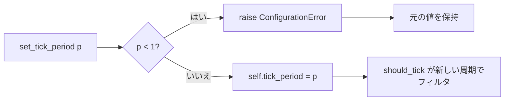

# tests/ticker/test_handler.py

> 📅 最終更新日: 2026/11/13

## 役割

`celestialflow.ticker.TickHandler` の拍フィルタの基本セマンティクスを検証します：デフォルトの `tick_period`、実行時に変更した後の `should_tick()` の挙動、位相の再アンカー、および非正の周期に対するパラメータ検証です。

## コアテスト対象

| オブジェクト | ソース | 説明 |
|------|------|------|
| `TickHandler` | `celestialflow.ticker` | 拍ハンドラの基底クラス。`tick_period: int = 1` |
| `TickHandler.should_tick(event)` | 同上 | ヒット条件は `(event.seq - 1) % tick_period == 0` |
| `TickHandler.set_tick_period(period)` | 同上 | 実行時に周期を変更する。不正な値は `ConfigurationError` を送出 |
| `TickEvent` | `celestialflow.ticker` | フィルタには `seq` のみが関与する；テストでは他の時刻フィールドを固定値で埋める |
| `ConfigurationError` | `celestialflow.runtime.util_errors` | 非正の周期に対する想定例外 |

## 主要 fixture と補助関数

| 名前 | 用途 |
|------|------|
| `make_event(seq)` | `seq` を指定し、`interval=1.0`、`scheduled_at=fired_at=wall_time=float(seq)`、`drift=0.0`、`skipped=0` のイベントを構築する |
| `BareHandler` | `on_tick` のみを実装する最小のサブクラス。`tick_period` を上書きせず、デフォルト値と実行時の調整を観察するために使用 |
| `hit_seqs(handler, upto)` | `1..upto` の各拍について `handler.should_tick(make_event(seq))` を呼び出し、ヒットした番号のリストを返す |

> テストは `Ticker` を起動せず、`TickHub` にも依存せず、基底クラスのメソッドを直接呼び出すだけなので、完全に同期的でタイミングの揺らぎがありません。

## テストカバレッジマトリックス

| ケース | カバレッジ目標 |
|------|---------|
| `test_handler_default_tick_period_is_one` | デフォルト `tick_period == 1`、1〜5 拍のすべてがヒット |
| `test_set_tick_period_takes_effect_on_should_tick` | `set_tick_period(2)` → `1,3,5,7` がヒット；さらに 3 に設定 → `1,4,7` がヒット |
| `test_set_tick_period_rejects_non_positive` | `set_tick_period(0)` が `ConfigurationError` を送出し、元の値 `3` が保持される |

## 主要な挙動の詳細

### フィルタ式と位相

`should_tick` は `seq - 1` を基準に剰余を取るため、**第 1 拍は任意の正当な周期でヒットします**。周期を変更しても「現在の拍」から数え直すのではなく、`seq == 1` へ再アンカーされます：

| 周期 | ヒットする番号（1 始まり） |
|:----:|------------------|
| 1 | 1, 2, 3, 4, 5, 6, 7 |
| 2 | 1, 3, 5, 7 |
| 3 | 1, 4, 7 |

テストはまず `set_tick_period(2)` で `[1, 3, 5, 7]` を検証し、次に `set_tick_period(3)` で `[1, 4, 7]` を検証します。2 回目の調整は `seq` が進んでいない同一オブジェクトで行われるため、結果は依然として `seq == 1` を基準にアンカーされ、位相が `seq` のみで決まり呼び出しタイミングに依存しないことが分かります。

### パラメータ検証

`set_tick_period(0)` は代入前に `< 1` をチェックし、`ConfigurationError("tick_period must be a positive integer, got 0")` を送出します。テストはまず 3 に設定し、次に例外をトリガーし、最後に `handler.tick_period == 3` をアサートして、失敗した呼び出しが元の状態を汚染しないことを証明します。



## 実行方法

```bash
# すべて実行
uv run pytest tests/ticker/test_handler.py -v

# デフォルト値のみ
uv run pytest tests/ticker/test_handler.py -k "default" -v

# 実行時の調整のみ
uv run pytest tests/ticker/test_handler.py -k "set_tick_period" -v
```

## 注意事項

- これらのケースの実行時間はミリ秒単位で、バックグラウンドスレッドを待つ必要はありません。
- `BareHandler.on_tick` は空実装で、`should_tick` は基底クラスが提供します；将来基底クラスがフィルタ式を変更した場合（例えば `seq % period` に変更）、本ファイルのヒット数列のアサートは即座に失敗します。
- `TickHandler.handle_exception` のデフォルト挙動（トレースバックの出力）は本ファイルのカバレッジ範囲外です。関連ケースは `test_hub.md` と `test_ticker.md` を参照してください。
- 関連実装は `src/celestialflow/ticker/core_handler.py`、意味論の説明は `docs/zh-CN/src/ticker/core_handler.md` を参照してください。
