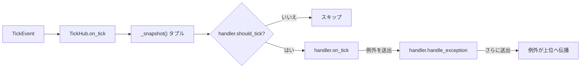

# tests/ticker/test_hub.py

> 📅 最終更新日: 2026/11/13

## 役割

`celestialflow.ticker.TickHub` の配信と管理のセマンティクスを検証します：

- 同じ拍を登録済みのすべてのハンドラへファンアウトする；
- 各ハンドラが自身の `tick_period` に従って独立にフィルタする；
- 実行時の `set_tick_period` が直ちに後続の配信へ影響する；
- 自身の登録、循環参照を形成する hub、不正な `tick_period` を拒否する；
- 単一ハンドラのコールバックが例外を投げた場合、そのハンドラ自身の `handle_exception` へ隔離し、他のハンドラを阻害しない。

## コアテスト対象

| オブジェクト | ソース | 説明 |
|------|------|------|
| `TickHub` | `celestialflow.ticker` | それ自体が `TickHandler` であり、ハンドラのタプルを保持してコピーオンライトで更新する |
| `TickHub.add_handler(handler)` | 同上 | `tick_period` を検証し、循環参照を検出した後に追加する |
| `TickHub.on_tick(event)` | 同上 | スナップショットを走査し、フィルタ後に 1 つずつ `on_tick` を呼び出し、例外はそのハンドラの `handle_exception` へ渡す |
| `TickHandler` | `celestialflow.ticker` | ハンドラの基底クラス |
| `ConfigurationError` | `celestialflow.runtime.util_errors` | 不正なハンドラを登録した際の想定例外 |

## 主要 fixture とフェイクオブジェクト

| 名前 | 用途 |
|------|------|
| `make_event(seq)` | `seq` を指定し、他の時刻フィールドを `float(seq)` にした `TickEvent` を構築する |
| `RecordingHandler(tick_period=1)` | `__init__` 内で `self.tick_period` を直接代入し（`set_tick_period` を経由しない）、ヒットした `event.seq` を `seqs` へ追加する |
| `FailingHandler`（ケース内のローカルクラス） | `on_tick` が `RuntimeError("boom")` を投げ、`handle_exception` を上書きして例外を `errors` へ収集する |

## テストカバレッジマトリックス

| ケース | カバレッジ目標 |
|------|---------|
| `test_hub_fans_out_to_all_handlers` | 2 つのハンドラを登録し、単一の拍で両方が `seq == 1` を受信する |
| `test_hub_filters_by_tick_period` | 周期 1 と周期 2 のハンドラがそれぞれ `[1,2,3,4,5]` と `[1,3,5]` にヒットする |
| `test_hub_picks_up_runtime_tick_period_change` | 実行中に周期 3 へ変更すると、以降は `4, 7` のみヒットし、累計は `[1,2,3,4,7]` になる |
| `test_hub_rejects_self_registration` | `hub.add_handler(hub)` が `ConfigurationError` を送出する |
| `test_hub_rejects_cycle_registration` | `a.add_handler(b)` の後に `b.add_handler(a)` が `ConfigurationError` を送出する |
| `test_hub_rejects_invalid_tick_period` | `tick_period=0` のハンドラを登録すると `ConfigurationError` を送出する |
| `test_hub_isolates_handler_exceptions` | 失敗ハンドラの例外は自身で収集され、後続のハンドラもその拍を受信する |

## 主要な挙動の詳細

### 配信とフィルタ

`TickHub.on_tick` は `_snapshot()`（現在のハンドラタプルの参照）を走査し、各ハンドラについてまず `should_tick(event)` を呼び、ヒットした場合のみ `on_tick(event)` を呼び出します。したがって hub 自身がカウントを持つ必要はなく、周期のセマンティクスは完全に `TickHandler` が提供します。

`test_hub_filters_by_tick_period` は `seq = 1..5` を連続して投函します：

| ハンドラ | `tick_period` | ヒット列 |
|--------|:-------------:|----------|
| `every` | 1 | 1, 2, 3, 4, 5 |
| `every_other` | 2 | 1, 3, 5 |

### 実行時の調整

まず周期 1 で `1..3` を投函し、ハンドラは `[1,2,3]` を記録します；その後 `handler.set_tick_period(3)` を呼び、`4..9` を投函します。フィルタ式は `(seq - 1) % 3 == 0` なので、ヒットするのは `4` と `7` で、最終的に `seqs == [1, 2, 3, 4, 7]` になります。



### 登録の検証

- **不正な周期**：`add_handler` はまず `validate_tick_period(handler)` を呼び、`tick_period < 1` なら直接 `ConfigurationError` を送出します。
- **自身の登録**：`handler is self` のとき `ConfigurationError("cannot register a TickHub into itself")` を送出します。
- **循環参照**：登録対象が `TickHub` の場合のみ深さ優先で走査します。`test_hub_rejects_cycle_registration` はまず `a → b` を確立し、次に `b → a` を試みます；このとき登録対象の `a` からその子孫（`b` を含む）を走査し、`self`（すなわち `b`）がすでに連鎖内にあることを見つけて `b → a` が循環になると判断し、循環エラーを送出します。走査は `seen` 集合で重複訪問を避けます。
- テストは直接の循環（長さ 2）のみをカバーし、間接的な循環は同じ走査ロジックで保証されます。

### 例外の隔離

`test_hub_isolates_handler_exceptions` は `FailingHandler` と `RecordingHandler` を登録して 1 拍を投函します：

- `FailingHandler.on_tick` が `RuntimeError("boom")` を投げる；
- hub が捕捉して `failing.handle_exception(e)` を呼び、例外が `failing.errors` へ追加される；
- ループは継続し、`ok.seqs == [1]` になる。

`handle_exception` 自身がさらに例外を投げた場合、hub はもはや捕捉せず、例外は駆動元の `Ticker` へ上位伝播します（`test_ticker.md` のフォールバックケースを参照）。

## 実行方法

```bash
# すべて実行
uv run pytest tests/ticker/test_hub.py -v

# 配信とフィルタのみ
uv run pytest tests/ticker/test_hub.py -k "fans_out or filters or runtime" -v

# 登録の検証のみ
uv run pytest tests/ticker/test_hub.py -k "rejects" -v

# 例外の隔離のみ
uv run pytest tests/ticker/test_hub.py -k "isolates" -v
```

## 注意事項

- すべてのケースは `hub.on_tick(...)` を直接呼び出し、バックグラウンドスレッドを起動しないため、実行時間はミリ秒単位です。
- `RecordingHandler` は `__init__` 内で `self.tick_period` を直接書き込み、`set_tick_period` の検証を迂回します；そのため `tick_period=0` を構築でき、`add_handler` の登録時検証を確認するために使用されます。
- コピーオンライト設計は本ファイルで並行安全性を直接アサートしておらず、登録 / 配信の挙動を通じて間接的にのみカバーしています。
- 関連実装は `src/celestialflow/ticker/core_hub.py`、意味論の説明は `docs/zh-CN/src/ticker/core_hub.md` を参照してください。
