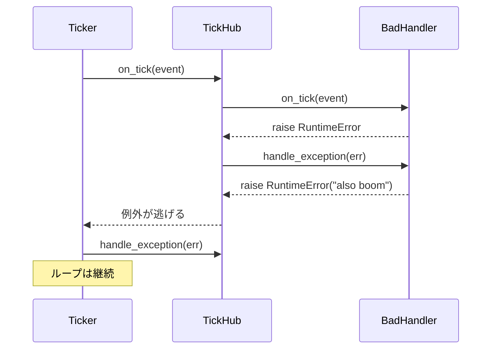

# tests/ticker/test_ticker.py

> 📅 最終更新日: 2026/11/13

## 役割

`celestialflow.ticker.Ticker` のエンドツーエンドの時間駆動挙動を検証します：周期トリガーと停止、`tick_period` のスケーリング、実行時の速度変更、タイムアウトによる拍のスキップ、ハンドラ例外の隔離、`TickHub` をルートとした場合のフォールバック、および非正の周期の検証です。

> 本ファイルは ticker 領域で唯一、実際のバックグラウンドスレッドと実時間を使用するテストですが、すべての周期は `0.01~0.05` 秒のオーダーで、`wait_until` / `assert_stays_true` により明確なタイムアウトを設定しているため、全体は数秒以内に完了するはずです。

## コアテスト対象

| オブジェクト | ソース | 説明 |
|------|------|------|
| `Ticker(interval, handler, *, name="ticker")` | `celestialflow.ticker` | `time.monotonic()` に基づいて予定時刻をアンカーするバックグラウンドティッカー |
| `Ticker.start()` / `stop()` / `is_running()` | 同上 | ライフサイクル制御。最初の拍は 1 周期後にトリガーされる |
| `Ticker.get_interval()` / `set_interval(v)` | 同上 | 速度変更。`set_interval` は待機を起床させて再アンカーする |
| `TickHandler` / `TickHub` / `TickEvent` | `celestialflow.ticker` | ハンドラ、配信センター、拍イベント |
| `ConfigurationError` | `celestialflow.runtime.util_errors` | 非正の周期に対する想定例外 |

## 主要 fixture とフェイクオブジェクト

| 名前 | 用途 |
|------|------|
| `wait_until(cond, *, timeout=5.0, ...)` | `tests/conftest.py` 由来。バックグラウンドスレッドが期待するイベントを生成するまでポーリングし、失敗時は `pytest.fail` |
| `assert_stays_true(cond, *, duration=0.3, ...)` | 一定時間にわたり条件が成立し続けることを検証し、「停止後はもうトリガーされない」ことを確認するために使用 |
| `RecordingHandler(tick_period=1)` | 受信した `TickEvent` を `events` へ記録する |
| `SlowHandler`（ケース内のローカルクラス） | 各拍で `time.sleep(0.05)` し、タイムアウトによる拍のスキップを発生させる |
| `FailingHandler`（ケース内のローカルクラス） | 各拍でカウントして `RuntimeError` を投げ、`handle_exception` が例外を収集する |
| `BadHandler` + `RecordingHub`（ケース内のローカルクラス） | `on_tick` と `handle_exception` の両方が例外を投げ、hub は `handle_exception` を上書きしてフォールバック例外を収集する |

## テストカバレッジマトリックス

| ケース | カバレッジ目標 |
|------|---------|
| `test_ticker_fires_periodically_and_stops` | 周期トリガー、`seq` が 1 から連続して増加、停止後に新しいイベントが発生しない |
| `test_ticker_honors_handler_tick_period` | ハンドラの `tick_period=2` のとき奇数拍のみを受信する |
| `test_ticker_set_interval_takes_effect` | 30 秒周期ではイベントが発生せず、`set_interval(0.02)` の後に直ちにトリガーされる |
| `test_ticker_reports_skipped_ticks_on_overrun` | 1 拍の所要時間が周期を超えると `TickEvent.skipped > 0` になる |
| `test_ticker_isolates_handler_exceptions` | コールバックの例外は自身の `handle_exception` へ渡され、拍ループは継続する |
| `test_ticker_backstops_handler_exception_via_root_hub` | 子ハンドラの `handle_exception` がさらに投げた場合、ルート hub がフォールバックし、スレッドは生存する |
| `test_ticker_rejects_non_positive_interval` | 構築時と `set_interval` の非正値がいずれも `ConfigurationError` を送出する |

## 主要な挙動の詳細

### 周期トリガーと停止

```python
handler = RecordingHandler()
ticker = Ticker(0.02, handler)

ticker.start()
wait_until(lambda: len(handler.events) >= 3, timeout=2.0)
ticker.stop()

assert not ticker.is_running()
assert [event.seq for event in handler.events] == list(range(1, len(handler.events) + 1))
```

- `start()` はバックグラウンドスレッドが生存していない場合にのみ daemon スレッドを生成して起動します；最初の拍は 1 周期全体を待ちます。
- `stop()` は停止フラグを立て、`notify_all` して `join`（最大 5 秒）し、成功後にスレッド参照を空にします。
- 停止後さらに `0.1` 秒観察し、イベント数が変化しないことで、ループが短時間の停止ではなく終了したことを証明します。

### `tick_period` のスケーリング

`Ticker` は `_dispatch` 内でまずルートハンドラの `should_tick(event)` を呼びます。`RecordingHandler(tick_period=2)` は `(seq - 1) % 2 == 0` にヒットし、すなわち `seq = 1, 3, 5, ...` です。テストは起動後に少なくとも 2 つのイベントを待ち、その後 `all(event.seq % 2 == 1 for event in handler.events)` をアサートします。

### 実行時の速度変更

```python
ticker = Ticker(30.0, handler)
ticker.start()
assert handler.events == []      # 30 秒周期なので、短時間ではトリガーされないはず
ticker.set_interval(0.02)
wait_until(lambda: len(handler.events) >= 1, timeout=2.0)
```

`set_interval` は条件変数の保護下で `_interval` を更新して `notify_all` します；ループは起床後に新しい周期を読み、すでに時刻に達していれば直ちにトリガーし、そうでなければ再び待機します。テストは最後に `ticker.get_interval() == 0.02` をアサートします。

### タイムアウトによる拍のスキップ

`SlowHandler.on_tick` は各拍で `0.05` 秒スリープし、`Ticker` の周期は `0.01` 秒です。ループの計算は次の通りです：

```text
lateness = fired - scheduled
skipped  = int(lateness // interval)   # lateness > 0 のとき
prev_fire = scheduled + skipped * interval
```

そのため各拍で複数の逃した周期がスキップされ、`skipped` が `TickEvent` に書き込まれます。テストは `any(event.skipped > 0)` を最大 3 秒待ち、追いかけ式の補発は行いません（リクエストの嵐を避けるため）。

### 2 層の例外隔離

| シナリオ | 挙動 |
|------|------|
| ハンドラの `on_tick` が例外を投げる | `Ticker._dispatch` が捕捉してそのハンドラの `handle_exception` を呼び、ループは継続する |
| ハンドラの `handle_exception` も例外を投げ、かつルートハンドラが `TickHub` | 例外は `hub.on_tick` から逃げ、`Ticker._dispatch` が捕捉して**ルート hub** の `handle_exception` でフォールバックし、ループは継続する |
| ルートハンドラが `TickHub` ではなく、その `handle_exception` がさらに投げる | 例外は `_dispatch` の外へ逃げ、バックグラウンドスレッドが終了する（本ファイルでは直接カバーしていない） |

`test_ticker_isolates_handler_exceptions` は `handler.count >= 3 and len(handler.errors) >= 3` を待ち、連続失敗後もトリガーが継続することを証明します。

`test_ticker_backstops_handler_exception_via_root_hub` の子ハンドラ `BadHandler` は `handle_exception` 内で再び `RuntimeError("also boom")` を投げます；ルートは `RecordingHub`（`handle_exception` を上書きして例外を収集）で、テストは `len(hub.fallbacks) >= 1` を待ち、`ticker.is_running()` が依然として真であることをアサートします。



### パラメータ検証

- `Ticker(0.0, handler)` は構築時に `ConfigurationError` を送出します；`interval <= 0` は一律で拒否されます。
- `set_interval(-1.0)` も同様に `ConfigurationError` を送出します。
- 構築時には `validate_tick_period(handler)` も呼ばれ、ルートハンドラの周期が不正な場合も拒否されます（本ファイルは `RecordingHandler` の正当なデフォルト値を使用しており、個別にはカバーしていません）。

## 実行方法

```bash
# すべて実行
uv run pytest tests/ticker/test_ticker.py -v

# ライフサイクルのみ
uv run pytest tests/ticker/test_ticker.py -k "fires or stops" -v

# 速度変更と拍のスキップのみ
uv run pytest tests/ticker/test_ticker.py -k "interval or skipped" -v

# 例外の隔離のみ
uv run pytest tests/ticker/test_ticker.py -k "exception" -v
```

## 注意事項

- すべてのバックグラウンドスレッドは `try/finally` 内で `stop()` され、ケース失敗後のスレッドリークを防ぎます。
- アサートは正確なトリガー回数に依存せず、`>=` や「すべて奇数」といった安定した性質のみを使用します；タイムアウトは一律 `wait_until` で制御し、固定の `sleep` を避けます。
- `assert_stays_true(duration=0.1)` は停止後にもうトリガーされないことを確認するために使用します；マシンのスケジューリングで誤検知が起きた場合は、アサートを緩めるのではなく実装を調整すべきです。
- `Ticker.stop()` は未起動（`_thread is None`）の場合は何もしません；5 秒以内に終了できないスレッドに対しては `RuntimeStateError` を送出します。
- 関連実装は `src/celestialflow/ticker/core_ticker.py`、意味論の説明は `docs/zh-CN/src/ticker/core_ticker.md` を参照してください。
