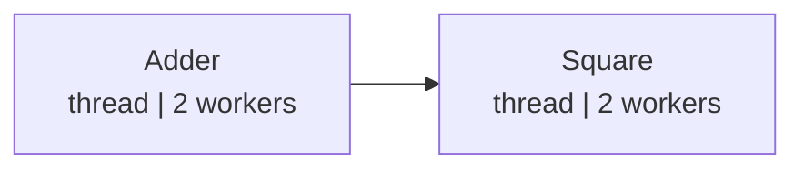

# demo/demo_ctree.py

> 📅 最后更新日期: 2026/11/13

## 目标

演示如何用 `celestialtree` 客户端替换 CelestialFlow 默认的 `LocalEventClient`。

默认情况下，`TaskGraph` 与 `TaskExecutor` 使用 `LocalEventClient`：事件只在本地生成递增 ID，不离开当前进程。调用 `set_ctree(CelestialTreeClient(...))` 后，任务输入、成功、失败、重试与终止信号等事件都会发送到 CelestialTree 服务，并可通过其客户端接口查询任务血缘（provenance / ancestors / descendants）。

## 默认与替换

### 任务图

`TaskGraph.set_ctree()` 会把客户端同步注入到图中所有节点：

```python
from celestialtree import Client as CelestialTreeClient

from celestialflow import TaskGraph

client = CelestialTreeClient(
    host="127.0.0.1",
    http_port=7777,
    grpc_port=7778,
    transport="http",
)

graph = TaskGraph("demo_ctree_graph", graph_mode="thread")
graph.set_ctree(client)  # 替代默认的 LocalEventClient
```

### 单节点

不经过任务图时，节点自身持有的事件客户端同样可以被替换：

```python
from celestialflow import TaskExecutor

executor = TaskExecutor("StandaloneSquare", square, execution_mode="thread")
executor.set_ctree(client)
```

## 演示场景

### `demo_graph_with_ctree`

两节点任务图：



- `Adder` → 把二元组任务相加
- `Square` → 对输入求平方
- 图模式：`graph_mode="thread"`
- 注入任务：`[(1, 2), (3, 4), (5, 6)]`
- 运行前打印事件客户端类型，运行后通过捕获到的成功事件查询 CelestialTree

### `demo_executor_with_ctree`

单个 `StandaloneSquare` 执行器，输入 `[2, 3, 4]`，演示不建图时的接入方式。

## 事件捕获与溯源

`EventCapture` 是 demo 内的轻量观察者，只匹配目标节点的 `TaskSuccessEvent`，并记录：

- `task_id`：成功任务对应的输入事件 ID
- `success_id`：成功事件 ID

运行结束后，demo 使用 CelestialTree 客户端依次查询：

| 接口 | 说明 |
|------|------|
| `get_event(event_id)` | 读取单个事件的类型、父事件与时间戳 |
| `ancestors(event_id)` | 查询祖先事件 ID 列表 |
| `provenance(event_id)` | 返回以 `parents` 嵌套的血缘结构 |
| `descendants(event_id)` | 返回以 `children` 嵌套的后代结构 |

`provenance` 与 `descendants` 都是嵌套字典，demo 中的 `_collect_ids()` 按 `parents` / `children` 字段递归展开成事件 ID 列表，便于终端阅读。

## 配置

| 环境变量 | 默认值 | 说明 |
|------|------|------|
| `CTREE_HOST` | `127.0.0.1` | CelestialTree 服务地址 |
| `CTREE_HTTP_PORT` | `7777` | HTTP 端口，事件查询始终走 HTTP |
| `CTREE_GRPC_PORT` | `7778` | gRPC 端口 |
| `CTREE_TRANSPORT` | `http` | 事件上报传输方式，可选 `http` 或 `grpc` |

脚本启动时调用 `load_dotenv()`，因此仓库根目录 `.env` 中的配置会自动生效；未配置时使用上表默认值。

## 可能出现的问题

1. **必须启动 CelestialTree 服务**：`main()` 先调用 `health()`，连接失败时会打印提示并直接返回，不会继续运行演示。
2. **gRPC 只影响事件上报**：`CTREE_TRANSPORT="grpc"` 时事件通过 gRPC 发送，但 `get_event` / `ancestors` / `provenance` / `descendants` 等查询接口仍走 HTTP，因此 HTTP 端口也需要可用。
3. **事件 ID 由服务端生成**：不同运行轮次的 ID 会变化，示例输出中的数字仅作参考。
4. **无断言**：演示脚本，不验证溯源结果的正确性，只展示客户端接口的用法。
5. **追踪会产生额外网络开销**：每个任务事件都会同步发送一次请求，任务量较大时建议评估 CelestialTree 服务的吞吐。

## 运行方式

```bash
# HTTP（默认）
python demo/demo_ctree.py

# gRPC
# PowerShell
$env:CTREE_TRANSPORT="grpc"; python demo/demo_ctree.py
# Bash
CTREE_TRANSPORT=grpc python demo/demo_ctree.py
```

`__main__` 会依次运行 `demo_graph_with_ctree()` 与 `demo_executor_with_ctree()`。

## 预期行为

终端会先打印 CelestialTree 版本与传输方式，然后分别输出两个示例的事件客户端替换结果和溯源信息，示意如下：

```text
CelestialTree version: {'name': 'CelestialTree', 'version': '...'} transport=http

=== 任务图：graph.set_ctree(client) ===
  默认事件客户端: celestialflow.runtime.util_event.LocalEventClient
  替换后事件客户端: celestialtree.client.Client
  最后一次成功事件: 40037（共 3 次成功）
  event       : type=task.success, parents=[40032]
  input event : task.input [40032]
  ancestors   : [40025]
  provenance  : 40037 <- 40032 <- 40030 <- 40025
  descendants : 40032 -> 40037

=== 单节点：executor.set_ctree(client) ===
  默认事件客户端: celestialflow.runtime.util_event.LocalEventClient
  替换后事件客户端: celestialtree.client.Client
  最后一次成功事件: 40044（共 3 次成功）
  event       : type=task.success, parents=[40040]
  input event : task.input [40040]
  ancestors   : [40040]
  provenance  : 40044 <- 40040
  descendants : 40040 -> 40044
```

> 事件 ID、`ancestors` 内容与血缘层级取决于当前 CelestialTree 中的实际数据，数字仅作格式示意。

## 依赖

- `celestialflow`（`TaskGraph`、`TaskExecutor`、`Observer`，事件类型来自 `celestialflow.observer`）
- `celestialtree`（`Client`）
- `python-dotenv`
- 外部服务：CelestialTree（HTTP 端口必须可用；gRPC 端口仅在 `CTREE_TRANSPORT=grpc` 时需要）
