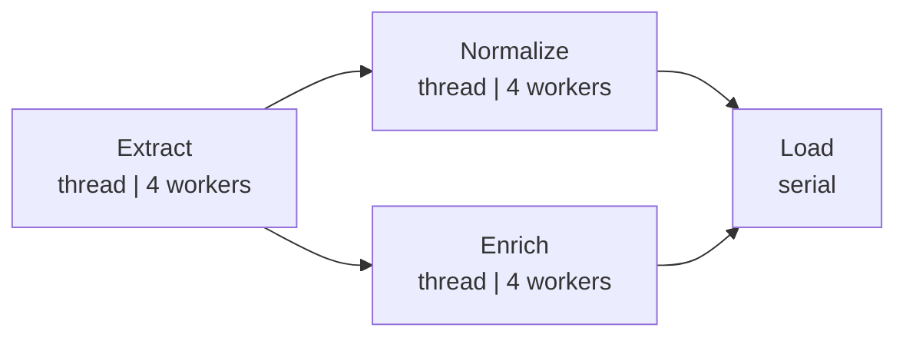

# demo/demo_graph.py

> 📅 最后更新日期: 2026/10/30

## 目标

演示 CelestialFlow 中 `TaskGraph` 的高级图拓扑构建：扇出/扇入（fan-out/fan-in）ETL 管道，以及异步分阶段流水线。

## 演示场景

### `demo_etl_fan_out_fan_in`
ETL 管道，扇出/扇入拓扑：



ASCII 补充示意：

```
Extract ──┬── Normalize ──┬── Load
          └── Enrich ─────┘
```

- `Extract` → 根据 ID 生成记录（thread 模式，4 worker）
- `Normalize` → 对记录值做归一化（thread 模式，4 worker）
- `Enrich` → 为记录添加分类标签（thread 模式，4 worker）
- `Load` → 保存记录（serial 模式）

**图结构**：DAG，一对多扇出 + 多对一扇入
**图模式**：`graph_mode="thread"`

### `demo_async_pipeline`
两阶段异步流水线：


ASCII 补充示意：

```
AsyncDouble ──> AsyncToStr
```

- `AsyncDouble` → 异步将输入翻倍（async 模式，8 worker）
- `AsyncToStr` → 异步将结果转为字符串（async 模式，8 worker）

**图结构**：DAG，线性两阶段
**图模式**：`graph_mode="async"`

## 关键配置

- 各 Stage 通过 `TaskExecutor(..., execution_mode="thread" | "async")` 显式指定执行模式
- ETL 管道与异步管道分别通过 `TaskGraph(..., graph_mode="thread")` 与 `graph_mode="async"` 指定图模式
- `execution_mode="async"` 用于协程任务函数（`async_double`、`async_to_str`）

## 可能出现的问题

1. **无断言**：演示脚本，不验证结果正确性。
2. **ETL 函数含 sleep**：`extract_record`（0.5s）、`transform_normalize`/`transform_enrich`（0.3s）、`load_record`（0.2s），完整执行有一定耗时。

## 运行方式

```bash
python demo/demo_graph.py
```

> **注意**：当前 `__main__` 会依次调用 `demo_etl_fan_out_fan_in()` 与 `asyncio.run(demo_async_pipeline())`，两个演示场景都会运行。

## 预期行为

脚本没有注册任何 observer，也没有 `print` 语句，因此运行期间**不会向终端输出任务级日志或统计摘要**；只能通过外部观察（例如 celestialflow-web 上报，本 demo 未启用）或自行在 `demo_utils` 的任务函数里加日志来确认执行过程。

### ETL 管道（`demo_etl_fan_out_fan_in`）

依次执行 Extract → Normalize/Enrich → Load，每个任务函数内部只做 `sleep` 与数据变换。当输入为 `list(range(1, 16))` 时，Extract 处理 15 条记录，Normalize 与 Enrich 各接收 15 条，Load 节点共接收 30 条任务（15 × 2 下游）。例如 Extract 产出 `{'id': 1, 'value': 10, 'label': 'item_1'}`，Normalize 追加 `normalized: 0.1`，Enrich 追加 `category: 'odd'`。

### 异步流水线（`demo_async_pipeline`）

两阶段顺序执行：先把 `list(range(1, 21))` 的 20 个任务交给 `AsyncDouble`，其结果再流入 `AsyncToStr`。按 `async_double` 的 0.3s 与 `async_to_str` 的 0.2s sleep 估算，总耗时约 1~2 秒（`AsyncDouble` 8 并发、`AsyncToStr` 8 并发）。

## 依赖

- `celestialflow`（`TaskGraph`、`TaskExecutor`）
- `demo_utils`（`extract_record`、`transform_normalize`、`transform_enrich`、`load_record`、`async_double`、`async_to_str`）
- `python-dotenv`
- `celestialtree`（模块级 `import`，缺失时脚本无法启动；`graph.set_ctree(...)` 默认被注释，服务端并非必需）
