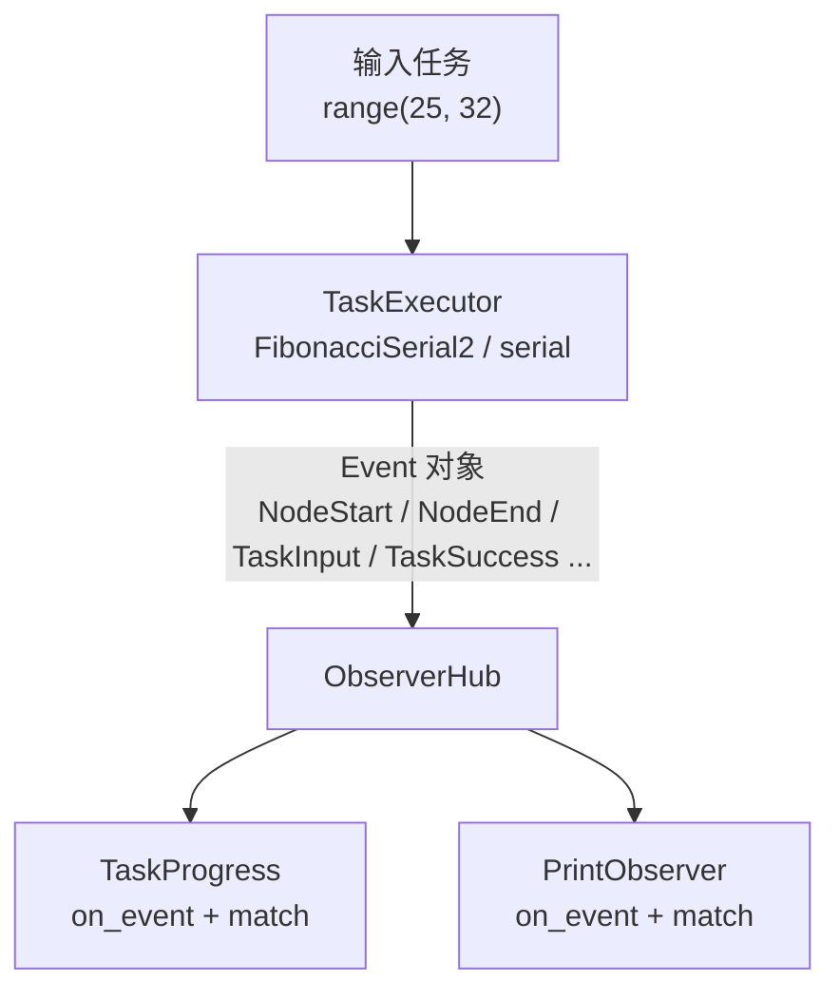

# demo/demo_observer.py

> 📅 最后更新日期: 2026/11/13

## 目标

演示如何在 CelestialFlow 中为 `TaskExecutor` 注册不同类型的 observer。

当前文件同时展示两种方式：

- 使用本文件内自定义的 `TaskProgress`（继承 `Observer`，基于 `tqdm` 的进度条观察者）
- 直接使用 `celestialflow` 内置的 `PrintObserver`（构造时传入 `name` 作为输出前缀，示例中传 `executor.get_name()`）

## 演示内容

当前 demo 包含两个入口函数：

| 函数 | 说明 |
|------|------|
| `demo_progress_observer` | 创建 `TaskExecutor`，注册 `TaskProgress`，显示进度条 |
| `demo_print_observer` | 创建 `TaskExecutor`，注册内置 `PrintObserver(executor.get_name())`，打印 observer 生命周期日志 |

两种 observer 的定位如下：



## 关键配置

- `execution_mode="serial"`
- `max_workers=6`
- `max_retries=1`
- 两个示例都通过 `executor.add_observer(...)` 注册 observer

observer 一览：

| observer | 来源 | 作用 |
|----------|------|------|
| `TaskProgress` | 本文件本地定义 | 用 `tqdm` 展示执行进度，适合命令行交互场景 |
| `PrintObserver` | `celestialflow` 内置（`celestialflow.observer.core_print`） | 在 `on_event` 中输出各事件计数，构造参数 `name` 作为输出前缀 |

`PrintObserver` 只实现统一的 `on_event(event)`，用 `match event` 按事件类型维护计数并打印（`name` 为构造时传入的前缀）：

| 事件 | 输出 / 作用 |
|------|------|
| `NodeStartEvent` | 打印 `[{name}] start total={total}` |
| `TaskInputEvent` | 累加 `total` 并打印 `[{name}] total={total}(+1)` |
| `TaskSuccessEvent` | 累加成功数并打印 `[{name}] succeeded={n}(+1), total={total}` |
| `TaskFailEvent` | 累加失败数并打印 `[{name}] failed={n}(+1), total={total}` |
| `TaskSkipEvent` | 累加跳过数并打印 `[{name}] skipped={n}(+1), total={total}` |
| `NodeEndEvent` | 打印 `[{name}] finish total=..., skipped=..., succeeded=..., failed=...` |

`TaskRetryEvent`、终止信号事件与图事件不在上述分支中，会由 `match` 的兜底分支忽略。
`Observer` 基类当前只提供 `on_event` 与 `handle_exception`，不再有逐个事件回调。

## 可能出现的问题

1. **`__main__` 同时运行 `demo_progress_observer` 和 `demo_print_observer`**：两个 observer 依次执行，先显示 tqdm 进度条，再输出日志。
2. **当前示例只展示成功路径**：`test_task` 现在是 `range(25, 32)`，因此运行时通常只会看到 `TaskInputEvent`、`NodeStartEvent`、`TaskSuccessEvent` 和 `NodeEndEvent` 对应的输出。
3. **`TaskInputEvent` 与 `NodeStartEvent` 的先后**：`run()` 会先注入全部任务再启动执行器，因此 `NodeStartEvent` 到达时 `total` 已累加到最终值（`PrintObserver` 会先打印若干条 `total=...(+1)`，再打印 `start total=7`）。`TaskProgress` 也正是依赖这一点，在 `NodeStartEvent` 时用累计的 `_total` 创建进度条。
4. **无断言**：这是演示脚本，不验证结果数值，只用于展示 observer 调用时机。
5. **计算耗时受输入影响**：当前为迭代 O(n) 斐波那契，单任务耗时随 `n` 线性增长，但 `fibonacci(31)` 与 `fibonacci(25)` 的差异仍在微秒级，不会显著影响总时长。

## 运行方式

```bash
python demo/demo_observer.py
```

## 预期行为

运行后会打印类似如下的 observer 生命周期日志：

### `demo_progress_observer`

运行 `demo_progress_observer()` 时，终端会看到类似这样的进度条（`TaskProgress` 未设置 `desc`，因此无前缀）：

```text
 0%|          | 0/7 [00:00<?, ?it/s]100%|████████████████████████████| 7/7 [00:00<00:00, ...it/s]
```

### `demo_print_observer`

运行 `demo_print_observer()` 时，会打印类似如下的 observer 生命周期日志（前缀为 `executor.get_name()` 返回的 `FibonacciSerial2`）：

```text
[FibonacciSerial2] total=1(+1)
[FibonacciSerial2] total=2(+1)
...
[FibonacciSerial2] total=7(+1)
[FibonacciSerial2] start total=7
[FibonacciSerial2] succeeded=1(+1), total=7
[FibonacciSerial2] succeeded=2(+1), total=7
...
[FibonacciSerial2] succeeded=7(+1), total=7
[FibonacciSerial2] finish total=7, skipped=0, succeeded=7, failed=0
```

如果你想观察失败、跳过和重试等事件，可以把输入改回包含异常值、重复值或非法输入的列表，例如：

```python
test_task = list(range(25, 32)) + [0, 27, None, 0, ""]
```

这样更容易让 `TaskFailEvent` / `TaskSkipEvent` 触发；但要注意：

- `TaskProgress` 的 `on_event` 只 `match` `NodeStartEvent` / `TaskInputEvent` / `TaskSuccessEvent` / `TaskFailEvent` / `TaskSkipEvent` / `NodeEndEvent`，不处理 `TaskRetryEvent`。
- `PrintObserver` 的 `on_event` 同样只处理 `NodeStartEvent` / `NodeEndEvent` / `TaskInputEvent` / `TaskSuccessEvent` / `TaskFailEvent` / `TaskSkipEvent`，其兜底分支会忽略 `TaskRetryEvent`。`Observer` 基类本身也只提供 `on_event` 与 `handle_exception`，因此本 demo 的两个 observer 都不会对重试事件产生输出。

## 依赖

- `celestialflow`（`Observer`、`PrintObserver`、`TaskExecutor`；`TaskProgress` 由本仓库同目录的 `demo_observer.py` 本地定义）
- `demo_utils`（`fibonacci`）
- `tqdm`（`TaskProgress` 进度条依赖）
