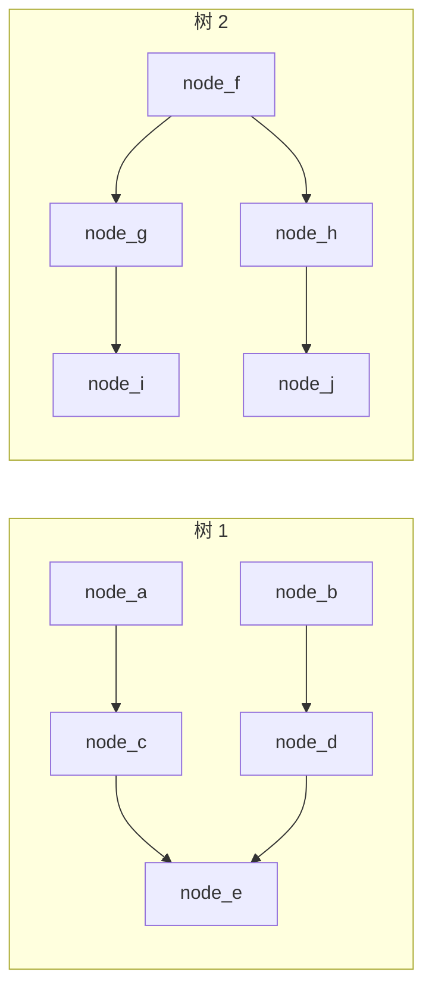
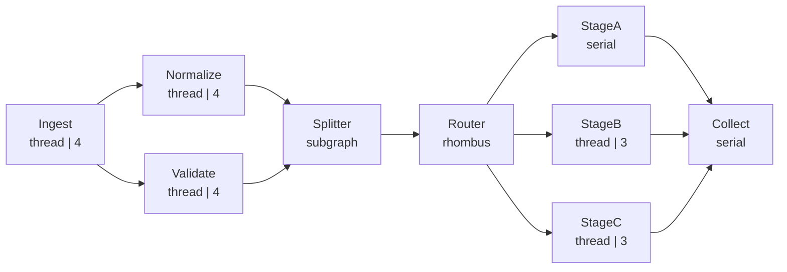

# demo/demo_web.py

> 📅 最后更新日期: 2026/10/30

## 目标

本文件包含两个演示：`demo_forest()`（两棵独立树状 DAG）与 `demo_topology_topology()`（6 层、含扇出/扇入、`TaskSplitter` 与 `TaskRouter` 的复杂任务图）。两者都在调用 `graph.run(...)` 时显式传入 `report=ReportConfig(...)`，由框架按节拍把状态、结构、错误与生命周期数据推送到 celestialflow-web，用于观察任务的运行情况。

## 演示场景

### 森林（`demo_forest`）

两棵互不干扰的树状 DAG 共存于同一 `TaskGraph`：



- 树 1：`node_a → node_c → node_e`，`node_b → node_d → node_e`
- 树 2：`node_f → node_g → node_i`，`node_f → node_h → node_j`
- 全部节点使用 `add_one_sleep`（`execution_mode="thread"`，`max_workers=2`），图模式为 `graph_mode="thread"`
- 初始任务注入 `node_a`（`1..10`）、`node_b`（`11..20`）、`node_f`（`21..30`）
- 运行时显式上报：`graph.run(init_tasks, report=ReportConfig("http://localhost:5005/"))`

### 复杂拓扑（`demo_topology_topology`）

> 该演示的图名为 `demo_web_topology`，函数名为 `demo_topology_topology`。



ASCII 补充示意：

```
Ingest ──┬── Normalize ──┐
         └── Validate ───┴── Splitter ── Router ──┬── StageA ──┐
                                                  ├── StageB ──┴── Collect
                                                  └── StageC ──┘
```

- `Ingest` → 注入 24 个种子任务（thread 模式，4 worker）
- `Normalize` → 归一化并放大任务值；`7` 连续失败 3 次后**重试耗尽失败**，`11` 失败 1 次后重试成功（thread 模式，4 worker，`max_retries=2`）
- `Validate` → 校验任务；`11` 直接抛出**不可重试**的 `RuntimeError`（thread 模式，4 worker）
- `Splitter` → 把上游传入的可迭代结果拆分为独立条目（每任务拆分出 2~3 个条目）
- `Router` → 按 `item % 3` 把条目分发到 `StageA` / `StageB` / `StageC`，三条下游边的传输量各不相同
- `StageA`（serial）/ `StageB`、`StageC`（thread，3 worker）→ 三个并行处理分支
- `Collect` → 汇聚三个 stage 的输出（serial）

**图结构**：DAG，多层扇出/扇入 + 拆分 + 路由
**图模式**：`graph_mode="thread"`，节点内部混合 serial / thread 执行模式

## 上报方式

上报由运行入口显式传入 `ReportConfig` 开启，框架不再从宿主项目配置文件隐式读取上报设置：

```python
from celestialflow import ReportConfig

graph.run(init_tasks, report=ReportConfig("http://localhost:5005/"))
```

- `ReportConfig` 由 `celestialflow` 包级导出，构造参数 `url` 必须是以 `http` / `https` 开头的地址；对象在构造时完成校验（非法地址抛 `ConfigurationError`），末尾的 `/` 会被去掉。
- 省略 `report`（或传 `None`）表示不上报，两个 demo 在没有 web 服务时仍可独立运行。
- 省略 `url` 时使用默认地址 `http://127.0.0.1:5005`。

`demo_topology_topology` 的上报代码与 `demo_forest` 完全一致：

```python
seeds = [*range(1, 21), 3, 5, 8, 12]
graph.run({"Ingest": seeds}, report=ReportConfig("http://localhost:5005/"))
```

## 在 web 端可观察的内容

| 维度 | 观察内容 |
|------|---------|
| 结构图 | 九节点多层拓扑；`Splitter` 显示为 subgraph、`Router` 显示为菱形；启用「边标签」后可观察每条边累计/增量传输量 |
| 节点状态卡 | 各节点的处理中/成功/失败计数，以及不同执行模式（serial / thread）与并行度 |
| 错误日志 | `Normalize` 的 `ValueError`（重试后失败）与 `Validate` 的 `RuntimeError`（不可重试）两类错误 |
| 进度条 | 成功 / 失败 / 跳过等分段的比例 |
| 生命周期 | 重试次数（`retry_times`）随失败记录持久化 |

## 关键配置

- 各 Stage 通过 `TaskExecutor(..., execution_mode="thread" | "serial")` 显式指定执行模式
- `normalize.set_retry_exceptions(ValueError)` 指定可重试异常；`max_retries=2` 提供两次重试机会
- `Ingest` 注入 24 个种子任务，其中 `3`、`5`、`8`、`12` 与前面的种子值重复；demo 未配置 `skip_func`，故这些重复值不会被去重，仍按普通任务进入各节点
- 图模式为 `graph_mode="thread"`，节点内部可混合执行模式
- 上报由 `report=ReportConfig(...)` 显式开启（见上文「上报方式」）

## 关键实现

- `_metrics_of(target)`：从运行对象的 `ObserverHub`（`target.observers._snapshot()`）中查找 `MetricsObserver` 并返回；该辅助函数在本文件中仍保留定义，但两个 demo 当前都不再调用它（脚本已不再打印「各节点计数」摘要），需要手工读取指标时可直接复用。
- `make_flaky(fail_map)`：构造「前 `fail_map[n]` 次抛 `ValueError`、之后成功」的任务函数，用于制造可重试失败。
- `make_stage_task(prefix)`：构造返回 `f"{prefix}({x})"` 的 stage 任务函数。

## 可能出现的问题

1. **无断言**：演示脚本，不验证结果正确性。
2. **任务函数含 sleep**：各阶段 sleep 从 0.02s（`route_task`）到 1s（`ingest_task`）不等，完整执行预计数十秒。
3. **依赖 web 服务**：上报地址指向 `http://localhost:5005/`，未启动 celestialflow-web 时上报与注入拉取都会失败，控制台会出现连接错误回溯（推送线程与节拍器会捕获并打印，不影响任务执行）；如需完全离线运行，去掉 `report=` 参数即可。
4. **Normalize / Validate 的失败**：`Normalize` 的 `7` 与 `Validate` 的 `11` 会制造失败路径，脚本启动时不依赖外部服务，可独立运行。

## 运行方式

```bash
python demo/demo_web.py
```

`__main__` 会依次运行 `demo_forest()` 与 `demo_topology_topology()`，两者独立执行。

> 运行前请先启动 celestialflow-web（默认监听 `5005` 端口），否则 `report=ReportConfig(...)` 指向的上报地址不可用。

## 预期行为

两个 demo 都**不再向终端打印**各节点计数摘要（该逻辑已随上报方式改造一并移除）；终端只会出现框架自身日志，以及 web 服务不可用时的连接错误回溯。执行结果需要在 celestialflow-web 仪表盘上观察：

```
Ingest → Normalize / Validate → Splitter → Router → StageA / StageB / StageC → Collect
```

> 若未启动 web 服务，脚本仍会完成本地计算，但上报数据无法展示。

## 依赖

- `celestialflow`（`TaskGraph`、`TaskExecutor`、`TaskSplitter`、`TaskRouter`、`ReportConfig`）
- `demo_utils`（`add_one_sleep`）
- 外部服务：celestialflow-web（上报目标，默认 `http://localhost:5005/`）
