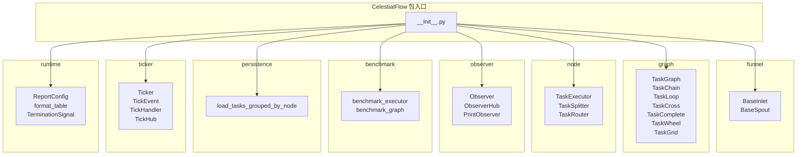

# src/celestialflow/__init__.py

> 📅 最后更新日期: 2026/10/30

## 简介

本项目根入口，从各子模块集中导出全部公开 API，用户只需 `from celestialflow import ...` 即可访问所有核心功能。

包级 `__all__` 共 **25** 个符号。其中来自各子包的符号经由对应包的 `__init__.py` 再导出；`benchmark_executor` / `benchmark_graph` / `format_table` / `TerminationSignal` / `load_tasks_grouped_by_node` 这 5 个则按文件直接从 `util_*` 模块导入（属于已稳定对外承诺的工具函数与类型）。

## 模块分组

按来源模块分类，每个组说明其主要用途。

---

### funnel — 数据入口

提供任务数据入口与出口抽象，用于连接外部数据源与任务图。

| 导出符号 | 说明 |
|----------|------|
| `BaseInlet` | 数据入口基类，定义统一的数据拉取/推送接口 |
| `BaseSpout` | 数据出口基类，定义统一的数据输出接口 |

---

### graph — 任务图核心

提供多种拓扑结构定义，支持 DAG 构建、依赖连接与执行调度。`TaskGraph` 默认 `graph_mode="serial"`，预定义结构默认 `graph_mode="thread"`。

| 导出符号 | 说明 |
|----------|------|
| `TaskGraph` | 通用任务图容器，支持任意 DAG 拓扑 |
| `TaskChain` | 线性链式结构（前一节点 → 后一节点） |
| `TaskCross` | 分层交叉结构（相邻层之间全连接） |
| `TaskGrid` | 二维网格结构（每个节点连接右侧与下方邻居） |
| `TaskLoop` | 有环结构，节点首尾相连形成闭环 |
| `TaskWheel` | 轮状结构，中心节点连向一个环，环上节点首尾相连形成闭环 |
| `TaskComplete` | 完全图结构，每个节点都连向其余全部节点 |

> `TaskLoop` / `TaskWheel` 是有环结构。`TaskGraph._build_analysis()` 在 `graph_mode="serial"` 且图非 DAG 时抛出 `ConfigurationError`，因此这两类结构应使用默认的 `graph_mode="thread"`（或显式指定 `"async"`）。

---

### node — 任务执行层

提供任务执行器、路由分发与任务拆分等执行层能力。

| 导出符号 | 说明 |
|----------|------|
| `TaskExecutor` | 通用任务执行器，支持 serial / thread / async 三种执行模式；可作为图节点直接接入 `TaskGraph` |
| `TaskSplitter` | 任务拆分器，将一个输入拆分为多个子任务 |
| `TaskRouter` | 路由分发器，根据规则将任务分发到不同下游 |

> 注：`BaseTaskNode`、`TaskDispatch` 等内部抽象类不通过包根或 `celestialflow.node` 导出，外部代码应仅依赖上表中的 `TaskExecutor` / `TaskSplitter` / `TaskRouter`。

---

### observer — 可观测性

提供观察者模式支持，用于监控任务执行过程。包根只导出观察者协议与集线器、控制台观察者；指标观察者 `MetricsObserver` 需从 `celestialflow.observer` 导入。

| 导出符号 | 说明 |
|----------|------|
| `Observer` | 观察者基类，定义 on_node_start / on_task_success / on_task_fail 等回调接口 |
| `ObserverHub` | 观察者集线器，将事件广播给一组子观察者 |
| `PrintObserver` | 基于 print 的控制台进度观察者，构造时需传入名称前缀；计数器线程安全 |

---

### benchmark — 基准测试

提供执行器与任务图的性能基准测试能力。两者均为 `async` 函数。

| 导出符号 | 说明 |
|----------|------|
| `benchmark_executor` | 对同步/异步 `TaskExecutor` 进行多模式基准测试 |
| `benchmark_graph` | 对整个任务图进行 `graph_mode × execution_mode` 基准测试 |

---

### persistence — 持久化

提供基于 SQLite 的记录查询功能。

| 导出符号 | 说明 |
|----------|------|
| `load_tasks_grouped_by_node` | 自行创建并关闭连接，按 node 分组读取指定状态的记录；签名为 `(db_path, statuses=("failed", "pending")) -> dict[str, list[dict[str, Any]]]` |

> 包根只再导出 `load_tasks_grouped_by_node`；其余 sqlite 查询工具（如 `load_task_error_records`）请直接从 `celestialflow.persist.util_sqlite` 导入。

---

### ticker — 定时驱动

提供基于 Ticker 的定时任务事件驱动能力。

| 导出符号 | 说明 |
|----------|------|
| `Ticker` | 周期性触发的事件生成器 |
| `TickEvent` | 单次 tick 产生的事件对象 |
| `TickHandler` | 处理 TickEvent 的回调接口类型 |
| `TickHub` | 将 tick 事件广播给一组 TickHandler 的集线器 |

---

### runtime — 运行时辅助

提供运行时辅助类型、配置对象与工具函数。

| 导出符号 | 说明 |
|----------|------|
| `ReportConfig` | 远程上报配置（`frozen` dataclass），构造时校验并规范化 `url`；作为 `report=` 参数传给图运行入口 |
| `format_table` | 格式化表格输出，用于控制台展示对比数据 |
| `TerminationSignal` | 终止信号，用于控制图执行流程的结束 |

---

## `__all__` 列表

完整公开 API 列表（当前共 25 个符号，与源码 `__all__` 逐项一致）：

```python
__all__ = [
    "BaseInlet",
    "BaseSpout",
    "Observer",
    "ObserverHub",
    "PrintObserver",
    "ReportConfig",
    "TaskChain",
    "TaskComplete",
    "TaskCross",
    "TaskExecutor",
    "TaskGraph",
    "TaskGrid",
    "TaskLoop",
    "TaskRouter",
    "TaskSplitter",
    "TaskWheel",
    "TerminationSignal",
    "TickEvent",
    "TickHandler",
    "TickHub",
    "Ticker",
    "benchmark_executor",
    "benchmark_graph",
    "format_table",
    "load_tasks_grouped_by_node",
]
```

## 使用示例

以下示例演示如何从包入口导入并使用 CelestialFlow 的核心功能构建和执行任务图。

```python
from celestialflow import TaskGraph, TaskExecutor
from celestialflow.observer import MetricsObserver


# 1. 定义任务处理函数
def double(x: int) -> int:
    return x * 2


def add_one(x: int) -> int:
    return x + 1


# 2. 创建 TaskExecutor 节点（func 必填，execution_mode 默认 "serial"）
stage_a = TaskExecutor("StageA", func=double, execution_mode="serial")
stage_b = TaskExecutor("StageB", func=add_one, execution_mode="serial")

# 3. 构建 DAG 图
graph = TaskGraph(name="DemoGraph")
graph.set_nodes([stage_a, stage_b])
graph.connect([stage_a], [stage_b])

# 4. 注册图级指标观察者，读取运行结果
metrics = MetricsObserver()
graph.add_observer(metrics)

# 5. 执行图：键为节点名，值为该节点的初始任务
graph.run({stage_a.get_name(): [1, 2, 3, 4, 5]})

# 6. 查看各节点的指标快照
for node_name, node_metrics in metrics.get_graph_metrics().items():
    print(
        node_name,
        node_metrics.status,
        node_metrics.external_input,
        node_metrics.succeeded,
        node_metrics.failed,
    )
```

> `TaskGraph` 实例是一次性对象：完成一次 `run()` / `run_async()` 后不应复用，需要重复执行时请重新构建图与节点。

### 使用 TaskExecutor 独立执行

`TaskExecutor` 可脱离图结构独立运行，适合单步任务执行：

```python
from celestialflow import TaskExecutor

# 创建执行器并传入数据迭代器
executor = TaskExecutor("Adder", func=lambda x: x + 10, execution_mode="serial")
executor.run([1, 2, 3])

# 获取成功任务的 (task, result) 对
for task, result in executor.get_success_pairs():
    print(f"Task: {task} -> Result: {result}")

# 获取失败任务的 (task, PersistedError) 对
print("Failures:", len(executor.get_error_pairs()))
```

### 使用预定义图结构

```python
from celestialflow import TaskChain, TaskExecutor
from celestialflow.observer import MetricsObserver

nodes = [
    TaskExecutor("S1", func=lambda x: x * 2),
    TaskExecutor("S2", func=lambda x: x + 1),
    TaskExecutor("S3", func=lambda x: x**2),
]

# 预定义结构的 graph_mode 默认为 "thread"
chain = TaskChain(name="DemoChain", nodes=nodes)
metrics = MetricsObserver()
chain.add_observer(metrics)

chain.run({nodes[0].get_name(): [1, 2, 3]})

for node_name, node_metrics in metrics.get_graph_metrics().items():
    print(node_name, node_metrics.status, node_metrics.succeeded)
```

### 启用远程上报

`ReportConfig` 只作为图运行入口的 `report=` 参数使用；不传（`None`）表示关闭上报。`TaskExecutor.run()` 不接受 `report` 参数。

```python
from celestialflow import ReportConfig, TaskExecutor, TaskGraph

graph = TaskGraph(name="ReportedGraph")
worker = TaskExecutor("Worker", func=lambda x: x + 1)
graph.set_nodes([worker])

# url 必须是 http/https 地址；末尾 "/" 会被去掉，非法地址在构造时抛 ConfigurationError
config = ReportConfig("http://127.0.0.1:5005")
graph.run({worker.get_name(): [1, 2, 3]}, report=config)
```

> 示例假设 `127.0.0.1:5005` 上存在可用的上报服务，仅用于演示 `report=` 参数的接法；`run_async()` 同样接受 `report`。

## 模块依赖关系



> 依赖方向说明：`ReportConfig` 来自 `celestialflow.runtime` 的再导出；`benchmark_*`、`format_table`、`TerminationSignal`、`load_tasks_grouped_by_node` 则是包根按文件直接导入，不经过对应子包的 `__init__.py`。`benchmark` 位于依赖链顶层，不会被其他子模块导入。

## 注意事项

- **包根只导出公开 API**：`__all__` 中不包含 `MetricsObserver`、`DEFAULT_REPORT_URL`、`TaskEnvelope` 等符号，它们请从对应子包导入（如 `from celestialflow.observer import MetricsObserver`）。
- **一次性对象**：`TaskGraph` / `TaskExecutor` 的 `run()` / `run_async()` 均为一次性调用，重复执行需重建实例；这也正是 `celestialflow.benchmark` 需要克隆工具的原因。
- **运行入口参数**：`TaskGraph.run()` / `run_async()` 签名为 `(init_tasks_dict, *, if_put_signal=True, log_level=DEFAULT_LOG_LEVEL, report=None)`；`TaskExecutor.run()` / `run_async()` 只有 `if_put_signal` 与 `log_level`，不支持 `report`。
- **没有内置状态快照方法**：`TaskGraph` 不提供 `get_status_snapshot()`；运行期统计请通过 `add_observer()` 注册 `MetricsObserver`，结构信息用 `get_nodes()` / `get_edges()` / `get_node_meta()` 获取。
