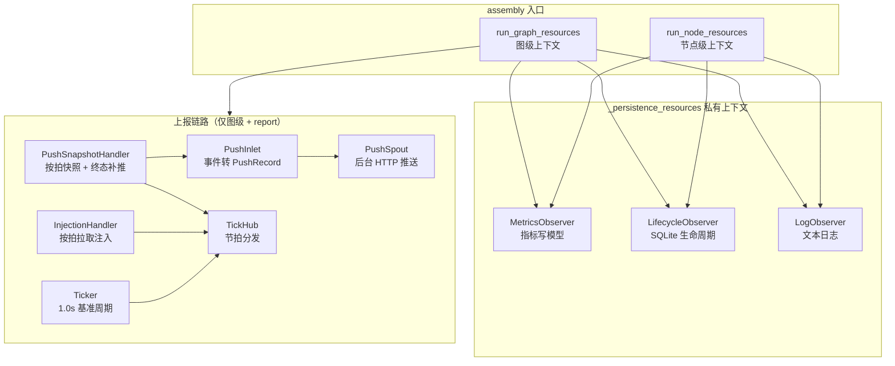

# src/celestialflow/assembly/__init__.py

> 📅 最后更新日期: 2026/11/13

`assembly` 是 CelestialFlow 的**运行期资源装配模块**。它把一次运行所需的全局观察者、后台 spout、远程上报通道与节拍器集中创建、注册、启动和回收，避免 `TaskGraph.run()` 与 `TaskExecutor.run()` 各自重复实现生命周期管理。

模块本身只有两个公开入口：`run_graph_resources`（图级运行）与 `run_node_resources`（单节点运行）。二者都是 `contextmanager`，在 `with` 进入时完成资源装配并产出 lifecycle 数据库路径，在退出时按固定顺序收尾。

> 包级 `__init__.py` 只再导出 `core_run.py` 中的这两个函数；`_persistence_resources` 等私有辅助不对外暴露。`assembly` 也不会被 `celestialflow/__init__.py` 再导出，需要时从 `celestialflow.assembly` 导入。

## 导出符号

```python
__all__ = [
    "run_graph_resources",
    "run_node_resources",
]
```

| 导出符号 | 来源 | 说明 |
|---------|------|------|
| `run_graph_resources` | `core_run.py` | 图级资源上下文：指标、lifecycle、log，按需追加远程上报、任务注入与节拍器 |
| `run_node_resources` | `core_run.py` | 单节点资源上下文：指标、lifecycle、log，不涉及图结构与上报 |

## 装配范围

| 资源 | `run_graph_resources` | `run_node_resources` |
|------|:---------------------:|:--------------------:|
| `MetricsObserver`（指标写模型） | ✅ 内部创建并注册 | ✅ 内部创建并注册 |
| `LifecycleObserver` + `LifecycleSpout` | ✅ | ✅ |
| `LogObserver` + `LogSpout` | ✅ | ✅ |
| `PushInlet` + `PushSpout` | ✅ 仅当 `report is not None` | ❌ |
| `PushSnapshotHandler` | ✅ 仅当 `report is not None` | ❌ |
| `InjectionHandler` + `InjectionTarget` | ✅ 仅当 `report is not None` | ❌ |
| `Ticker`（默认 1 秒基准周期） | ✅ 仅当 `report is not None` | ❌ |
| `requests.Session`（上报与注入共用） | ✅ 仅当 `report is not None` | ❌ |

> 这里的 `MetricsObserver` 是**只写模型**：它被注册到调用方传入的 `ObserverHub` 中，由节点事件驱动计数；它的只读视图会传给 `LogObserver` 与 `PushSnapshotHandler`，用于日志汇总和状态快照。

## 结构关系



## 使用示例

下面的示例直接使用两个装配入口，创建一个满足 `InjectionTarget` 协议的最小图对象，并观察上下文产出的 lifecycle 数据库路径：

```python
from collections.abc import Iterable, Mapping
from typing import Any

from celestialflow.assembly import run_graph_resources, run_node_resources
from celestialflow.observer import ObserverHub


class DemoGraph:
    """满足 InjectionTarget 协议的最小实现。"""

    def inject_tasks(self, tasks: Mapping[str, Iterable[Any]]) -> None:
        for node, values in tasks.items():
            print(f"inject {list(values)} -> {node}")

    def inject_terminations(self, nodes) -> None:
        print(f"terminate {list(nodes)}")


# 图级：默认不启用远程上报
graph_hub = ObserverHub()
with run_graph_resources(graph_hub, DemoGraph(), log_level="info") as db_path:
    print("图级 lifecycle 数据库:", db_path)

# 节点级：没有 InjectionTarget、没有上报
node_hub = ObserverHub()
with run_node_resources(node_hub, log_level="warning") as db_path:
    print("节点级 lifecycle 数据库:", db_path)
```

运行后会在当前工作目录生成：

- `lifecycles/<日期>/flow_lifecycle(<时间>).sqlite3`
- `logs/flow_log(<日期>).log`

## 注意事项

1. **每次进入都会追加观察者**：`MetricsObserver`、`LifecycleObserver`、`LogObserver` 都由入口新建并 `add_observer()` 到传入的 hub。不要在同一个 hub 上反复进入上下文，否则会出现重复计数和重复落盘。
2. **`log_level` 会先规范化**：大小写不敏感、会去除首尾空白；非法级别抛 `InvalidOptionError`，非字符串抛 `ConfigurationError`。
3. **返回值可能是 `None`**：上下文产出的是 `lifecycle.db_path`，类型为 `Path | None`；正常启动后为实际路径。
4. **图级入口才处理上报**：`run_node_resources` 完全不接收 `report` 参数，独立节点不参与远程上报与任务注入。
5. **收尾顺序固定**：图级上下文先停 ticker，再停 lifecycle / log，最后停推送 spout 并关闭 HTTP 会话，详见 [`core_run.md`](./core_run.md)。
