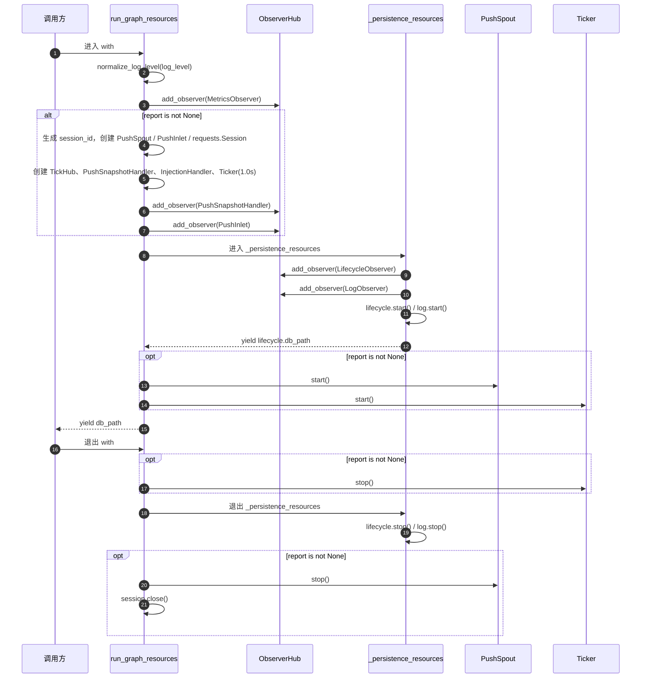
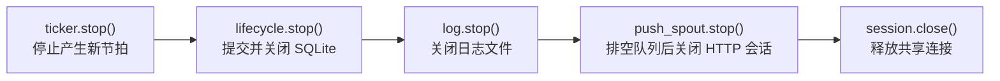

# src/celestialflow/assembly/core_run.py

> 📅 最后更新日期: 2026/11/13

`core_run.py` 实现 CelestialFlow 的两类运行期资源装配上下文：

- `run_graph_resources`：服务 `TaskGraph.run()` / `TaskGraph.run_async()`，装配指标、lifecycle、log，并在传入 `ReportConfig` 时额外装配远程上报、任务注入和节拍器；
- `run_node_resources`：服务 `TaskExecutor.run()` / `TaskExecutor.run_async()`，只装配指标、lifecycle、log，不涉及图结构与上报。

两个入口都通过私有上下文 `_persistence_resources()` 复用「创建并注册 lifecycle / log 观察者 → 启动 → 产出数据库路径 → 停止」的公共逻辑。

## 公开函数

```python
@contextmanager
def run_graph_resources(
    observers: ObserverHub,
    injection_target: InjectionTarget,
    *,
    log_level: str = DEFAULT_LOG_LEVEL,
    report: ReportConfig | None = None,
) -> Generator[Path | None, None, None]: ...


@contextmanager
def run_node_resources(
    observers: ObserverHub,
    *,
    log_level: str = DEFAULT_LOG_LEVEL,
) -> Generator[Path | None, None, None]: ...
```

### 参数说明

| 参数 | 适用入口 | 类型 | 默认值 | 说明 |
|------|---------|------|--------|------|
| `observers` | 两者 | `ObserverHub` | 必填 | 运行作用域内的观察者 hub；入口会把指标、持久化与上报观察者追加进去 |
| `injection_target` | 图级 | `InjectionTarget` | 必填 | 任务注入目标，通常是 `TaskGraph` 自身；需实现 `inject_tasks()` 与 `inject_terminations()` |
| `log_level` | 两者 | `str` | `DEFAULT_LOG_LEVEL`（`"INFO"`） | `LogObserver` 的过滤级别，进入时由 `normalize_log_level()` 规范化为大写 |
| `report` | 图级 | `ReportConfig \| None` | `None` | 远程上报配置；`None` 表示完全关闭上报、注入与节拍器 |

### 返回值与异常

- 返回值（`with ... as db_path`）：`Path | None`，即 lifecycle spout 启动后创建的 SQLite 文件路径；正常启动后不为 `None`。
- `InvalidOptionError`：`log_level` 不在 `LEVEL_DICT` 允许集合中。
- `ConfigurationError`：`log_level` 不是字符串（由 `normalize_log_level()` 抛出）。
- 上下文体内抛出的异常会在完成资源回收后继续向外传播。

## 私有辅助：`_persistence_resources`

```python
@contextmanager
def _persistence_resources(
    observers: ObserverHub,
    metrics_view: MetricsObserver,
    log_level: str,
) -> Generator[Path | None, None, None]: ...
```

职责：

1. 创建 `LifecycleObserver()` 与 `LogObserver(metrics_view, log_level)`；
2. 将两者按 **lifecycle → log** 的顺序注册到 `observers`；
3. 依次调用 `lifecycle.start()`、`log.start()`，随后 `yield lifecycle.db_path`；
4. 在 `finally` 中依次调用 `lifecycle.stop()`、`log.stop()`。

> `run_graph_resources` / `run_node_resources` 不再自行创建 `LifecycleSpout` / `LogSpout` / `LifecycleInlet` / `LogInlet`。这些对象完全封装在 `LifecycleObserver` / `LogObserver` 门面内部，装配入口只与观察者门面交互。

## 图级资源装配顺序



### 注册顺序（`report` 非 `None` 时）

| 顺序 | 观察者 | 作用 |
|:----:|--------|------|
| 1 | `MetricsObserver` | 指标写模型，供日志与快照读取 |
| 2 | `PushSnapshotHandler` | 监听 `GraphEndEvent` 补推终态快照 |
| 3 | `PushInlet` | 把图启动、图结束、任务失败事件转成推送记录 |
| 4 | `LifecycleObserver` | 任务生命周期写入 SQLite |
| 5 | `LogObserver` | 运行日志写入文本文件 |

> **为什么快照处理器要注册在 `PushInlet` 之前？** `ObserverHub` 按注册顺序同步分发事件。收到 `GraphEndEvent` 时，`PushSnapshotHandler` 先把终态快照入队，随后 `PushInlet` 才把 `graph_end`（会话下线通知）入队。推送 spout 的队列是 FIFO，因此服务端一定先收到终态快照、再收到 `shutdown_session`，不会出现「会话已结束但终态还没到」的竞态。

## 收尾顺序

退出 `with` 时按以下顺序回收：



| 顺序 | 操作 | 原因 |
|:----:|------|------|
| 1 | `ticker.stop()` | 先切断时间驱动源，避免收尾过程中继续产生快照或注入请求 |
| 2 | `lifecycle.stop()` | 提交剩余事务并关闭 SQLite 连接 |
| 3 | `log.stop()` | 关闭日志文件句柄 |
| 4 | `push_spout.stop()` | spout 的 `stop()` 会先发送终止信号，队列中已有的终态快照 / 下线通知会在退出前处理完 |
| 5 | `session.close()` | 关闭上报与注入共用的 `requests.Session` |

> 注意：`ticker.stop()` 位于 `_persistence_resources` 的**内层** `finally`，而 `push_spout.stop()` / `session.close()` 位于**外层** `finally`。因此无论上下文体、ticker 启动还是持久化资源启动阶段抛异常，已经创建的资源都会按上述相对顺序回收。

## 使用示例

### 图级：关闭上报

```python
from collections.abc import Iterable, Mapping
from pathlib import Path
from typing import Any

from celestialflow.assembly import run_graph_resources
from celestialflow.observer import ObserverHub


class DemoGraph:
    """满足 InjectionTarget 协议的最小图对象。"""

    def inject_tasks(self, tasks: Mapping[str, Iterable[Any]]) -> None:
        print("任务注入:", {node: list(values) for node, values in tasks.items()})

    def inject_terminations(self, nodes) -> None:
        print("终止符注入:", list(nodes))


hub = ObserverHub()
graph = DemoGraph()
with run_graph_resources(hub, graph, log_level="info") as db_path:
    assert db_path is None or Path(db_path).exists()
    graph.inject_tasks({"A": [1, 2, 3]})
    graph.inject_terminations(["A"])
```

### 图级：启用上报

```python
from celestialflow.assembly import run_graph_resources
from celestialflow.observer import ObserverHub
from celestialflow.runtime import ReportConfig


class DemoGraph:
    def inject_tasks(self, tasks) -> None:
        print("任务注入:", tasks)

    def inject_terminations(self, nodes) -> None:
        print("终止符注入:", list(nodes))

    def start(self) -> None:
        print("图开始执行")


graph = DemoGraph()

# 假设 127.0.0.1:5005 上存在上报服务；服务不可用时推送失败只会在
# PushSpout 后台线程中打印回溯，不会中断任务图执行。
with run_graph_resources(
    ObserverHub(),
    injection_target=graph,
    log_level="debug",
    report=ReportConfig("http://127.0.0.1:5005"),
) as db_path:
    graph.start()
```

启用上报后，节拍器以 `1.0s` 为基准周期：

| 处理器 | `tick_period` | 实际周期 | 行为 |
|--------|:-------------:|:--------:|------|
| `PushSnapshotHandler` | 1 | 1 秒 | 读取整图指标并推送状态快照；图结束时额外补推终态 |
| `InjectionHandler` | 5 | 5 秒 | 从 `/api/pull_injection` 拉取任务与终止符并注入 |

### 节点级

```python
from celestialflow.assembly import run_node_resources
from celestialflow.observer import ObserverHub

hub = ObserverHub()
with run_node_resources(hub, log_level="warning") as db_path:
    print("lifecycle 数据库:", db_path)
```

## 注意事项

1. **不要重复进入同一个 hub**：每次进入都会追加新的指标 / lifecycle / log 观察者，重复进入会导致计数翻倍、日志重复。
2. **上报链路是「按需装配」**：`report=None` 时不会创建 `PushSpout`、`PushInlet`、`PushSnapshotHandler`、`InjectionHandler`、`Ticker` 或 `requests.Session`，也不会有任何网络 IO。
3. **注入目标只在图级使用**：`run_node_resources` 不接收 `injection_target`，独立运行节点不会被远程注入任务。
4. **`PushSpout` 先启动、`Ticker` 后启动**：保证第一拍到来时推送通道已就绪。
5. **收尾阶段可能抛异常**：spout / ticker 的 `stop()` 在后台线程未按时退出时会抛 `RuntimeStateError`；此时后续清理仍由外层 `finally` 继续执行。
6. **数据库路径来自 lifecycle spout**：`db_path` 在 `lifecycle.start()` 之后才可用，因此上下文进入时即可拿到；退出后路径仍可读取。
