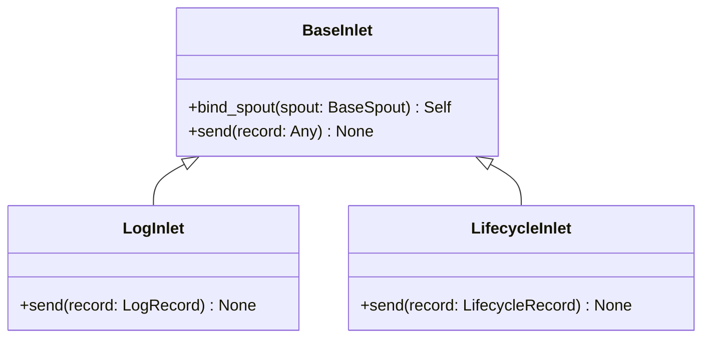

# src/celestialflow/funnel/core_inlet.py

> 📅 最后更新日期: 2026/11/13

`BaseInlet` 是所有入口类（Inlet）的基类，负责将记录通过队列发送到对应的 `BaseSpout`。

## 类定义

```python
class BaseInlet:
    _queue: Queue[Any]
    _counter: PendingCounter

    def bind_spout(self, spout: BaseSpout) -> Self:
        """
        将当前 inlet 绑定到给定 spout。

        :param spout: 目标监听器
        :return: 当前已绑定的 inlet 实例
        """
        self._queue = spout.get_queue()
        self._counter = spout.get_counter()
        return self

    def send(self, record: Any) -> None:
        """
        将记录送入绑定 spout 的队列。

        :param record: 待发送的记录
        :return: ``None``
        """
        if not hasattr(self, "_queue") or not hasattr(self, "_counter"):
            raise InitializationError("inlet is not bound to spout")

        # 先增加待处理数量，再入队；若入队失败则立即回滚计数。
        self._counter.increment()
        try:
            self._queue.put(record)
        except Exception:
            self._counter.decrement()
            raise
```

## 核心方法

### bind_spout

```python
def bind_spout(self, spout: BaseSpout) -> Self:
```

- 将当前 inlet 绑定到指定的 `BaseSpout` 实例。
- 内部会复用 spout 的输入队列（`_queue`）和待处理计数器（`_counter`）。
- 返回自身，支持链式调用：`BaseInlet().bind_spout(spout)`。
- 未绑定前调用 `send()` 会抛出 `InitializationError`。

### send（公开）

```python
def send(self, record: Any) -> None:
```

- 将 `record` 放入与 spout 共享的队列，是 Inlet 唯一的写入出口。
- 入队前先 `increment()` 计数；若入队失败则立即 `decrement()` 回滚，并原样重新抛出异常。
- 未绑定 spout 时（缺少 `_queue` / `_counter`）抛 `InitializationError("inlet is not bound to spout")`。
- 子类可新增语义化方法（例如 `emit()`），内部委托给 `self.send(...)`；**不要**覆写 `send()` 后再回调 `self.send(...)`，否则会无限递归。

## 继承关系



### 继承关系说明

| 子类 | 所在文件 | 职责 |
|------|---------|------|
| `LogInlet` | `persist/core_log.py` | 日志记录入口，`send(LogRecord)` 转发到 `LogSpout`；具体事件翻译由 `LogObserver` 完成 |
| `LifecycleInlet` | `persist/core_lifecycle.py` | 生命周期记录入口，`send(LifecycleRecord)` 转发到 `LifecycleSpout` 写入 SQLite；具体事件翻译由 `LifecycleObserver` 完成 |

## 使用示例

```python
from celestialflow.funnel import BaseSpout, BaseInlet


class MySpout(BaseSpout):
    def __init__(self):
        super().__init__()
        self.received = []

    def _handle_record(self, record):
        self.received.append(record)


class MyInlet(BaseInlet):
    # 新增语义化方法，内部委托给公开的 send()
    def emit(self, data):
        self.send(data)


# 使用
spout = MySpout()
inlet = MyInlet().bind_spout(spout)

spout.start()
inlet.emit("hello")
inlet.emit({"key": "value"})
spout.stop()

print(spout.received)
```

## 注意事项

1. **单向通信**: Inlet 只管写入队列，Spout 负责消费，两者通过队列解耦。
2. **绑定方式**: 队列和计数器由 `BaseSpout` 创建并通过 `bind_spout()` 共享给 Inlet，Inlet 不直接负责队列生命周期。
3. **线程安全**: 使用 `queue.Queue` 与 `PendingCounter`（内部加锁）实现线程间安全通信。
4. **未绑定异常**: 若未调用 `bind_spout()` 就调用 `send()`，会抛出 `InitializationError`。
5. **使用模式**: 通常每个 `BaseSpout` 对应一个 `BaseInlet`，形成生产者-消费者对。
6. **不要覆写 `send()` 再委托自身**: `send()` 是 Inlet 的最终写入出口，子类应新增语义化方法并调用 `self.send(...)`。
