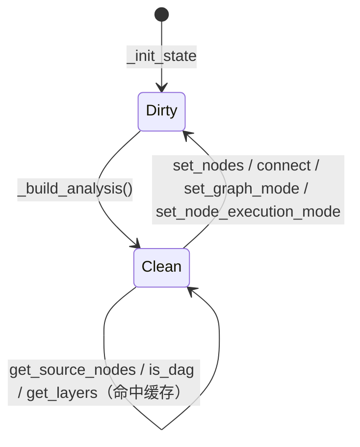
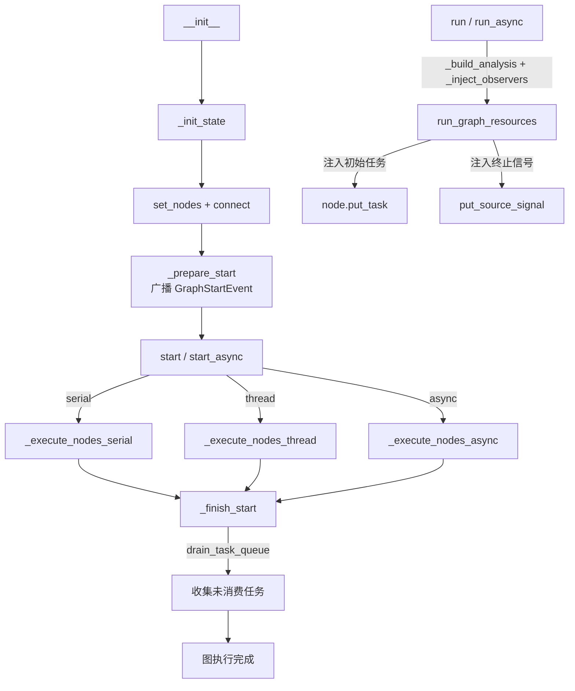

# src/celestialflow/graph/core_graph.py

> 📅 最后更新日期: 2026/10/30

`TaskGraph` 是 CelestialFlow 的核心调度器，负责管理一组任务节点（`BaseTaskNode` 派生对象，公共 API 包括 `TaskExecutor`、`TaskSplitter`、`TaskRouter`）的依赖关系、执行流程与生命周期。

> 注意：`TaskGraph` 是一次性对象。一次 `start()` / `start_async()` / `run()` 完成后，不保证当前实例可被安全重置并再次启动；如需重复执行同一流程，请重新创建新的 `TaskGraph` 和关联任务节点。

## 关键数据结构

`TaskGraph` 内部使用 `node_dict: dict[str, AnyTaskNode]` 维护所有节点的映射，队列连接在 `connect()` 阶段通过节点的 `connect_to()` 建立。图分析基于内部维护的 `OrderGraph` 实例（`self.order_graph`），其 `out_edges` / `in_edges` 是入/出边邻接表引用视图。

图分析结果全部为**私有字段**，只能通过公开方法访问：

| 私有字段 | 类型 | 对应的公开访问方法 |
|---------|------|------------------|
| `_source_names` | `list[str]` | `get_source_nodes()` |
| `_is_dag` | `bool` | `is_dag()` |
| `_layers_dict` | `dict[int, list[str]]` | `get_layers()` |
| `_analysis_dirty` | `bool` | 无（内部缓存失效标记） |

> 这三个字段不再是公开属性。旧写法 `graph.source_names`、`graph.is_dag`、`graph.layers_dict` 已不可用；其中 `is_dag` 已改为**方法调用** `graph.is_dag()`，请勿按布尔属性使用（未加括号时得到的是绑定方法对象，恒为真值）。

## 图分析惰性重建

`TaskGraph` 不在构造时计算图分析结果，而是采用「惰性 + 脏标记」策略：

- `_init_state()` 把 `_analysis_dirty` 初始化为 `True`。
- `get_source_nodes()` / `is_dag()` / `get_layers()` 在返回前都会调用 `_build_analysis()`；后者仅在 `_analysis_dirty is True` 时真正重算，否则直接返回缓存。
- 任何可能改变图结构或分析语义的构建期操作都会把 `_analysis_dirty` 置为 `True`：
  - `set_nodes()`（新增节点）
  - `connect()`（新增边）
  - `set_graph_mode()`（`serial` 模式下的环检测语义随之变化）
  - `set_node_execution_mode()`（节点执行模式变化）
- `_build_analysis()` 计算完成后把 `_analysis_dirty` 置回 `False`。
- `run()` / `run_async()` 在启动前会先调用一次 `_build_analysis()`，因此串行执行阶段可以直接使用已建好的 `_layers_dict`。



## 初始化

```python
class TaskGraph:
    def __init__(self, name: str, graph_mode: str = "serial"): ...
```

### 参数说明

- **name**: 任务图名称（必填）
- **graph_mode**: 图执行模式
  - `serial`（默认）: 串行执行，按层级（`get_layers()`）拓扑序逐层执行
  - `thread`: 线程并发执行，每个节点在独立线程中启动
  - `async`: 异步并发执行，需要在已运行事件循环的上下文中调用（见 [`start_async`](#start_async)）

`__init__` 依次调用 `_set_name`、`set_graph_mode`、`set_ctree(LocalEventClient())` 与 `_init_state()`。

## 图构建

### set_nodes

```python
def set_nodes(self, nodes: list[AnyTaskNode]) -> None:
    """
    添加节点到任务图中。注册节点、写入 OrderGraph，并注入图级事件客户端。

    :param nodes: 待添加的节点列表
    :raises DuplicateNodeError: 存在重复的节点名称
    """
```

注册完成后会把 `_analysis_dirty` 置为 `True`，下次读取分析结果时才会重算。

### connect

```python
def connect[R](
    self,
    from_nodes: list[AnyTaskNode],
    to_nodes: list[AnyTaskNode],
) -> None:
    """
    建立超边连接：from_nodes 中的每个节点连接到 to_nodes 中的每个节点。
    内部调用 from_node.connect_to(to_node) 完成队列连接，并向 order_graph 添加边。

    :param from_nodes: 上游节点列表
    :param to_nodes: 下游节点列表
    :raises NodeNotFoundError: 任一端节点未注册
    """
```

连接完成后同样把 `_analysis_dirty` 置为 `True`。

## 配置方法

### _set_name

```python
def _set_name(self, name: str) -> None:
    """设置任务图名称。"""
```

### set_graph_mode

```python
def set_graph_mode(self, graph_mode: str) -> None:
    """
    设置图执行模式，可选值为 'serial'、'thread' 或 'async'。

    :raises InvalidOptionError: graph_mode 不在合法集合中
    """
```

设置成功后把 `_analysis_dirty` 置为 `True`。

### set_node_execution_mode

```python
def set_node_execution_mode(self, execution_mode: str) -> None:
    """
    批量设置所有节点的 execution_mode（'serial'、'thread' 或 'async'）。
    仅把 _analysis_dirty 置为 True；实际的图分析重算在下次读取分析结果时发生。
    """
```

### set_ctree

```python
def set_ctree(self, ctree_client: EventClient) -> None:
    """
    设置任务图共享的事件客户端。
    传入后会同步下发给当前图中的所有节点。
    """
```

> 默认情况下，`TaskGraph` 会在内部使用 `LocalEventClient()` 生成本地递增事件 ID，因此即使没有安装 `celestialtree`，核心执行链路也可以正常工作。
>
> 如果你希望把事件上报到 CelestialTree，需要先额外安装 `celestialtree`，再自行构造对应客户端实例并传给 `set_ctree()`。

## 观察者

### add_observer

```python
def add_observer(self, observer: Observer) -> None:
    """
    注册图级观察者。

    图级观察者会收到图中所有节点的事件；该注册仅在 run() / run_async()
    路径下生效（这两个入口会把图级 hub 注入每个节点）。
    """
```

图级观察者经 `_inject_observers()` 注入每个节点，注入的是 hub 对象本身，因此运行期往图级 hub 增删观察者会立即对所有节点生效。注入必须在灌入初始任务之前完成，否则初始任务的输入事件不会分发给图级观察者。

### get_observers

```python
def get_observers(self) -> ObserverHub:
    """返回图级观察者 hub，供节点以外的协作者以观察者形式发布事件。"""
```

## 图分析

### _build_analysis

```python
def _build_analysis(self) -> None:
    """
    按需分析任务图，计算源节点、是否为 DAG 与层级信息。

    :raises ConfigurationError: serial 模式下图含环（非 DAG）时触发
    """
```

行为要点：

1. `_analysis_dirty is False` 时直接返回，不重复计算。
2. 依次执行 `source_nodes()` → `is_dag()`（`util_order_graph` 中的模块级函数）→ `compute_node_levels()` → `cluster_by_value_sorted()`，结果写入 `_source_names` / `_is_dag` / `_layers_dict`。
3. 把 `_analysis_dirty` 置为 `False`。
4. 若图含环且 `graph_mode == "serial"`，抛出 `ConfigurationError`，提示改用 `thread` 或 `async`。

> 该方法是幂等的「缓存重建入口」，不应由外部直接调用；公开读取请使用 `get_source_nodes()` / `is_dag()` / `get_layers()`。

### put_source_signal

```python
def put_source_signal(self) -> None:
    """将终止信号放入所有源节点的队列中。"""
```

遍历 `_source_names`，对 `node_dict` 中对应节点调用 `put_signal()`。由于 `run()` / `run_async()` / `start()` 已经触发过 `_build_analysis()`，此处读取到的源节点列表是有效的缓存。

## 启动执行

### run

```python
def run(
    self,
    init_tasks_dict: dict[str, Iterable[Any]],
    *,
    if_put_signal: bool = True,
    log_level: str = DEFAULT_LOG_LEVEL,        # 默认 "INFO"
    report: ReportConfig | None = None,
) -> None:
    """
    运行任务图。流程：
    1. 调用 _build_analysis() 构建（或复用）图分析缓存
    2. 调用 _inject_observers() 注入图级观察者 hub
    3. 在 run_graph_resources 上下文中，把 init_tasks_dict 中每个任务注入对应节点（node.put_task）
    4. if_put_signal=True 时自动向源节点注入终止信号
    5. 调用 start() 启动执行
    """
```

参数说明：

| 参数 | 类型 | 默认值 | 说明 |
|------|------|:------:|------|
| `init_tasks_dict` | `dict[str, Iterable[Any]]` | 必填 | 键为节点名称，值为该节点的任务可迭代对象 |
| `if_put_signal` | `bool` | `True` | 是否在注入任务后自动向源节点补发终止信号 |
| `log_level` | `str` | `DEFAULT_LOG_LEVEL`（`"INFO"`） | `LogInlet` 的日志过滤级别，大小写不敏感，首尾空白会被忽略 |
| `report` | `ReportConfig \| None` | `None` | 远程上报配置；`None` 表示不上报 |

- `raises InvalidOptionError`: `log_level` 不在允许的级别集合中时（由 `run_graph_resources` 内部的 `normalize_log_level()` 抛出）。
- 运行期异常会被收集为 `error_list`，最终以 `ExceptionGroup("Errors occurred during run", ...)` 抛出。

```python
from celestialflow import TaskExecutor, TaskGraph
from celestialflow.runtime import ReportConfig

node = TaskExecutor("S1", func=lambda x: x + 1)
graph = TaskGraph(name="MyGraph", graph_mode="thread")
graph.set_nodes([node])

graph.run(
    {node.get_name(): [1, 2, 3]},
    log_level="DEBUG",
    report=ReportConfig(url="http://127.0.0.1:5005"),  # 传 None 表示不上报
)
```

运行期的观察者注入、全局 funnel 观察者注册以及 `lifecycle` / `log` spout 的启停由 `run_graph_resources` 上下文统一管理。启用 `report` 时，该上下文还会注册 `PushInlet` / `PushSnapshotHandler`，启动 `PushSpout` 与节拍器，按拍推送状态快照并从远端拉取待注入任务。

### run_async

```python
async def run_async(
    self,
    init_tasks_dict: dict[str, Iterable[Any]],
    *,
    if_put_signal: bool = True,
    log_level: str = DEFAULT_LOG_LEVEL,
    report: ReportConfig | None = None,
) -> None:
    """异步版本的 run()，注入后调用 start_async()。参数含义与 run() 一致。"""
```

### restore_db

```python
def restore_db(
    self,
    db_path: str | Path,
    statuses: Iterable[str] | None = None,
    *,
    filter_by_error_type: bool = False,
    if_put_signal: bool = True,
    log_level: str = DEFAULT_LOG_LEVEL,
    report: ReportConfig | None = None,
) -> None:
    """
    从 sqlite 持久化库中读取任务，按持久化记录中的节点名分组后启动任务图。

    :param db_path: sqlite 数据库文件路径
    :param statuses: 记录状态过滤列表，默认 ``["failed", "pending"]``
    :param filter_by_error_type: 是否按各节点的 ``retry_exceptions`` 过滤
        ``error_type``，默认 ``False``
    :param if_put_signal: 是否在恢复任务注入后为所有源节点补发终止信号，默认 True
    :param log_level: 日志过滤级别，默认 ``DEFAULT_LOG_LEVEL``
    :param report: 远程上报配置；``None`` 表示不上报，默认 ``None``
    """
```

恢复流程：

1. 调用 `load_tasks_grouped_by_node(db_path, statuses)`（来自 `persist.util_sqlite`）得到 `{节点名: [记录, ...]}`。
2. 遍历每组记录时，若节点名不在 `self.node_dict` 中则 `continue` 跳过——即**不再对图中已不存在的节点回放任务**，避免因拓扑变更后的陈旧记录导致注入失败。
3. `filter_by_error_type=True` 时按 `node.get_retry_error_type_names()` 过滤 `error_type`，`status == "pending"` 的记录始终保留。
4. 汇总为 `tasks` 后复用 `run()`，并把 `if_put_signal` / `log_level` / `report` 原样透传。

> 由于第 2 步只做跳过不做报错，恢复时若数据库中的节点名与当前图不一致，多余记录会被静默丢弃，请自行确认图结构与持久化数据一致。

### 生命周期约束

- `TaskGraph` 内部会在启动过程中建立运行期队列连接、前驱绑定、线程引用和状态快照。
- 这些运行时资源设计上服务于一次完整执行，不承诺在运行结束后被安全清空并复用。
- 如果需要重新跑同一套拓扑，推荐重新实例化图对象与节点对象，而不是再次调用同一实例的 `run()`。

```python
from celestialflow import TaskExecutor, TaskGraph

node_a = TaskExecutor("A", func=lambda x: x + 1)
node_b = TaskExecutor("B", func=lambda x: x * 2)

graph = TaskGraph(name="MyGraph", graph_mode="thread")
graph.set_nodes(nodes=[node_a, node_b])
graph.connect([node_a], [node_b])
graph.run({node_a.get_name(): [1, 2, 3, 4, 5]})
```

### start

```python
def start(self) -> None:
    """
    启动任务图（同步入口）。
    根据 graph_mode 选择 _execute_nodes_serial() 或 _execute_nodes_thread()；
    其它模式抛出 InvalidOptionError。
    启动与收尾阶段的异常会聚合为 ExceptionGroup 抛出。
    """
```

`start()` 先记录 `start_perf = time.perf_counter()`，再调用 `_prepare_start()`，最后在 `finally` 中调用 `_finish_start(start_perf)`。

### start_async

```python
async def start_async(self) -> None:
    """
    异步启动任务图。要求 graph_mode='async'，否则抛出 InvalidOptionError。
    与同步 start() 的区别：
    - async 执行模式的节点走协程（node.start_async()），不会在节点内部再调用 asyncio.run；
    - serial / thread 执行模式的节点通过 asyncio.to_thread 在独立线程中运行。
    """
```

### _prepare_start / _finish_start

```python
def _prepare_start(self) -> None:
    """
    启动前准备：向图级观察者 hub 广播 on_graph_start 事件。
    start_time 取调用时刻的 time.time()；is_dag 通过 self.is_dag() 现取。
    """


def _finish_start(self, start_perf: float) -> list[Exception]:
    """
    启动后收尾：遍历所有节点调用 drain_task_queue() 收集未消费任务，
    广播 on_graph_end 事件，清理线程引用，返回收集到的异常列表。
    """
```

`_prepare_start()` 广播的 `GraphStartEvent` 字段：`graph`、`graph_mode`、`start_time`（`time.time()`）、`is_dag`（`self.is_dag()`）、`nodes`、`edges`、`source_nodes`、`node_meta`。事件中**不包含** `class_name`；节点类名只在 `node_meta` 的每一项里出现。`start_time` 在真正开始执行时才取 `time.time()`，`TaskGraph` 不再维护 `self.start_time` 实例字段。

`_finish_start()` 中 `elapsed` 由 `time.perf_counter() - start_perf` 计算，结束后清空 `self.threads`。

`lifecycle` / `log` 相关 spout、节拍器的启停由外层 `run_graph_resources` 统一管理，本方法只负责图对象自身的收尾逻辑。

### _execute_nodes_serial / _execute_nodes_thread / _execute_nodes_async

```python
def _execute_nodes_serial(self) -> None:
    """按层级（self._layers_dict）拓扑序逐层、逐个串行执行（层间按层级升序、层内按注册顺序）。"""


def _execute_nodes_thread(self) -> None:
    """每个节点在独立守护线程中启动，最后统一 join。"""


async def _execute_nodes_async(self) -> None:
    """全图并发执行（asyncio.gather）。"""
```

`_execute_nodes_serial()` 直接读取 `_layers_dict`，依赖 `start()` 之前 `_build_analysis()` 已经完成计算（`_prepare_start()` 中的 `is_dag()` 调用即会触发）。

### _execute_node / _execute_node_async

```python
def _execute_node(self, node: AnyTaskNode) -> None:
    """
    在同步图启动路径下执行单个节点。
    - async 节点走 asyncio.run(node.start_async())
    - 其他节点走 node.start()
    """


async def _execute_node_async(self, node: AnyTaskNode) -> None:
    """
    异步执行单个节点：async 走协程，其余走 asyncio.to_thread(node.start)。
    """
```

## 查询接口

| 方法 | 返回类型 | 说明 |
|------|---------|------|
| `get_nodes()` | `list[str]` | 按注册顺序返回所有节点名称 |
| `get_edges()` | `dict[str, list[str]]` | 出边邻接表（与内部 `OrderGraph` 共享引用，调用方应只读） |
| `get_node_meta()` | `dict[str, dict[str, Any]]` | 各节点的构建期元信息 |
| `get_source_nodes()` | `list[str]` | 源节点名称列表（返回前按需触发图分析） |
| `is_dag()` | `bool` | 是否为有向无环图（返回前按需触发图分析） |
| `get_layers()` | `dict[int, list[str]]` | `{层级: 节点名称列表}`（返回前按需触发图分析） |
| `get_order_graph()` | `OrderGraph` | 内部有序有向图实例 |
| `get_observers()` | `ObserverHub` | 图级观察者 hub |

```python
from celestialflow import TaskExecutor, TaskGraph

a = TaskExecutor("A", func=lambda x: x + 1)
b = TaskExecutor("B", func=lambda x: x * 2)
graph = TaskGraph(name="Demo", graph_mode="thread")
graph.set_nodes([a, b])
graph.connect([a], [b])

print(graph.get_source_nodes())  # ['A']
print(graph.is_dag())            # True（注意是方法调用）
print(graph.get_layers())        # {0: ['A'], 1: ['B']}
```

> 语义细节：`get_source_nodes()` 返回的是「每个源 SCC 的一个代表节点」（由 `util_order_graph.source_nodes()` 得到），因此含环图不会返回环上的全部节点；`get_layers()` 中同一 SCC 内的节点共享同一层级。三者返回的 `list` / `dict` 都是缓存对象本身，调用方应只读。

### 注入接口

```python
def inject_tasks(self, tasks: Mapping[str, Sequence[Any]]) -> None:
    """
    按节点名将注入任务写入待执行队列。先尽力注入存在的节点，再对未知节点统一报错。

    :raises UnknownNodeError: 存在图中不存在的目标节点
    """


def inject_terminations(self, nodes: Sequence[str]) -> None:
    """
    向指定节点注入终止信号。先尽力注入存在的节点，再对未知节点统一报错。

    :raises UnknownNodeError: 存在图中不存在的目标节点
    """
```

> `inject_tasks` / `inject_terminations` 采用"先尽力注入、后集中报错"策略，因此单个未知节点不会导致其余节点的任务/终止信号被丢弃。这两个接口是运行期远端注入（`run_graph_resources` 中的 `PushInlet`）的落点。

### get_node_meta 说明

返回各节点的构建期元信息，这些字段在运行期固定不变，随图结构一次性上报，不进入每轮状态推送：

```python
{
    node_name: {
        "class_name": ...,  # 节点类名
        "execution_mode": ...,  # 执行模式
        "max_workers": ...,  # 最大并发工作数
    }
}
```

### 图级事件（观察者）

`TaskGraph` 在 `_prepare_start()` / `_finish_start()` 阶段向观察者 hub 广播 `GraphStartEvent` 与 `GraphEndEvent`。图分析信息（图名、模式、启动时间、`is_dag`、节点/边/源节点列表、节点元信息等）在启动事件中一次性上报；运行时监控建议通过 `add_observer()` 注册图级观察者完成，而非依赖单个节点轮询。

| 事件 | 字段 |
|------|------|
| `GraphStartEvent` | `graph`、`graph_mode`、`start_time`、`is_dag`、`nodes`、`edges`、`source_nodes`、`node_meta` |
| `GraphEndEvent` | `graph`、`end_time`、`elapsed` |

## 生命周期图



## 图执行模式详解

### serial 模式

```
按 get_layers() 层级拓扑序逐层同步执行 node.start() → 数据通过队列流动 → 终止信号到达后停止
```

- 按层级（拓扑序）逐层同步执行，层内按注册顺序
- 默认模式
- 图含环时会在 `_build_analysis()` 抛出 `ConfigurationError`

### thread 模式

```
为每个节点启动独立线程 → node.start() → join 全部线程
```

- 最大化并行度
- 适用场景：CPU/IO 混合型并发流水线

### async 模式

```
异步执行所有节点（asyncio.gather）→ 需在已有事件循环中调用 start_async()
```

- 全图并发协程执行
- `serial` / `thread` 模式下的节点通过 `asyncio.to_thread` 在独立线程中运行，避免阻塞事件循环
- 适用场景：需要与其它异步系统集成

## 非 DAG 图的注意事项

对于有环图（`TaskLoop` / `TaskWheel` 等），若 `graph_mode='serial'` 且图含环（非 DAG），
`_build_analysis` 会抛出 `ConfigurationError`，提示切换到 `thread` 或 `async` 模式。

若在 `thread` / `async` 模式下使用有环图，建议在 `run` 时设置 `if_put_signal=False`，
由外部显式注入 `TerminationSignal` 控制停止时机，否则终止信号可能让部分节点在收到
上游数据前提前退出。

```python
# 环图：run() 会一直阻塞，需在外部条件满足时注入终止
# loop = TaskLoop(name="Loop", nodes=[n1, n2, n3])
# loop.run({n1.get_name(): tasks}, if_put_signal=False)
# 另一个线程或回调中：
# loop.inject_terminations([n1.get_name(), n2.get_name(), n3.get_name()])
```

## 使用示例

### 最小可运行示例

```python
from celestialflow import TaskExecutor, TaskGraph


def stage_a(x: int) -> int:
    return x + 1


def stage_b(x: int) -> int:
    return x * 2


a = TaskExecutor("A", func=stage_a)
b = TaskExecutor("B", func=stage_b)

graph = TaskGraph(name="Demo", graph_mode="thread")
graph.set_nodes([a, b])
graph.connect([a], [b])

graph.run({a.get_name(): [1, 2, 3]})

print(graph.get_source_nodes())
print(graph.is_dag())
print(graph.get_layers())
```

### 启用远程上报与日志级别

```python
from celestialflow import TaskExecutor, TaskGraph
from celestialflow.runtime import ReportConfig

a = TaskExecutor("A", func=lambda x: x + 1)
graph = TaskGraph(name="Reported", graph_mode="thread")
graph.set_nodes([a])

graph.run(
    {a.get_name(): [1, 2, 3]},
    log_level="DEBUG",
    report=ReportConfig(),  # 默认 http://127.0.0.1:5005
)
```

> `report` 只要非 `None` 即启用上报：需要该地址上确有接收服务（否则推送失败会被记为 `ReporterError`），且 `ReportConfig` 在构造时就会校验地址合法性（非 `http` / `https` 会抛 `ConfigurationError`）。

## 未消费任务处理

`_finish_start()` 中通过遍历 `node_dict` 调用每个节点的 `drain_task_queue()` 收集所有剩余任务，
将其标记为 `UnconsumedError` 并通过持久化层（lifecycle / log）按日期组织的 sqlite
持久化文件中记录失败信息。
