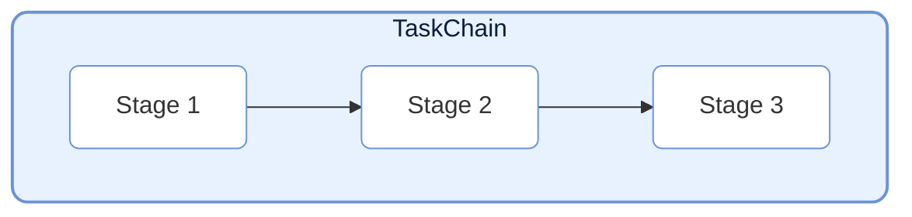
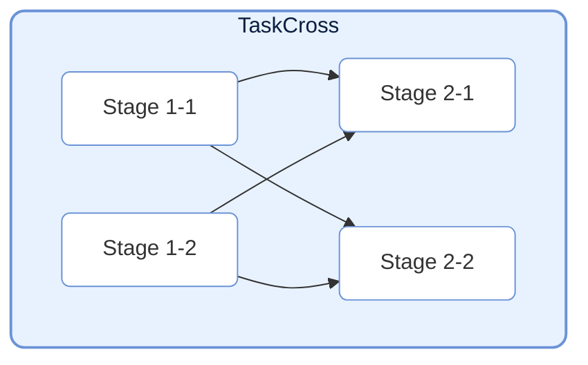
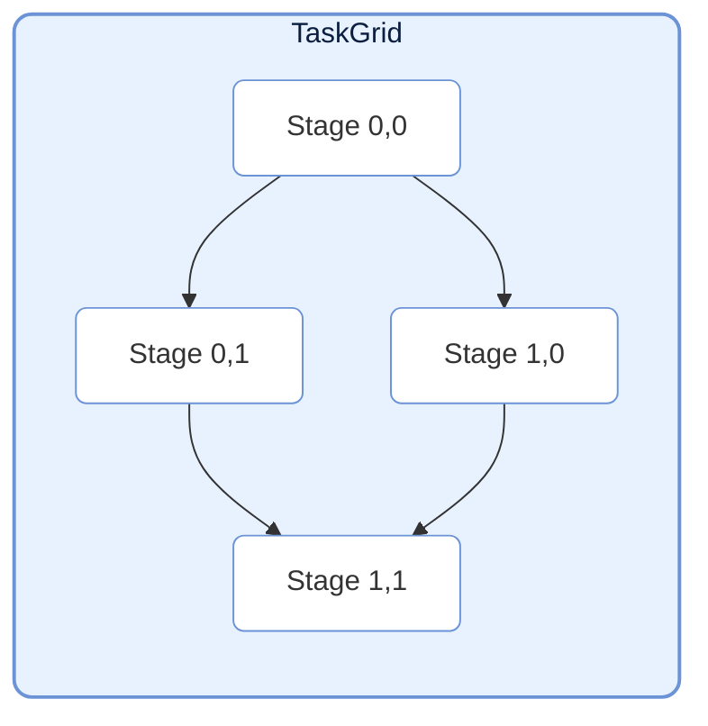
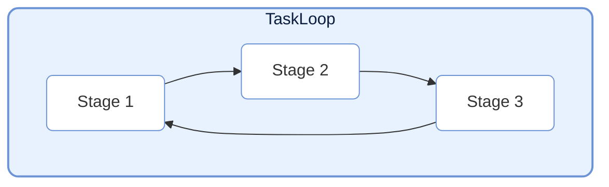
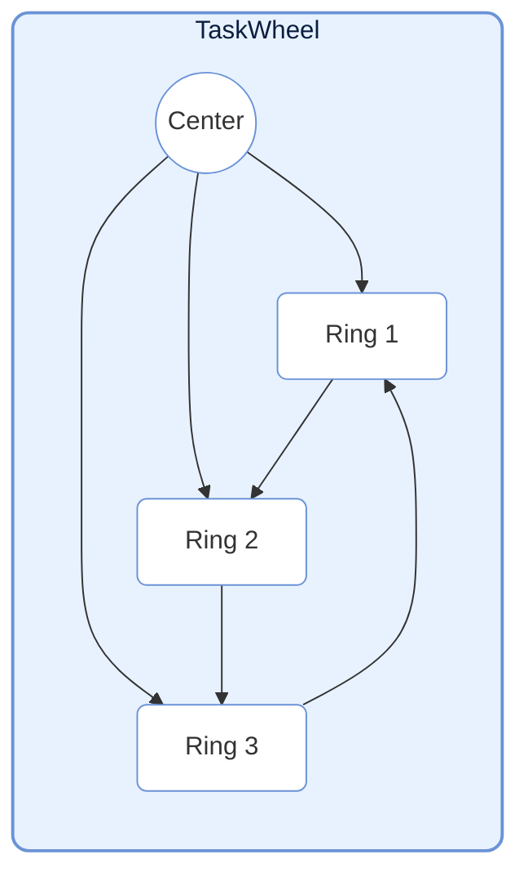
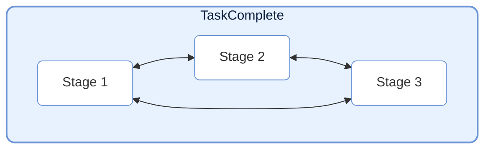

# src/celestialflow/graph/core_structure.py

> 📅 最后更新日期: 2026/10/30

`core_structure.py` 提供 6 种预定义任务图结构，帮助用户快速构建常见的任务流形态。所有结构都继承自 `TaskGraph`，因此同样具备 `run()` / `run_async()` / `start()` / `start_async()` / `get_*()` 等能力。

## 结构总览

| 结构 | 形态 | 是否 DAG | 构造参数 | 构造期校验 |
|------|------|:--------:|----------|------------|
| `TaskChain` | 线性链 | 是 | `nodes: list[AnyTaskNode]` | `nodes` 为空 → `InvalidStructureError` |
| `TaskCross` | 多层全连接 | 是 | `layers: list[list[AnyTaskNode]]` | `layers` 为空或含空层 → `InvalidStructureError` |
| `TaskGrid` | 二维网格 | 是 | `grid: list[list[AnyTaskNode]]` | `grid` 为空 / 首行为空 / 各行长度不一致 → `InvalidStructureError` |
| `TaskLoop` | 单环闭环 | 否 | `nodes: list[AnyTaskNode]` | `nodes` 为空 → `InvalidStructureError` |
| `TaskWheel` | 中心 + 环 | 否 | `center: AnyTaskNode, ring: list[AnyTaskNode]` | `ring` 为空 → `InvalidStructureError` |
| `TaskComplete` | 完全图 | 否 | `nodes: list[AnyTaskNode]` | 节点数 `< 2` → `InvalidStructureError` |

公共构造约定：

- 所有结构的 `graph_mode` 参数默认值为 `"thread"`（注意：`TaskGraph` 本身的默认值是 `"serial"`），可选 `"serial"` / `"thread"` / `"async"`。
- 非法 `graph_mode` 会在 `super().__init__()` 中由 `set_graph_mode()` 抛出 `InvalidOptionError`。
- 结构类在 `super().__init__()` 之后依次调用 `set_nodes()` 与若干次 `connect()`，因此实例化完成时图已构建好，`_analysis_dirty` 为 `True`，首次读取分析结果时按需重算。
- 除传入的节点外，结构类不额外创建节点对象；所有校验只检查容器形状与数量。

## Chain (线性链)



`TaskChain` 是最简单的任务结构，将多个节点按顺序连接，形成线性的数据流，链上只有一个源节点。

```python
from celestialflow import TaskChain, TaskExecutor

stage1 = TaskExecutor("S1", func=lambda x: x + 1)
stage2 = TaskExecutor("S2", func=lambda x: x * 2)
stage3 = TaskExecutor("S3", func=lambda x: x - 3)

chain = TaskChain(
    name="DataPipeline",
    nodes=[stage1, stage2, stage3],
    graph_mode="thread",  # thread: 节点并行运行; serial: 节点串行运行
)

chain.run({stage1.get_name(): [1, 2, 3]})
```

## Cross (交叉层)



`TaskCross` 将任务按“层”组织。每层包含多个并行执行的节点，相邻层之间的节点建立全连接依赖（上一层每个节点都连接到下一层所有节点）。**只有相邻层**之间建边，跨层（如第 1 层到第 3 层）不直接连接。

```python
from celestialflow import TaskCross, TaskExecutor

stage_1_1 = TaskExecutor("S11", func=lambda x: x + 1)
stage_1_2 = TaskExecutor("S12", func=lambda x: x * 2)
stage_2_1 = TaskExecutor("S21", func=lambda x: x - 1)
stage_2_2 = TaskExecutor("S22", func=lambda x: x // 2)

cross = TaskCross(
    name="CrossPipeline",
    layers=[[stage_1_1, stage_1_2], [stage_2_1, stage_2_2]],
    graph_mode="thread",
)
cross.run(
    {
        stage_1_1.get_name(): [1, 2],
        stage_1_2.get_name(): [10, 20],
    }
)
```

## Grid (网格)



`TaskGrid` 将任务节点组织成二维网格。每个节点连接其**右侧**（同一行 `j+1`）和**下方**（同一列 `i+1`）的节点；网格必须是矩形，即所有行长度相等。

```python
from celestialflow import TaskExecutor, TaskGrid

stage_00 = TaskExecutor("S00", func=lambda x: x)
stage_01 = TaskExecutor("S01", func=lambda x: x + 1)
stage_10 = TaskExecutor("S10", func=lambda x: x * 2)
stage_11 = TaskExecutor("S11", func=lambda x: x * x)

grid = TaskGrid(
    name="GridPipeline",
    grid=[[stage_00, stage_01], [stage_10, stage_11]],
    graph_mode="thread",
)
grid.run({stage_00.get_name(): [1, 2]})
```

## Loop (环形)



`TaskLoop` 将节点首尾相连形成闭环（最后一个节点连回第一个节点）。默认使用 `thread` 图执行模式。

> 环结构不是 DAG：`graph_mode="serial"` 会在 `_build_analysis()` 阶段抛出 `ConfigurationError`；即便使用 `thread` / `async`，也通常需要 `if_put_signal=False` 并由外部注入终止信号来控制停止时机。

```python
from celestialflow import TaskExecutor, TaskLoop

stage1 = TaskExecutor("L1", func=lambda x: x + 1)
stage2 = TaskExecutor("L2", func=lambda x: x * 2)
stage3 = TaskExecutor("L3", func=lambda x: x - 1)  # L3 -> L1 形成闭环

loop = TaskLoop(
    name="FeedbackLoop",
    nodes=[stage1, stage2, stage3],
)

# 环图不在此处直接 run：run 会一直阻塞，直到外部注入终止信号
print(loop.get_source_nodes())
print(loop.is_dag())  # False
```

## Wheel (轮形)



`TaskWheel` 包含一个中心节点和一个环形结构。中心节点连接向环上的每个节点，环上节点首尾相连。节点注册顺序为 `[center, *ring]`。

```python
from celestialflow import TaskExecutor, TaskWheel

center_stage = TaskExecutor("Hub", func=lambda x: {"input": x})
ring_stage1 = TaskExecutor("R1", func=lambda x: x["input"] + 1)
ring_stage2 = TaskExecutor("R2", func=lambda x: x["input"] + 2)
ring_stage3 = TaskExecutor("R3", func=lambda x: x["input"] + 3)

wheel = TaskWheel(
    name="HubAndSpoke",
    center=center_stage,
    ring=[ring_stage1, ring_stage2, ring_stage3],
)

# 环图执行同样需要外部终止注入，这里只验证结构
print(wheel.get_nodes())  # ['Hub', 'R1', 'R2', 'R3']
print(wheel.is_dag())  # False
```

## Complete (完全图)



`TaskComplete` 是一种特殊的结构，其中每个节点都连接向除自己以外的所有其他节点。由于存在双向连接，它必然含环，因此至少需要 2 个节点，且不能用于 `serial` 模式。

```python
from celestialflow import TaskComplete, TaskExecutor

stage1 = TaskExecutor("N1", func=lambda x: x**2)
stage2 = TaskExecutor("N2", func=lambda x: x + 1)
stage3 = TaskExecutor("N3", func=lambda x: x // 2)
stage4 = TaskExecutor("N4", func=lambda x: x - 1)

complete = TaskComplete(
    name="FullMesh",
    nodes=[stage1, stage2, stage3, stage4],
)

# 完全图含环，直接 run 会阻塞，需外部终止注入
print(complete.get_nodes())
print(complete.is_dag())  # False
```

## 使用示例

以下示例展示各预定义图结构的具体构建和执行方式。

### TaskChain 完整示例

```python
from celestialflow import TaskChain, TaskExecutor


# 定义三个阶段：数据清洗 -> 转换 -> 聚合
def clean(data: str) -> str:
    return data.strip()


def transform(data: str) -> int:
    return int(data) * 2


def aggregate(data: int) -> dict:
    return {"original": data // 2, "doubled": data}


# 构建链
s1 = TaskExecutor("Clean", func=clean)
s2 = TaskExecutor("Transform", func=transform)
s3 = TaskExecutor("Aggregate", func=aggregate)
chain = TaskChain(name="ETL", nodes=[s1, s2, s3], graph_mode="thread")

# 启动
chain.run({s1.get_name(): [" 10 ", " 20 ", " 30 "]})

# 获取节点数与结构
print(f"链阶段数: {len(chain.get_nodes())}")
print(chain.get_edges())
```

### TaskCross 完整示例

```python
from celestialflow import TaskCross, TaskExecutor


# 第一层：数据准备
def load_a(x: int) -> int:
    return x + 1


def load_b(x: int) -> int:
    return x * 10


# 第二层：计算分析
def analyze_a(x: int) -> float:
    return x * 1.5


def analyze_b(x: int) -> float:
    return x * 2.0


layer1 = [TaskExecutor("LoadA", func=load_a), TaskExecutor("LoadB", func=load_b)]
layer2 = [TaskExecutor("AnaA", func=analyze_a), TaskExecutor("AnaB", func=analyze_b)]

cross = TaskCross(name="DataAnalysis", layers=[layer1, layer2])
cross.run({layer1[0].get_name(): [1, 2], layer1[1].get_name(): [3, 4]})
print(cross.get_nodes())
print(cross.get_layers())
```

### TaskGrid 完整示例

```python
from celestialflow import TaskExecutor, TaskGrid

# 2x2 网格
n00 = TaskExecutor("Init", func=lambda x: x)
n01 = TaskExecutor("Add", func=lambda x: x + 1)
n10 = TaskExecutor("Mul", func=lambda x: x * 2)
n11 = TaskExecutor("Square", func=lambda x: x * x)

grid = TaskGrid(name="CalcGrid", grid=[[n00, n01], [n10, n11]])
grid.run({n00.get_name(): [1, 2, 3]})
print(grid.get_nodes())
print(grid.is_dag())  # True
```

### TaskLoop 完整示例

```python
from celestialflow import TaskExecutor, TaskLoop

# 三节点环：每个节点处理后将结果传给下一个
loop_nodes = [
    TaskExecutor("Ring1", func=lambda x: x + 1),
    TaskExecutor("Ring2", func=lambda x: x * 2),
    TaskExecutor("Ring3", func=lambda x: x - 3),  # Ring3 -> Ring1 形成闭环
]

loop = TaskLoop(name="RingLoop", nodes=loop_nodes)

# 环图不能直接 run（会一直阻塞），正确做法是在外部条件满足时注入终止：
# loop.inject_terminations([n.get_name() for n in loop_nodes])
# loop.run({loop_nodes[0].get_name(): [5]}, if_put_signal=False)
print(loop.get_nodes())
print(loop.is_dag())  # False
```

### TaskWheel 完整示例

```python
from celestialflow import TaskExecutor, TaskWheel

center = TaskExecutor("Hub", func=lambda x: {"input": x, "processed": x * 10})
ring_nodes = [
    TaskExecutor("Channel1", func=lambda x: x["processed"] + 1),
    TaskExecutor("Channel2", func=lambda x: x["processed"] + 2),
    TaskExecutor("Channel3", func=lambda x: x["processed"] + 3),
]

wheel = TaskWheel(name="HubWheel", center=center, ring=ring_nodes)

# 与 TaskLoop 相同：环图需外部终止注入后再 run
print(wheel.get_nodes())
print(wheel.is_dag())  # False
print(wheel.get_layers())  # 同一闭环内的节点共享层级
```

### TaskComplete 完整示例

```python
from celestialflow import TaskComplete, TaskExecutor

nodes = [
    TaskExecutor("N1", func=lambda x: x**2),
    TaskExecutor("N2", func=lambda x: x + 1),
    TaskExecutor("N3", func=lambda x: x // 2),
]

complete = TaskComplete(name="FullConnected", nodes=nodes)

# 完全图含环，需外部终止注入后再 run
print(complete.get_nodes())
print(complete.is_dag())  # False
```

## 注意事项

- 结构类只负责「建图」，不负责运行策略；`graph_mode` 与 `if_put_signal` 仍需按图形态自行选择。
- `TaskLoop` / `TaskWheel` / `TaskComplete` 均含环，`serial` 模式会在图分析阶段直接报错，`thread` / `async` 模式下应配合 `if_put_signal=False` 与外部终止注入。
- `TaskCross` 的层级全连接会放大边数：两层各 `m`、`n` 个节点时产生 `m * n` 条边；`TaskComplete` 在 `n` 个节点下产生 `n * (n - 1)` 条边，大规模使用前需评估队列与内存开销。
