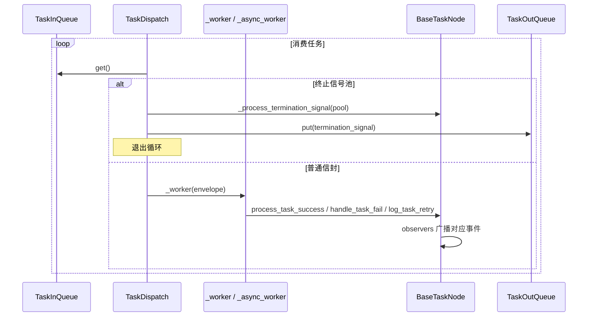
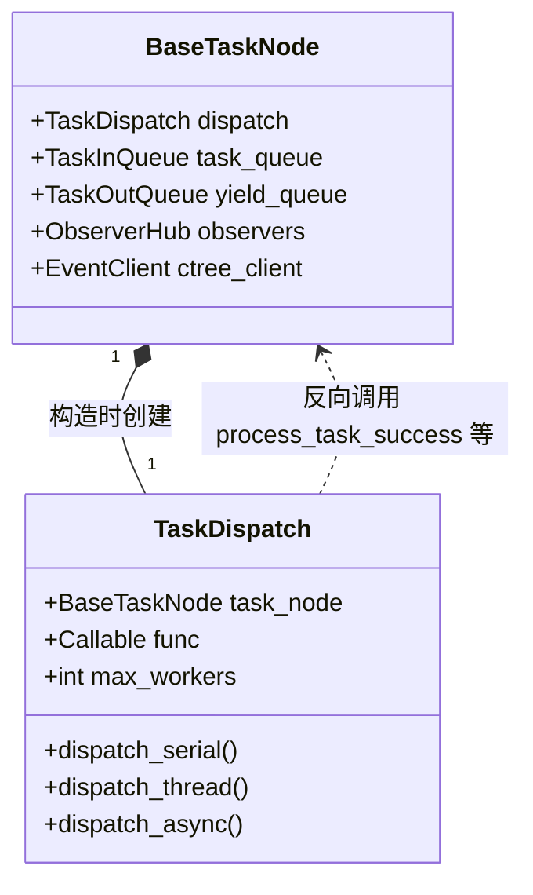

# src/celestialflow/node/core_dispatch.py

> 📅 最后更新日期: 2026/10/30

`core_dispatch.py` 定义了 `TaskDispatch[T, R, Y]`，即 `BaseTaskNode` 持有的"任务调度器"组件。它从节点对象的输入队列中拉取 `TaskEnvelope` / 终止信号，按 `execution_mode` 串行 / 线程 / 异步地调用节点回调，并负责合并终止信号、初始化 / 释放线程池，以及把 worker 最外层捕获到的异常交回宿主 `handle_task_fail` 统一处理。

> `TaskDispatch` 是 `BaseTaskNode` 的**内部组件**，由 `BaseTaskNode.__init__` 在构造时自动创建；它不是公共 API，不出现在 `node/__init__.py` 的 `__all__` 中。

## 核心对象

### `TaskDispatch[T, R, Y]`

```python
class TaskDispatch[T, R, Y]:
    def __init__(
        self,
        task_node: BaseTaskNode[T, R, Y],
        func: Callable[[T], R] | Callable[[T], Awaitable[R]],
        max_workers: int,
    ): ...
```

| 字段 | 类型 | 说明 |
|------|------|------|
| `task_node` | `BaseTaskNode[T, R, Y]` | 宿主节点（**不是** `TaskExecutor`，而是基类） |
| `func` | `Callable[[T], R] | Callable[[T], Awaitable[R]]` | 节点回调引用 |
| `max_workers` | `int` | 并发上限 |
| `_pool` | `ThreadPoolExecutor | None` | 线程池（仅 thread 模式使用） |

> 调度器会通过宿主对象反向调用 `task_node.observers` / `task_node.process_task_success` / `handle_task_fail` / `log_task_retry` / `get_name` / `ctree_client.emit` / `task_queue` / `yield_queue` 等。

## 公开调度方法

| 方法 | 用途 |
|------|------|
| `dispatch_serial()` | 在当前线程同步消费任务队列；遇到 `TerminationIdPool` 时合并并退出 |
| `dispatch_thread()` | 用 `ThreadPoolExecutor` 并发消费；任务数 ≥ `max_workers` 时阻塞等待空闲槽位 |
| `async dispatch_async()` | 维护 `pending` 任务集合限制并发的异步消费；流式到达、边收边跑 |

### `dispatch_serial`

主循环伪代码：

```text
while True:
    envelope = task_queue.get()
    if isinstance(envelope, TerminationIdPool):
        termination_signal = _process_termination_signal(envelope)
        break
    _worker(envelope)
yield_queue.put(termination_signal)
```

### `dispatch_thread`

```text
_init_pool("thread")
try:
    pending = set[Future[None]]()
    while True:
        envelope = task_queue.get()
        if isinstance(envelope, TerminationIdPool):
            termination_signal = _process_termination_signal(envelope)
            break
        # 限流：pending 数 ≥ max_workers 时阻塞等待已完成 futures
        while len(pending) >= max_workers:
            _, pending = wait(pending, return_when=FIRST_COMPLETED)
        pending.add(_pool.submit(_worker, envelope))
    wait(pending)  # 等待当前批次全部完成
    yield_queue.put(termination_signal)
finally:
    _release_pool()
```

### `dispatch_async`

```text
pending = set[asyncio.Task[None]]()

async def worker(envelope):
    await _async_worker(envelope)

while True:
    envelope = await asyncio.to_thread(task_queue.get)  # 不阻塞事件循环
    if isinstance(envelope, TerminationIdPool):
        termination_signal = _process_termination_signal(envelope)
        break

    # 限流：pending 数 ≥ max_workers 时等待最早完成的任务
    while len(pending) >= max_workers:
        _, pending = await asyncio.wait(pending, return_when=asyncio.FIRST_COMPLETED)

    task = asyncio.create_task(worker(envelope))
    pending.add(task)

if pending:
    await asyncio.gather(*pending)  # 等待队列耗尽后仍在执行的批次
yield_queue.put(termination_signal)
```

> 异步路径**不使用 `asyncio.Semaphore`**：并发上限完全由 `pending` 集合的 `len` 控制。每轮循环在创建新 task 前先检查 `len(pending) >= self.max_workers`，用 `asyncio.wait(..., return_when=asyncio.FIRST_COMPLETED)` 等出空位；收到终止信号后不再收新任务，但会 `asyncio.gather` 等待所有在途任务完成，再向下游投递合并后的终止信号。

## 内部辅助方法

| 方法 | 行为 |
|------|------|
| `_call_sync(task) -> R` | 调用同步回调；若返回 awaitable，抛 `ConfigurationError` |
| `_call_async(task) -> R` | 调用异步回调；若返回值不可 await，抛 `ConfigurationError` |
| `_worker(envelope) -> None` | 同步执行单个任务：先判断 `skip_func`，再 `for fail_times in range(1, max_retries + 2)` 重试循环；命中 `retry_exceptions` 时调用 `task_node.log_task_retry`，达到重试上限或非可重试异常时调用 `handle_task_fail`；成功时调用 `process_task_success`。最外层 `try` 捕获到未处理异常时同样调用 `task_node.handle_task_fail(task_envelope, exception)` 兜底 |
| `_async_worker(envelope) -> None` | 异步版 `_worker`，使用 `await self._call_async(task)`；最外层异常同样交给 `handle_task_fail` 兜底 |
| `_process_termination_signal(pool) -> TerminationSignal` | 把 `TerminationIdPool.ids` 中的所有 id 通过 `ctree_client.emit(CTreeEvent.TERMINATION_MERGE, parents=...)` 合并为单个 `TerminationSignal(source=task_node.get_name())`，并广播 `TerminationMergeEvent` |
| `_init_pool(execution_mode)` | 仅当 `execution_mode == "thread"` 且 `_pool is None` 时构造 `ThreadPoolExecutor(max_workers=self.max_workers)` |
| `_release_pool()` | 关闭并清空 `_pool`（线程模式结束时调用） |

### `_worker` 重试循环细节

```python
def _worker(self, task_envelope: TaskEnvelope[T]) -> None:
    try:
        task = task_envelope.get_task()
        if self.task_node.skip_func is not None and self.task_node.skip_func(task):
            self.task_node.handle_task_skip(task_envelope)
            return

        max_retries = self.task_node.max_retries
        for fail_times in range(1, max_retries + 2):
            try:
                start_perf = time.perf_counter()
                result = self._call_sync(task)
                self.task_node.process_task_success(task_envelope, result, start_perf)
                return
            except Exception as exception:
                if fail_times > max_retries or not isinstance(
                    exception, self.task_node.retry_exceptions
                ):
                    self.task_node.handle_task_fail(task_envelope, exception)
                    return
                self.task_node.log_task_retry(task_envelope, exception, fail_times)
    except Exception as exception:
        self.task_node.handle_task_fail(task_envelope, exception)
```

## 关键数据流



## 异常一览

| 异常 | 触发场景 |
|------|---------|
| `ConfigurationError` | 同步调用返回 awaitable / 异步调用返回非 awaitable |
| `InitializationError` | `dispatch_thread` 中 `_pool is None`（理论上 `_init_pool` 已保证，但代码保留兜底） |

> worker 最外层捕获到的其他异常不会重新抛出到框架调度路径，而是通过 `task_node.handle_task_fail(task_envelope, exception)` 计入该任务的失败记录（触发 `TaskFailEvent` 并持久化 `error_type` / `error_message`）。

## 与宿主 `BaseTaskNode` 的关系



> 在 `BaseTaskNode.__init__` 中通过 `self.dispatch = TaskDispatch(cast(BaseTaskNode[T, R, Y], self), self.func, self.max_workers)` 完成宿主绑定。

## 注意事项

1. **宿主类型是 `BaseTaskNode` 而非 `TaskExecutor`**：即使实际传入的是 `TaskSplitter` / `TaskRouter`，调度器也只通过 `BaseTaskNode` 接口访问宿主。
2. **终止信号路径**：单条 `TerminationSignal` 在 `TaskInQueue` 中会与其他来源合并为 `TerminationIdPool`；调度器在收到池子时统一 emit `TERMINATION_MERGE` 并广播 `TerminationMergeEvent`。
3. **线程池生命周期**：`_pool` 仅在 `dispatch_thread` 中临时存在，进入前 `_init_pool`、退出时 `_release_pool`，因此同一调度器不支持跨次 `start` 复用。
4. **异步路径不阻塞事件循环**：`dispatch_async` 用 `asyncio.to_thread(task_queue.get)` 拉取输入，并通过 `pending` 集合的 `len` 与 `asyncio.wait(FIRST_COMPLETED)` 控制并发，实现"边收边跑"且不卡事件循环；不使用 `asyncio.Semaphore`。
5. **worker 兜底异常回到宿主**：`_worker` / `_async_worker` 最外层 `except Exception` 调用 `task_node.handle_task_fail(task_envelope, exception)`，不再向观察者广播崩溃事件，也不再写入日志 inlet 的 `worker_crash`。
6. **支持跳过判定**：`_worker` / `_async_worker` 在执行前先判断 `skip_func`，命中则调用 `handle_task_skip` 并直接返回。