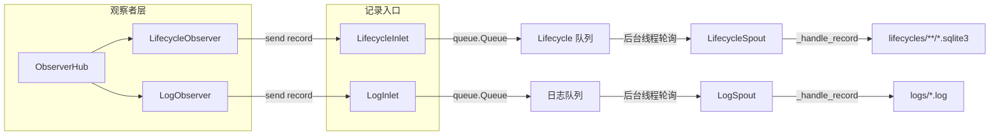

# src/celestialflow/persist/__init__.py

> 📅 最后更新日期: 2026/11/13

`persist` 模块是 CelestialFlow 的**持久化模块**，提供任务生命周期（Lifecycle）与运行日志（Log）的记录、写入与查询能力。

模块采用"**观察者 + 入口 + 监听器**"三层结构：

- `LifecycleObserver` / `LogObserver` 是 `Observer` 子类，消费观测事件并翻译为记录，同时负责 spout 的启停与路径暴露；
- `LifecycleInlet` / `LogInlet` 只继承 `BaseInlet`，提供 `send(record)`，把记录投入绑定 spout 的队列；
- `LifecycleSpout` / `LogSpout` 在后台线程从队列取出记录并落盘。

## 导出符号

模块级 `__all__` 完整导出如下：

```python
__all__ = [
    "InsertRecord",
    "LifecycleInlet",
    "LifecycleObserver",
    "LifecycleRecord",
    "LifecycleSpout",
    "LogInlet",
    "LogObserver",
    "LogRecord",
    "LogSpout",
    "PromoteFailedRecord",
    "PromoteSkippedRecord",
    "PromoteSuccessRecord",
    "UpdateRetryRecord",
]
```

| 导出符号 | 来源模块 | 说明 |
|---------|---------|------|
| `LifecycleObserver` | `core_lifecycle` | 生命周期观察者（门面），把事件翻译为生命周期记录，管理 spout 启停并暴露 `db_path` |
| `LifecycleInlet` | `core_lifecycle` | 生命周期记录入口，`send(record)` 投递到绑定的 spout |
| `LifecycleSpout` | `core_lifecycle` | 生命周期监听器，在后台线程把记录写入 SQLite |
| `LifecycleRecord` | `core_lifecycle` | 生命周期记录联合类型（`InsertRecord` 等五种的 `type` 别名） |
| `InsertRecord` | `core_lifecycle` | 新任务进入节点时写入的 pending 记录 |
| `PromoteSuccessRecord` | `core_lifecycle` | 将 pending 晋升为 `success` 并写入结果 |
| `PromoteFailedRecord` | `core_lifecycle` | 将 pending 晋升为 `failed` |
| `PromoteSkippedRecord` | `core_lifecycle` | 将 pending 晋升为 `skipped` |
| `UpdateRetryRecord` | `core_lifecycle` | 更新 pending 记录的重试次数与最近一次错误 |
| `LogObserver` | `core_log` | 日志观察者（门面），把事件翻译为日志记录，管理 spout 启停并暴露 `log_path` |
| `LogInlet` | `core_log` | 日志记录入口，`send(record)` 投递到绑定的 spout |
| `LogSpout` | `core_log` | 日志监听器，把日志写入 `logs/` 目录的文本文件 |
| `LogRecord` | `core_log` | 单条日志记录（`timestamp` / `level` / `message`） |

> 模块 `__init__` 仅导出 `core_*` 文件中的符号；工具函数 `util_payload` / `util_sqlite` / `util_render` 不在此导出，需按需从对应模块导入。

## 文件说明

1. **core_lifecycle.py**（`LifecycleObserver` / `LifecycleInlet` / `LifecycleSpout` / 记录类型）
   - **作用**: 任务生命周期的持久化，统一记录任务的 pending / success / failed / skipped 状态与重试信息。
   - **写入方式**: `LifecycleObserver.on_event()` 按事件类型构造 `LifecycleRecord` dataclass，经 `LifecycleInlet.send()` 入队；`LifecycleSpout._handle_record()` 按记录类型执行对应 SQLite 写操作。
   - **存储格式**: SQLite 数据库（WAL 模式），文件位于 `lifecycles/` 目录。

2. **core_log.py**（`LogObserver` / `LogInlet` / `LogSpout` / `LogRecord`）
   - **作用**: 运行日志收集与持久化。
   - **写入方式**: `LogObserver.on_event()` 处理图 / 节点 / 任务 / 终止信号事件并生成 `LogRecord`，依据 `metrics_view` 写入节点汇总，再经 `LogInlet.send()` 入队；`LogSpout` 把日志写入 `logs/` 目录下的文本文件。
   - **日志格式**: 每行包含 `timestamp level message`。

3. **util_payload.py**
   - **作用**: 将任务数据递归转换为 JSON 友好的持久化结构。
   - **关键函数**: `to_persisted_payload(task)`——基本类型透传、容器递归、其他类型降级为 `str()`。

4. **util_sqlite.py**
   - **作用**: SQLite 数据库的连接管理与记录读写工具。
   - **关键函数**: `connect_db`、`normalize_record`、`row_to_record_dict`、`insert_record`、`promote_record_to_{success,skipped,failed}_by_event_id`、`update_retry_by_event_id`、`delete_record_by_event_id`、`load_tasks_grouped_by_node`、`load_task_{error,result}_records`。写入类函数复用调用方传入的 `conn`；读取类函数自行建立并关闭连接。

5. **util_render.py**
   - **作用**: 图结构渲染工具，将节点 / 边 / 源节点渲染为带边框的树形文本。
   - **关键函数**: `render_structure_list(nodes, edges, source_nodes)`。

## 模块关联

### 内部关联
- `LifecycleObserver` / `LogObserver` 继承 `observer.Observer`，内部各自创建并绑定一个 inlet 与 spout，把记录投入 spout 队列。
- `LifecycleInlet` / `LogInlet` 只继承 `funnel.BaseInlet`，仅提供 `send(record)`；不再直接消费事件。
- `LifecycleSpout` / `LogSpout` 继承 `funnel.BaseSpout`，消费队列并落盘。

### 外部关联
- **与 Observer 模块**: `LifecycleObserver` / `LogObserver` 是 `Observer` 子类，由 `run_graph_resources` / `run_node_resources`（`assembly/core_run.py`）注册到 `ObserverHub` 并统一启停。
- **与 Node 模块**: `BaseTaskNode.get_success_pairs()` / `get_error_pairs()` 通过 `observers.find(LifecycleObserver)` 取得 `db_path` 后读取记录，因此独立运行与图级调度均可用。
- **与 Runtime 模块**: `LogObserver` 引用 `runtime.util_constant.LEVEL_DICT` 做级别过滤，引用 `runtime.util_types.MetricsView` 读取节点汇总。
- **与 Funnel 模块**: 复用 `BaseInlet` / `BaseSpout` 基类实现线程安全队列与消费线程。

## 架构特点

### 生产者-消费者模式



### 文件名规范

| 持久化类型 | 文件路径模式 |
|-----------|-------------|
| 日志 | `logs/flow_log({日期}).log` |
| 生命周期 | `./lifecycles/{日期}/flow_lifecycle({时间}).sqlite3` |

### 批量刷新策略

- 日志文件以**行缓冲**方式写入（`buffering=1`），读取方可以及时看到新增日志。
- Lifecycle SQLite 写入采用**即时 commit**：`LifecycleSpout._handle_record()` 在记录实际发生改动后立即 `commit()`，`_after_stop()` 再做一次 `commit()` 兜底。
- 全局 spout 不随单个执行器启停，而是由 `run_graph_resources` / `run_node_resources` 在整段运行期间统一启动与停止，避免频繁开关文件句柄。

## 使用示例

### 装配到观察者 hub（推荐）

```python
from celestialflow.observer import MetricsObserver, ObserverHub
from celestialflow.persist import LifecycleObserver, LogObserver

metrics_view = MetricsObserver()
hub = ObserverHub()
hub.add_observer(metrics_view)

lifecycle = LifecycleObserver()
log = LogObserver(metrics_view, log_level="INFO")
hub.add_observer(lifecycle)
hub.add_observer(log)

lifecycle.start()
log.start()
try:
    # ... 运行任务图或单节点 ...
    print(lifecycle.db_path, log.log_path)
finally:
    log.stop()
    lifecycle.stop()
```

### 只使用记录入口

```python
from celestialflow.persist import InsertRecord, LifecycleInlet, LifecycleSpout

spout = LifecycleSpout()
spout.start()
inlet = LifecycleInlet().bind_spout(spout)

inlet.send(InsertRecord(event_id=1, ts=0.0, node="StageA", task="hello"))

spout.stop()
```

## 注意事项

1. **事件消费在观察者层**：`LifecycleInlet` / `LogInlet` 不再消费事件，只提供 `send(record)`；事件到记录的翻译由 `LifecycleObserver` / `LogObserver` 负责。
2. **构造参数**：`LogObserver` 构造时需传入 `metrics_view`（`MetricsView`）与可选 `log_level`（默认 `runtime.util_log_level.DEFAULT_LOG_LEVEL`）。
3. **路径暴露**：`LifecycleObserver.db_path` / `LogObserver.log_path` 在 spout 启动前为 `None`。
4. **`__all__` 仅含核心符号**：工具函数位于 `util_*` 文件，需按需从 `celestialflow.persist.util_xxx` 导入。
