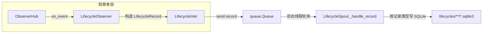

# src/celestialflow/persist/core_lifecycle.py

> 📅 最后更新日期: 2026/11/13

`persist/core_lifecycle.py` 负责任务生命周期（Lifecycle）的持久化：记录任务在整个生命周期中的状态变化（pending → success / failed / skipped，以及重试次数更新），并将数据写入 `lifecycles/` 目录下的 SQLite 数据库文件。

核心组件为记录类型 `InsertRecord` / `PromoteSuccessRecord` / `PromoteFailedRecord` / `UpdateRetryRecord` / `PromoteSkippedRecord`、监听器 `LifecycleSpout`、入口 `LifecycleInlet` 与观察者门面 `LifecycleObserver`。

## 架构设计

### 数据流



系统采用 **生产者-消费者** 模式：

1. **LifecycleObserver（观察者 + 翻译器）**：继承 `Observer`，在 `on_event()` 中把观测事件翻译为对应的记录 dataclass，经 `LifecycleInlet.send()` 放入线程安全队列；同时负责 spout 的 `start()` / `stop()` 并暴露 `db_path`。
2. **LifecycleInlet（记录入口）**：只继承 `BaseInlet`，提供类型化的 `send(record)`，不直接消费事件、也不操作数据库。
3. **LifecycleSpout（消费者）**：继承 `BaseSpout`，运行在独立后台线程中，根据记录的具体类型执行对应的 SQLite 写操作。

## 记录类型

所有记录均为 `frozen=True, slots=True` 的只读 dataclass，并且可用 `match` 按类型分派。

### InsertRecord

新任务进入节点时写入的 pending 记录。

| 字段 | 类型 | 说明 |
|------|------|------|
| `event_id` | `int` | 任务输入事件 ID（`TaskInputEvent.input_id`） |
| `ts` | `float` | 记录时间戳 |
| `node` | `str` | 节点名称 |
| `task` | `Any` | 任务的 JSON 友好载荷（已经过 `to_persisted_payload`） |

### PromoteSuccessRecord

将 pending 记录晋升为 success 并写入任务结果。

| 字段 | 类型 | 说明 |
|------|------|------|
| `event_id` | `int` | 任务输入事件 ID（`TaskSuccessEvent.task_id`） |
| `ts` | `float` | 记录时间戳 |
| `result` | `Any` | 任务结果的 JSON 友好载荷 |

### PromoteFailedRecord

将 pending 记录晋升为 failed。

| 字段 | 类型 | 说明 |
|------|------|------|
| `event_id` | `int` | 任务输入事件 ID（`TaskFailEvent.task_id`） |
| `error_id` | `int` | 最终失败事件 ID（`TaskFailEvent.error_id`） |
| `ts` | `float` | 记录时间戳 |
| `error_type` | `str` | 异常类型名称（`type(exception).__name__`） |
| `error_message` | `str` | 异常消息（`str(exception)`） |

### UpdateRetryRecord

更新 pending 记录的重试次数与最近一次失败信息。

| 字段 | 类型 | 说明 |
|------|------|------|
| `event_id` | `int` | 任务输入事件 ID（`TaskRetryEvent.task_id`） |
| `ts` | `float` | 记录时间戳 |
| `retry_times` | `int` | 已重试次数（`TaskRetryEvent.retry_times`） |
| `error_type` | `str` | 最近一次异常类型名称 |
| `error_message` | `str` | 最近一次异常消息 |

### PromoteSkippedRecord

将 pending 记录晋升为 skipped。

| 字段 | 类型 | 说明 |
|------|------|------|
| `event_id` | `int` | 任务输入事件 ID（`TaskSkipEvent.task_id`） |
| `skip_id` | `int` | 跳过事件 ID（`TaskSkipEvent.skip_id`） |
| `ts` | `float` | 记录时间戳 |

### LifecycleRecord

```python
type LifecycleRecord = (
    InsertRecord
    | PromoteSuccessRecord
    | PromoteFailedRecord
    | UpdateRetryRecord
    | PromoteSkippedRecord
)
```

`LifecycleInlet.send()` 与 `LifecycleSpout._handle_record()` 都接收该联合类型，由 `match` 按具体类型决定写入语义。

## LifecycleSpout

`LifecycleSpout` 继承 `BaseSpout`，负责管理 SQLite 数据库文件的创建和写入。

### 初始化与启动

```python
class LifecycleSpout(BaseSpout):
    def __init__(self) -> None:
        """初始化生命周期记录监听器。"""
        super().__init__()

        self.db_path: Path | None = None
        self._conn: sqlite3.Connection | None = None
```

启动后（`_before_start()`），会在 `./lifecycles/{date}/` 目录下创建一个 `flow_lifecycle({time}).sqlite3` 文件并建立 sqlite 连接。时间部分取自 `%H-%M-%S-%f` 并截断到毫秒，避免同一秒内多次运行互相覆盖。

```python
from celestialflow.persist import LifecycleSpout

lifecycle_spout = LifecycleSpout()
lifecycle_spout.start()
print(lifecycle_spout.db_path)  # ./lifecycles/2026-11-13/flow_lifecycle(....).sqlite3
lifecycle_spout.stop()
```

`_after_stop()` 会先 `commit()` 再关闭连接，确保剩余事务落盘。

### _handle_record 记录类型

`LifecycleSpout._handle_record(record: LifecycleRecord)` 按记录类型执行不同操作：

| 记录 | 底层调用 | 说明 |
|------|---------|------|
| `InsertRecord` | `insert_record` | 新任务进入 node，写入一条 `pending` 记录（`task_json` 为载荷） |
| `PromoteSuccessRecord` | `promote_record_to_success_by_event_id` | 将 pending 晋升为 `success`，写入结果 JSON 并清空错误字段 |
| `PromoteFailedRecord` | `promote_record_to_failed_by_event_id` | 将 pending 晋升为 `failed`，切换到 `error_id` 并写入错误类型与消息 |
| `UpdateRetryRecord` | `update_retry_by_event_id` | 保持 pending 状态，仅更新 `retry_times` 与最近一次失败的错误类型 / 消息 |
| `PromoteSkippedRecord` | `promote_record_to_skipped_by_event_id` | 将 pending 晋升为 `skipped`，切换到 `skip_id` 并清空错误字段 |

其他类型的记录不会命中任何分支，`changed` 保持 `False`，因此不产生写入。

写入语义：

- 连接未初始化（`_conn is None`）时抛 `InitializationError`；
- 每条底层写函数返回"是否实际改动记录"的 `bool`，仅当 `changed` 为 `True` 时才 `commit()`。

### 文件路径

Lifecycle 数据默认保存在 `./lifecycles/` 目录下，按日期归档：

```text
./lifecycles/
└── 2026-11-13/
    └── flow_lifecycle(14-30-05-123).sqlite3
```

## LifecycleInlet

```python
class LifecycleInlet(BaseInlet):
    def send(self, record: LifecycleRecord) -> None: ...
```

- 只继承 `BaseInlet`，**不再是 `Observer`**，不消费事件；
- `send()` 转调 `BaseInlet.send()`，把记录放入绑定 spout 的队列；
- 未绑定 spout 时调用 `send()` 会由 `BaseInlet` 抛 `InitializationError`；
- `bind_spout(spout)` 来自 `BaseInlet`，返回 `self` 以支持链式调用。

```python
lifecycle_inlet = LifecycleInlet().bind_spout(lifecycle_spout)
```

## LifecycleObserver

```python
class LifecycleObserver(Observer):
    def __init__(self) -> None: ...

    @property
    def db_path(self) -> Path | None: ...
    def start(self) -> None: ...
    def stop(self) -> None: ...
    def on_event(self, event: Event) -> None: ...
```

- `__init__` 内部创建 `LifecycleSpout` 并构造 `LifecycleInlet().bind_spout(spout)`；
- `db_path` 透传 spout 的数据库路径，spout 尚未启动时为 `None`；
- `start()` / `stop()` 分别启动 / 停止 spout 的后台写入循环；
- `on_event()` 按事件类型生成记录，未关心的事件落入 `case _: pass` 被忽略。

### 事件到记录的映射

| 事件 | 生成的记录 | 字段来源 |
|------|-----------|---------|
| `TaskInputEvent` | `InsertRecord` | `event_id=event.input_id`、`node=event.node`、`task=to_persisted_payload(event.task)` |
| `TaskSuccessEvent` | `PromoteSuccessRecord` | `event_id=event.task_id`、`result=to_persisted_payload(event.result)` |
| `TaskFailEvent` | `PromoteFailedRecord` | `event_id=event.task_id`、`error_id=event.error_id`、`error_type=type(event.exception).__name__`、`error_message=str(event.exception)` |
| `TaskSkipEvent` | `PromoteSkippedRecord` | `event_id=event.task_id`、`skip_id=event.skip_id` |
| `TaskRetryEvent` | `UpdateRetryRecord` | `event_id=event.task_id`、`retry_times=event.retry_times`、最近一次错误类型 / 消息 |

说明：

- 所有记录的 `ts` 均取记录构造时刻的 `datetime.now().timestamp()`；
- 只有 `TaskInputEvent` / `TaskSuccessEvent` / `TaskFailEvent` / `TaskSkipEvent` / `TaskRetryEvent` 会产生记录，节点 / 图 / 终止信号事件被忽略；
- 重试记录保持 `pending` 状态，最终仍由成功 / 失败 / 跳过记录晋升；
- `LifecycleObserver` 只写队列，不直接操作数据库；所有 I/O 都在 `LifecycleSpout` 的后台线程中完成。

## 使用示例

### 通过观察者门面（推荐）

```python
from celestialflow.observer import TaskInputEvent, TaskSuccessEvent
from celestialflow.persist import LifecycleObserver

observer = LifecycleObserver()
observer.start()
try:
    observer.on_event(
        TaskInputEvent(node="StageA", task="hello", task_repr="'hello'", input_id=1)
    )
    observer.on_event(
        TaskSuccessEvent(
            node="StageA",
            task="hello",
            task_repr="'hello'",
            result="HELLO",
            result_repr="'HELLO'",
            elapsed=0.01,
            task_id=1,
            success_id=2,
        )
    )
finally:
    observer.stop()

print(observer.db_path)  # ./lifecycles/2026-11-13/flow_lifecycle(...).sqlite3
```

实际使用中，`LifecycleObserver` 由 `assembly/core_run.py` 的 `run_graph_resources` / `run_node_resources` 注册到 hub 并统一启停，进入上下文时产出 `db_path`。

### 手动投递记录

```python
from celestialflow.persist import InsertRecord, LifecycleInlet, LifecycleSpout

spout = LifecycleSpout()
spout.start()
inlet = LifecycleInlet().bind_spout(spout)

inlet.send(InsertRecord(event_id=1, ts=0.0, node="StageA", task={"x": 1}))

spout.stop()
```

读取已持久化记录请使用 `util_sqlite` 的读取函数：`load_tasks_grouped_by_node`（按 node 分组读取指定状态的记录）、`load_task_error_records`（读取某 node 的 `(task, (error_type, error_message))` 配对）、`load_task_result_records`（读取某 node 的 `(task, result)` 配对）。

## 注意事项

1. **SQLite 存储**：使用 WAL 模式 + `check_same_thread=False`，支持跨线程读写（见 `util_sqlite.connect_db`）。
2. **按需 commit**：仅当底层写操作实际改动记录后才 `commit()`；`_after_stop()` 再做一次兜底提交。
3. **Inlet 只写队列**：`LifecycleInlet` 不直接操作数据库，也不消费事件；所有 I/O 在 `LifecycleSpout` 的后台线程中完成。
4. **观察者与入口已拆分**：历史版本中 `LifecycleInlet` 同时是 `Observer` 并覆写 `on_task_*`；现在事件消费统一由 `LifecycleObserver.on_event()` 完成，`LifecycleInlet` 只保留 `send(record)`。
5. **跨包导入**：`Event` / `Observer` / 各 `*Event` 统一通过 `from ..observer import (...)` 包级导入，遵循 `core_*` 跨包导入规则。
