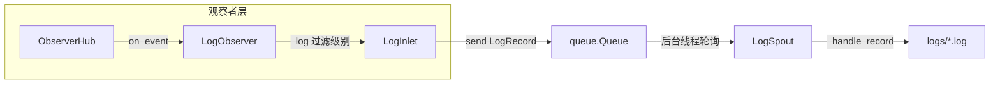

# src/celestialflow/persist/core_log.py

> 📅 最后更新日期: 2026/11/13

`persist/core_log.py` 提供了一个线程安全的日志系统，通过生产者-消费者模式将日志统一收集、格式化和持久化到 `logs/` 目录下的文本文件。

核心组件为记录类型 `LogRecord`、监听器 `LogSpout`、入口 `LogInlet` 与观察者门面 `LogObserver`。

## 架构设计

### 数据流



### 日志级别过滤

`LogObserver._log()` 在写入队列前进行两级过滤：

1. 级别必须是 `LEVEL_DICT` 中的已知键（否则直接返回）；
2. 级别数值不得低于 `log_level` 阈值（否则丢弃）。

### 观察者与入口拆分

`LogObserver` 继承 `Observer`，把日志系统接入事件总线：

1. **LogObserver（观察者 + 翻译器）**：
   - 在 `on_event()` 中按事件类型生成日志（图 / 节点 / 任务 / 终止信号）；
   - 记录节点启停时通过 `metrics_view` 读取节点汇总（输入总数、成功 / 失败 / 跳过数）；
   - 负责 spout 的 `start()` / `stop()` 并暴露 `log_path`。

2. **LogInlet（记录入口）**：
   - 只继承 `BaseInlet`，提供类型化 `send(record)`，不消费事件、不写文件。

3. **LogSpout（消费者）**：
   - 继承 `BaseSpout`，运行在独立后台线程中；
   - 从队列中取出 `LogRecord`，格式化为一行写入文件。

## 日志级别

系统支持以下标准日志级别（数值越大优先级越高，见 `runtime.util_constant.LEVEL_DICT`）：

| 级别 | 值 | 说明 |
|------|----|------|
| TRACE | 0 | 最详细的追踪信息，如终止信号合并 |
| DEBUG | 10 | 调试信息，如任务输入、终止信号输入 |
| SUCCESS | 20 | 关键操作成功，如任务完成 |
| INFO | 30 | 一般信息，如节点 / 图启停、图结构打印 |
| WARNING | 40 | 警告信息，如任务重试 |
| ERROR | 50 | 错误信息，如任务失败 |
| CRITICAL | 60 | 严重错误（当前内置事件处理未使用该级别） |

## LogRecord

```python
@dataclass(frozen=True, slots=True)
class LogRecord:
    timestamp: str
    level: str
    message: str
```

| 字段 | 说明 |
|------|------|
| `timestamp` | 格式化后的时间戳（`%Y-%m-%d %H:%M:%S`） |
| `level` | 已大写的日志级别 |
| `message` | 日志消息 |

## LogSpout

`LogSpout` 继承 `BaseSpout`，负责日志文件的配置和写入线程的管理。

### 初始化与启动

```python
from celestialflow.persist import LogSpout

spout = LogSpout()
spout.start()
print(spout.log_path)  # logs/flow_log(2026-11-13).log
spout.stop()
```

- `log_path` 在 `start()` 之前为 `None`；
- 启动后日志写入 `logs/flow_log({date}).log`，以追加模式（`"a"`）与 UTF-8 打开；
- 使用行缓冲（`buffering=1`），读取方可以及时看到新增日志；
- `_handle_record()` 把记录拼成 `"{timestamp} {level} {message}\n"` 写入文件；文件句柄未初始化时抛 `InitializationError`；
- `_after_stop()` 关闭文件句柄。

### 文件路径

```text
logs/
└── flow_log(2026-11-13).log
```

## LogInlet

```python
class LogInlet(BaseInlet):
    def send(self, record: LogRecord) -> None: ...
```

- 只继承 `BaseInlet`，**不再是 `Observer`**，不消费事件；
- `send()` 转调 `BaseInlet.send()` 把记录放入绑定 spout 的队列；未绑定 spout 时抛 `InitializationError`；
- 通过 `bind_spout(spout)` 绑定，返回 `self` 支持链式调用。

```python
log_inlet = LogInlet().bind_spout(log_spout)
```

## LogObserver

```python
class LogObserver(Observer):
    def __init__(
        self,
        metrics_view: MetricsView,
        log_level: str = DEFAULT_LOG_LEVEL,
    ) -> None: ...

    @property
    def log_path(self) -> Path | None: ...
    def start(self) -> None: ...
    def stop(self) -> None: ...
    def on_event(self, event: Event) -> None: ...
```

### 构造参数

| 参数 | 类型 | 说明 |
|------|------|------|
| `metrics_view` | `MetricsView` | **必填**，指标只读视图，用于在节点启停时记录节点汇总 |
| `log_level` | `str` | 最低日志级别，默认 `runtime.util_log_level.DEFAULT_LOG_LEVEL`（`"INFO"`）；传入值仅做 `upper()`，非法级别抛 `InvalidOptionError` |

`__init__` 会创建 `LogSpout` 与 `LogInlet().bind_spout(spout)`。`log_level` 不做 `strip()`，需要规范化请在装配入口调用 `normalize_log_level()`。

### 事件处理与日志级别

`on_event()` 按事件类型分派，未关心的事件落入 `case _: pass`：

#### 任务图 (Graph)

| 事件 | 日志级别 | 说明 |
|------|---------|------|
| `GraphStartEvent` | INFO | 记录任务图启动及结构信息（经 `util_render` 渲染，逐行写入） |
| `GraphEndEvent` | INFO | 记录任务图结束及耗时（`Use {elapsed:.2f}s.`） |

#### 节点 (Node)

| 事件 | 日志级别 | 说明 |
|------|---------|------|
| `NodeStartEvent` | INFO | 记录节点启动，并从 `metrics_view` 读取输入任务数，输出执行模式与并发数 |
| `NodeEndEvent` | INFO | 记录节点结束，并从 `metrics_view` 输出成功 / 失败 / 跳过统计与耗时 |

#### 任务 (Task)

| 事件 | 日志级别 | 说明 |
|------|---------|------|
| `TaskInputEvent` | DEBUG | 记录任务进入输入队列及来源（`from_node` 为 `None` 时写作 `external`） |
| `TaskSuccessEvent` | SUCCESS | 记录任务成功完成及结果、耗时 |
| `TaskSkipEvent` | SUCCESS | 记录任务被跳过 |
| `TaskRetryEvent` | WARNING | 记录任务失败但触发重试（含已重试次数） |
| `TaskFailEvent` | ERROR | 记录任务失败且无法重试（异常消息中的换行被替换为空格） |

#### 终止信号 (Termination)

| 事件 | 日志级别 | 说明 |
|------|---------|------|
| `TerminationInputEvent` | DEBUG | 记录终止信号输入 |
| `TerminationMergeEvent` | TRACE | 记录终止信号合并（含父 ID 列表） |

> 日志中的任务、结果均使用事件自带的 `task_repr` / `result_repr`；事件 ID 以 `[task_id->success_id*]` 形式附在末尾，便于与 ctree 事件关联。

## 使用示例

### 通过观察者门面（推荐）

```python
from celestialflow.observer import MetricsObserver, NodeStartEvent
from celestialflow.persist import LogObserver

metrics_view = MetricsObserver()
log = LogObserver(metrics_view, log_level="DEBUG")
log.start()
try:
    log.on_event(NodeStartEvent(node="NodeA", execution_mode="thread", max_workers=4, start_time=1.0))
finally:
    log.stop()

print(log.log_path)  # logs/flow_log(2026-11-13).log
```

实际使用中，`LogObserver` 由 `assembly/core_run.py` 的 `run_graph_resources` / `run_node_resources` 注册到 hub 并统一启停。

### 手动投递记录

```python
from celestialflow.persist import LogInlet, LogRecord, LogSpout

spout = LogSpout()
spout.start()
inlet = LogInlet().bind_spout(spout)

inlet.send(LogRecord(timestamp="2026-11-13 10:00:00", level="INFO", message="hello"))

spout.stop()
```

通过事件驱动（而非通用 `info()` / `debug()`）记录日志，可以确保生成的日志结构化、易读、便于机器解析。

## 注意事项

1. **构造需要 `metrics_view`**：`LogObserver(metrics_view, log_level)` 必须传入指标只读视图，用于节点启停的汇总输出。
2. **事件消费在观察者层**：`LogInlet` 只提供 `send(record)`；`on_graph_*` / `on_node_*` / `on_task_*` 等逐个回调已不存在，全部逻辑集中在 `LogObserver.on_event()`。
3. **`log_level` 仅大写化**：构造时不 `strip()`；需要忽略大小写与首尾空白时请先用 `normalize_log_level()`。
4. **行缓冲写入**：日志文件以 `buffering=1` 打开，写入即立即可见。
