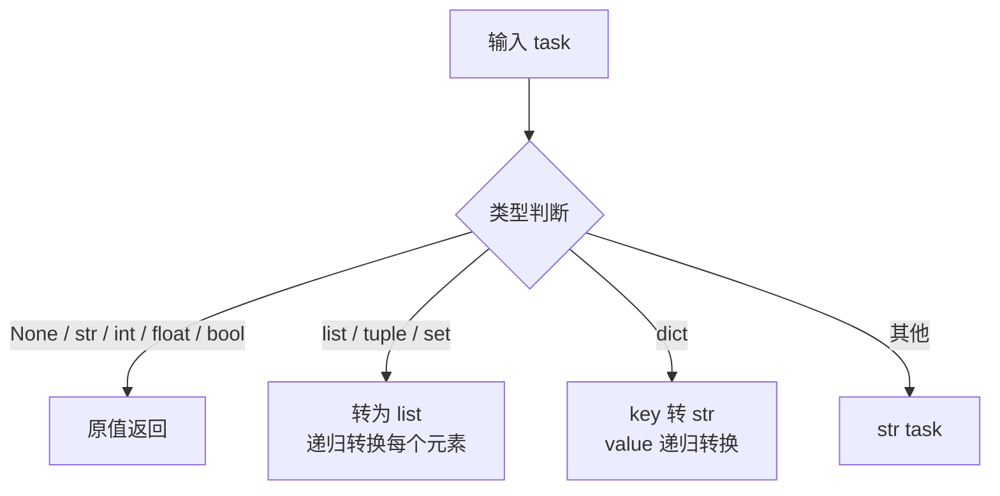

# src/celestialflow/persist/util_payload.py

> 📅 最后更新日期: 2026/11/13

`persist/util_payload.py` 提供任务数据的持久化序列化工具，将任意 Python 对象递归转换为 JSON 友好的结构。

## 核心函数

### to_persisted_payload

```python
def to_persisted_payload(task: Any) -> Any:
    """
    将任务转换为可持久化的 JSON 友好结构。

    :param task: 待序列化的任务数据
    :return: 可持久化的 JSON 友好结构
    """
```

**转换规则：**

| 输入类型 | 输出 | 说明 |
|---------|------|------|
| `None` / `str` / `int` / `float` / `bool` | 原值返回 | 已是 JSON 原生类型 |
| `list` / `tuple` / `set` | `list` | 递归转换每个元素 |
| `dict` | `dict` | key 转 `str`，value 递归转换 |
| 其他类型 | `str(task)` | 转为字符串表示 |



## 使用示例

### 基本类型直接透传

```python
from celestialflow.persist.util_payload import to_persisted_payload

print(to_persisted_payload(42))  # 42
print(to_persisted_payload("hello"))  # "hello"
print(to_persisted_payload(True))  # True
print(to_persisted_payload(None))  # None
```

### 复合类型递归转换

```python
from celestialflow.persist.util_payload import to_persisted_payload

# 列表
result = to_persisted_payload([1, "a", True])
print(result)  # [1, 'a', True]

# 嵌套字典
result = to_persisted_payload({"score": 95, "tags": ["a", "b"]})
print(result)  # {'score': 95, 'tags': ['a', 'b']}


# 自定义对象
class MyTask:
    def __str__(self):
        return "MyTask(id=1)"


result = to_persisted_payload(MyTask())
print(result)  # "MyTask(id=1)"
```

### 在 LifecycleObserver 中的使用

`to_persisted_payload` 由 `LifecycleObserver.on_event()` 自动调用：处理 `TaskInputEvent` 时用 `to_persisted_payload(event.task)` 填充 `InsertRecord.task`，处理 `TaskSuccessEvent` 时用 `to_persisted_payload(event.result)` 填充 `PromoteSuccessRecord.result`。因此任务与结果最终以 JSON 友好的形式落到 SQLite。

```python
from celestialflow.persist.util_payload import to_persisted_payload

payload = to_persisted_payload({"x": 1, "obj": object()})
print(payload["x"])  # 1
print(type(payload["obj"]))  # <class 'str'>
```

> 正常使用无需手动调用：把 `LifecycleObserver` 注册到 `ObserverHub`，或直接向其 `on_event()` 投递事件即可。

## 注意事项

- 序列化策略是**尽力而为**：对于无法直接 JSON 序列化的对象，降级为 `str()` 字符串表示。
- 转换结果最终由 `LifecycleSpout` 通过 `util_sqlite` 层以 `json.dumps` 形式写入 SQLite 的 `task_json` / `result_json` 字段。
- 本模块只负责数据格式转换，不涉及任何文件读写。
- 转换结果本身仍可能是嵌套结构；`dict` 的 key 统一转为 `str`，`set` 的顺序不保证。
