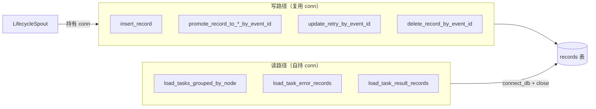

# src/celestialflow/persist/util_sqlite.py

> 📅 最后更新日期: 2026/10/30

`persist/util_sqlite.py` 提供 SQLite 数据库的连接管理与记录读写工具，是 `LifecycleSpout` 的底层存储引擎。

函数按**连接生命周期的归属**分为两类：

- **复用调用方连接的写操作**：显式接收 `sqlite3.Connection`，由调用方（`LifecycleSpout`）负责打开 / `commit()` / 关闭；
- **自持连接的读取操作**：内部自行 `connect_db()` 并在 `finally` 中 `close()`。

两条转换工具（`normalize_record` / `row_to_record_dict`）不接触连接。

## 核心函数概览

| 函数 | 签名要点 | 说明 |
|------|---------|------|
| `connect_db` | `(db_path) -> Connection` | 创建连接、配置 PRAGMA、确保表结构与索引 |
| `normalize_record` | `(record) -> dict \| None` | 归一化为 sqlite 可写参数字典；缺少 `event_id` 时返回 `None` |
| `row_to_record_dict` | `(row) -> dict` | 将 `sqlite3.Row` 还原为对外记录字典 |
| `insert_record` | `(conn, record) -> bool` | 插入一条 pending 记录 |
| `promote_record_to_success_by_event_id` | `(conn, event_id, result, *, ts) -> bool` | 晋升为 `success` 并写入结果 |
| `promote_record_to_failed_by_event_id` | `(conn, event_id, new_event_id, *, ts, error_type="", error_message="") -> bool` | 晋升为 `failed` 并切换到错误事件 ID |
| `promote_record_to_skipped_by_event_id` | `(conn, event_id, new_event_id, *, ts) -> bool` | 晋升为 `skipped` 并切换到跳过事件 ID |
| `update_retry_by_event_id` | `(conn, event_id, *, ts, retry_times, error_type="", error_message="") -> bool` | 保持 pending，更新重试次数与最近一次错误 |
| `delete_record_by_event_id` | `(conn, event_id) -> bool` | 按 `event_id` 删除记录 |
| `load_tasks_grouped_by_node` | `(db_path, statuses=("failed", "pending")) -> dict[str, list[dict]]` | 按 node 分组读取指定状态 |
| `load_task_error_records` | `(db_path, node) -> list[tuple[task, (error_type, error_message)]]` | 读取某 node 的失败任务与错误配对 |
| `load_task_result_records` | `(db_path, node) -> list[tuple[task, result]]` | 读取某 node 的成功任务与结果配对 |

> 私有辅助 `_ensure_table(conn)` 只被 `connect_db` 调用，不对外暴露。



## 数据库表结构

```sql
CREATE TABLE IF NOT EXISTS records (
    id INTEGER PRIMARY KEY AUTOINCREMENT,
    event_id INTEGER NOT NULL,
    ts REAL,
    node TEXT NOT NULL,
    status TEXT NOT NULL,
    error_type TEXT NOT NULL DEFAULT '',
    error_message TEXT NOT NULL DEFAULT '',
    task_json TEXT NOT NULL,
    result_json TEXT NOT NULL DEFAULT 'null',
    retry_times INTEGER NOT NULL DEFAULT 0
)
```

> 兼容旧库：`_ensure_table` 会检查 `retry_times` 列，缺失时自动 `ALTER TABLE` 补齐。

**索引：**

- `idx_records_event_id`（UNIQUE）：按 `event_id` 快速定位，同时保证一个事件 ID 只有一条记录
- `idx_records_status_id`：按 `(status, id)` 组合查询

> 表中的 `node` 字段标识任务所属节点（业务字段，须由调用方显式写入）。

## 连接管理

### connect_db

```python
def connect_db(db_path: str | Path) -> sqlite3.Connection:
```

- 先 `mkdir(parents=True, exist_ok=True)` 创建父目录；
- 自动配置 PRAGMA：
  - `journal_mode=WAL` — 写操作不阻塞读
  - `synchronous=NORMAL` — 平衡性能与安全
  - `foreign_keys=ON` — 启用外键约束
- `check_same_thread=False` — 允许跨线程使用（使用端 spout 仅有单个消费线程）；
- `row_factory = sqlite3.Row`，因此查询结果可按列名取值；
- 最后调用 `_ensure_table(conn)` 建表、补列、建索引并 `commit()`。

> 本函数**只负责创建**连接，关闭与提交由调用方负责。

## 记录序列化

### normalize_record

```python
def normalize_record(record: dict[str, Any]) -> dict[str, Any] | None:
```

- 缺少 `event_id` 时返回 `None`（非业务记录被忽略）。
- 业务记录必须显式提供 `node`、`status` 与 `task_json`。
- 输出为标准参数字典：`event_id` / `node` / `status` / `error_type` / `error_message` / `ts` / `task_json` / `result_json` / `retry_times`；其中 `task_json` / `result_json` 为 `json.dumps(..., ensure_ascii=False)` 结果。
- 缺省值：`error_type` / `error_message` 为空字符串，`ts` 为 `0.0`，`retry_times` 为 `0`。

### row_to_record_dict

```python
def row_to_record_dict(row: sqlite3.Row) -> dict[str, Any]:
```

将 sqlite 行转换为对外记录字典（`id` / `event_id` / `ts` / `node` / `status` / `error_type` / `error_message` / `task_json` / `result_json` / `retry_times`），其中 `task_json` / `result_json` 经 `json.loads` 还原。

## 写操作（复用调用方连接）

以下函数接收 `conn`，**不提交也不关闭**，由调用方在改动后自行 `commit()`。返回值均为 `bool`，表示是否实际影响到记录（`cursor.rowcount > 0`；`insert_record` 在成功执行 INSERT 后返回 `True`，元信息记录被忽略时返回 `False`）。

| 函数 | 行为 |
|------|------|
| `insert_record(conn, record)` | 归一化后 INSERT；依赖 `event_id` 唯一索引，重复写入会抛 `sqlite3.IntegrityError` |
| `promote_record_to_success_by_event_id(conn, event_id, result, *, ts)` | `status='success'`，写入 `ts` 与 `result_json`，同时清空 `error_type` / `error_message` |
| `promote_record_to_failed_by_event_id(conn, event_id, new_event_id, *, ts, error_type="", error_message="")` | `status='failed'`，写入 `ts`、错误信息，并把 `event_id` 切换为 `new_event_id` |
| `promote_record_to_skipped_by_event_id(conn, event_id, new_event_id, *, ts)` | `status='skipped'`，写入 `ts`，切换 `event_id`，清空错误字段 |
| `update_retry_by_event_id(conn, event_id, *, ts, retry_times, error_type="", error_message="")` | 只更新 `retry_times` / `ts` / 错误信息，**不改变** `status`（保持 pending） |
| `delete_record_by_event_id(conn, event_id)` | `DELETE FROM records WHERE event_id = ?` |

> `promote_*` / `update_retry` 全部以 `event_id` 为定位条件。由于成功 / 跳过 / 失败会切换 `event_id`，同一条 pending 记录在不同阶段可用不同的 ID 定位。

## 读操作（自持连接）

以下函数内部调用 `connect_db(db_path)`，在 `finally` 中 `close()`，调用方无需管理连接。

### load_tasks_grouped_by_node

```python
def load_tasks_grouped_by_node(
    db_path: str | Path,
    statuses: Iterable[str] = ("failed", "pending"),
) -> dict[str, list[dict[str, Any]]]:
```

- `statuses` 为空时直接返回 `{}`；
- 以 `ORDER BY node ASC, id ASC` 读取；
- 返回 `{node_name: [{"task_json": task, "error_type": str, "status": str}, ...]}`，其中 `task_json` 已 `json.loads` 还原为 Python 对象。

### load_task_error_records

```python
def load_task_error_records(
    db_path: str | Path, node: str
) -> list[tuple[Any, tuple[str, str]]]:
```

读取指定 node 中 `status='failed'` 的记录，按 `id ASC` 返回 `[(task, (error_type, error_message)), ...]`。

### load_task_result_records

```python
def load_task_result_records(db_path: str | Path, node: str) -> list[tuple[Any, Any]]:
```

读取指定 node 中 `status='success'` 的记录，按 `id ASC` 返回 `[(task, result), ...]`。

## 使用示例

### 基本写入与读取

```python
from celestialflow.persist.util_sqlite import (
    connect_db,
    insert_record,
    load_task_result_records,
    promote_record_to_success_by_event_id,
)

# 1. 创建连接（自动配置 + 建表）
conn = connect_db("test_data.sqlite3")

# 2. 写入 pending 记录（需传 conn）
record = {
    "event_id": 1,
    "ts": 0.0,
    "node": "StageA",
    "status": "pending",
    "task_json": {"x": 1},
}
insert_record(conn, record)

# 3. 任务成功后晋升为 success
promote_record_to_success_by_event_id(conn, 1, {"y": 2}, ts=0.0)
conn.commit()
conn.close()

# 4. 读取时由函数自行管理连接
for task, result in load_task_result_records("test_data.sqlite3", node="StageA"):
    print(task, "->", result)
```

### 按 node 分组加载

```python
from celestialflow.persist.util_sqlite import load_tasks_grouped_by_node

grouped = load_tasks_grouped_by_node(
    "lifecycles/2026-10-30/flow_lifecycle(10-00-00-123).sqlite3",
    ("failed", "pending"),
)
for node_name, items in grouped.items():
    print(node_name, len(items))
```

### 读取任务错误 / 结果配对

```python
from celestialflow.persist.util_sqlite import (
    load_task_error_records,
    load_task_result_records,
)

db_path = "lifecycles/2026-10-30/flow_lifecycle(10-00-00-123).sqlite3"
errors = load_task_error_records(db_path, node="StageA")  # [(task, (error_type, error_message))]
results = load_task_result_records(db_path, node="StageA")  # [(task, result)]
```

## 注意事项

1. **连接归属**：写操作（`insert` / `promote_*` / `update_retry` / `delete`）需要调用方传入 `conn` 并手动 `commit()`；三个 `load_*` 读取函数在内部自行建立并关闭连接。
2. **唯一性**：`insert_record` 使用普通 `INSERT`，`event_id` 的唯一索引保证一条事件 ID 只对应一条记录；重复插入会抛 `sqlite3.IntegrityError`，调用方需自行处理。
3. **过滤规则**：`normalize_record` 会过滤掉缺少 `event_id` 的记录（返回 `None`），`insert_record` 随即返回 `False`。
4. **JSON 字段**：`task_json` 与 `result_json` 在库中是 `json.dumps` 后的字符串；`row_to_record_dict` 与各 `load_*` 函数读取时会 `json.loads` 还原。
5. **`retry_times`**：由 `update_retry_by_event_id` 维护，用于记录任务在晋升前的重试次数。
6. **业务字段显式写入**：`node` 与 `status` 为业务字段，须由调用方（如 `LifecycleInlet`）在写入记录时显式提供，`normalize_record` 不做默认推断。
