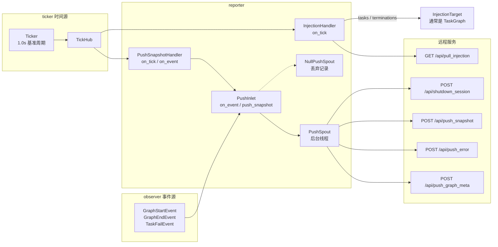

# src/celestialflow/reporter/__init__.py

> 📅 最后更新日期: 2026/11/13

`reporter` 是 CelestialFlow 的**远程上报与任务注入模块**。它把框架内部的观测事件、指标快照与失败信息推送到远程服务，并按节拍从远程服务拉取待注入的任务与终止符。

模块由三部分组成：

| 文件 | 角色 |
|------|------|
| [`core_push.py`](./core_push.md) | `PushRecord`、`PushSpout`、`NullPushSpout`、`PushInlet`：事件/快照 → HTTP 推送记录 |
| [`core_snapshot.py`](./core_snapshot.md) | `PushSnapshotHandler`、`to_status_snapshot()`：按拍读取指标并生成状态快照 |
| [`core_inject.py`](./core_inject.md) | `InjectionTarget`、`InjectionHandler`：按拍拉取远程注入 |

## 导出符号

```python
__all__ = [
    "InjectionHandler",
    "InjectionTarget",
    "NullPushSpout",
    "PushInlet",
    "PushSnapshotHandler",
    "PushSpout",
]
```

| 导出符号 | 来源 | 说明 |
|---------|------|------|
| `InjectionHandler` | `core_inject.py` | 节拍处理器，每 5 拍从 `/api/pull_injection` 拉取任务与终止符 |
| `InjectionTarget` | `core_inject.py` | 注入目标协议，只要求 `inject_tasks()` 与 `inject_terminations()` |
| `NullPushSpout` | `core_push.py` | 空推送 spout，消费记录后直接丢弃，可用于测试或只关心入队语义的占位场景 |
| `PushInlet` | `core_push.py` | 观察者 + inlet，把事件与快照转成 `PushRecord` 并入队 |
| `PushSnapshotHandler` | `core_snapshot.py` | 同时是节拍处理器与观察者：按拍推快照，并在图结束时补推终态 |
| `PushSpout` | `core_push.py` | 后台线程 spout，按 `PushRecord.kind` 调用对应 HTTP 端点 |

> `PushRecord`、`PushKind`、`to_status_snapshot()` 虽然定义在 `core_*` 文件中，但没有被包级 `__init__.py` 再导出；需要直接使用时从具体模块导入，例如 `from celestialflow.reporter.core_push import PushRecord`。

## 数据流



## 端点一览

| 方法 | 端点 | 触发来源 | 主要载荷 |
|------|------|---------|---------|
| `POST` | `/api/push_graph_meta` | `PushInlet` 收到 `GraphStartEvent` | 会话 ID、图名、图模式、启动时间、是否 DAG、节点、边、源节点、节点元信息 |
| `POST` | `/api/push_error` | `PushInlet` 收到 `TaskFailEvent` | 会话 ID、`event_id`、节点、任务载荷、异常类型、异常消息、时间戳 |
| `POST` | `/api/push_snapshot` | `PushInlet.push_snapshot()`（由 `PushSnapshotHandler` 按拍调用） | 会话 ID、节点状态快照、发送时刻 |
| `POST` | `/api/shutdown_session` | `PushInlet` 收到 `GraphEndEvent` | 仅会话 ID；服务端据此把会话标记为已结束 |
| `GET` | `/api/pull_injection` | `InjectionHandler.on_tick()` | 查询参数 `session_id`；响应含 `tasks` 与 `terminations` |

## 使用示例

### 关闭上报：用 `NullPushSpout` 占位

```python
from celestialflow.observer import GraphEndEvent, GraphStartEvent
from celestialflow.reporter import NullPushSpout, PushInlet

spout = NullPushSpout()
inlet = PushInlet().bind_spout(spout)
spout.start()

inlet.on_event(
    GraphStartEvent(
        graph="Demo",
        graph_mode="thread",
        start_time=0.0,
        is_dag=True,
        nodes=["A"],
        edges={"A": []},
        source_nodes=["A"],
        node_meta={"A": {}},
    )
)
inlet.on_event(GraphEndEvent(graph="Demo", end_time=1.0, elapsed=1.0))

spout.stop()
```

`NullPushSpout` 不建立 HTTP 会话，所有记录都被丢弃，因此该示例可以离线运行。

### 由装配入口自动接线

生产代码通常不需要手动组装，`assembly.run_graph_resources()` 会在 `report` 非 `None` 时自动创建并注册 `PushInlet`、`PushSpout`、`PushSnapshotHandler`、`InjectionHandler` 与 `Ticker`：

```python
from celestialflow.assembly import run_graph_resources
from celestialflow.observer import ObserverHub
from celestialflow.runtime import ReportConfig


class DemoGraph:
    def inject_tasks(self, tasks) -> None:
        print("远程任务:", tasks)

    def inject_terminations(self, nodes) -> None:
        print("远程终止符:", list(nodes))

    def run(self, init_tasks) -> None:
        print("本地初始任务:", init_tasks)


graph = DemoGraph()
init_tasks = {"A": [1, 2, 3]}

with run_graph_resources(
    ObserverHub(),
    injection_target=graph,
    report=ReportConfig("http://127.0.0.1:5005"),
):
    graph.run(init_tasks)
```

## 注意事项

1. **推送失败不致命**：`PushSpout` 的后台线程会捕获单条记录的推送异常并打印回溯，该条记录被丢弃，线程继续消费后续记录。
2. **上报会话标识不透明**：`assembly` 用 `uuid4().hex` 生成 `session_id`，同时用于推送、下线通知与注入拉取；调用方无需关心其格式。
3. **快照与下线通知的顺序**：图级装配把 `PushSnapshotHandler` 注册在 `PushInlet` 之前，保证 `GraphEndEvent` 触发的终态快照先入队、`shutdown_session` 后入队。
4. **不经过包根导出**：`from celestialflow import PushInlet` 会失败；请从 `celestialflow.reporter` 或其具体子模块导入。
