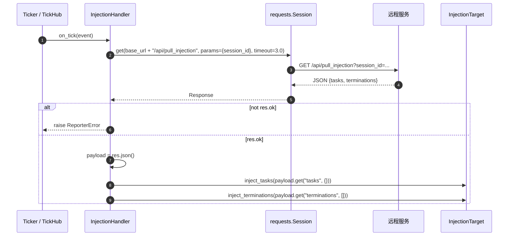

# src/celestialflow/reporter/core_inject.py

> 📅 最后更新日期: 2026/11/13

`core_inject.py` 实现**远程任务注入**：`InjectionHandler` 作为节拍处理器，按固定拍数从远程服务拉取待注入的任务与终止符，并交给 `InjectionTarget`（通常是 `TaskGraph`）处理。

## 核心对象

| 对象 | 类型 | 职责 |
|------|------|------|
| `InjectionTarget` | `Protocol` | 注入目标的最小接口：只要求两个注入方法 |
| `InjectionHandler` | `TickHandler` 子类 | 每 `tick_period=5` 拍 GET 一次注入接口并调用目标 |
| `_PULL_TIMEOUT` | 模块常量 | 单次拉取超时，`3.0` 秒 |

## InjectionTarget

```python
class InjectionTarget(Protocol):
    def inject_tasks(self, tasks: Mapping[str, Iterable[Any]]) -> None: ...

    def inject_terminations(self, nodes: Sequence[str]) -> None: ...
```

| 方法 | 参数 | 说明 |
|------|------|------|
| `inject_tasks` | `Mapping[str, Iterable[Any]]` | 节点名到任务可迭代对象的映射；每个值只会被遍历一次 |
| `inject_terminations` | `Sequence[str]` | 需要注入终止符的节点名序列 |

> 该协议刻意只暴露注入语义，不暴露节点容器与持久化细节，使上报模块与图结构解耦。`TaskGraph` 恰好实现了这两个方法，因此可以直接作为 `target`。

## InjectionHandler

```python
class InjectionHandler(TickHandler):
    tick_period: int = 5

    def __init__(
        self,
        base_url: str,
        session_id: str,
        target: InjectionTarget,
        session: requests.Session,
    ) -> None: ...

    def on_tick(self, event: TickEvent) -> None: ...
```

| 参数 | 说明 |
|------|------|
| `base_url` | 远程服务基础地址，例如 `http://127.0.0.1:5005` |
| `session_id` | 上报会话标识，作为查询参数 `session_id` 提交 |
| `target` | 注入目标，通常是任务图 |
| `session` | 复用的 HTTP 会话，由调用方（`assembly`）负责关闭；处理器不关闭它 |

### 节拍缩放

`tick_period = 5` 表示「每 5 拍执行一次」。实际周期由 `Ticker` 的基准周期决定：

| `Ticker.interval` | 实际拉取周期 |
|:-----------------:|:------------:|
| `1.0` 秒（`assembly` 默认） | 5 秒 |
| `0.5` 秒 | 2.5 秒 |
| `2.0` 秒 | 10 秒 |

过滤器使用 `TickHandler.should_tick()`：`(seq - 1) % tick_period == 0`，因此第 1、6、11… 拍命中（相位锚定在 `seq == 1`）。

### 单拍流程



### 期望的响应结构

```json
{
  "tasks": {
    "A": [1, 2, 3],
    "B": ["x"]
  },
  "terminations": ["A"]
}
```

- `tasks`：缺省为 `{}`；
- `terminations`：缺省为 `[]`；
- 两个键都由服务端决定，处理器只负责取出并原样交给目标。

### 异常语义

| 情况 | 行为 |
|------|------|
| HTTP 响应非 2xx | 抛 `ReporterError("Failed to pull task injection: <status>")` |
| 连接失败 / 超时 | `requests` 自身异常原样抛出 |
| `inject_tasks()` 抛异常 | 异常原样抛出，且**不会**继续执行 `inject_terminations()` |
| 处理器异常 | 由 `TickHub` / `Ticker` 的异常隔离机制交给 `handler.handle_exception()`（默认打印回溯），后续节拍继续 |

> 处理器本身没有重试与去重逻辑：拉取失败只影响当前拍；下一拍会重新请求。服务端应保证同一 `session_id` 下的注入接口幂等，或自行处理重复投递。

## 使用示例

下面的示例用最小替身替代 HTTP 会话与图，演示一次拉取与注入；示例可离线运行：

```python
from collections.abc import Iterable, Mapping, Sequence
from typing import Any

from celestialflow.reporter import InjectionHandler
from celestialflow.ticker import TickEvent


class StubResponse:
    ok = True
    status_code = 200

    def json(self) -> dict[str, Any]:
        return {
            "tasks": {"A": [1, 2]},
            "terminations": ["A"],
        }


class StubSession:
    """最小 requests.Session 替身，仅用于演示。"""

    def get(self, url, params=None, timeout=None):
        print("GET", url, params, timeout)
        return StubResponse()


class DemoGraph:
    """满足 InjectionTarget 协议的最小实现。"""

    def inject_tasks(self, tasks: Mapping[str, Iterable[Any]]) -> None:
        print("tasks:", {node: list(values) for node, values in tasks.items()})

    def inject_terminations(self, nodes: Sequence[str]) -> None:
        print("terminations:", list(nodes))


handler = InjectionHandler(
    base_url="http://127.0.0.1:5005",
    session_id="session-1",
    target=DemoGraph(),
    session=StubSession(),  # 生产环境使用 requests.Session()
)

# seq=5 命中 tick_period=5 的节拍
handler.on_tick(
    TickEvent(
        seq=5,
        interval=1.0,
        scheduled_at=4.0,
        fired_at=4.0,
        wall_time=0.0,
        drift=0.0,
        skipped=0,
    )
)
```

输出：

```text
GET http://127.0.0.1:5005/api/pull_injection {'session_id': 'session-1'} 3.0
tasks: {'A': [1, 2]}
terminations: ['A']
```

## 注意事项

1. **会话复用**：`requests.Session` 由 `assembly.run_graph_resources()` 创建，并同时传给 `PushSpout` 与 `InjectionHandler`；处理器只使用、不关闭。
2. **`event` 参数未使用**：`on_tick(event)` 的触发节奏完全由 `tick_period` 控制，处理器不读取 `TickEvent` 的字段。
3. **`target` 的 `inject_tasks` 入参类型是 `Mapping[str, Iterable[Any]]`**：值可以是 range、生成器、列表等任意可迭代对象，但只会被消费一次。
4. **注入失败不会自动回滚**：若 `inject_tasks()` 已部分注入后抛异常，已注入的任务仍留在图中；这是目标对象自身的语义，处理器不介入。
5. **只在图级启用**：`run_node_resources()` 不装配注入处理器；独立运行的节点不会从远程拉取任务。
