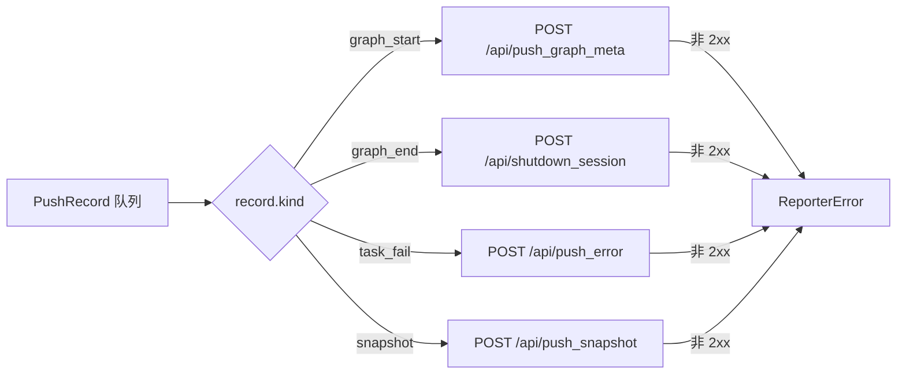

# src/celestialflow/reporter/core_push.py

> 📅 最后更新日期: 2026/11/13

`core_push.py` 定义 CelestialFlow 的**推送通道**：把图启动、图结束、任务失败与状态快照统一表示为 `PushRecord`，由后台线程 `PushSpout` 按记录类型调用不同 HTTP 端点。

本文件包含四个核心对象：

| 对象 | 类型 | 职责 |
|------|------|------|
| `PushKind` | 类型别名 | 记录类型：`"graph_start"` / `"graph_end"` / `"task_fail"` / `"snapshot"` |
| `PushRecord` | `frozen` + `slots` 数据类 | 一条待推送记录，字段按事件类型分组 |
| `PushSpout` | `BaseSpout` 子类 | 后台消费队列，按 `kind` 推送 HTTP 请求 |
| `NullPushSpout` | `BaseSpout` 子类 | 空实现，消费后直接丢弃 |
| `PushInlet` | `BaseInlet` + `Observer` | 把观测事件和状态快照转成 `PushRecord`，通过 `send()` 入队 |

## PushRecord

```python
type PushKind = Literal["graph_start", "graph_end", "task_fail", "snapshot"]


@dataclass(frozen=True, slots=True)
class PushRecord:
    kind: PushKind
    # GraphStartEvent 字段
    graph: str = ""
    graph_mode: str = ""
    start_time: float = 0.0
    is_dag: bool = False
    nodes: list[str] = field(default_factory=list[str])
    edges: dict[str, list[str]] = field(default_factory=dict[str, list[str]])
    source_nodes: list[str] = field(default_factory=list[str])
    node_meta: dict[str, dict[str, Any]] = field(default_factory=dict[str, dict[str, Any]])
    # GraphEndEvent 字段
    end_time: float = 0.0
    elapsed: float = 0.0
    # TaskFailEvent 字段
    event_id: int = 0
    node: str = ""
    task_json: Any = None
    error_type: str = ""
    error_message: str = ""
    ts: float = 0.0
    # 状态快照字段
    snapshot: dict[str, dict[str, Any]] = field(default_factory=dict[str, dict[str, Any]])
```

`kind` 决定哪些字段有效，其余字段保持默认值：

| `kind` | 有效字段 | 对应事件 / 来源 |
|--------|---------|----------------|
| `"graph_start"` | `graph`、`graph_mode`、`start_time`、`is_dag`、`nodes`、`edges`、`source_nodes`、`node_meta` | `GraphStartEvent` |
| `"graph_end"` | `graph`、`end_time`、`elapsed` | `GraphEndEvent` |
| `"task_fail"` | `event_id`、`node`、`task_json`、`error_type`、`error_message`、`ts` | `TaskFailEvent` |
| `"snapshot"` | `snapshot` | `PushInlet.push_snapshot()`（由 `PushSnapshotHandler` 按拍调用） |

> `graph` 字段同时被 `graph_start` 与 `graph_end` 使用。`graph_end` 记录虽然携带 `end_time` / `elapsed`，但当前 `PushSpout` 的下线通知只提交 `session_id`，这两个字段不会出现在 `/api/shutdown_session` 的请求体中。

## PushSpout

```python
class PushSpout(BaseSpout):
    def __init__(
        self,
        session_id: str,
        base_url: str,
        timeout: float = 3.0,
    ) -> None: ...
```

| 参数 | 说明 |
|------|------|
| `session_id` | 上报会话标识，随每条记录提交；线上字段名为 `session_id` |
| `base_url` | 远程服务基础地址，例如 `http://127.0.0.1:5005` |
| `timeout` | 单次 HTTP 请求超时（秒），默认 `3.0` |

生命周期：

- `_before_start()`：创建复用的 `requests.Session`。
- `_after_stop()`：关闭并清空该会话。
- 若 spout 未启动（`_session is None`），`_handle_record()` 直接返回，记录被静默丢弃。

### 推送分发表



| `kind` | 端点 | 请求体字段 | 失败异常 |
|--------|------|-----------|---------|
| `graph_start` | `/api/push_graph_meta` | `session_id`、`graph`、`graph_mode`、`start_time`、`is_dag`、`nodes`、`edges`、`source_nodes`、`node_meta` | `ReporterError("Failed to push graph meta: <status>")` |
| `graph_end` | `/api/shutdown_session` | `session_id` | `ReporterError("Failed to notify shutdown: <status>")` |
| `task_fail` | `/api/push_error` | `session_id`、`event_id`、`node`、`task_json`、`error_type`、`error_message`、`ts` | `ReporterError("Failed to push error: <status>")` |
| `snapshot` | `/api/push_snapshot` | `session_id`、`snapshot`、`timestamp`（发送时的 `time.time()`） | `ReporterError("Failed to push snapshot: <status>")` |

> `ReporterError` 由 `BaseSpout` 的后台循环捕获并打印回溯，**不会**终止线程；该条记录被丢弃，后续记录继续推送。

## NullPushSpout

`NullPushSpout` 是 `PushSpout` 的空实现：`_handle_record()` 直接 `return None`，不建立 HTTP 会话、不发请求。用于只需要「入队语义」而不需要网络的场景（例如测试或占位）。

```python
class NullPushSpout(BaseSpout):
    def _handle_record(self, _record: PushRecord) -> None:
        return None
```

## PushInlet

`PushInlet` 同时继承 `BaseInlet` 与 `Observer`：

- 作为 `Observer`，它实现 `on_event(event)`，用 `match event` 把三类事件转成 `PushRecord`；
- 作为 `BaseInlet`，它通过 `bind_spout(spout)` 绑定推送 spout，并调用继承自 `BaseInlet` 的 `send(record)` 入队；
- 提供 `push_snapshot(snapshot)`，供 `PushSnapshotHandler` 按拍直接推送状态快照。

### 事件映射

| 事件 | 生成的记录 | 说明 |
|------|-----------|------|
| `GraphStartEvent` | `kind="graph_start"` | 图元信息、节点/边/源节点、节点元信息 |
| `GraphEndEvent` | `kind="graph_end"` | 会话下线通知；服务端收到后将会话标记为已结束，但会话数据与错误库仍保留 |
| `TaskFailEvent` | `kind="task_fail"` | `task_json` 由 `to_persisted_payload(event.task)` 转换；`error_type` 取异常类名，`error_message` 取 `str(exception)`，`ts` 取当前墙钟时间 |
| 其他事件 | 无 | `case _: pass`，静默忽略 |

> `GraphEndEvent` 在 `PushInlet` 中只产生 `graph_end`（下线通知）。同一事件还会被 `PushSnapshotHandler` 用来补推一次终态快照，两者是独立观察者，详见 [`core_snapshot.md`](./core_snapshot.md)。

## 使用示例

下面的示例用 `NullPushSpout` 的子类打印记录内容，不发任何网络请求：

```python
from celestialflow.observer import GraphEndEvent, GraphStartEvent, TaskFailEvent
from celestialflow.reporter import NullPushSpout, PushInlet


class PrintSpout(NullPushSpout):
    """打印记录内容，但不发送 HTTP 请求。"""

    def _handle_record(self, record) -> None:
        print(f"kind={record.kind}, graph={record.graph}, node={record.node}")


spout = PrintSpout()
inlet = PushInlet().bind_spout(spout)
spout.start()

inlet.on_event(
    GraphStartEvent(
        graph="Demo",
        graph_mode="thread",
        start_time=0.0,
        is_dag=True,
        nodes=["A"],
        edges={"A": []},
        source_nodes=["A"],
        node_meta={"A": {}},
    )
)
inlet.on_event(
    TaskFailEvent(
        node="A",
        task=1,
        task_repr="1",
        exception=ValueError("bad value"),
        task_id=1,
        error_id=2,
    )
)
inlet.push_snapshot({"A": {"status": 2, "tasks_succeeded": 0}})
inlet.on_event(GraphEndEvent(graph="Demo", end_time=2.0, elapsed=2.0))

spout.stop()
```

输出（顺序与入队顺序一致）：

```text
kind=graph_start, graph=Demo, node=
kind=task_fail, graph=, node=A
kind=snapshot, graph=, node=
kind=graph_end, graph=Demo, node=
```

## 注意事项

1. **记录不可变**：`PushRecord` 是 `frozen=True, slots=True` 的数据类，构造后不可修改；发送线程只读取。
2. **推送失败会丢记录**：当前没有重试队列；单条失败只打印回溯并丢弃。
3. **会话由 spout 管理**：`PushSpout` 在 `start()` 时创建 `requests.Session`，在 `stop()` 时关闭；调用方不要复用其内部会话。
4. **记录顺序即队列顺序**：`BaseSpout.stop()` 把终止信号放在队尾，因此调用 `stop()` 前已入队的记录会先被处理完。
5. **`push_snapshot` 不做网络 IO**：它只负责把快照包装成 `PushRecord` 并入队，真正的发送在 `PushSpout` 后台线程中完成。
