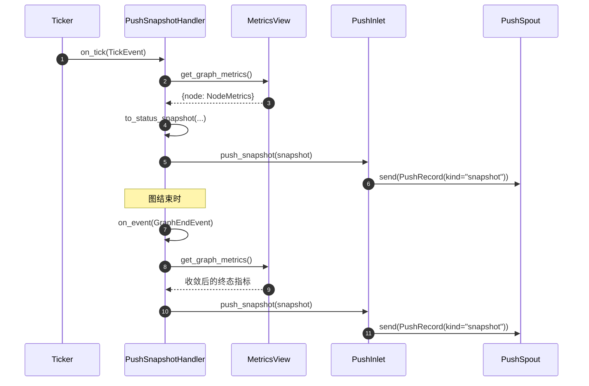

# src/celestialflow/reporter/core_snapshot.py

> 📅 最后更新日期: 2026/11/13

`core_snapshot.py` 负责把**图级指标快照**转换成上报载荷并交给推送通道。它是「时间驱动」与「事件驱动」的交汇点：

- 作为 `TickHandler`，按节拍（默认每拍，基准周期 1 秒）读取整图指标并推送；
- 作为 `Observer`，在图结束时补推一次**终态快照**。

本文件不进行任何网络 IO：它只做指标投影与入队，真正的 HTTP 发送由 `PushSpout` 完成。

## to_status_snapshot

```python
def to_status_snapshot(
    metrics: Mapping[str, NodeMetrics],
) -> dict[str, dict[str, Any]]: ...
```

把 `{节点名: NodeMetrics}` 投影为 `{节点名: 状态字典}`。字段映射如下：

| `NodeMetrics` 字段 | 快照键 | 说明 |
|--------------------|--------|------|
| `start_time` | `start_time` | 节点进入运行状态的墙钟时间 |
| `end_time` | `end_time` | 节点退出运行状态的墙钟时间 |
| `status` | `status` | `NodeStatus`（`IntEnum`），JSON 序列化为整数 |
| `input_total` | `tasks_input` | 输入任务总数（外部注入 + 上游） |
| `succeeded` | `tasks_succeeded` | 成功任务数 |
| `failed` | `tasks_failed` | 失败任务数 |
| `skipped` | `tasks_skipped` | 跳过任务数 |
| `processed` | `tasks_processed` | 已处理任务数 |
| `pending` | `tasks_pending` | 待处理任务数 |
| `upstream_counts` | `upstream_counts` | 各上游节点提供任务数 |
| `downstream_counts` | `downstream_counts` | 发往各下游节点任务数 |

> `external_input` 与 `upstream_input` 不单独进入快照，它们的信息已经汇总在 `tasks_input` 中。

示例输出：

```python
{
    "A": {
        "start_time": 100.0,
        "end_time": 100.1,
        "status": 2,
        "tasks_input": 1,
        "tasks_succeeded": 1,
        "tasks_failed": 0,
        "tasks_skipped": 0,
        "tasks_processed": 1,
        "tasks_pending": 0,
        "upstream_counts": {},
        "downstream_counts": {},
    }
}
```

## PushSnapshotHandler

```python
class PushSnapshotHandler(TickHandler, Observer):
    def __init__(self, metrics_view: MetricsView, inlet: PushInlet) -> None: ...
    def on_tick(self, event: TickEvent) -> None: ...
    def on_event(self, event: Event) -> None: ...
    def _push_snapshot(self) -> None: ...
```

| 参数 | 类型 | 说明 |
|------|------|------|
| `metrics_view` | `MetricsView` | 指标只读视图，通常是 `MetricsObserver` 实例 |
| `inlet` | `PushInlet` | 已绑定 `PushSpout` 的推送 inlet |

### 两条触发路径



| 方法 | 触发条件 | 行为 |
|------|---------|------|
| `on_tick(event)` | 每个命中的节拍（`tick_period` 继承自 `TickHandler`，默认 1） | 调用 `_push_snapshot()` |
| `on_event(event)` | 仅 `GraphEndEvent` | 补推一次终态快照；其余事件 `case _: pass` |
| `_push_snapshot()` | 内部方法 | `to_status_snapshot(metrics_view.get_graph_metrics())` → `inlet.push_snapshot(...)` |

### 为什么需要在图结束时补推

快照只在节拍上产生，而图收尾会立即停止节拍器，因此**末拍与图结束之间**的状态变化不会被任何节拍捕获，例如：

- 所有节点最终进入 `NodeStatus.STOPPED`；
- 最后一批任务的成功 / 失败 / 跳过计数；
- 最终 `tasks_pending` 归零。

`GraphEndEvent` 在节点全部结束、图收尾阶段触发，此时指标已收敛为终值；在该事件上补推一次即可让服务端拿到完整终态。

> 终态快照的入队顺序依赖 `assembly` 的观察者注册顺序：`PushSnapshotHandler` 注册在 `PushInlet` 之前，因此 `GraphEndEvent` 会先触发终态快照、再触发 `graph_end`（`shutdown_session`）。两者进入同一个 FIFO 队列，服务端先收到快照、后收到下线通知。

## 使用示例

下面的示例用真实的 `MetricsObserver` 产生指标，并用 `PushSpout` 的队列观察入队结果（不启动 spout，因此不会发网络请求）：

```python
from celestialflow.observer import (
    GraphEndEvent,
    MetricsObserver,
    NodeEndEvent,
    NodeStartEvent,
    TaskInputEvent,
    TaskSuccessEvent,
)
from celestialflow.reporter import PushInlet, PushSnapshotHandler, PushSpout
from celestialflow.ticker import TickEvent

# 1. 用事件填充指标写模型
metrics = MetricsObserver()
metrics.on_event(
    NodeStartEvent(node="A", execution_mode="serial", max_workers=1, start_time=100.0)
)
metrics.on_event(TaskInputEvent(node="A", task=1, task_repr="1", input_id=1))
metrics.on_event(
    TaskSuccessEvent(
        node="A",
        task=1,
        task_repr="1",
        result=2,
        result_repr="2",
        elapsed=0.1,
        task_id=1,
        success_id=1,
    )
)
metrics.on_event(
    NodeEndEvent(
        node="A",
        execution_mode="serial",
        max_workers=1,
        elapsed=0.1,
        end_time=100.1,
    )
)

# 2. 组装快照处理器（此处不 start spout，仅观察队列）
spout = PushSpout(session_id="demo", base_url="http://127.0.0.1:5005")
inlet = PushInlet().bind_spout(spout)
handler = PushSnapshotHandler(metrics, inlet)

# 3. 模拟一次节拍 + 一次图结束
tick = TickEvent(
    seq=1,
    interval=1.0,
    scheduled_at=0.0,
    fired_at=0.0,
    wall_time=0.0,
    drift=0.0,
    skipped=0,
)
handler.on_tick(tick)
handler.on_event(GraphEndEvent(graph="Demo", end_time=100.2, elapsed=0.2))

# 4. 检查入队的两条 snapshot 记录
for _ in range(2):
    record = spout.get_queue().get()
    node = record.snapshot["A"]
    print(record.kind, node["status"], node["tasks_succeeded"], node["tasks_processed"])
```

输出：

```text
snapshot 2 1 1
snapshot 2 1 1
```

## 注意事项

1. **只读视图**：处理器只调用 `MetricsView.get_graph_metrics()`，不修改指标；可以安全地与日志观察者共享同一个 `MetricsObserver`。
2. **不做网络 IO**：`on_tick` / `on_event` 都只入队；网络失败由 `PushSpout` 的后台线程处理。
3. **`tick_period` 可调**：默认每拍推送；若服务端压力较大，可通过 `handler.set_tick_period(n)` 降低频率（基准周期 1 秒时即每 `n` 秒一次）。
4. **终态快照不替代节拍快照**：它只补一次最终状态，不补历史中间状态。
5. **快照结构是普通字典**：`snapshot` 字段可直接被 `requests` 的 JSON 编码器序列化；`status` 虽然是 `NodeStatus`，但作为 `IntEnum` 会编码为整数。
