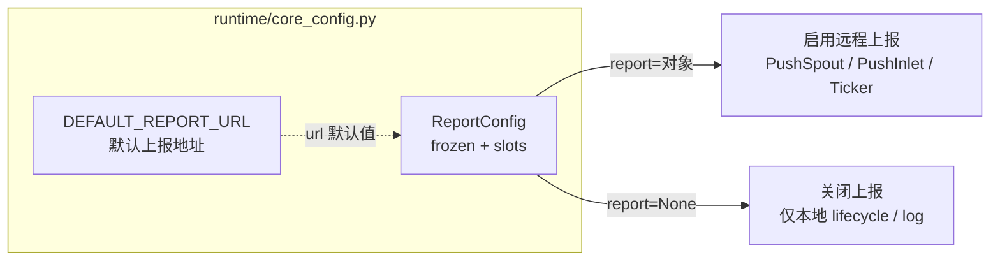

# src/celestialflow/runtime/core_config.py

> 📅 最后更新日期: 2026/10/30

`runtime/core_config.py` 定义**由运行入口显式传入**的运行期配置类型。它不读取宿主项目的 `pyproject.toml`——上报是否启用、上报到哪里，完全由调用方决定。

## 作用

- 提供默认上报地址常量 `DEFAULT_REPORT_URL`
- 提供不可变配置对象 `ReportConfig`，在构造时完成地址校验与规范化
- 统一 `run()` / `run_async()` / `restore_db()` 的 `report` 参数类型



## 核心对象

### DEFAULT_REPORT_URL

```python
DEFAULT_REPORT_URL = "http://127.0.0.1:5005"
```

`ReportConfig` 未显式指定地址时使用的默认上报地址。

### ReportConfig

```python
@dataclass(frozen=True, slots=True)
class ReportConfig:
    url: str = DEFAULT_REPORT_URL
```

| 成员 | 类型 | 说明 |
|------|------|------|
| `url` | `str` | 上报服务基础地址，必须为 `http` / `https`；末尾的 `/` 会被去掉 |

特性：

- **`frozen=True`**：构造后不可再赋值，配置对象可安全在多个运行入口之间共享
- **`slots=True`**：不允许动态添加属性
- **`__post_init__` 负责校验与规范化**，因此非法地址在**构造时**就会抛错，而不是等到运行期资源（`PushSpout`、`Ticker`）启动后才失败

### 校验规则

`__post_init__()` 按以下顺序处理 `url`：

| 步骤 | 检查 | 失败时 |
|:----:|------|--------|
| 1 | `url` 必须是 `str` | `ConfigurationError` |
| 2 | `url.strip().rstrip("/")` 后不能为空 | `ConfigurationError` |
| 3 | `urllib.parse.urlsplit` 的 `scheme` 必须是 `http` / `https`，且 `netloc` 非空 | `ConfigurationError` |
| 4 | 通过校验后 `object.__setattr__(self, "url", url)` 写回规范化结果 | — |

规范化只做两件事：去掉首尾空白、去掉**所有**连续的尾部 `/`。例如 `" http://127.0.0.1:5005/// "` → `"http://127.0.0.1:5005"`。

> 注意：`"127.0.0.1:5005"` 这类缺少 scheme 的字符串会被拒绝（`urlsplit` 认为 scheme 为空），必须写成 `"http://127.0.0.1:5005"`。

## 语义：传对象 = 启用上报，传 None = 关闭

运行入口（`TaskGraph.run()` / `run_async()` / `restore_db()`）的 `report` 参数默认为 `None`：

| `report` 取值 | 行为 |
|---------------|------|
| `ReportConfig(...)` 实例 | 启用远程上报：创建 `PushSpout`、`PushInlet`、`PushSnapshotHandler`、`InjectionHandler` 与 `Ticker`，按拍向 `report.url` 推送状态快照并从远端拉取注入任务 |
| `None`（默认） | 只装配本地 `MetricsObserver` / `LifecycleSpout` / `LogSpout`，不发起任何网络请求 |

由于默认值就是 `None`，**不传 `report` 即关闭上报**，不存在「配置了地址就自动上报」的隐式行为。

## 使用示例

### 1. 使用默认地址启用上报

```python
from celestialflow import TaskExecutor, TaskGraph
from celestialflow.runtime import ReportConfig

graph = TaskGraph(name="ReportDemo")
graph.set_nodes([TaskExecutor("worker", lambda x: x * 2)])

# 传 ReportConfig 对象即启用上报，默认上报到 http://127.0.0.1:5005
graph.run({"worker": [1, 2, 3]}, report=ReportConfig())
```

### 2. 指定自定义地址 / 关闭上报

```python
from celestialflow import TaskExecutor, TaskGraph
from celestialflow.runtime import ReportConfig

# 自定义地址；传参可位置传或关键字传
with_report = ReportConfig("https://flow.example.com/api/")
print(f"规范化后的地址: {with_report.url}")  # https://flow.example.com/api

graph = TaskGraph(name="CustomReportDemo")
graph.set_nodes([TaskExecutor("worker", lambda x: x)])
graph.run({"worker": [1]}, report=with_report)

# 不传 report（等价 report=None）即完全关闭上报
graph_local = TaskGraph(name="LocalOnlyDemo")
graph_local.set_nodes([TaskExecutor("worker", lambda x: x)])
graph_local.run({"worker": [2]})
```

### 3. 处理非法地址

```python
from celestialflow.runtime import ReportConfig
from celestialflow.runtime.util_errors import ConfigurationError

for bad_url in ["", "   ", "127.0.0.1:5005", "ftp://127.0.0.1:5005", 5005]:
    try:
        ReportConfig(url=bad_url)  # type: ignore[arg-type]
    except ConfigurationError as exc:
        print(f"{bad_url!r} -> {exc}")
```

## 注意事项

- `ReportConfig` 是**只读**配置：需要换地址请新建实例，不能修改 `url` 字段。
- 校验发生在**构造时**；把 `ReportConfig(...)` 放到 try 块里即可在启动运行期资源之前拦下配置错误。
- 运行期**不会**读取 `pyproject.toml` 的 `[tool.celestialflow]`：上报地址只由本对象提供，启用与否只看 `report` 是否为 `None`。
- `DEFAULT_REPORT_URL` 与 `ReportConfig` 均由 `celestialflow.runtime` 导出；其中 `ReportConfig` 还被包根重新导出（`from celestialflow import ReportConfig` 亦可用），`DEFAULT_REPORT_URL` 只能从 `celestialflow.runtime` 导入。
- 日志级别的默认值与校验不在本文件，见 `runtime/util_log_level.py`。
