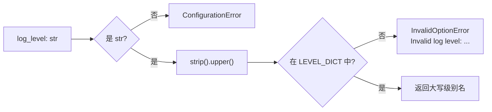

# src/celestialflow/runtime/util_log_level.py

> 📅 最后更新日期: 2026/10/30

`runtime/util_log_level.py` 提供日志级别的默认值与规范化校验，**仅供运行入口内部使用**，不属于对外配置 API。

## 作用

- 定义运行入口未显式指定日志级别时的默认值 `DEFAULT_LOG_LEVEL`
- 提供 `normalize_log_level()`：把用户传入的级别名规范化为 `LEVEL_DICT` 中的大写键名，并对非法输入抛出异常

> 该文件是 `util_*` 模块，**不在** `celestialflow.runtime/__init__.py` 的 `__all__` 中，需通过完整路径导入：
> `from celestialflow.runtime.util_log_level import DEFAULT_LOG_LEVEL, normalize_log_level`。

## 核心对象

### DEFAULT_LOG_LEVEL

```python
DEFAULT_LOG_LEVEL = "INFO"
```

运行入口未显式指定日志级别时使用的默认值。它被多处签名用作默认参数：

| 使用位置 | 说明 |
|----------|------|
| `TaskGraph.run()` / `run_async()` / `restore_db()` 的 `log_level` | 图级运行入口 |
| `BaseTaskNode.run()` 等节点的 `log_level` | 单节点运行入口 |
| `LogInlet.__init__()` | 日志过滤器构造默认值 |
| `assembly.core_run.run_graph_resources()` / `run_node_resources()` | 运行期资源装配 |

### normalize_log_level

```python
def normalize_log_level(log_level: str) -> str: ...
```

校验并规范化日志级别：

1. `log_level` 必须是 `str`，否则抛 `ConfigurationError`
2. 执行 `strip().upper()`，首尾空白被忽略、大小写不敏感
3. 若结果不在 `LEVEL_DICT`（见 `runtime/util_constant.py`）的键中，抛 `InvalidOptionError("log level", ...)`
4. 返回规范化后的**大写**级别名

`LEVEL_DICT` 的合法键为：`TRACE` / `DEBUG` / `SUCCESS` / `INFO` / `WARNING` / `ERROR` / `CRITICAL`。



```python
def normalize_log_level(log_level: str) -> str:
    """
    校验并规范化日志级别。

    :param log_level: 待校验的日志级别
    :return: 规范化后的日志级别（大写）
    :rtype: str
    :raises ConfigurationError: ``log_level`` 不是字符串时
    :raises InvalidOptionError: ``log_level`` 不在允许的级别集合中时
    """
```

## 使用示例

### 1. 规范化日志级别

```python
from celestialflow.runtime.util_log_level import DEFAULT_LOG_LEVEL, normalize_log_level

print(DEFAULT_LOG_LEVEL)  # INFO

print(normalize_log_level("info"))  # INFO
print(normalize_log_level("  Debug "))  # DEBUG
print(normalize_log_level("WARNING"))  # WARNING
```

### 2. 处理非法输入

```python
from celestialflow.runtime.util_errors import ConfigurationError, InvalidOptionError
from celestialflow.runtime.util_log_level import normalize_log_level

for bad_level in ["VERBOSE", ""]:
    try:
        normalize_log_level(bad_level)
    except InvalidOptionError as exc:
        print(f"{bad_level!r} 不是合法级别，可选值: {exc.allowed}")

try:
    normalize_log_level(30)  # type: ignore[arg-type]
except ConfigurationError as exc:
    print(f"类型错误: {exc}")
```

### 3. 传给图的运行入口

```python
from celestialflow import TaskExecutor, TaskGraph
from celestialflow.runtime.util_log_level import DEFAULT_LOG_LEVEL, normalize_log_level

graph = TaskGraph(name="LogLevelDemo")
graph.set_nodes([TaskExecutor("worker", lambda x: x)])

level = normalize_log_level("debug")  # 交给运行入口前先规范化
graph.run({"worker": [1, 2, 3]}, log_level=level)

# 也可以直接用默认值
graph_default = TaskGraph(name="LogLevelDefaultDemo")
graph_default.set_nodes([TaskExecutor("worker", lambda x: x)])
graph_default.run({"worker": [4]}, log_level=DEFAULT_LOG_LEVEL)
```

## 注意事项

- 运行入口内部会再调用一次 `normalize_log_level()`，因此直接传 `"debug"` 也能工作；提前调用只是为了在启动运行期资源之前拿到错误。
- `InvalidOptionError` 是 `ConfigurationError` 的子类，捕获 `ConfigurationError` 即可同时覆盖「类型不对」和「取值不合法」两种情况。
- 日志级别到数值的映射由 `runtime/util_constant.py` 的 `LEVEL_DICT` 定义，本文件只做规范化，不负责数值比较。
- 日志级别**不会**从 `pyproject.toml` 隐式读取，只能通过运行入口的 `log_level` 参数显式传入；不传则使用 `DEFAULT_LOG_LEVEL`。
