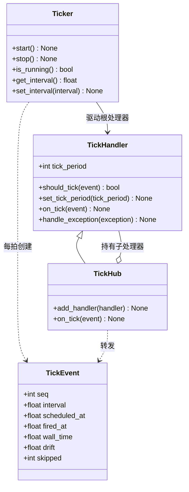
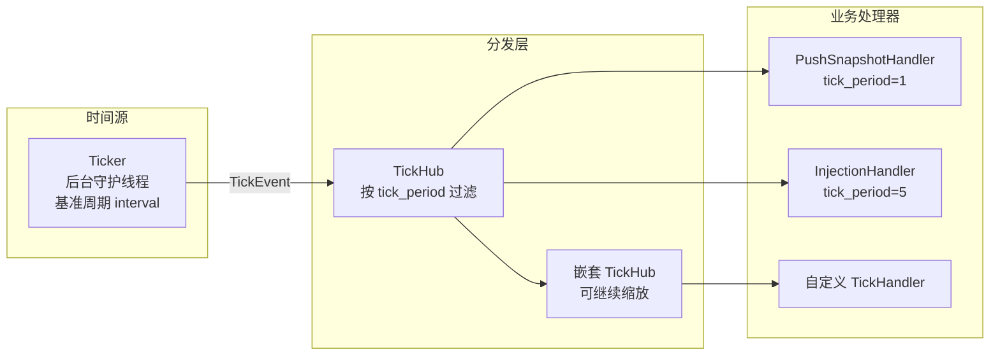

# src/celestialflow/ticker/__init__.py

> 📅 最后更新日期: 2026/11/13

`ticker` 是 CelestialFlow 的**时间驱动模块**：在独立后台线程中以固定基准周期产生节拍，并按各处理器声明的 `tick_period` 缩放后分发。它与事件驱动的 `observer` / `funnel` 相互独立，可以在使用处按需组合。

典型用途是 `reporter` 的上报链路：`PushSnapshotHandler` 每拍推送状态快照，`InjectionHandler` 每 5 拍拉取一次远程注入。

## 导出符号

```python
__all__ = [
    "TickEvent",
    "TickHandler",
    "TickHub",
    "Ticker",
]
```

| 符号 | 来源 | 说明 |
|------|------|------|
| `TickEvent` | `core_event.py` | 一次节拍的不可变时序快照（序号、周期、计划/实际触发时刻、漂移、跳过数） |
| `TickHandler` | `core_handler.py` | 节拍处理器基类，声明 `tick_period` 并提供 `should_tick()` / `on_tick()` / `handle_exception()` |
| `TickHub` | `core_hub.py` | 节拍分发中心，本身也是 `TickHandler`，把节拍按各子处理器的 `tick_period` 过滤后转发 |
| `Ticker` | `core_ticker.py` | 时间源与后台线程，按基准周期产生 `TickEvent` 并驱动根处理器 |

> `validate_tick_period()` 虽然定义在 `core_handler.py`，但没有被包级 `__init__.py` 再导出；需要时从 `celestialflow.ticker.core_handler` 导入。

## 类关系



## 分层结构



`Ticker` 只认识一个根处理器；`TickHub` 负责广播。处理器既可以是叶子节点，也可以是另一个 `TickHub`，从而形成树状节拍分发结构。

## 节拍缩放

所有处理器共享同一个 `Ticker.interval` 基准周期，但各自通过 `tick_period` 声明「每隔多少拍执行一次」：

```text
实际周期 = Ticker.interval × handler.tick_period
```

| `Ticker.interval` | `tick_period` | 实际周期 | 命中的 `seq` |
|:-----------------:|:-------------:|:--------:|:------------:|
| 1.0 秒 | 1 | 1 秒 | 1, 2, 3, 4, … |
| 1.0 秒 | 2 | 2 秒 | 1, 3, 5, 7, … |
| 1.0 秒 | 5 | 5 秒 | 1, 6, 11, 16, … |
| 0.5 秒 | 5 | 2.5 秒 | 1, 6, 11, 16, … |

> 过滤公式是 `(seq - 1) % tick_period == 0`，所以**第 1 拍始终命中**；运行期通过 `set_tick_period()` 修改后，相位会重新锚定到 `seq == 1`。

## 使用示例

下面的示例启动一个 0.1 秒基准周期的节拍器，并让两个处理器分别每拍、每 2 拍执行一次。示例约 0.5 秒结束：

```python
import time

from celestialflow.ticker import TickEvent, TickHandler, TickHub, Ticker


class RecordingHandler(TickHandler):
    def __init__(self, name: str, tick_period: int = 1) -> None:
        self.name = name
        self.tick_period = tick_period
        self.hits: list[int] = []

    def on_tick(self, event: TickEvent) -> None:
        self.hits.append(event.seq)
        print(f"{self.name}: seq={event.seq}, skipped={event.skipped}")


hub = TickHub()
every = RecordingHandler("every", tick_period=1)
every_other = RecordingHandler("every-other", tick_period=2)
hub.add_handler(every)
hub.add_handler(every_other)

ticker = Ticker(0.1, hub, name="demo-ticker")
ticker.start()
time.sleep(0.55)
ticker.stop()

print("every:", every.hits)
print("every-other:", every_other.hits)
```

可能的输出（具体拍数取决于调度）：

```text
every: seq=1, skipped=0
every-other: seq=1, skipped=0
every: seq=2, skipped=0
every: seq=3, skipped=0
every-other: seq=3, skipped=0
every: seq=4, skipped=0
every: seq=5, skipped=0
every-other: seq=5, skipped=0
every: [1, 2, 3, 4, 5]
every-other: [1, 3, 5]
```

## 文件说明

| 文件 | 重点内容 |
|------|---------|
| [`core_event.py`](./core_event.md) | `TickEvent` 七个字段的含义，monotonic 与墙钟的区别 |
| [`core_handler.py`](./core_handler.md) | `TickHandler` 的过滤公式、运行期调速、异常处理契约 |
| [`core_hub.py`](./core_hub.md) | 注册、循环检测、写时复制、逐处理器异常隔离 |
| [`core_ticker.py`](./core_ticker.md) | 后台循环、计划时刻锚定、跳拍不追赶、启动/停止语义 |

## 注意事项

1. **处理器串行执行**：同一拍内所有命中的处理器在 `Ticker` 后台线程中按注册顺序内联执行；慢处理器会推迟后续节拍，需要异步解耦时应把处理器实现为「写队列 + 独立消费者」。
2. **不追赶**：某拍处理超时导致错过若干个周期时，`Ticker` 只把错过数量记入 `TickEvent.skipped`，随后从当前时刻重新锚定，不会连续补发。
3. **异常隔离分两层**：处理器 `on_tick()` 抛异常交给它自己的 `handle_exception()`；若其再抛，则交给根处理器（通常是 `TickHub`）的 `handle_exception()` 兜底。
4. **与 observer 独立**：`ticker` 不依赖 `observer` / `funnel`；`PushSnapshotHandler` 之类同时继承两套基类的对象由使用处组合。
5. **包根已导出**：`Ticker` / `TickEvent` / `TickHandler` / `TickHub` 同时被 `celestialflow/__init__.py` 再导出，可直接 `from celestialflow import Ticker`。
