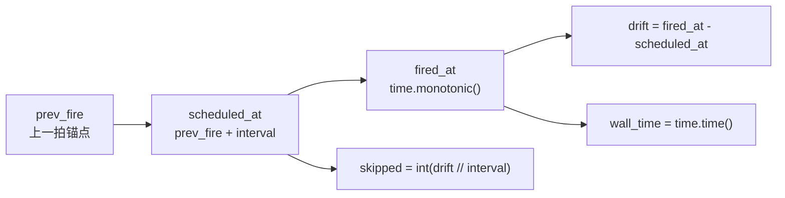

# src/celestialflow/ticker/core_event.py

> 📅 最后更新日期: 2026/11/13

`core_event.py` 定义 `TickEvent`：`Ticker` 每次触发时构造并交给处理器的**不可变时序快照**。处理器通过它判断当前拍序号、读取基准周期，或诊断调度漂移与跳拍情况。

## TickEvent

```python
@dataclass(frozen=True, slots=True)
class TickEvent:
    seq: int
    interval: float
    scheduled_at: float
    fired_at: float
    wall_time: float
    drift: float
    skipped: int
```

| 字段 | 类型 | 单位 | 说明 |
|------|------|------|------|
| `seq` | `int` | — | 节拍序号，从 `1` 开始单调递增；`TickHandler.should_tick()` 的过滤基准 |
| `interval` | `float` | 秒 | 本拍使用的**基准周期**（不是缩放后的实际周期） |
| `scheduled_at` | `float` | monotonic 秒 | 计划触发时刻 |
| `fired_at` | `float` | monotonic 秒 | 实际触发时刻 |
| `wall_time` | `float` | Unix 秒 | 实际触发时刻的墙钟时间（`time.time()`） |
| `drift` | `float` | 秒 | 实际晚于计划的时长，即 `fired_at - scheduled_at` |
| `skipped` | `int` | 拍 | 因上一拍处理超时而被跳过的基准周期数 |

## 时间基准



- 除 `wall_time` 外，所有时间字段都基于 `time.monotonic()`，**不受系统墙钟调整（NTP、手动改时间）影响**。
- `wall_time` 仅用于对外展示或与业务时间对齐，不参与调度计算。
- `drift` 通常是一个很小的正数（线程唤醒开销）；若某拍处理耗时超过一个周期，`drift` 会显著增大，`skipped` 也会大于 0。
- `skipped` 表示「为了不追赶而直接跳过的完整基准周期数」。例如 `interval=1.0`、实际晚了 `2.3` 秒，则 `skipped=2`，下一拍的锚点直接推进到 `scheduled_at + 2 × interval`。

## 与 `tick_period` 的关系

`interval` 始终是 `Ticker` 的基准周期，**不会**被处理器的 `tick_period` 改写。处理器看到 `seq=6`、`tick_period=5` 时，实际已经过去了 5 个基准周期（约 5 × `interval` 秒）。

```text
Ticker.interval = 1.0
handler.tick_period = 5

seq:      1    2    3    4    5    6    7 ...
handler:  ✅   -    -    -    -    ✅   -  ...
event.interval = 1.0（每一拍都相同）
```

## 使用示例

`TickEvent` 通常由 `Ticker` 创建；测试或手动驱动处理器时可以直接构造：

```python
from celestialflow.ticker import TickEvent

event = TickEvent(
    seq=6,
    interval=1.0,
    scheduled_at=5.0,
    fired_at=5.05,
    wall_time=1_700_000_000.0,
    drift=0.05,
    skipped=0,
)

print(event.seq)                     # 6
print(event.interval)                # 1.0
print(round(event.drift, 3))         # 0.05
print(event.wall_time)               # 1700000000.0
```

处理器中读取节拍信息：

```python
from celestialflow.ticker import TickEvent, TickHandler


class DriftMonitor(TickHandler):
    tick_period = 10

    def on_tick(self, event: TickEvent) -> None:
        if event.skipped:
            print(f"第 {event.seq} 拍跳过了 {event.skipped} 个周期")
        if event.drift > event.interval / 2:
            print(f"第 {event.seq} 拍漂移偏大: {event.drift:.3f}s")
```

## 注意事项

1. **不可变**：`frozen=True, slots=True`，处理器不能修改事件字段；需要派生状态时请自行计算。
2. **`seq` 从 1 开始**：过滤公式 `(seq - 1) % tick_period == 0` 依赖这一点，第 1 拍必然命中。
3. **`interval` 是基准周期**：不要用它乘以 `tick_period` 去反推历史时间；调度锚点由 `scheduled_at` / `fired_at` 给出。
4. **`skipped` 只统计整周期**：不足一个周期的延迟体现在 `drift` 中，不体现在 `skipped` 中。
5. **`wall_time` 可能回拨**：若宿主机调整了系统时间，`wall_time` 可能不单调；`seq`、`scheduled_at`、`fired_at` 不受影响。
