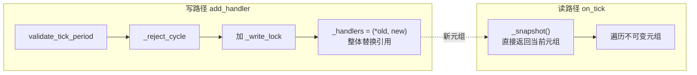
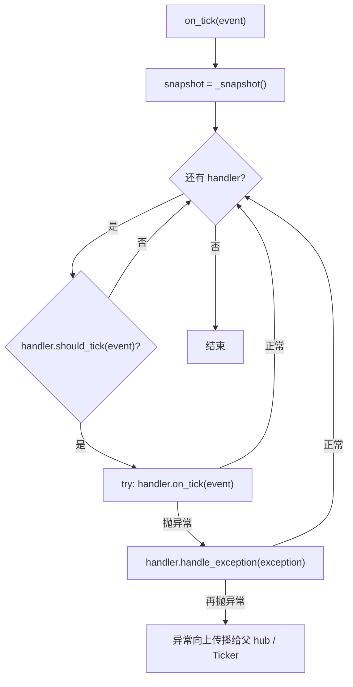

# src/celestialflow/ticker/core_hub.py

> 📅 最后更新日期: 2026/11/13

`core_hub.py` 定义 `TickHub`：节拍**分发中心**。它本身也是 `TickHandler`，因此可以作为 `Ticker` 的根处理器，也可以嵌套进另一个 `TickHub`；每一拍按各子处理器自己的 `tick_period` 过滤后转发。

## TickHub

```python
class TickHub(TickHandler):
    def __init__(self) -> None: ...
    def add_handler(self, handler: TickHandler) -> None: ...
    def on_tick(self, event: TickEvent) -> None: ...
```

| 成员 | 说明 |
|------|------|
| `_handlers` | 当前子处理器元组，写时复制 |
| `_write_lock` | 写路径互斥锁 |
| `add_handler(handler)` | 校验 `tick_period` 与循环引用后追加 |
| `on_tick(event)` | 按注册顺序把命中的节拍转发给子处理器 |

### 注册

`add_handler()` 依次执行：

1. `validate_tick_period(handler)`：`tick_period` 必须 `>= 1`；
2. `_reject_cycle(handler)`：拒绝会形成 hub 循环引用的注册；
3. 在 `_write_lock` 保护下用 `(*self._handlers, handler)` 整体替换元组。

> 当前没有 `remove_handler()`；处理器一旦注册就会一直参与分发。重复注册同一个实例不会去重，它会在每一拍被调用多次。

### 循环检测

`_reject_cycle()` 只沿着**嵌套的 `TickHub`** 向下搜索：

- `handler is self` → `ConfigurationError("cannot register a TickHub into itself")`；
- 若 `handler` 不是 `TickHub`，直接通过（普通处理器不持有其他 hub，无法形成环）；
- 否则用栈做 DFS，遍历 `handler` 内部的所有嵌套 hub；若遇到 `self`，抛：
  `ConfigurationError("cyclic TickHub registration detected: ...")`。

这样可以避免 A → B → A 的 hub 环在分发时无限递归。

### 写时复制



- 元组不可变，写入方整体替换引用；
- 读路径 `_snapshot()` 不加锁、不拷贝；
- 因此分发过程中新增处理器不会破坏当前迭代，迭代方看到的永远是某一个完整版本。

### 分发与异常隔离



| 场景 | 结果 |
|------|------|
| 某个子处理器 `on_tick()` 抛异常 | 调用该处理器自己的 `handle_exception()`，其余处理器继续 |
| 该处理器的 `handle_exception()` 也抛异常 | 异常逃出 `TickHub.on_tick()` |
| `TickHub` 由 `Ticker` 驱动 | `Ticker` 捕获逃逸异常并调用本 hub 的 `handle_exception()` 兜底，节拍循环继续 |
| `TickHub` 嵌套在另一个 hub 中 | 父 hub 捕获并调用本 hub 的 `handle_exception()` 兜底 |

### 嵌套与整体缩放

`TickHub` 继承 `TickHandler.tick_period`（默认 `1`）。父级在调用子 hub 的 `on_tick()` 前同样会执行 `should_tick()`，因此给一个子 hub 设置 `tick_period` 可以**整体降低其子树的触发频率**：

```text
Ticker(interval=1.0)
└── root Hub (tick_period=1)
    ├── handler A (tick_period=1)   → 1 秒
    └── sub Hub (tick_period=5)     → 每 5 秒进入一次
        ├── handler B (tick_period=1) → 实际 5 秒
        └── handler C (tick_period=2) → 实际 10 秒
```

## 使用示例

下面的示例直接调用 `on_tick()`，验证按 `tick_period` 过滤与嵌套 hub 的行为：

```python
from celestialflow.ticker import TickEvent, TickHandler, TickHub


class Collector(TickHandler):
    def __init__(self, name: str, tick_period: int = 1) -> None:
        self.name = name
        self.tick_period = tick_period
        self.hits: list[int] = []

    def on_tick(self, event: TickEvent) -> None:
        self.hits.append(event.seq)


def make_event(seq: int) -> TickEvent:
    return TickEvent(
        seq=seq,
        interval=1.0,
        scheduled_at=float(seq - 1),
        fired_at=float(seq - 1),
        wall_time=0.0,
        drift=0.0,
        skipped=0,
    )


every = Collector("every", tick_period=1)
every_other = Collector("every-other", tick_period=2)

root = TickHub()
root.add_handler(every)
root.add_handler(every_other)

for seq in range(1, 7):
    root.on_tick(make_event(seq))

print(every.hits)        # [1, 2, 3, 4, 5, 6]
print(every_other.hits)  # [1, 3, 5]
```

循环引用会被拒绝：

```python
from celestialflow.runtime.util_errors import ConfigurationError
from celestialflow.ticker import TickHub

outer = TickHub()
inner = TickHub()
outer.add_handler(inner)

try:
    inner.add_handler(outer)
except ConfigurationError as exc:
    print(exc)
# cyclic TickHub registration detected: ...
```

## 注意事项

1. **注册顺序即执行顺序**：同一拍内命中的处理器按 `add_handler()` 顺序串行执行。
2. **异常不会中断其余处理器**：单个处理器的 `on_tick()` 失败只影响它自己。
3. **`handle_exception()` 不应再抛**：若它自身抛异常，会逃出当前 hub，虽然父级 / `Ticker` 还有一层兜底，但会丢失当前拍剩余处理器的分发。
4. **循环检测只看 hub**：普通处理器即使内部持有 hub 引用也不会被检测；避免在自定义处理器中反向驱动父 hub。
5. **写时复制适合读多写少**：运行期频繁 `add_handler()` 会产生新元组，但不会阻塞正在进行的读取。
