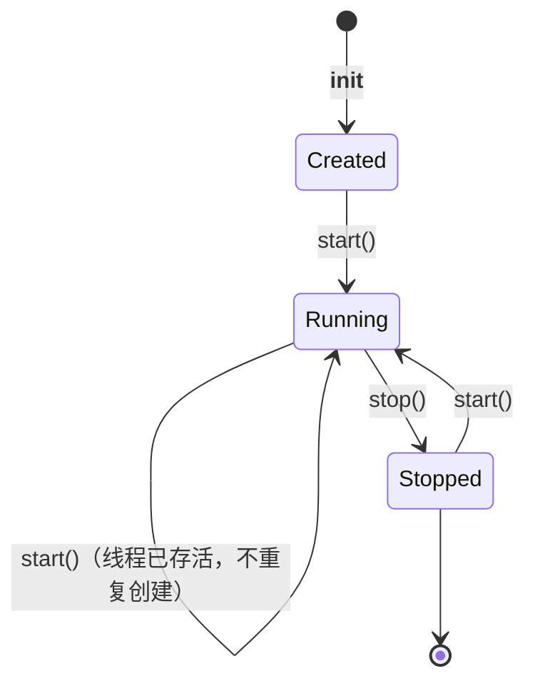
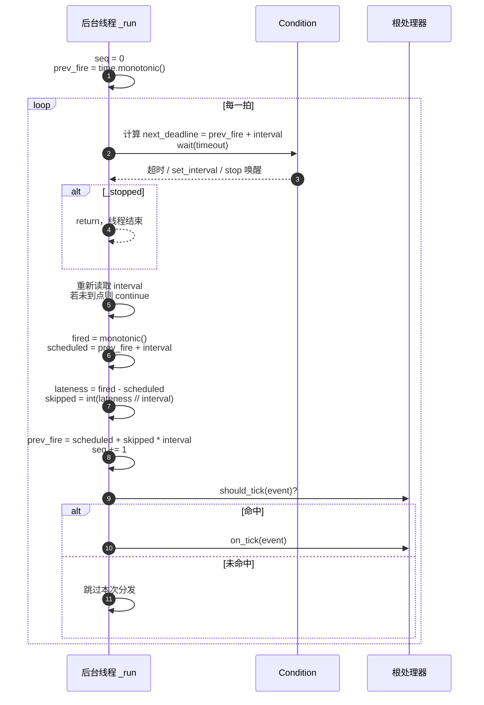

# src/celestialflow/ticker/core_ticker.py

> 📅 最后更新日期: 2026/11/13

`core_ticker.py` 定义 `Ticker`：基于时间驱动的节拍器。它在独立守护线程中以 `time.monotonic()` 为基准锚定计划触发时刻，每拍构造 `TickEvent` 并交给根处理器（通常是 `TickHub`）。

## Ticker

```python
class Ticker:
    def __init__(
        self,
        interval: float,
        handler: TickHandler,
        *,
        name: str = "ticker",
    ) -> None: ...

    def start(self) -> None: ...
    def stop(self) -> None: ...
    def is_running(self) -> bool: ...
    def get_interval(self) -> float: ...
    def set_interval(self, interval: float) -> None: ...
```

| 参数 | 说明 |
|------|------|
| `interval` | 基准周期（秒），必须为正数 |
| `handler` | 根处理器，通常为 `TickHub` |
| `name` | 后台线程名称，默认 `"ticker"` |

构造时校验：

- `interval <= 0` → `ConfigurationError("ticker interval must be positive, got ...")`；
- `handler.tick_period < 1` → 由 `validate_tick_period()` 抛 `ConfigurationError`。

## 生命周期



| 方法 | 行为 |
|------|------|
| `start()` | 先调用 `_before_start()`；若后台线程不存在或已死亡，则在 `Condition` 保护下重置 `_stopped=False`，创建并启动守护线程 |
| `stop()` | 若从未启动（`_thread is None`）直接返回；否则置 `_stopped=True` 并 `notify_all()` 唤醒等待中的线程，`join(timeout=5.0)`，线程仍存活则抛 `RuntimeStateError`，最后置 `_thread=None` 并调用 `_after_stop()` |
| `is_running()` | `_thread is not None and _thread.is_alive()` |
| `get_interval()` | 在 `Condition` 保护下读取当前基准周期 |
| `set_interval(interval)` | 校验正数后在 `Condition` 保护下更新周期并 `notify_all()`，下一拍起生效 |

> `start()` 每次调用都会执行 `_before_start()`，即使线程已经在运行。自定义子类若在该钩子中做资源初始化，应保证幂等。

## 调度算法



### 关键点

| 行为 | 说明 |
|------|------|
| **首拍延迟一个周期** | `prev_fire` 在线程启动时初始化为当前 `monotonic()`，第一次触发发生在 `interval` 秒之后 |
| **计划时刻锚定** | 每拍的目标时刻是 `prev_fire + interval`，不是「上一拍实际结束时间 + interval」 |
| **不追赶** | 若处理耗时导致 `lateness > 0`，`skipped = int(lateness // interval)`，`prev_fire` 直接推进到 `scheduled + skipped × interval`，不连续补发错过的拍 |
| **不足一个周期的延迟** | `skipped=0`，只体现在 `TickEvent.drift` 中 |
| **动态调速** | `set_interval()` 会唤醒等待；循环重新读取 `_interval` 并重新计算 deadline，下一拍起生效 |
| **内联执行** | 根处理器在当前线程中同步执行；慢处理器会推迟后续节拍 |

### 跳拍示例

```text
interval = 1.0
prev_fire = 0.0

计划 1.0s，实际 1.2s 触发：lateness=0.2，skipped=0
    prev_fire = 1.0，下一拍计划 2.0s

计划 2.0s，实际 4.3s 触发（处理器耗时 3.1s）：lateness=2.3，skipped=2
    prev_fire = 2.0 + 2×1.0 = 4.0，下一拍计划 5.0s
    —— 2.0~4.0 之间的 2 个周期被直接跳过
```

## 异常隔离

`_dispatch()` 的执行顺序：

1. `handler.should_tick(event)` 返回 `False` → 当前拍不调用处理器；
2. 否则 `try: handler.on_tick(event)`；
3. 捕获异常后调用 `handler.handle_exception(exception)`。

失败隔离分两层：

| 层级 | 行为 |
|------|------|
| 第一层 | 处理器 `on_tick()` 抛出的异常交给它自己的 `handle_exception()` |
| 第二层 | 若 `handle_exception()` 再抛，异常逃出 `_dispatch()`；根处理器通常是 `TickHub`，`Ticker` 会捕获并回调该 hub 的 `handle_exception()` 兜底，节拍循环继续 |
| 终止线程 | 若根处理器不是 `TickHub` 且其 `handle_exception()` 也抛异常，异常会终止后台线程 |

> `_run()` 没有对 `_dispatch()` 再包一层 `try`，所以第二层兜底完全依赖根处理器的 `handle_exception()`。

## 使用示例

```python
import time

from celestialflow.ticker import TickEvent, TickHandler, TickHub, Ticker


class Collector(TickHandler):
    def __init__(self) -> None:
        self.seqs: list[int] = []

    def on_tick(self, event: TickEvent) -> None:
        self.seqs.append(event.seq)


handler = Collector()
hub = TickHub()
hub.add_handler(handler)

ticker = Ticker(0.1, hub, name="demo-ticker")
print(ticker.is_running())  # False
ticker.start()
print(ticker.is_running())  # True

time.sleep(0.35)
ticker.stop()
print("已触发拍数:", len(handler.seqs))
print("前后间隔示例:", handler.seqs[:5])
```

动态调速：

```python
import time

from celestialflow.ticker import TickEvent, TickHandler, TickHub, Ticker


class Collector(TickHandler):
    def __init__(self) -> None:
        self.times: list[float] = []

    def on_tick(self, event: TickEvent) -> None:
        self.times.append(event.fired_at)


handler = Collector()
hub = TickHub()
hub.add_handler(handler)

ticker = Ticker(0.2, hub)
ticker.start()
time.sleep(0.25)
ticker.set_interval(0.1)   # 下一拍起使用新周期
time.sleep(0.25)
ticker.stop()

print("基准周期:", ticker.get_interval())
```

## 注意事项

1. **守护线程**：`Ticker` 线程是 `daemon=True`，主程序退出时不会阻塞；但正常收尾仍应显式 `stop()`。
2. **停止超时**：`join` 最多等待 `5.0` 秒；若处理器长时间阻塞，`stop()` 会抛 `RuntimeStateError`，且不会执行 `_after_stop()`，可再次调用 `stop()` 重试。
3. **重复 `start()` 安全**：线程已存活时不会创建第二个线程；但 `_before_start()` 仍会被调用。
4. **`stop()` 后不可复用同一线程对象**：`stop()` 会把 `_thread` 置为 `None`，再次 `start()` 会创建新线程；`seq` 也从 `1` 重新计数。
5. **处理器串行**：需要并发消费时，让 `on_tick()` 只写入队列，由独立消费者处理。
6. **与 `funnel` 解耦**：`Ticker` 不依赖 `BaseSpout` / `BaseInlet`；需要异步落盘或推送时，在处理器内部组合对应对象。
